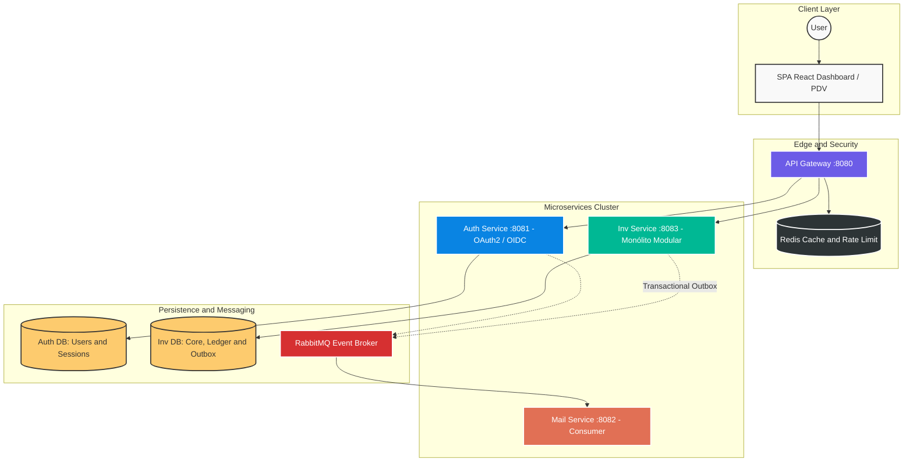

# 🐾 Sistema de Microsserviços - Pet Shop & Auth

---


[](LICENSE)


Este projeto é um sistema distribuído empresarial para gerenciamento de um **Pet Shop & PDV**, combinando **Microsserviços de Borda/Segurança** (`api-gateway`, `auth-service`, `mail-service`) com um **Monólito Modular orientado a DDD** no núcleo de negócio (`inv-service`: Checkout, Financeiro e Estoque).

---

## 🏛️ Hub Central de Documentação Técnica

Toda a arquitetura, regras de negócio e decisões de engenharia estão catalogadas na pasta [`docs/`](docs):

### 📚 Guias Arquiteturais e de Domínio
* 🏛️ **[Visão Geral do Sistema (C4 Containers & Migrações)](docs/architecture/system-overview.md)**
* 💰 **[Motor Financeiro & Contábil (Ledger Append-Only, CQRS e D+0)](docs/domains/finance.md)**
* 🛒 **[Domínio de Checkout (Máquinas de Estado, Webhooks e Long Polling)](docs/domains/checkout.md)**
* 📦 **[Domínio de Inventário (Estoque Atômico e Alertas Anti-Spam)](docs/domains/inventory.md)**
* 🔐 **[Segurança & Gestão de Identidade (OIDC, RSA e Rate Limiting)](docs/domains/security.md)**
* 📝 **[Histórico de Mudanças & PRs (Keep a Changelog)](CHANGELOG.md)**

---

## 📑 Catálogo de Decisões de Arquitetura (ADRs)

| ID | Título do ADR | Status | Bounded Contexts | Destaque Técnico |
| :--- | :--- | :--- | :--- | :--- |
| **[ADR-0001](docs/adr/0001-modular-monolith-bounded-contexts.md)** | Monólito Modular com Bounded Contexts | `Aceito` | Core / Inv-Service | Eliminação de nano-serviços e redução de latência no PDV. |
| **[ADR-0002](docs/adr/0002-atomic-sql-inventory-and-hybrid-locking.md)** | Controle Híbrido de Concorrência & Estoque Atômico | `Aceito` | Inventory, Checkout | `UPDATE ... RETURNING`, `@Retryable` e Lock Pessimista na Liquidação. |
| **[ADR-0003](docs/adr/0003-async-long-polling-pos-deferred-result.md)** | Long Polling Não-Bloqueante com `DeferredResult` | `Aceito` | Checkout | *Request Parking* assíncrono para PDV aguardando Webhooks. |
| **[ADR-0004](docs/adr/0004-transactional-outbox-with-skip-locked.md)** | Transactional Outbox com `FOR UPDATE SKIP LOCKED` | `Aceito` | Shared, Checkout, Finance, Inventory | Workers concorrentes com lock por registro e entrega AMQP *at-least-once*. |
| **[ADR-0005](docs/adr/0005-append-only-financial-ledger-and-idempotency.md)** | Ledger Financeiro Imutável com UUID | `Aceito` | Finance | Journaling contábil imutável e eliminação de saldo mutável. |
| **[ADR-0006](docs/adr/0006-cqrs-asynchronous-projections-and-self-healing-retry.md)** | Projeções CQRS Assíncronas e Auto-Cura | `Aceito` | Finance | Projeção pós-commit com fila de retry e scheduler auto-curável. |
| **[ADR-0007](docs/adr/0007-d0-daily-cash-closing-and-high-watermark.md)** | Fechamento D+0 com High Watermark | `Aceito` | Finance | Processamento incremental $O(\Delta)$ e reconciliação de divergências. |
| **[ADR-0008](docs/adr/0008-distributed-idempotent-consumer-and-schema-evolution.md)** | Consumidor Idempotente e Schema Evolution | `Aceito` | Mail, Shared | Deduplicação com `processed_events` e fallback V1/V2. |
| **[ADR-0009](docs/adr/0009-centralized-oauth2-oidc-and-stateless-resource-servers.md)** | Spring Auth Server OIDC e RSA 2048-bit | `Aceito` | Auth, Gateway | Resource Servers stateless validados localmente em memória. |
| **[ADR-0010](docs/adr/0010-dashboard-read-only-composition-module.md)** | Dashboard como Módulo de Composição de Leitura | `Aceito` | Dashboard, Core | BFF interno read-only consumindo contratos `*.api` e CQRS diário. |
| **[ADR-0011](docs/adr/0011-synchronous-open-host-service-checkout-inventory.md)** | Open Host Service Síncrono de Comandos (Checkout → Inventory) | `Aceito` | Checkout, Inventory | Lote ordenado (`produtoId ASC`), `Propagation.MANDATORY` e `ItemVenda.produtoId`. |
| **[ADR-0012](docs/adr/0012-idempotent-payment-pipeline-and-single-phase-sale-reversal.md)** | Pipeline Idempotente de Pagamento e Cancelamento em Fase Única de Venda Concluída | `Aceito` | Checkout, Finance, Inventory, Shared | Reentregas idempotentes de pagamento e devolução de estoque no cancelamento. |
| **[ADR-0013](docs/adr/0013-surefire-failsafe-test-lifecycle.md)** | Testes Unitários no Surefire e Integrações no Failsafe | `Aceito` | Transversal | Integrações `*IT` e `*IntegrationTest` no Failsafe e conciliação dos relatórios no CI. |

---

## 🏛️ Arquitetura do Sistema



---

## 📂 Estrutura do Projeto (Modular DDD)

```plaintext
petshop-microservices/
├── docs/                               # Hub de Governança & Arquitetura
│   ├── architecture/                   # System Overview e Observabilidade
│   ├── domains/                        # Deep Dives dos Bounded Contexts
│   └── adr/                            # 13 Architecture Decision Records (MADR 3.0)
│
├── apps/
│   ├── api-gateway/                    # Spring Cloud Gateway + Redis Token Bucket
│   ├── auth-service/                   # Spring Authorization Server (OIDC / RSA)
│   ├── mail-service/                   # Consumidor Idempotente de E-mails
│   ├── common-lib/                     # Utilitários Compartilhados (Exceções, RSA Utils)
│   └── inv-service/                    # Monólito Modular de Vendas, Estoque e Finanças
│       └── src/main/java/inv/
│           ├── checkout/               # Vendas, Pagamentos, Webhooks e Long Polling
│           ├── dashboard/              # Módulo de Composição Read-Only (BFF Interno)
│           ├── finance/                # Ledger Append-Only, CQRS, High Watermark e D+0
│           ├── inventory/              # Baixas Atômicas, Reserva e Alertas Anti-Spam
│           └── shared/                 # Transactional Outbox (SKIP LOCKED) e Configurações
│
├── infra/                              # Stack de Observabilidade (Prometheus, Grafana, Loki)
├── CHANGELOG.md                        # Histórico de mudanças estruturado por PR
└── docker-compose.yml                  # Orquestração local de containers
```

---

## 🛠️ Como Rodar o Projeto

### Pré-requisitos
* Docker e Docker Compose instalados.
* Java 21 (Opcional, caso queira rodar diretamente na IDE).

### 1. Configurar Variáveis de Ambiente
O projeto utiliza um arquivo `.env` na raiz para configurar as credenciais e conexões do cluster Docker Compose (instâncias PostgreSQL de cada serviço, RabbitMQ, Redis, chaves JWT/RSA, Mailtrap e credenciais iniciais).

O modelo completo pré-configurado para execução local está disponível em [`.env.example`](.env.example). Para utilizá-lo, crie seu arquivo `.env` executando:

```bash
cp .env.example .env
```

> [!TIP]
> As variáveis padrão do [`.env.example`](.env.example) já são compatíveis com o ambiente de desenvolvimento local. Caso deseje alterar portas, senhas ou URLs, edite o arquivo `.env` gerado antes de iniciar os containers.

### 2. Subir o Cluster
```bash
docker-compose up --build
```

### 3. Acessar Swagger / OpenAPI Unificado
* Documentação das APIs: [http://localhost:8080/swagger-ui/index.html](http://localhost:8080/swagger-ui/index.html)
* Grafana: [http://localhost:3000](http://localhost:3000) (`admin` / `admin`)
* Prometheus: [http://localhost:9090](http://localhost:9090) (Scrape ativo em `api-gateway:8080` e `inv-service:8083`)
* RabbitMQ Management: [http://localhost:15672](http://localhost:15672) (`guest` / `guest`)

---

## 🧪 Estratégia de Testes de Concorrência (Testcontainers)

Os testes de estresse validam os pontos críticos de concorrência com containers reais PostgreSQL e RabbitMQ:

1. **Race Conditions de Estoque ([ADR-0002](docs/adr/0002-atomic-sql-inventory-and-hybrid-locking.md)):** 50 threads concorrentes disputando as últimas 5 unidades de produto.
2. **Workers Paralelos de Outbox ([ADR-0004](docs/adr/0004-transactional-outbox-with-skip-locked.md)):** 10 workers drenam 100 mensagens distintas com `FOR UPDATE SKIP LOCKED` no cenário sem falha injetada. Outro cenário valida a republicação após falha de persistência posterior ao ACK e a idempotência do estorno no Finance.
3. **Auto-Cura CQRS ([ADR-0006](docs/adr/0006-cqrs-asynchronous-projections-and-self-healing-retry.md)):** Injeção de falha na projeção assíncrona e validação da recomposição idempotente da projeção.
4. **Deduplicação de E-mail ([ADR-0008](docs/adr/0008-distributed-idempotent-consumer-and-schema-evolution.md)):** 10 mensagens com o mesmo `eventId` resultam em uma chamada ao remetente SMTP simulado e um registro em `processed_events` no cenário testado. Uma falha após o envio e antes de gravar o registro pode duplicar o e-mail.

Execute os comandos na raiz do projeto. O Surefire executa os testes unitários e de arquitetura na fase `test`. O Failsafe executa as classes `*IT` e `*IntegrationTest` na fase `integration-test` e verifica seus resultados na fase `verify`. O CI usa `mvn clean verify` e confere os relatórios por módulo antes do build das imagens. Consulte a [ADR-0013](docs/adr/0013-surefire-failsafe-test-lifecycle.md).

```bash
# Executar os testes do Surefire (sem Docker)
mvn test

# Executar o ciclo completo, incluindo as integrações (requer Docker ativo)
mvn verify
```

---
## 📄 Licença
Copyright (c) 2026 Gabriel Tanaka ([@iXDGabrielTK](https://github.com/iXDGabrielTK)).

Este projeto está sob a licença [GNU Affero General Public License v3](LICENSE) (`AGPL-3.0-only`). Veja o arquivo [LICENSE](LICENSE) para os termos completos.

### ⚖️ Licença e Código-Fonte Correspondente (AGPLv3 Seções 6 e 13)

O código-fonte está disponível em <https://github.com/iXDGabrielTK/petshop-microservices>.
As imagens publicadas pelo CI identificam a revisão usada no build pelos metadados OCI:

```bash
docker inspect --format '{{ json .Config.Labels }}' <imagem>
COMMIT_SHA=$(docker inspect --format '{{ index .Config.Labels "org.opencontainers.image.revision" }}' <imagem>)
echo "https://github.com/iXDGabrielTK/petshop-microservices/tree/${COMMIT_SHA}"
docker run --rm --entrypoint cat <imagem> /app/licenses/LICENSE
docker run --rm --entrypoint cat <imagem> /app/licenses/THIRD-PARTY-NOTICES.md
```

Para reconstruir a revisão correspondente, use Java 21, Maven e Docker:

```bash
git clone https://github.com/iXDGabrielTK/petshop-microservices.git
cd petshop-microservices
git checkout <COMMIT_SHA>
mvn clean package -DskipTests
docker build -f apps/inv-service/Dockerfile -t petshop/inv-service:local .
```

Substitua `inv-service` por `api-gateway`, `auth-service` ou `mail-service` conforme necessário.
O comando local recompila a revisão; não implica identidade binária entre builds.
Imagens locais com alterações não commitadas não devem anunciar o SHA anterior como fonte exata.

Ao distribuir imagens, disponibilize também o código-fonte correspondente à revisão efetivamente
empacotada, incluindo alterações e arquivos de build. Ao operar uma versão modificada pela rede,
ofereça aos usuários remotos, de forma visível na interface que utilizam, acesso gratuito ao seu
código-fonte correspondente, conforme a Seção 13. Um link apenas neste README não substitui essa
oferta na interface de uma implantação modificada.

Os componentes de terceiros mantêm seus próprios termos, descritos em
[THIRD-PARTY-NOTICES.md](THIRD-PARTY-NOTICES.md).
