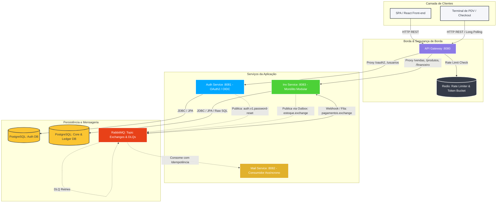
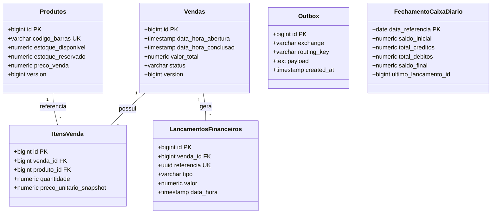

# 🏛️ Arquitetura do Sistema & Visão Geral (System Overview)

Este documento fornece a visão arquitetural consolidada do ecossistema **Pet Shop Microservices**, cobrindo o modelo C4 de containers, a matriz de comunicação entre serviços e o mapeamento de esquemas físicos de banco de dados (Flyway/JPA).

---

## 1. Diagrama C4 de Containers & Infraestrutura

---

## 2. Matriz de Comunicação entre Componentes

| Origem | Destino | Protocolo | Padrão / Semântica | Descrição |
| :--- | :--- | :--- | :--- | :--- |
| **Cliente / PDV** | **API Gateway** | HTTP/1.1 (JSON) | Síncrono / Long Polling | Requisições públicas, autenticação e espera não-bloqueante via `DeferredResult`. |
| **API Gateway** | **Auth Service** | HTTP/1.1 | Proxy Reverso / Stateless | Roteamento de rotas `/oauth2/**` e `/usuarios/**`. |
| **API Gateway** | **Inv Service** | HTTP/1.1 | Proxy Reverso / Stateless | Roteamento de rotas de catálogo, checkout e dashboards financeiros. Precedência dedicada para webhooks de pagamento (`/pagamentos/webhook/**`, `order: 1`) isenta de rate limit. |
| **Inv Service (`inv.checkout`)** | **Inv Service (`inv.inventory.api`)** | Em Memória | Open Host Service Síncrono (`Propagation.MANDATORY`) | Reserva, confirmação de baixa e estorno em lote ordenado por `produtoId ASC` via `EstoqueCommandService` e leitura de snapshot de catálogo via `CatalogoQueryService` (ADR-0011). |
| **Inv Service (`inv.dashboard`)** | **Inv Service (`*.api`)** | Em Memória | Open Host Service / CQRS Read | Composição de KPIs consumindo exclusivamente `VendaQueryService` (`inv.checkout.api`), `ReceitaQueryService` (`inv.finance.api`) e `EstoqueQueryService` (`inv.inventory.api`). |
| **Inv Service (`inv.checkout`)** | **Inv Service (`inv.finance`)** | Em Memória | Spring Events (`VendaPagaEvent`) | Publicação de `VendaPagaEvent` (`inv.shared.event`) consumida por `VendaPagaEventListener` na mesma transação. |
| **Inv Service (Worker)** | **RabbitMQ** | AMQP 0-9-1 | Polling Transacional (`SKIP LOCKED`) | Worker de Outbox lendo tabela `outbox` e publicando alertas em `estoque.exchange`. |
| **Auth Service** | **RabbitMQ** | AMQP 0-9-1 | Push Assíncrono | Publicação direta de eventos de recuperação de senha (`PasswordResetMessage`). |
| **RabbitMQ** | **Mail Service** | AMQP 0-9-1 | Idempotent Consumer | Consumo de e-mails transacionais com deduplicação em `processed_events`. |

---

## 3. Mapeamento Físico de Banco de Dados & Migrations (Flyway)

A integridade do modelo de dados é gerenciada de forma estrita via scripts de migração do Flyway e tabelas de suporte do ecossistema Spring.

### A. Esquema do `inv-service` (Migrations Flyway `V1` a `V6`)

* [`V1__Schema_Inicial.sql`](../../apps/inv-service/src/main/resources/db/migration/V1__Schema_Inicial.sql) e [`V2__ajusta_schema_produtos_vendas_pagamentos.sql`](../../apps/inv-service/src/main/resources/db/migration/V2__ajusta_schema_produtos_vendas_pagamentos.sql)
* [`V3__financial_projection_checkpoint_v2.sql`](../../apps/inv-service/src/main/resources/db/migration/V3__financial_projection_checkpoint_v2.sql) e [`V4__projecao_receita_diaria.sql`](../../apps/inv-service/src/main/resources/db/migration/V4__projecao_receita_diaria.sql)
* [`V5__indices_dashboard.sql`](../../apps/inv-service/src/main/resources/db/migration/V5__indices_dashboard.sql) e [`V6__comentarios_fk_fronteira_modular.sql`](../../apps/inv-service/src/main/resources/db/migration/V6__comentarios_fk_fronteira_modular.sql)

| Artefato / Tabela | Migration | Bounded Context | Finalidade Arquitetural |
| :--- | :--- | :--- | :--- |
| `produtos` | `V1`, `V2` | **Inventory** | Registro de catálogo e saldo atômico (`estoque_disponivel`, `estoque_reservado`, `@Version`). |
| `movimentacoes_estoque` | `V1` | **Inventory** | Trilha histórica de auditoria de entradas, saídas, reservas e estornos (`venda_id` escalar). |
| `vendas` | `V1`, `V2` | **Checkout** | Agregado raiz de transação comercial e máquina de estados (`ABERTA`, `AGUARDANDO_PAGAMENTO`, `CONCLUIDA`, `CANCELADA`). |
| `itens_venda` | `V1` | **Checkout** | Snapshots imutáveis de preço e nome do produto no momento da compra (`produto_id` escalar). |
| `pagamentos` | `V2` | **Checkout** | Intenções e confirmações de pagamento com deduplicação por `uuid_referencia` e `nsu_transacao`. |
| `outbox` | `V1` | **Shared** | Fila física de transações distribuídas para despacho AMQP sem 2PC (`SKIP LOCKED`). |
| `lancamentos_financeiros` | `V1` | **Finance** | **Ledger Contábil Append-Only**; registros imutáveis com `referencia` UUID única. |
| `financial_projection_venda` | `V1` | **Finance** | Tabela de leitura CQRS contendo saldos consolidados por venda. |
| `financial_projection_checkpoint` | `V1` | **Finance** | Tabela legada de checkpoint da projeção de vendas (substituída pela `v2` na `V3`). |
| `financial_projection_checkpoint_v2` | `V3` | **Finance** | Checkpoint idempotente da projeção de vendas indexado por `lancamento_id` real. |
| `financial_projection_diaria` | `V4` | **Finance** | Projeção CQRS de grão diário para receitas e despesas em regime de caixa (`ProjecaoReceitaQueryService`). |
| `financial_projection_diaria_checkpoint` | `V4` | **Finance** | Checkpoint de idempotência próprio da projeção diária (listener síncrono e backfill). |
| `financial_reconciliation_checkpoint`| `V1`, `V2` | **Finance** | Marcação de *High Watermark* (`BIGINT`) para reconciliação incremental. |
| `projection_retry_queue` | `V1` | **Finance** | Fila de auto-cura para reprocessar falhas assíncronas com `SKIP LOCKED`. |
| `fechamento_caixa_diario` | `V1` | **Finance** | Tabela de snapshots consolidados D+0 de fechamento diário. |
| `idx_vendas_concluidas`, `idx_itens_venda_venda`, `idx_produtos_abaixo_min` | `V5` | **Checkout / Inventory** | Índices parciais e compostos criados via `CREATE INDEX CONCURRENTLY` para leitura de alta performance do Dashboard. |
| `fk_itens_venda_produto`, `fk_movimentacoes_venda`, `fk_lancamento_venda` | `V6` | **Cross-Context** | Comentários declarativos (`COMMENT ON CONSTRAINT`) documentando as FKs físicas de fronteira modular sem mapeamento JPA cross-context. |

### B. Esquema do `auth-service` ([`V2__create_oauth_tables.sql`](../../apps/auth-service/src/main/resources/db/migration/V2__create_oauth_tables.sql))

| Tabela | Finalidade Arquitetural |
| :--- | :--- |
| `oauth2_registered_client` | Registro persistido de aplicações clientes (Front-end SPA, PDV Desktop, Mobile). |
| `oauth2_authorization` | Estado das sessões OAuth2, códigos de autorização emitidos e Refresh Tokens ativos. |
| `oauth2_authorization_consent` | Consentimentos de escopo concedidos pelos usuários. |
| `usuarios` | Base cadastral de credenciais com senhas criptografadas em BCrypt. |

### C. Esquema do `mail-service` (JPA Automático)

> [!NOTE]
> **Estratégia Mista de Migrações:** Enquanto o `inv-service` e o `auth-service` utilizam **Flyway** devido à criticidade de versionamento de regras de negócio, tabelas contábeis e especificações padrão OIDC, o `mail-service` utiliza gerenciamento automático de schema via **Hibernate (`ddl-auto=update`)**. Como o consumidor de e-mails atua como um worker assíncrono cuja única persistência é a tabela efêmera de deduplicação `processed_events` (sem constraints relacionais complexas), a criação direta via JPA reduz o overhead de manutenção de scripts manuais.

| Tabela | Finalidade Arquitetural |
| :--- | :--- |
| `processed_events` | Tabela de idempotência de eventos consumidos (`event_id` como PK) para proteção contra envio duplicado de e-mails. |

---

## 4. Rastreabilidade e Observabilidade Distribuída

* **Distributed Tracing:** Toda mensagem originada no sistema carrega um cabeçalho `eventId` / `correlationId` para rastreamento ponta a ponta no Grafana Loki.
* **Métricas em Tempo Real (Prometheus):** Endpoints `/actuator/prometheus` expostos e configurados para coleta periódica em `infra/prometheus/prometheus.yml`:
  - `api-gateway`: Scrape em `api-gateway:8080` (métricas de rotas reativas, rate limiting e tráfego de borda).
  - `inv-service`: Scrape em `inv-service:8083` (métricas de concorrência, locks pessimistas, execução de jobs e throughput de webhooks).
* **Telemetria de Borda Desacoplada & Proteção contra Log Storms:** O API Gateway coleta atividade via `ActivityFilter` com fallback não-bloqueante (`onErrorResume`) e supressão de warnings (máximo de 1 log a cada 10s sob falha de conexão com o Redis). A limpeza de registros com mais de 1 hora no Redis é executada assincronamente pelo `ActivityPurgeScheduler` a cada 5 minutos.
* **Logs Não-Bloqueantes:** Utilização de `Logstash Async Appender` para evitar overhead de I/O de disco em threads HTTP de requisição.
* **Consistência de Variáveis de Ambiente:** Normalização estrita de variáveis de ambiente no `docker-compose.yml` (como `JWT_PUBLIC_KEY` em maiúsculas), garantindo paridade total com o `.env.example` e validação stateless de tokens RSA entre serviços.
