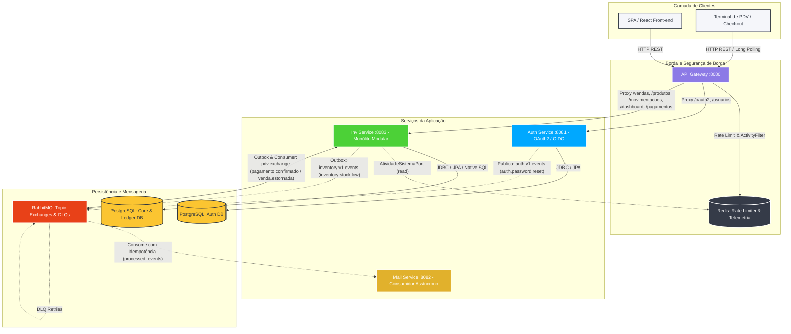
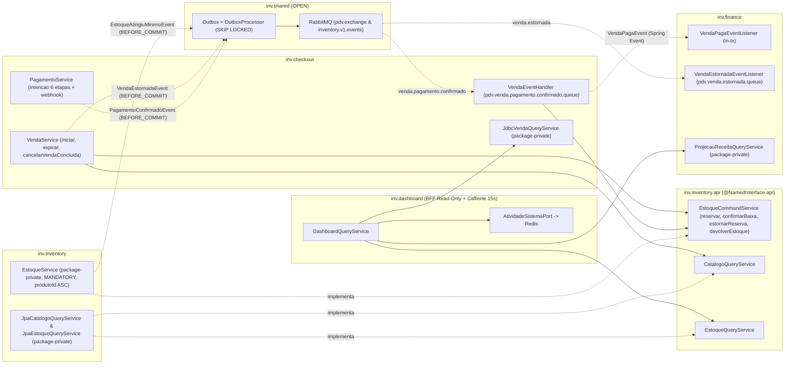
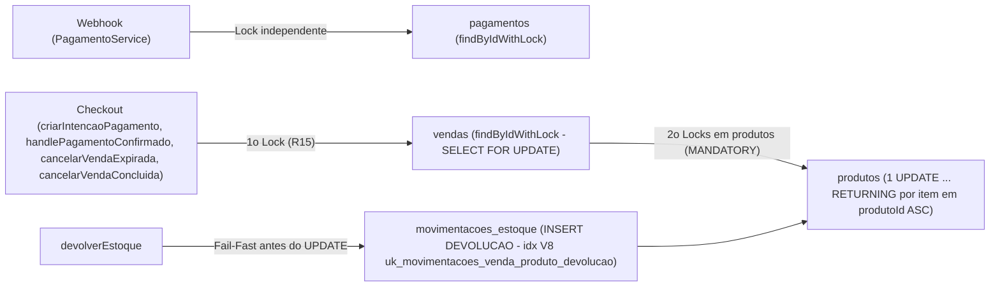
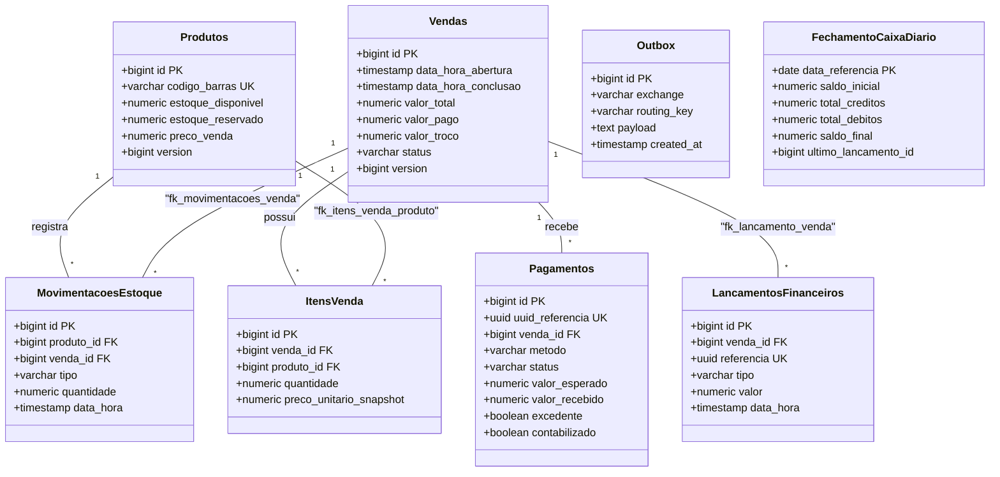

# 🏛️ Arquitetura do Sistema & Visão Geral (System Overview)

Este documento fornece a visão arquitetural consolidada do ecossistema **Pet Shop Microservices**, cobrindo o modelo C4 de containers, a arquitetura interna do monólito modular (`inv-service`), a hierarquia global de locks anti-deadlock, a matriz de comunicação, os esquemas físicos de banco de dados (Flyway `V1`–`V9`) e o contrato transversal de erros RFC 7807.

---

## 1. Diagrama C4 de Containers & Infraestrutura



---

## 2. Arquitetura Interna do Monólito Modular (`inv-service`), Fronteiras e Hierarquia de Locks

### A. Módulos Spring Modulith e Published Languages (`*.api`)

O `inv-service` é estruturado em cinco módulos declarados com `@ApplicationModule` (e interfaces públicas marcadas com `@NamedInterface("api")`), garantindo isolamento de agregados e ausência de dependências cíclicas:

| Módulo (`inv.*`) | Anotação Spring Modulith | Contratos Públicos (`*.api`) | Responsabilidade Principal |
| :--- | :--- | :--- | :--- |
| **`inv.inventory`** | `allowedDependencies = {"shared"}` | `EstoqueCommandService`, `CatalogoQueryService`, `EstoqueQueryService` | Catálogo de produtos, SQL atômico em lote ordenado, devolução integral (`V8`/`V9`) e alertas anti-spam. |
| **`inv.checkout`** | `allowedDependencies = {"inventory::api", "shared"}` | `VendaQueryService`, `VendaRecenteView` | Ciclo de vida da venda, intenção de pagamento idempotente (6 etapas), webhook, long polling e cancelamento em fase única. |
| **`inv.finance`** | `allowedDependencies = {"shared"}` | `ReceitaQueryService`, `PeriodoContabil`, `ResumoReceita`, `ReceitaDiariaView`, `FechamentoCaixaView`, `FrescorProjecao` | Ledger append-only (`CREDITO` e `ESTORNO` via `ON CONFLICT DO NOTHING`), projeções CQRS com pendência durável, fechamento D+0 e reconciliação $O(\Delta)$. |
| **`inv.dashboard`** | `allowedDependencies = {"checkout::api", "finance::api", "inventory::api", "shared"}` | — (consumidor *Conformist* read-only) | BFF interno de leitura (`GET /dashboard/stats`), degradação graciosa por card e cache Caffeine (`dashboard.cache.ttl=15s`). |
| **`inv.shared`** | `type = Type.OPEN`, `allowedDependencies = {}` | — (Shared Kernel aberto) | Transactional Outbox (`SKIP LOCKED`), `RabbitMQConfig`, `SecurityConfig` (JWT RSA) e eventos de integração (`VendaPagaEvent`, `VendaEstornadaEvent`). |



### B. Governança Automatizada (`ArquiteturaTest` e `ModulithTest`)

Todas as fronteiras arquiteturais são verificadas de forma contínua sem exceções congeladas (`archunit_store/` integralmente removido e zero `@ArchIgnore` ou `FreezingArchRule`):

* **[`ArquiteturaTest`](../../apps/inv-service/src/test/java/inv/architect/ArquiteturaTest.java) (`R1`–`R15`):**
  - `R1`–`R4`: isolamento unidirecional entre `checkout`, `finance` e `inventory`, além de ausência de ciclos entre módulos de topo.
  - `R5`–`R6`: ninguém depende de `inv.dashboard` e `dashboard` consome apenas `*.api`.
  - `R7`–`R8`: repositórios Spring Data e entidades JPA confinados ao próprio contexto (`onlyHaveDependentClassesThat()`).
  - `R9`, `R10`, `R14`: pureza das APIs (`interface`, `record`, `enum`), classes `infrastructure.query` e implementações de `*.api` com visibilidade `package-private`.
  - `R11`–`R12`: clientes Redis/AMQP restritos à infraestrutura/config/outbox e `inv.shared` agnóstico aos contextos de negócio.
  - `R13`: whitelist estrita garantindo que `inv.checkout` dependa de `inv.inventory` exclusivamente via `inv.inventory.api`.
  - `R15` (`escritasEmVendaDevemUsarFindByIdWithLock`): garante que toda mutação em `Venda` existente adquira antes `VendaRepository.findByIdWithLock` (sem carregar `Pagamento`/`getPagamentos()` antes do lock).
* **[`ModulithTest`](../../apps/inv-service/src/test/java/inv/architect/ModulithTest.java):** executa `ApplicationModules.of(InvServiceApplication.class).verify()` e gera diagramas C4/PlantUML e Module Canvases via `Documenter`.

```bash
mvn test -pl apps/inv-service -am -Dtest=ArquiteturaTest,ModulithTest
```

### C. Hierarquia Global de Locks Anti-Deadlock (`SQLState 40P01`)

Para impossibilitar ciclos no grafo de espera do PostgreSQL sob concorrência extrema, toda escrita segue uma hierarquia única:



* O webhook adquire lock apenas em `pagamentos` e nunca em `vendas`, evitando inversão de lock com o consumidor ou o cancelamento.
* As transações do Checkout que alteram vendas ou registram intenções adquirem primeiro `vendas(id)` e somente depois executam os `UPDATE`s atômicos em `produtos` na ordem estritamente crescente de `produtoId`.
* Em `devolverEstoque`, a inserção de `DEVOLUCAO` precede o `UPDATE` de recomposição em `produtos`, fazendo colisões duplicadas sem lock de venda abortarem imediatamente no índice único parcial `uk_movimentacoes_venda_produto_devolucao` (`SQLState 23505`).

---

## 3. Matriz de Comunicação entre Componentes

| Origem | Destino | Protocolo | Padrão / Semântica | Descrição |
| :--- | :--- | :--- | :--- | :--- |
| **Cliente / PDV** | **API Gateway** | HTTP/1.1 (JSON) | Síncrono / Long Polling | Requisições públicas, autenticação e espera não-bloqueante via `DeferredResult`. |
| **API Gateway** | **Auth Service** | HTTP/1.1 | Proxy Reverso / Stateless | Roteamento de rotas `/oauth2/**` e `/usuarios/**` (`order: 0`). |
| **API Gateway** | **Inv Service** | HTTP/1.1 | Proxy Reverso / Stateless | Roteamento de `/produtos/**`, `/vendas/**`, `/movimentacoes/**`, `/dashboard/**` e `/pagamentos/**` (`order: 2`), com rota dedicada `inv-webhook` (`/pagamentos/webhook/**`, `order: 1`) isenta de rate limit. |
| **Inv Service (`inv.checkout`)** | **Inv Service (`inv.inventory.api`)** | Em Memória | Open Host Service Síncrono (`Propagation.MANDATORY`) | Leitura de catálogo (`CatalogoQueryService.buscarParaCheckout`) e comandos em lote ordenado por `produtoId ASC` via `EstoqueCommandService` (`reservar`, `confirmarBaixa`, `estornarReserva`, `devolverEstoque`) ([ADR-0011](../adr/0011-synchronous-open-host-service-checkout-inventory.md)). |
| **Inv Service (`inv.dashboard`)** | **Inv Service (`*.api`)** | Em Memória | Open Host Service / CQRS Read | Composição read-only consumindo exclusivamente `VendaQueryService`, `ReceitaQueryService` e `EstoqueQueryService` ([ADR-0010](../adr/0010-dashboard-read-only-composition-module.md)). |
| **Inv Service (`inv.checkout`)** | **Inv Service (`inv.finance`)** | Em Memória | Spring Event (`VendaPagaEvent`) | Publicação de `VendaPagaEvent` consumida por `VendaPagaEventListener` na mesma transação (`INSERT ... ON CONFLICT DO NOTHING RETURNING id`). |
| **Inv Service (`OutboxProcessor`)** | **RabbitMQ (`pdv.exchange`)** | AMQP 0-9-1 | Polling Transacional (`SKIP LOCKED`) | Despacho de `PagamentoConfirmadoEvent` (`venda.pagamento.confirmado` → `pdv.venda.pagamento.confirmado.queue`) e `VendaEstornadaEvent` (`venda.estornada` → `pdv.venda.estornada.queue`), ambos com DLQs em `pdv.exchange.dlx`. |
| **Inv Service (`OutboxProcessor`)** | **RabbitMQ (`inventory.v1.events`)** | AMQP 0-9-1 | Polling Transacional (`SKIP LOCKED`) | Despacho de alertas de estoque mínimo (`inventory.stock.low` → `inventory.v1.stock-low.notify`, DLQ em `inventory.v1.events.dlx`). |
| **Auth Service** | **RabbitMQ (`auth.v1.events`)** | AMQP 0-9-1 | Push Assíncrono | Publicação de recuperação de senha (`auth.password.reset` → `auth.v1.password-reset.send-email`). |
| **RabbitMQ** | **Mail Service** | AMQP 0-9-1 | Idempotent Consumer | Consumo de `auth.v1.password-reset.send-email` e `inventory.v1.stock-low.notify` com deduplicação em `processed_events`. |

---

## 4. Mapeamento Físico de Banco de Dados & Migrations (Flyway)

A integridade do modelo de dados é gerenciada de forma estrita via scripts de migração do Flyway e tabelas de suporte do ecossistema Spring.



### A. Esquema do `inv-service` (Migrations Flyway `V1` a `V9`)

* [`V1__Schema_Inicial.sql`](../../apps/inv-service/src/main/resources/db/migration/V1__Schema_Inicial.sql) e [`V2__ajusta_schema_produtos_vendas_pagamentos.sql`](../../apps/inv-service/src/main/resources/db/migration/V2__ajusta_schema_produtos_vendas_pagamentos.sql)
* [`V3__financial_projection_checkpoint_v2.sql`](../../apps/inv-service/src/main/resources/db/migration/V3__financial_projection_checkpoint_v2.sql) e [`V4__projecao_receita_diaria.sql`](../../apps/inv-service/src/main/resources/db/migration/V4__projecao_receita_diaria.sql)
* [`V5__indices_dashboard.sql`](../../apps/inv-service/src/main/resources/db/migration/V5__indices_dashboard.sql) e [`V6__comentarios_fk_fronteira_modular.sql`](../../apps/inv-service/src/main/resources/db/migration/V6__comentarios_fk_fronteira_modular.sql)
* [`V7__pagamento_contabilizado.sql`](../../apps/inv-service/src/main/resources/db/migration/V7__pagamento_contabilizado.sql) e [`V8__indice_movimentacoes_estoque_devolucao.sql`](../../apps/inv-service/src/main/resources/db/migration/V8__indice_movimentacoes_estoque_devolucao.sql)
* [`V9__indice_movimentacoes_estoque_saida.sql`](../../apps/inv-service/src/main/resources/db/migration/V9__indice_movimentacoes_estoque_saida.sql)

| Artefato / Tabela | Migration | Bounded Context | Finalidade Arquitetural |
| :--- | :---: | :--- | :--- |
| `produtos` | `V1`, `V2` | **Inventory** | Registro de catálogo e saldo atômico (`estoque_disponivel`, `estoque_reservado`, `@Version`). |
| `movimentacoes_estoque` | `V1` | **Inventory** | Trilha histórica de auditoria (`ENTRADA`, `RESERVA`, `SAIDA`, `CANCELAMENTO_RESERVA`, `DEVOLUCAO`) com `venda_id` escalar. |
| `vendas` | `V1`, `V2` | **Checkout** | Agregado raiz de transação comercial e máquina de estados (`ABERTA`, `AGUARDANDO_PAGAMENTO`, `CONCLUIDA`, `CANCELADA`). |
| `itens_venda` | `V1` | **Checkout** | Snapshots imutáveis de preço e nome do produto no momento da compra (`produto_id` escalar). |
| `pagamentos` | `V2`, `V7` | **Checkout** | Intenções e confirmações de pagamento com `uuid_referencia` único, `nsu_transacao`, `excedente` e coluna `contabilizado` (`BOOLEAN DEFAULT FALSE` + backfill). |
| `outbox` | `V1` | **Shared** | Fila física de transações distribuídas para despacho AMQP sem 2PC (`SKIP LOCKED`). |
| `lancamentos_financeiros` | `V1` | **Finance** | **Ledger Contábil Append-Only**; registros imutáveis com `referencia` UUID única (`CREDITO`, `DEBITO`, `ESTORNO`). |
| `financial_projection_venda` | `V1` | **Finance** | Tabela de leitura CQRS contendo saldos consolidados por venda. |
| `financial_projection_checkpoint` | `V1` | **Finance** | Tabela legada de checkpoint da projeção de vendas (substituída pela `v2` na `V3`). |
| `financial_projection_checkpoint_v2` | `V3` | **Finance** | Checkpoint idempotente da projeção de vendas indexado por `lancamento_id` real. |
| `financial_projection_diaria` | `V4` | **Finance** | Projeção CQRS de grão diário para receitas e despesas em regime de caixa (`ProjecaoReceitaQueryService`). |
| `financial_projection_diaria_checkpoint` | `V4` | **Finance** | Checkpoint de idempotência próprio da projeção diária (listener síncrono e backfill). |
| `financial_reconciliation_checkpoint` | `V1`, `V2` | **Finance** | Marcação de *High Watermark* (`BIGINT`) para reconciliação incremental. |
| `projection_retry_queue` | `V1` | **Finance** | Fila de auto-cura e pendência durável para reprocessar projeções com `SKIP LOCKED`. |
| `fechamento_caixa_diario` | `V1` | **Finance** | Tabela de snapshots consolidados D+0 de fechamento diário. |
| `idx_vendas_concluidas`, `idx_itens_venda_venda`, `idx_produtos_abaixo_min` | `V5` | **Checkout / Inventory** | Índices parciais e compostos (`CREATE INDEX CONCURRENTLY`) para leitura do Dashboard. |
| `fk_itens_venda_produto`, `fk_movimentacoes_venda`, `fk_lancamento_venda` | `V6` | **Cross-Context** | Comentários declarativos (`COMMENT ON CONSTRAINT`) documentando as FKs físicas de fronteira modular sem mapeamento JPA cross-context. |
| `uk_movimentacoes_venda_produto_devolucao` | `V8` | **Inventory** | Índice único parcial (`WHERE tipo = 'DEVOLUCAO'`, `CONCURRENTLY`) garantindo no máximo 1 devolução por `(venda_id, produto_id)` e proteção Fail-Fast. |
| `idx_movimentacoes_venda_saida` | `V9` | **Inventory** | Índice parcial (`ON movimentacoes_estoque (venda_id) WHERE tipo = 'SAIDA'`, `CONCURRENTLY`) que acelera a auditoria integral de `devolverEstoque`. |

### B. Esquema do `auth-service` ([`V2__create_oauth_tables.sql`](../../apps/auth-service/src/main/resources/db/migration/V2__create_oauth_tables.sql))

| Tabela | Finalidade Arquitetural |
| :--- | :--- |
| `oauth2_registered_client` | Registro persistido de aplicações clientes (Front-end SPA, PDV Desktop, Mobile). |
| `oauth2_authorization` | Estado das sessões OAuth2, códigos de autorização emitidos e Refresh Tokens ativos. |
| `oauth2_authorization_consent` | Consentimentos de escopo concedidos pelos usuários. |
| `usuarios` | Base cadastral de credenciais com senhas criptografadas em BCrypt. |

### C. Esquema do `mail-service` (JPA Automático)

> [!NOTE]
> **Estratégia Mista de Migrações:** Enquanto o `inv-service` e o `auth-service` utilizam **Flyway** devido à criticidade de versionamento de regras de negócio, tabelas contábeis e especificações padrão OIDC, o `mail-service` utiliza gerenciamento automático de schema via **Hibernate (`ddl-auto=update`)**. Como o consumidor de e-mails atua como um worker assíncrono cuja única persistência é a tabela efêmera de deduplicação `processed_events` (sem constraints relacionais complexas), a criação direta via JPA reduz o overhead de manutenção de scripts manuais.

| Tabela | Finalidade Arquitetural |
| :--- | :--- |
| `processed_events` | Tabela de idempotência de eventos consumidos (`event_id` como PK) para proteção contra envio duplicado de e-mails. |

---

## 5. Padronização Transversal de Erros HTTP (RFC 7807 / ProblemDetail)

O tratamento de exceções HTTP é centralizado no [`GlobalExceptionHandler`](../../apps/common-lib/src/main/java/common/exception/GlobalExceptionHandler.java) da `common-lib` (`@RestControllerAdvice`), garantindo respostas uniformes em `ProblemDetail` (`Content-Type: application/problem+json`) com `type`, `title`, `status`, `detail` e `timestamp`. Os handlers locais legados em `VendaController` foram removidos na etapa `E5` do `DEBT-ARCH-004`.

| HTTP / `status` | Exceções Capturadas (`common.exception` / Spring) | `title` | `type` |
| :---: | :--- | :--- | :--- |
| **400** | `MethodArgumentNotValidException` (inclui `fields`) | `Dados Inválidos` | `https://petshop.com/errors/invalid-data` |
| **400** | `BusinessException` | `Regra de Negócio Violada` | `https://petshop.com/errors/business-rule-violation` |
| **401** | `BadCredentialsException`, `InternalAuthenticationServiceException` (e falhas de JWT no filtro Security) | `Falha na Autenticação` | `https://petshop.com/errors/unauthorized` |
| **403** | `AccessDeniedException` | `Acesso Negado` | `https://petshop.com/errors/forbidden` |
| **404** | `ResourceNotFoundException` | `Recurso não encontrado` | `https://petshop.com/errors/resource-not-found` |
| **409** | `ConflictException` (inclui `CancelamentoVendaConflitoException` e conflitos de intenção de pagamento) | `Conflito de Estado` | `https://petshop.com/errors/conflict` |
| **409** | `OptimisticLockingFailureException`, `ObjectOptimisticLockingFailureException` | `Conflito de Concorrência` | `https://petshop.com/errors/optimistic-lock-failure` |
| **503** | `ServiceUnavailableException` (inclui `CancelamentoVendaDesabilitadoException`) | `Serviço Indisponível` | `https://petshop.com/errors/service-unavailable` |
| **500** | `Exception` (fallback genérico) | `Erro Interno do Servidor` | `https://petshop.com/errors/internal-server-error` |

---

## 6. Rastreabilidade e Observabilidade Distribuída

* **Distributed Tracing:** Toda mensagem originada no sistema carrega um cabeçalho `eventId` / `correlationId` para rastreamento ponta a ponta no Grafana Loki.
* **Métricas em Tempo Real (Prometheus):** Endpoints `/actuator/prometheus` expostos e configurados para coleta periódica em `infra/prometheus/prometheus.yml`:
  - `api-gateway`: Scrape em `api-gateway:8080` (métricas de rotas reativas, rate limiting e tráfego de borda).
  - `inv-service`: Scrape em `inv-service:8083` (métricas de concorrência, locks pessimistas, execução de jobs, throughput de webhooks, latência e falhas por card do dashboard `dashboard.card.latency{card}` / `dashboard.card.failure{card}`, e contador de pagamentos tardios `pagamento.excedente.total`).
  - `auth-service`: Scrape em `auth-service:8081` (emissão de tokens OAuth2, sessões e autenticações).
  - `mail-service`: Scrape em `mail-service:8082` (processamento de e-mails transacionais e deduplicação de eventos).
  - `rabbitmq`: Scrape via endpoint de métricas em `rabbitmq:15692`.
* **Telemetria de Borda Desacoplada & Proteção contra Log Storms:** O API Gateway coleta atividade via `ActivityFilter` com fallback não-bloqueante (`onErrorResume`) e supressão de warnings (máximo de 1 log a cada 10s sob falha de conexão com o Redis). A limpeza de registros com mais de 1 hora no Redis é executada assincronamente pelo `ActivityPurgeScheduler` a cada 5 minutos.
* **Logs Não-Bloqueantes:** Utilização de `Logstash Async Appender` para evitar overhead de I/O de disco em threads HTTP de requisição.
* **Consistência de Variáveis de Ambiente e Kill Switch:** Normalização estrita de variáveis de ambiente no `docker-compose.yml` (como `JWT_PUBLIC_KEY` em maiúsculas e `FEATURES_CANCELAMENTO_VENDA_CONCLUIDA_ENABLED` com padrão `false`), garantindo paridade total com o `.env.example`, validação stateless de tokens RSA entre serviços e controle operacional seguro do cancelamento pós-faturamento.
