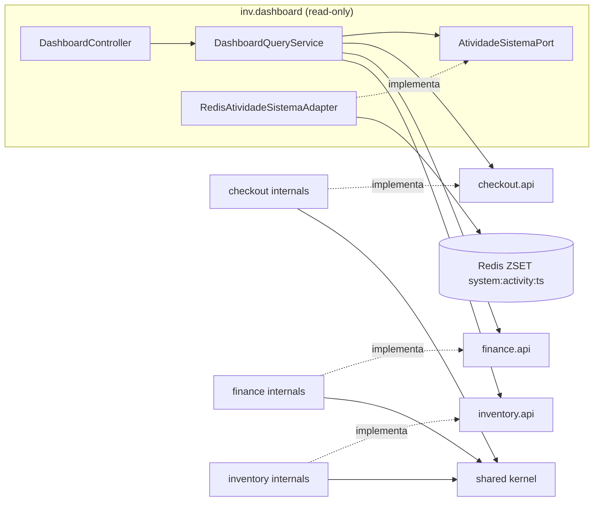
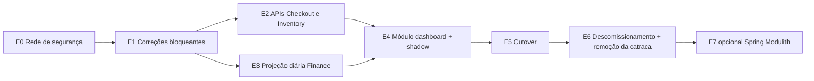

# DEBT-ARCH-001 — Plano para erradicar o acoplamento do Dashboard no `inv-service`

> **Decisão recomendada (TL;DR):** criar o módulo de composição **`inv.dashboard`** (um BFF interno só de leitura). Ele orquestra **APIs públicas de query** (`inv.<contexto>.api`) de cada Bounded Context (**Opção B**). Os indicadores financeiros saem de uma **nova projeção CQRS temporal** (`financial_projection_diaria`), que estende a ADR-0006 (padrão **Híbrido**). Durante a transição, o `@ArchIgnore` vira um **`FreezingArchRule`** (catraca: novas violações quebram o build, as antigas ficam registradas). Na Etapa 6, com o legado removido, a catraca sai e as regras rodam sem exceção.

---

## 📌 Progresso da Execução

- [x] **E0** — Rede de segurança (Testes de caracterização + Catraca FreezingArchRule)
- [x] **E1** — Correções bloqueantes (F1, F3, F7)
- [ ] **E2** — APIs de query Checkout e Inventory (V5 migration + JdbcVendaQueryService)
- [ ] **E3** — Projeção diária Finance (V4 migration + listener + catch-up)
- [ ] **E4** — Módulo inv.dashboard + Shadow mode (dashboard.engine)
- [ ] **E5** — Cutover (Carga sintética 7d + 100% reconciliação)
- [ ] **E6** — Descomissionamento do legado + Remoção da catraca
- [ ] **E7** — (Backlog) Spring Modulith

---

## Decisões aprovadas (substituem a §7 "Decisões em aberto")

| # | Decisão | Impacto no plano |
|---|---|---|
| Q1 | **Receita pelo Ledger (Finance), regime de caixa.** Rótulo do card/tooltip: **"Receita Realizada (Caixa)"** se houver confusão com "Faturamento de Pedidos". **Troco em dinheiro NÃO entra na receita líquida.** | E3 fica obrigatória. A projeção diária deve somar o valor **efetivamente retido** (`valorRecebido − troco`), nunca o valor entregue pelo cliente. Os métodos transitórios de `VendaQueryService` (`somarFaturamentoConcluido`, `faturamentoDiarioConcluido`) saem na E6. Novo teste `ProjecaoReceitaDiariaIT`: pagamento em dinheiro com troco soma só o líquido. |
| Q2 | **Crescimento MTD vs MTD:** do dia 1 até hoje, contra o dia 1 até o mesmo dia do mês anterior. | `DashboardQueryService` troca `PeriodoContabil.mes(...)` por `new PeriodoContabil(mes.atDay(1), hoje)` e `new PeriodoContabil(mesAnt.atDay(1), mesAnt.atDay(min(hoje.getDayOfMonth(), mesAnt.lengthOfMonth())))`. Mês anterior zerado retorna crescimento neutro, sem divisão por zero. A paridade da E4 deixa de comparar o crescimento (semântica nova, documentada). |
| Q3 | **"Vendas recentes" filtradas por `status IN ('CONCLUIDA','CANCELAMENTO_SOLICITADO')`.** O `StatusVenda` real é `ABERTA, AGUARDANDO_PAGAMENTO, CANCELAMENTO_SOLICITADO, CONCLUIDA, CANCELADA`; não existe `PAGA`. `CONCLUIDA` é o status gravado após a confirmação do pagamento, e `CANCELAMENTO_SOLICITADO` continua visível até o cancelamento ser efetivado (o estorno só aparece no ledger depois disso). | **Constante de domínio** `StatusVenda.FATURADAS = List.of(CONCLUIDA, CANCELAMENTO_SOLICITADO)` no Checkout, usada **só dentro de `checkout`** (`JdbcVendaQueryService` passa a lista como parâmetro; o dashboard nunca vê o enum, pois a R6 proíbe `checkout.domain`). `listarRecentes` e `contarVendasConcluidas` usam o filtro e ordenam por `data_hora_conclusao DESC`. **Índice:** o parcial `idx_vendas_concluidas` da V5 passa a ser `ON vendas (data_hora_conclusao) WHERE status IN ('CONCLUIDA','CANCELAMENTO_SOLICITADO')`; um índice com `WHERE status = 'CONCLUIDA'` não seria usado por essa query. O `idx_vendas_abertura_desc` sai da V5. **Paridade (E4):** os métodos transitórios `somarFaturamentoConcluido` e `faturamentoDiarioConcluido` mantêm o filtro legado (só `CONCLUIDA`) para a comparação ser fiel. **Testes** em `JdbcVendaQueryServiceIT`: `CONCLUIDA` e `CANCELAMENTO_SOLICITADO` aparecem; `ABERTA`, `AGUARDANDO_PAGAMENTO` e `CANCELADA` não. **Fora de escopo (novo DEBT-ARCH-003):** a sugestão de criar `solicitarCancelamento()` e `efetivarCancelamento()` em `Venda` (transições, estorno no ledger, devolução de estoque) é mudança de domínio do Checkout, sem relação com o desacoplamento do dashboard. **Confirmado no código:** esses métodos não existem em `Venda`; só há `cancelar()`, que lança exceção para vendas concluídas. Por isso o DEBT-ARCH-003 é necessário e fica fora deste plano, para não misturar risco de regra de negócio com o refactor arquitetural. **Consequência:** enquanto o DEBT-ARCH-003 não for entregue, nenhuma venda chega a `CANCELAMENTO_SOLICITADO` por esse fluxo, então o filtro com dois status é preventivo e não muda o resultado hoje. |
| Q4 | **Catraca (`FreezingArchRule`) aprovada já na E0.** | Já refletido no `ArquiteturaTest` atual (regras 2 e 3 com `freeze`). |
| Q5 | **Caffeine entra (E4/E5), TTL de 15–30 s. Spring Modulith (E7) vai para o backlog.** | `@Cacheable` no `DashboardQueryService`, com métrica de hit/miss. E7 sai do escopo desta sprint. |
| Q6 | **Gate de validação: carga sintética de 7 dias + reconciliação a 100%.** | Substitui a exigência de "1 semana em produção" na E5. Ver E5 revisada. |

---

## 0. Auditoria do código: achados que mudam o plano

O plano parte do código atual, não só do diagnóstico inicial. Os itens marcados como **bloqueantes** impedem que as regras 2 e 3 fiquem verdes, ou impedem que as projeções sirvam como fonte confiável, **mesmo depois** de refatorar o `DashboardService`.

| # | Severidade | Achado | Evidência | Impacto no plano |
|---|---|---|---|---|
| F1 | 🔴 Bloqueante | **Bug na chave de idempotência da projeção CQRS.** O `LancamentoRegistradoEvent` é criado com `vendaId` na posição de `lancamentoId`. O checkpoint deduplica **por venda**. Por isso, o 2º pagamento de uma mesma venda (pagamento dividido) é descartado como "já processado" e some da projeção. | [VendaPagaEventListener.java#L31-L36](file:///c:/Users/gabri/IdeaProjects/petshop-microservices/apps/inv-service/src/main/java/inv/finance/infrastructure/messaging/VendaPagaEventListener.java#L31-L36) e [LancamentoRegistradoEvent.java](file:///c:/Users/gabri/IdeaProjects/petshop-microservices/apps/inv-service/src/main/java/inv/finance/infrastructure/messaging/LancamentoRegistradoEvent.java) | A projeção não pode alimentar o dashboard executivo antes da correção e do reparo dos dados (**Etapa 1**). |
| F2 | 🔴 Bloqueante | **O ArchUnit também importa as classes de teste.** O `@AnalyzeClasses(packages = "inv")` não tem `ImportOption`. O [`ProjecaoRetryIntegrationTest`](file:///c:/Users/gabri/IdeaProjects/petshop-microservices/apps/inv-service/src/test/java/inv/finance/ProjecaoRetryIntegrationTest.java#L3-L4) fica em `inv.finance` e importa `Venda` e `VendaRepository`. | [ArquiteturaTest.java#L10](file:///c:/Users/gabri/IdeaProjects/petshop-microservices/apps/inv-service/src/test/java/inv/architect/ArquiteturaTest.java#L10) | A regra 2 continuaria vermelha mesmo sem o `DashboardService`. A contagem de "22 violações" precisa ser reconferida (**Etapa 0**). |
| F3 | 🟠 Alta | **O Shared Kernel depende de um contexto.** O `PagamentoConsolidadoEvent` importa `inv.checkout.domain.model.MetodoPagamento`, o que cria o ciclo `checkout → shared → checkout`. | [PagamentoConsolidadoEvent.java](file:///c:/Users/gabri/IdeaProjects/petshop-microservices/apps/inv-service/src/main/java/inv/shared/event/PagamentoConsolidadoEvent.java) | Bloqueia a regra de ausência de ciclos (`slices().beFreeOfCycles()`) do Pilar 5 (**Etapa 1**). |
| F4 | 🟠 Alta | **`financial_projection_venda` não tem dimensão temporal** (só `venda_id`, saldos e `ultima_atualizacao`). O `fechamento_caixa_diario` é fatiado por **high watermark** e não por dia de calendário: `data_referencia = CURRENT_DATE - 1` no momento em que o job roda. | [V1__Schema_Inicial.sql#L71-L115](file:///c:/Users/gabri/IdeaProjects/petshop-microservices/apps/inv-service/src/main/resources/db/migration/V1__Schema_Inicial.sql#L71-L115) e [FechamentoCaixaService.java#L46-L48](file:///c:/Users/gabri/IdeaProjects/petshop-microservices/apps/inv-service/src/main/java/inv/finance/usecase/FechamentoCaixaService.java#L46-L48) | Nenhuma das duas fontes responde "receita do dia X" ou "receita do mês". Daí a nova projeção diária (**Etapa 3**). |
| F5 | 🟠 Alta | **`LazyInitializationException` latente no `/dashboard/stats`.** `mapRecentSale` chama `v.getItens()`, que é `@OneToMany` LAZY, fora de transação, e a propriedade `spring.jpa.open-in-view=false` está ativa. Além disso, há N+1 no "Top 5". | [DashboardService.java#L108-L112](file:///c:/Users/gabri/IdeaProjects/petshop-microservices/apps/inv-service/src/main/java/inv/finance/usecase/DashboardService.java#L108-L112) | Precisa ser confirmado por teste de caracterização (**Etapa 0**). A nova query por projeção elimina o problema. |
| F6 | 🟡 Média | **Mudança de semântica da receita.** Hoje a receita é `SUM(vendas.valor_total)` das vendas `CONCLUIDA`, pela data de conclusão (regime de competência). No ledger, a receita é `SUM(valorRecebido)` por pagamento, pela data do lançamento (regime de caixa; possivelmente inclui troco). | [VendaRepository.java#L22](file:///c:/Users/gabri/IdeaProjects/petshop-microservices/apps/inv-service/src/main/java/inv/checkout/infrastructure/persistence/VendaRepository.java#L22) e [VendaEventHandler.java#L65-L69](file:///c:/Users/gabri/IdeaProjects/petshop-microservices/apps/inv-service/src/main/java/inv/checkout/infrastructure/messaging/VendaEventHandler.java#L65-L69) | Decisão de negócio (ver §7). Validação por período de paridade/shadow (**Etapa 4**). |
| F7 | 🟡 Média | **Possível divergência de fuso horário.** `DateRange` usa `LocalDate.now()` da JVM, enquanto `lancamentos_financeiros.data_hora` usa `CURRENT_TIMESTAMP` do banco (`TIMESTAMP` sem fuso). | [DateRange.java](file:///c:/Users/gabri/IdeaProjects/petshop-microservices/apps/common-lib/src/main/java/common/util/DateRange.java) | Fixar o fuso `America/Sao_Paulo` na JVM, no Hibernate e na sessão do banco, e injetar `Clock`. |
| F8 | ⚪ Fora de escopo | O Checkout acessa internos do Inventory (`Produto` em `ItemVenda`, `EstoqueService`, `ProdutoRepository`). Não há ciclo, mas é um acoplamento a internos. | [VendaService.java](file:///c:/Users/gabri/IdeaProjects/petshop-microservices/apps/inv-service/src/main/java/inv/checkout/usecase/VendaService.java) | Fica congelado na catraca do ArchUnit. Sugiro abrir o **DEBT-ARCH-002**. |

---

## Pilar 1 — Topologia de pacotes e padrão arquitetural

### 1.1 Decisão: módulo de composição `inv.dashboard` (BFF interno de leitura)

| Alternativa | Veredito | Motivo |
|---|---|---|
| `inv.application.dashboard` | ❌ | O serviço é organizado **por módulo** (`checkout/finance/inventory/shared`). Um pacote de topo técnico (`application`) quebra essa simetria. Além disso, `slices().matching("inv.(*)..")` trataria `application` como um "módulo" sem semântica. |
| Manter em `inv.finance` com portas | ❌ | O Finance continuaria fazendo papel de agregador transversal, que é o anti-pattern de origem (o Finance passaria a conhecer contratos de vendas e estoque). |
| **`inv.dashboard` (módulo par, só de leitura)** | ✅ | É um **consumidor downstream** (Conformist) das *Published Languages* dos três contextos. Não tem modelo de escrita, não é dependência de ninguém e pode ser extraído como BFF/serviço analítico no futuro. |

### 1.2 Árvore de pacotes — Antes vs Depois

````carousel
```plaintext
ANTES (estado atual)
inv/
├── checkout/
│   ├── domain/model/            Venda, ItemVenda, StatusVenda ...
│   ├── infrastructure/persistence/VendaRepository   ◄──────────┐
│   └── usecase/                                              │ ❌ acesso direto
├── finance/                                                  │
│   ├── usecase/DashboardService.java  ───────────────────────┤
│   │        (+ StringRedisTemplate ❌, + DTO web ❌)         │
│   └── infrastructure/web/{controller/DashboardController,   │
│                           dto/DashboardStats}               │
├── inventory/                                                │
│   └── infrastructure/persistence/ProdutoRepository ◄────────┘ ❌
└── shared/
    └── event/PagamentoConsolidadoEvent ──► checkout.domain.MetodoPagamento ❌ (ciclo)
```
<!-- slide -->
```plaintext
DEPOIS (alvo)
inv/
├── dashboard/                                  ◄ NOVO — composição read-only
│   ├── application/
│   │   ├── DashboardQueryService.java          (orquestrador, @Service público)
│   │   ├── DashboardSnapshot.java              (modelo de aplicação, record)
│   │   ├── IndicadoresCalculadora.java         (funções puras: growth, rótulos)
│   │   └── port/AtividadeSistemaPort.java      (porta de saída — dono: consumidor)
│   └── infrastructure/
│       ├── redis/RedisAtividadeSistemaAdapter.java   (package-private)
│       └── web/{DashboardController, dto/DashboardStats}
├── checkout/
│   ├── api/                                    ◄ Open Host Service (público)
│   │   ├── VendaQueryService.java  (interface)
│   │   └── VendaRecenteView.java, FaturamentoDiarioView.java (records)
│   └── infrastructure/query/JdbcVendaQueryService.java   (package-private)
├── finance/
│   ├── api/
│   │   ├── ReceitaQueryService.java
│   │   └── PeriodoContabil, ResumoReceita, ReceitaDiariaView,
│   │       FechamentoCaixaView, FrescorProjecao (records)
│   └── infrastructure/
│       ├── query/ProjecaoReceitaQueryService.java         (package-private)
│       └── persistence/ProjecaoReceitaDiariaRepository.java
├── inventory/
│   ├── api/{EstoqueQueryService, ResumoEstoque}
│   └── infrastructure/query/JpaEstoqueQueryService.java  (package-private)
└── shared/   (sem dependência de nenhum contexto; MetodoPagamento movido p/ cá)
```
````

### 1.3 Fluxo unidirecional de dependências (alvo)



**Invariantes:** nenhum pacote depende de `inv.dashboard`. `finance` não conhece `checkout` nem `inventory`. Pacotes `*.api` só dependem de `java.*`, `common.*` e de outros `*.api`. `shared` não depende de nenhum contexto.

### 1.4 Justificativa

- **DDD:** cada contexto expõe um **Open Host Service** (`*.api`) com uma **Published Language** (records imutáveis). O `dashboard` é **Conformist**: consome sem impor modelo. Agregados (`Venda`, `Produto`) nunca atravessam fronteiras; só *Views* achatadas.
- **Clean Architecture:** a regra de dependência aponta para dentro. A porta de saída (`AtividadeSistemaPort`) pertence a **quem consome** (DIP). O Redis vira um detalhe de infraestrutura. O caso de uso deixa de depender de DTO web (hoje `DashboardService` importa `infrastructure.web.dto.DashboardStats`, uma inversão de camada).
- **Spring Modulith e visibilidade:** no Java, `package-private` só vale dentro do **mesmo pacote**. Por isso, as interfaces ficam públicas em `*.api` e as implementações são classes **package-private** em `*.infrastructure.query` (o Spring instancia beans não públicos sem problema). Nenhum código externo consegue fazer `new` nelas nem injetá-las pelo tipo concreto. O que o compilador não garante (por exemplo, repositórios públicos), o ArchUnit garante (Pilar 5). Esse layout é compatível com `@NamedInterface("api")` caso o Spring Modulith seja adotado (Etapa 7, opcional).

---

## Pilar 2 — Contratos e desacoplamento (esqueletos Java 21 / Spring Boot 3.4)

### 2.1 Finance — receita a partir das projeções (ADR-0006) e do D+0 (ADR-0007)

**Problema (F4):** a projeção existente é por venda, sem data. O fechamento D+0 é por watermark. **Solução:** estender a ADR-0006 com uma **projeção de grão diário**, escrita **na mesma transação de projeção** que já tem checkpoint e fila de retry (garantia exactly-once lógica). O D+0 entra como **KPI de saldo consolidado** e como **invariante de reconciliação**, não como série temporal.

```sql
-- V4__projecao_receita_diaria.sql  (expand-only, aditiva)
CREATE TABLE financial_projection_diaria (
    data_referencia     DATE PRIMARY KEY,
    total_creditos      NUMERIC(14,2) NOT NULL DEFAULT 0,
    total_debitos       NUMERIC(14,2) NOT NULL DEFAULT 0,
    qtd_lancamentos     BIGINT        NOT NULL DEFAULT 0,
    ultima_atualizacao  TIMESTAMP     NOT NULL DEFAULT CURRENT_TIMESTAMP
);
-- Checkpoint próprio: torna a projeção diária idempotente por si só (listener E backfill)
CREATE TABLE financial_projection_diaria_checkpoint (
    lancamento_id BIGINT PRIMARY KEY,
    processado_em TIMESTAMP NOT NULL DEFAULT CURRENT_TIMESTAMP
);
```

```java
package inv.finance.infrastructure.persistence;

@Repository
public interface ProjecaoReceitaDiariaRepository
        extends org.springframework.data.repository.Repository<LancamentoFinanceiro, Long> {

    /**
     * Aplica um lançamento à projeção diária exatamente uma vez.
     * A data vem da própria linha do ledger (fonte da verdade), o que é seguro em retries tardios.
     * Se o checkpoint já existir, o CTE não retorna linhas e o INSERT externo vira no-op.
     */
    @Modifying
    @Query(value = """
        WITH marcado AS (
            INSERT INTO financial_projection_diaria_checkpoint (lancamento_id)
            VALUES (:lancamentoId)
            ON CONFLICT DO NOTHING
            RETURNING lancamento_id
        )
        INSERT INTO financial_projection_diaria AS d
               (data_referencia, total_creditos, total_debitos, qtd_lancamentos)
        SELECT lf.data_hora::date,
               GREATEST(lf.valor, 0),
               GREATEST(-lf.valor, 0),
               1
          FROM marcado m
          JOIN lancamentos_financeiros lf ON lf.id = m.lancamento_id
        ON CONFLICT (data_referencia) DO UPDATE SET
               total_creditos     = d.total_creditos  + EXCLUDED.total_creditos,
               total_debitos      = d.total_debitos   + EXCLUDED.total_debitos,
               qtd_lancamentos    = d.qtd_lancamentos + EXCLUDED.qtd_lancamentos,
               ultima_atualizacao = CURRENT_TIMESTAMP
        """, nativeQuery = true)
    int aplicar(@Param("lancamentoId") long lancamentoId);

    /** Backfill/catch-up por faixa de IDs: idempotente e seguro em concorrência com o listener. */
    @Modifying
    @Query(value = """
        WITH marcado AS (
            INSERT INTO financial_projection_diaria_checkpoint (lancamento_id)
            SELECT id FROM lancamentos_financeiros WHERE id > :de AND id <= :ate
            ON CONFLICT DO NOTHING
            RETURNING lancamento_id
        )
        INSERT INTO financial_projection_diaria AS d
               (data_referencia, total_creditos, total_debitos, qtd_lancamentos)
        SELECT lf.data_hora::date, SUM(GREATEST(lf.valor,0)), SUM(GREATEST(-lf.valor,0)), COUNT(*)
          FROM marcado m JOIN lancamentos_financeiros lf ON lf.id = m.lancamento_id
         GROUP BY lf.data_hora::date
        ON CONFLICT (data_referencia) DO UPDATE SET
               total_creditos     = d.total_creditos  + EXCLUDED.total_creditos,
               total_debitos      = d.total_debitos   + EXCLUDED.total_debitos,
               qtd_lancamentos    = d.qtd_lancamentos + EXCLUDED.qtd_lancamentos,
               ultima_atualizacao = CURRENT_TIMESTAMP
        """, nativeQuery = true)
    int aplicarFaixa(@Param("de") long deExclusivo, @Param("ate") long ateInclusivo);
}
```

Mudança no [`FinancialProjectionListener`](file:///c:/Users/gabri/IdeaProjects/petshop-microservices/apps/inv-service/src/main/java/inv/finance/infrastructure/messaging/FinancialProjectionListener.java#L49-L56): uma linha a mais, dentro do mesmo `projectionTxTemplate`, protegida por feature flag:

```java
projectionTxTemplate.executeWithoutResult(status -> {
    jdbcTemplate.update("INSERT INTO financial_projection_checkpoint_v2 (lancamento_id) VALUES (?)", event.lancamentoId());
    projectionRepository.upsertProjection(event.vendaId(), event.valorAssinado(), credito, estorno);
    if (projecaoDiariaHabilitada) {                     // finance.projection.diaria.enabled
        projecaoDiariaRepository.aplicar(event.lancamentoId());
    }
});
```

**API pública do Finance:**

```java
package inv.finance.api;

/** Open Host Service de receita. Fonte: projeções CQRS (ADR-0006) e fechamento D+0 (ADR-0007). */
public interface ReceitaQueryService {
    ResumoReceita resumir(PeriodoContabil periodo);
    /** Série densa, com dias sem movimento iguais a zero, em ordem crescente. */
    List<ReceitaDiariaView> serieDiaria(PeriodoContabil periodo);
    Optional<FechamentoCaixaView> ultimoFechamento();
    /** Torna a consistência eventual observável para o cliente. */
    FrescorProjecao frescor();
}

public record PeriodoContabil(LocalDate inicio, LocalDate fim) {
    private static final long MAX_DIAS = 400;
    public PeriodoContabil {
        Objects.requireNonNull(inicio, "inicio");
        Objects.requireNonNull(fim, "fim");
        if (fim.isBefore(inicio)) throw new IllegalArgumentException("fim < inicio");
        if (ChronoUnit.DAYS.between(inicio, fim) > MAX_DIAS) throw new IllegalArgumentException("período excede " + MAX_DIAS + " dias");
    }
    public static PeriodoContabil dia(LocalDate d) { return new PeriodoContabil(d, d); }
    public static PeriodoContabil mes(YearMonth m) { return new PeriodoContabil(m.atDay(1), m.atEndOfMonth()); }
}

public record ResumoReceita(BigDecimal creditos, BigDecimal debitos) {
    public static final ResumoReceita ZERO = new ResumoReceita(BigDecimal.ZERO, BigDecimal.ZERO);
    public ResumoReceita { Objects.requireNonNull(creditos); Objects.requireNonNull(debitos); }
    public BigDecimal liquida() { return creditos.subtract(debitos); }
}

public record ReceitaDiariaView(LocalDate data, BigDecimal creditos, BigDecimal debitos) {
    public BigDecimal liquida() { return creditos.subtract(debitos); }
}

public record FechamentoCaixaView(LocalDate dataReferencia, BigDecimal saldoFinal,
                                  long highWatermark, LocalDateTime processadoEm) {}

/** Atraso aproximado: listeners assíncronos podem confirmar fora de ordem. */
public record FrescorProjecao(long ultimoLancamentoLedger, long ultimoLancamentoProjetado, long pendentesRetry) {
    public long atraso() { return Math.max(0, ultimoLancamentoLedger - ultimoLancamentoProjetado); }
    public boolean emDia() { return atraso() == 0 && pendentesRetry == 0; }
}
```

```java
package inv.finance.infrastructure.query;

@Component
@Transactional(readOnly = true)
class ProjecaoReceitaQueryService implements ReceitaQueryService {   // package-private

    private final JdbcClient jdbc;
    private final FechamentoCaixaRepository fechamentoRepository;

    ProjecaoReceitaQueryService(JdbcClient jdbc, FechamentoCaixaRepository fechamentoRepository) {
        this.jdbc = jdbc;
        this.fechamentoRepository = fechamentoRepository;
    }

    @Override
    public ResumoReceita resumir(PeriodoContabil p) {
        return jdbc.sql("""
                SELECT COALESCE(SUM(total_creditos),0) AS creditos,
                       COALESCE(SUM(total_debitos),0)  AS debitos
                  FROM financial_projection_diaria
                 WHERE data_referencia BETWEEN :inicio AND :fim
                """)
            .param("inicio", p.inicio()).param("fim", p.fim())
            .query(ResumoReceita.class).single();
    }

    @Override
    public List<ReceitaDiariaView> serieDiaria(PeriodoContabil p) {
        return jdbc.sql("""
                SELECT g.dia::date AS data,
                       COALESCE(d.total_creditos,0) AS creditos,
                       COALESCE(d.total_debitos,0)  AS debitos
                  FROM generate_series(CAST(:inicio AS date), CAST(:fim AS date), INTERVAL '1 day') AS g(dia)
                  LEFT JOIN financial_projection_diaria d ON d.data_referencia = g.dia::date
                 ORDER BY g.dia
                """)
            .param("inicio", p.inicio()).param("fim", p.fim())
            .query(ReceitaDiariaView.class).list();
    }

    @Override
    public Optional<FechamentoCaixaView> ultimoFechamento() {
        return fechamentoRepository.findTopByOrderByDataReferenciaDesc()
            .map(f -> new FechamentoCaixaView(f.getDataReferencia(), f.getSaldoFinal(),
                                              f.getUltimoLancamentoId(), f.getProcessadoEm()));
    }

    @Override
    public FrescorProjecao frescor() {
        return jdbc.sql("""
                SELECT (SELECT COALESCE(MAX(id),0) FROM lancamentos_financeiros)                     AS ultimo_lancamento_ledger,
                       (SELECT COALESCE(MAX(lancamento_id),0) FROM financial_projection_diaria_checkpoint) AS ultimo_lancamento_projetado,
                       (SELECT COUNT(*) FROM projection_retry_queue WHERE status = 'PENDENTE')       AS pendentes_retry
                """).query(FrescorProjecao.class).single();
    }
}
```

**Papel do D+0 (ADR-0007):** é exposto como `ultimoFechamento()` (KPI "Saldo de caixa consolidado até D-1", opcional no dashboard). Também vira uma nova invariante no `ReconciliacaoService`: `Σ financial_projection_diaria.(creditos − debitos)` sobre os lançamentos com `id ≤ highWatermark` deve ser igual a `saldo_final − saldo_inicial` acumulado. Divergência gera alerta `CRITICAL`, com a mesma classificação de severidade já existente.

> [!TIP]
> **Alternativa mais simples (fallback):** criar o índice `idx_lancamento_data_hora` e fazer `SUM` por intervalo direto em `lancamentos_financeiros`. Resolve no volume de um pet shop, mas contraria os drivers "leitura O(1)" da ADR-0006 e "sem varredura por timestamp" da ADR-0007. Só recomendo se a Etapa 3 for despriorizada.

### 2.2 Checkout — API de query (Ports & Adapters)

```java
package inv.checkout.api;

/** Open Host Service de leitura do Checkout. Nunca expõe agregados JPA. */
public interface VendaQueryService {

    long contarVendasConcluidas(LocalDateTime inicioInclusivo, LocalDateTime fimExclusivo);

    List<VendaRecenteView> listarRecentes(int limite);

    /** TRANSITÓRIO — paridade da Etapa 4. Vira @Deprecated(forRemoval = true) e sai na Etapa 6 se a semântica de ledger for aprovada (§7-Q1). */
    BigDecimal somarFaturamentoConcluido(LocalDateTime inicioInclusivo, LocalDateTime fimExclusivo);

    /** TRANSITÓRIO — idem. */
    List<FaturamentoDiarioView> faturamentoDiarioConcluido(LocalDate inicio, LocalDate fim);
}

public record VendaRecenteView(long vendaId, String produtoDestaque /* null = sem itens */,
                               int quantidadeItens, BigDecimal valorTotal, LocalDateTime abertaEm) {
    public VendaRecenteView {
        Objects.requireNonNull(valorTotal, "valorTotal");
        Objects.requireNonNull(abertaEm, "abertaEm");
        if (quantidadeItens < 0) throw new IllegalArgumentException("quantidadeItens < 0");
    }
}

public record FaturamentoDiarioView(LocalDate data, BigDecimal total) {}
```

```java
package inv.checkout.infrastructure.query;

@Component
@Transactional(readOnly = true)
class JdbcVendaQueryService implements VendaQueryService {   // package-private, lado de leitura sem hidratar agregados

    private static final int LIMITE_MAXIMO = 50;
    private final JdbcClient jdbc;

    JdbcVendaQueryService(JdbcClient jdbc) { this.jdbc = jdbc; }

    @Override
    public List<VendaRecenteView> listarRecentes(int limite) {
        // 1 round-trip, sem N+1 e sem LazyInitializationException (corrige F5)
        return jdbc.sql("""
                SELECT v.id AS venda_id,
                       pi.nome_produto_snapshot AS produto_destaque,
                       (SELECT COUNT(*) FROM itens_venda x WHERE x.venda_id = v.id) AS quantidade_itens,
                       v.valor_total, v.data_hora_abertura AS aberta_em
                  FROM vendas v
                  LEFT JOIN LATERAL (
                       SELECT i.nome_produto_snapshot FROM itens_venda i
                        WHERE i.venda_id = v.id ORDER BY i.id LIMIT 1) pi ON TRUE
                 WHERE v.status IN (:status)          -- StatusVenda.FATURADAS (Q3), passado como lista de nomes
                 ORDER BY v.data_hora_conclusao DESC
                 LIMIT :limite
                """)
            .param("status", STATUS_FATURADAS)        // List<String> derivada de StatusVenda.FATURADAS
            .param("limite", Math.clamp(limite, 1, LIMITE_MAXIMO))
            .query(VendaRecenteView.class).list();
    }

    @Override
    public long contarVendasConcluidas(LocalDateTime inicio, LocalDateTime fim) {
        return jdbc.sql("""
                SELECT COUNT(*) FROM vendas
                 WHERE status IN (:status) AND data_hora_conclusao >= :inicio AND data_hora_conclusao < :fim
                """).param("status", STATUS_FATURADAS).param("inicio", inicio).param("fim", fim).query(Long.class).single();
    }
    // somarFaturamentoConcluido / faturamentoDiarioConcluido: SQL equivalente ao legado (paridade)
}
```

Índices de suporte (`V5__indices_dashboard.sql` com `V5__indices_dashboard.sql.conf` contendo `executeInTransaction=false`):

```sql
-- Predicado idêntico ao da query (StatusVenda.FATURADAS), senão o planner não usa o índice parcial (Q3)
CREATE INDEX CONCURRENTLY IF NOT EXISTS idx_vendas_concluidas    ON vendas (data_hora_conclusao)
    WHERE status IN ('CONCLUIDA', 'CANCELAMENTO_SOLICITADO');
CREATE INDEX CONCURRENTLY IF NOT EXISTS idx_itens_venda_venda    ON itens_venda (venda_id, id);
CREATE INDEX CONCURRENTLY IF NOT EXISTS idx_produtos_abaixo_min  ON produtos (id) WHERE estoque_disponivel <= estoque_minimo;
```

### 2.3 Inventory — API de query

```java
package inv.inventory.api;

public interface EstoqueQueryService {
    ResumoEstoque resumo();
}

public record ResumoEstoque(long produtosAbaixoDoMinimo) {
    public ResumoEstoque { if (produtosAbaixoDoMinimo < 0) throw new IllegalArgumentException(); }
}
```

```java
package inv.inventory.infrastructure.query;

@Component
@Transactional(readOnly = true)
class JpaEstoqueQueryService implements EstoqueQueryService {   // package-private
    private final ProdutoRepository produtoRepository;
    JpaEstoqueQueryService(ProdutoRepository produtoRepository) { this.produtoRepository = produtoRepository; }

    @Override
    public ResumoEstoque resumo() {
        return new ResumoEstoque(produtoRepository.countProdutosComEstoqueBaixo());
    }
}
```

### 2.4 Métricas do Redis — porta de saída e adaptador

O ZSET `system:activity:ts` é escrito pelo [`ActivityFilter`](file:///c:/Users/gabri/IdeaProjects/petshop-microservices/apps/api-gateway/src/main/java/gateway/filter/ActivityFilter.java) do gateway. É telemetria de plataforma, não pertence a nenhum BC. A chave passa a ser um contrato compartilhado em `common-lib`:

```java
package common.telemetry;
public final class TelemetriaKeys {
    public static final String ATIVIDADE_ZSET = "system:activity:ts";
    private TelemetriaKeys() {}
}
```

```java
package inv.dashboard.application.port;

/** Porta de saída de propriedade do consumidor (DIP). Não expõe tipos do Redis. */
public interface AtividadeSistemaPort {
    /** @return quantidade de eventos de atividade na janela; vazio se a fonte estiver indisponível. */
    OptionalLong contarEventosNaJanela(Duration janela);
}
```

```java
package inv.dashboard.infrastructure.redis;

@Slf4j
@Component
class RedisAtividadeSistemaAdapter implements AtividadeSistemaPort {   // package-private
    private final StringRedisTemplate redis;
    private final Clock clock;

    RedisAtividadeSistemaAdapter(StringRedisTemplate redis, Clock clock) { this.redis = redis; this.clock = clock; }

    @Override
    public OptionalLong contarEventosNaJanela(Duration janela) {
        long agora = clock.millis();
        try {
            Long n = redis.opsForZSet().count(TelemetriaKeys.ATIVIDADE_ZSET, agora - janela.toMillis(), agora);
            return n == null ? OptionalLong.empty() : OptionalLong.of(n);
        } catch (DataAccessException e) {          // RedisConnectionFailureException etc.
            log.warn("Telemetria de atividade indisponível: {}", e.getMessage());
            return OptionalLong.empty();           // degrada o card, não o dashboard
        }
    }
}
```

Configuração: `spring.data.redis.timeout=250ms` limita o impacto de um Redis lento na latência do dashboard.

### 2.5 Orquestrador e controller

```java
package inv.dashboard.application;

@Service
public class DashboardQueryService {

    private static final Duration JANELA_ATIVIDADE = Duration.ofHours(1);
    private static final int TOP_RECENTES = 5;

    private final ReceitaQueryService receitas;
    private final VendaQueryService vendas;
    private final EstoqueQueryService estoque;
    private final AtividadeSistemaPort atividade;
    private final Clock clock;
    private final MeterRegistry meters;

    // construtor omitido

    /** Sem @Transactional de propósito: não abre transação entre módulos nem segura conexão durante a chamada ao Redis. */
    public DashboardSnapshot consultar() {
        LocalDate hoje = LocalDate.now(clock);
        YearMonth mes = YearMonth.from(hoje);
        var degradados = new ArrayList<String>();

        ResumoReceita receitaHoje = card("receitaHoje", () -> receitas.resumir(PeriodoContabil.dia(hoje)), ResumoReceita.ZERO, degradados);
        ResumoReceita mesAtual    = card("receitaMes",  () -> receitas.resumir(PeriodoContabil.mes(mes)), ResumoReceita.ZERO, degradados);
        ResumoReceita mesAnterior = card("receitaMesAnterior", () -> receitas.resumir(PeriodoContabil.mes(mes.minusMonths(1))), ResumoReceita.ZERO, degradados);
        List<ReceitaDiariaView> serie = card("serie7d",
                () -> receitas.serieDiaria(new PeriodoContabil(hoje.minusDays(6), hoje)), List.of(), degradados);
        long vendasHoje = card("vendasHoje",
                () -> vendas.contarVendasConcluidas(hoje.atStartOfDay(), hoje.plusDays(1).atStartOfDay()), 0L, degradados);
        List<VendaRecenteView> recentes = card("recentes", () -> vendas.listarRecentes(TOP_RECENTES), List.of(), degradados);
        long estoqueBaixo = card("estoqueBaixo", () -> estoque.resumo().produtosAbaixoDoMinimo(), 0L, degradados);
        OptionalLong ativ = atividade.contarEventosNaJanela(JANELA_ATIVIDADE);
        if (ativ.isEmpty()) degradados.add("atividade");
        FrescorProjecao frescor = card("frescor", receitas::frescor, null, degradados);

        return new DashboardSnapshot(
                receitaHoje.liquida(),
                IndicadoresCalculadora.crescimentoPercentual(mesAtual.liquida(), mesAnterior.liquida()),
                vendasHoje, estoqueBaixo, ativ.orElse(0L),
                recentes, serie, new DashboardSnapshot.Meta(Instant.now(clock), frescor, List.copyOf(degradados)));
    }

    private <T> T card(String nome, Supplier<T> consulta, T fallback, List<String> degradados) {
        try {
            return Timer.builder("dashboard.card.latency").tag("card", nome).register(meters).record(consulta);
        } catch (RuntimeException e) {
            meters.counter("dashboard.card.failure", "card", nome).increment();
            log.warn("Card {} degradado", nome, e);
            degradados.add(nome);
            return fallback;
        }
    }
}
```

O controller vai para `inv.dashboard.infrastructure.web`, mantém **`GET /dashboard/stats`** e mantém o **JSON atual**. A única mudança é aditiva: um campo `meta` com `geradoEm`, `frescor` e `cardsDegradados`, o que é retrocompatível. O mapeamento `DashboardSnapshot → DashboardStats` (por exemplo, o rótulo `"X + outros"`, os dias da semana em `pt-BR` e o formato `HH:mm`) é responsabilidade de apresentação e fica no controller/mapper, não no caso de uso.

---

## Pilar 3 — Consistência e trade-offs

| Dimensão | **Opção A:** Read model unificado via eventos | **Opção B:** Orquestrador + queries por BC | **Híbrido (recomendado)**: B + projeção CQRS só no Finance |
|---|---|---|---|
| Latência de leitura (p95 estimado) | ~2–5 ms (1 linha por PK) | ~15–40 ms (6–7 queries indexadas + 1 RTT Redis) | ~15–35 ms. As queries de receita leem no máximo ~62 linhas da projeção diária. |
| Pressão no OLTP | **Amplificação de escrita** a cada venda/pagamento. A linha "hoje" vira **hot row**, serializando checkouts concorrentes por lock de linha. | Leitura proporcional a requisições × visualizadores. Some com cache de 15–30 s. | Escrita extra de 1 upsert por lançamento, **fora** da transação do PDV (`AFTER_COMMIT`/async). Leitura barata. |
| Consistência | Eventual em **todos** os cards | Forte por card (READ COMMITTED), sem snapshot entre cards | Finance eventual (lag tipicamente < 1 s, pior caso ≈ 5 retries × 60 s, **observável** via `frescor`). Vendas e estoque imediatos. |
| Cobertura de eventos necessária | **Não existe hoje.** `VendaConcluidaEvent` só vai para o outbox/RabbitMQ. O estoque só emite `EstoqueAtingiuMinimoEvent` (não emite o retorno acima do mínimo). A atividade no Redis **não é evento**. | Nenhuma | Só `LancamentoRegistradoEvent`, que já existe e tem retry (corrigido na Etapa 1) |
| Rebuild/replay | Exige event store ou replay a partir do OLTP | Não se aplica | Backfill idempotente a partir do ledger (`aplicarFaixa`) |
| Complexidade e risco | Alto | Baixo | Médio-baixo |
| Extração futura para microsserviço | Excelente (eventos via broker) | Exige trocar chamadas in-process por HTTP/gRPC (mecânico, porque as interfaces já existem) | Finance pronto. O restante segue o caminho de B. |

**Conclusão.** Um dashboard executivo **não precisa de consistência forte entre cards**: o número contábil com autoridade é o fechamento D+0 (ADR-0007). Lag de segundos é aceitável **desde que seja visível**: o campo `meta.frescor` permite ao frontend mostrar "atualizado há Xs" ou um selo de "sincronizando". A Opção A pura exigiria criar eventos que não existem e introduziria contenção de hot row no caminho crítico do PDV, contrariando o driver de latência da ADR-0001. O Híbrido aplica CQRS **onde o domínio já publica eventos confiáveis** (o ledger) e usa queries diretas onde a leitura é barata e precisa ser imediata.

**Gatilhos para evoluir para A:** p95 > 150 ms com cache; mais de ~50 visualizadores simultâneos; necessidade de drill-down histórico; ou extração de `checkout`/`finance` para serviços separados.

**Aprovado (Q5):** `@Cacheable(value = "dashboard", unless = "!#result.meta().cardsDegradados().isEmpty()")` com Caffeine e TTL de 15–30 s no `DashboardQueryService`. O `unless` impede que um snapshot com card degradado (Redis ou Finance oscilando) fique cacheado depois que a dependência se recupera; a requisição seguinte tenta de novo. Validar na E4/E5 com teste: snapshot degradado não é cacheado e snapshot íntegro é. Atenção: conferir na versão do Spring em uso se `sync = true` (proteção contra stampede) aceita `unless`; se não aceitar, usar `Caffeine.get(key, loader)` manualmente. Isso deixa a pressão no OLTP **constante**, independente do número de visualizadores.

---

## Pilar 4 — Plano de execução fatorado (zero downtime, zero regressão)



**Princípios transversais:** migrations só **expand** até a E6 (nada é dropado antes); cada etapa é um PR com deploy independente; mudanças de comportamento ficam atrás de property (`dashboard.engine`, `finance.projection.diaria.enabled`), com rollback por variável de ambiente e rolling restart.

Comando padrão de verificação (requer Docker para Testcontainers):

```bash
mvn -pl apps/inv-service -am clean verify -DfailIfNoTests=false
mvn -pl apps/inv-service -am test -Dtest=ArquiteturaTest -Dsurefire.failIfNoSpecifiedTests=false
```

### E0 — Rede de segurança (só testes; sem mudança em produção)
> **Estado atual:** **Concluída.** `ArquiteturaTest` ativo com `DoNotIncludeTests` e catraca `freeze(...)` nas regras 2 e 3; catraca travada com `freeze.store.default.allowStoreCreation=false` em `archunit.properties`; teste de contrato `DashboardStatsContractTest` (`@JsonTest`) implementado congelando o contrato da API; e teste de integração e caracterização `DashboardLegacyCharacterizationIT` (Testcontainers PostgreSQL + Redis) implementado validando o Golden Master e reproduzindo formalmente o achado F5 (`LazyInitializationException` no legado quando há vendas cadastradas fora de transação com `open-in-view=false`).
- **Artefatos:**
  - `inv/dashboard/DashboardLegacyCharacterizationIT` (Testcontainers Postgres + Redis): popula vendas, itens, produtos e o ZSET, chama `GET /dashboard/stats` e grava um *golden master* do JSON. **Deve reproduzir o F5.** Se reproduzir, registrar como bug conhecido e caracterizar o comportamento com itens carregados.
  - `DashboardStatsContractTest` (`@JsonTest`): congela nomes e tipos dos campos JSON.
  - `ArquiteturaTest`: adicionar `importOptions = ImportOption.DoNotIncludeTests.class` (F2). Trocar os dois `@ArchIgnore` por `FreezingArchRule.freeze(...)`, com o store em `src/test/resources/archunit_store/` e `archunit.properties` contendo `freeze.store.default.allowStoreCreation=false` no CI. Com isso, **a contagem real é registrada** e confere ou corrige as "22".
- **Aceite:** suíte verde. O store versionado lista **só** violações do `DashboardService`. Uma violação nova, introduzida de propósito num branch de teste, **quebra** o build.
- **Rollback:** `git revert` (só testes).

### E1 — Correções bloqueantes (F1, F3, F7)
> **Estado atual:** **Concluída.** 
> - **F1:** `VendaPagaEventListener` corrigido para propagar `lancamento.getId()` (em vez de `event.vendaId()`); migration `V3__financial_projection_checkpoint_v2.sql` criada; `FinancialProjectionListener` atualizado para gravar no `checkpoint_v2`; `ReparoProjecaoVendaJob` implementado com transação sob `LOCK TABLE financial_projection_venda IN SHARE ROW EXCLUSIVE MODE` e CTE atômica de recálculo no mesmo snapshot; `ProjecaoRetryIntegrationTest` e `ProjecaoMultiplosPagamentosIT` passando com 100% de sucesso e 0 divergências na reconciliação pós-reparo.
> - **F3:** `MetodoPagamento` movido para `inv.shared.domain`, eliminando o ciclo `checkout -> shared -> checkout`; Regra R4 (`semCiclosEntreModulos`) ativada e validada no `ArquiteturaTest`.
> - **F7:** Overloads com `Clock` adicionados a `DateRange` em `common-lib` (e testes unitários com 100% de cobertura); bean `Clock` (`America/Sao_Paulo`) registrado via `DateTimeConfig`; JVM padronizada via `@PostConstruct` em `InvServiceApplication`; `spring.jpa.properties.hibernate.jdbc.time_zone=America/Sao_Paulo` configurado; `TZ=America/Sao_Paulo` configurado no `Dockerfile` e `docker-compose.yml`.

- **F1 — chave de idempotência:**
  1. Corrigir `new LancamentoRegistradoEvent(lancamento.getId(), lancamento.getVendaId(), …)`.
  2. **Novo checkpoint** `financial_projection_checkpoint_v2`. A tabela antiga contém `vendaId`s disfarçados de `lancamentoId` e colidiria com IDs reais (as duas sequências começam em 1).
  3. **Job de reparo** (`ReparoProjecaoVendaJob`, disparado manualmente após o rollout completo), numa transação com `LOCK TABLE financial_projection_venda IN SHARE ROW EXCLUSIVE MODE`. Num único statement (mesmo snapshot): recalcula `financial_projection_venda` a partir do ledger e popula o `checkpoint_v2` com **os IDs visíveis nesse snapshot**, não com uma faixa. Isso evita a corrida com IDs alocados mas ainda não confirmados.
  4. Teste `ProjecaoMultiplosPagamentosIT`: 2 pagamentos na mesma venda resultam em `saldo = soma`; reprocessar não duplica.
- **F3:** mover `MetodoPagamento` para `inv.shared.domain` (ou usar `String` no evento) e manter um alias deprecado no checkout se houver serialização persistida.
- **F7:** bean `Clock` (`America/Sao_Paulo`), `spring.jpa.properties.hibernate.jdbc.time_zone`, `TZ` no container e overloads `DateRange.hoje(Clock)` etc. em `common-lib`.
- **Aceite:** `ProjecaoRetryIntegrationTest` e `ProjecaoMultiplosPagamentosIT` verdes. Após o reparo, `ReconciliacaoService` com watermark 0 retorna **0 divergências**.
- **Rollback:** reverter o código. O `checkpoint_v2` fica órfão, sem efeito. O reparo é idempotente e pode rodar de novo.

### E2 — APIs de query do Checkout e do Inventory (aditivo, ainda sem uso)
- **Artefatos:** `checkout.api.*`, `inventory.api.*`, `JdbcVendaQueryService`, `JpaEstoqueQueryService` e a migration de índices `V5` (`CONCURRENTLY`).
- **Testes:** `JdbcVendaQueryServiceIT` (venda sem itens, venda com vários itens, limite e ordenação, só `CONCLUIDA` na contagem, borda de meia-noite) e `JpaEstoqueQueryServiceIT` (`estoque_minimo NULL` não é contado, igual ao legado). `EXPLAIN` das queries usando os índices.
- **Aceite:** testes verdes. O `ArquiteturaTest` continua verde (catraca inalterada).
- **Rollback:** código sem consumidores, basta revert. Os índices podem ser removidos com `DROP INDEX CONCURRENTLY`.

### E3 — Projeção diária do Finance (ADR-0006 estendida)
- **Artefatos:** `V4__projecao_receita_diaria.sql`, `ProjecaoReceitaDiariaRepository`, extensão do listener (flag), `ProjecaoDiariaCatchUpJob` (`@Scheduled`, janela dos últimos N mil IDs, `SKIP LOCKED`-safe por ser idempotente), comando de backfill completo e `finance.api.*` + `ProjecaoReceitaQueryService`.
- **Sequência de deploy:** (1) migration + código com flag **ligada**, em rolling deploy. Instâncias antigas não escrevem a projeção diária, o que é aceitável. (2) Após o rollout, rodar o **backfill completo** `aplicarFaixa(0, max)` em lotes de 5.000. Os checkpoints garantem que nada é contado duas vezes, mesmo em concorrência com o listener. (3) O catch-up periódico corrige qualquer lacuna residual.
- **Testes:** `ProjecaoReceitaDiariaIT`: idempotência (o mesmo lançamento 2× conta 1×); falha e retry (reaproveita o padrão do `ProjecaoRetryIntegrationTest`); **corrida entre listener e backfill** (`CountDownLatch` + 2 threads, a soma bate com o ledger); lançamento perto da meia-noite cai no dia correto; série densa com dias zerados.
- **Aceite:** `Σ projecao_diaria.(creditos − debitos) == SUM(lancamentos_financeiros.valor)` (query de auditoria no teste e em produção após o backfill). `frescor().emDia()` em regime estável.
- **Rollback:** `FINANCE_PROJECTION_DIARIA_ENABLED=false` e rolling restart. A tabela fica sem leitores. Para religar, rodar o catch-up.

### E4 — Módulo `inv.dashboard` + porta Redis + modo shadow
- **Artefatos:** pacote `inv.dashboard` completo (Pilar 2.4/2.5) e `TelemetriaKeys` em `common-lib` (o gateway passa a usar a mesma constante).
  - `DashboardStatsProvider` com 3 modos via `dashboard.engine`:
    - `legacy` (padrão): adaptador temporário em `inv.dashboard.infrastructure.legacy`, que delega ao `finance.usecase.DashboardService`. É uma dependência temporária, **registrada na catraca**.
    - `shadow`: o legado responde; o modular roda numa amostra (por exemplo, 10% das requisições, em executor limitado com virtual threads e semáforo de 2) e compara campo a campo, emitindo `dashboard.parity.delta{campo}` e um log estruturado.
    - `modular`: o novo serviço responde.
  - Os dois controllers não coexistem: o `DashboardController` de `finance` é removido e o novo controller delega ao provider.
- **Testes:** `DashboardQueryServiceTest` (unitário com mocks: degradação por card, growth com mês anterior zerado, `Clock` fixo); `RedisAtividadeSistemaAdapterIT` (Testcontainers `redis:7-alpine`, mais o cenário de Redis parado retornando `OptionalLong.empty()`); `DashboardParityIT` (mesmo seed da E0, `legacy` vs `modular`: vendas, estoque, atividade e recentes **idênticos**; diferenças de receita **só** nos casos esperados pela F6 e documentadas); `DashboardStatsContractTest` continua verde.
- **Aceite:** testes verdes. Em produção, em modo `shadow`: `parity.delta` igual a 0 para os campos não financeiros e delta financeiro explicado (troco, pagamentos parciais, data de pagamento vs conclusão). O p95 do modular é menor ou igual ao do legado.
- **Rollback:** `DASHBOARD_ENGINE=legacy`.

### E5 — Cutover
- **Pré-requisito (Q6):** rodar uma **carga sintética de 7 dias** (vendas, pagamentos divididos, troco em dinheiro, estornos, lançamentos perto da meia-noite) em ambiente de homologação e obter **reconciliação a 100%**: `Σ projeção diária == Σ ledger`, `ReconciliacaoService` com 0 divergências e `frescor.emDia()` ao final.
- `DASHBOARD_ENGINE=modular` em produção só depois do pré-requisito acima. Observação em produção: acompanhar o primeiro fechamento D+0 reconciliado sem divergência.
- Caffeine (TTL 15–30 s) habilitado nesta etapa.
- **SLOs de saída:** erro 5xx < 0,1%; p95 < 100 ms; `dashboard.card.failure` ≈ 0; `frescor.atraso` p99 < 50 lançamentos.
- **Rollback:** `DASHBOARD_ENGINE=legacy` (o legado continua no código até a E6).

### E6 — Descomissionamento e **remoção definitiva da catraca** ⟵ ponto exato
1. Apagar `finance.usecase.DashboardService`, `finance.infrastructure.web.dto.DashboardStats`, o adaptador `inv.dashboard.infrastructure.legacy` e os modos `legacy`/`shadow`.
2. Remover de `VendaRepository` os métodos `somarReceitaNoPeriodo`, `countVendasNoPeriodo`, `findTop5ByOrderByDataHoraAberturaDesc` e `findByStatusAndDataHoraConclusaoAfter` (confirmar antes que não há outros usos). Remover os métodos transitórios de `VendaQueryService`, se a §7-Q1 aprovar o ledger.
3. **No mesmo PR:** no `ArquiteturaTest`, remover o `freeze(...)` das regras 2 e 3 (que voltam a ser `ArchRule` puras, **sem `@ArchIgnore` e sem catraca**), apagar as entradas correspondentes em `archunit_store/` e ativar as novas regras do Pilar 5.
4. Documentação: atualizar o aviso do DEBT-ARCH-001 na [ADR-0001](file:///c:/Users/gabri/IdeaProjects/petshop-microservices/docs/adr/0001-modular-monolith-bounded-contexts.md#L89-L99) para "Resolvido"; criar a **ADR-0010 — Dashboard como módulo de composição de leitura**; adicionar um adendo à ADR-0006 sobre a projeção diária.
- **Aceite:** `mvn … -Dtest=ArquiteturaTest` verde, **sem nenhuma entrada de Finance no store**; `grep -r "import inv.checkout\|import inv.inventory" apps/inv-service/src/main/java/inv/finance` sem resultados.
- **Rollback:** `git revert` do PR (o código legado volta inteiro). Não há mudança de schema nesta etapa.

### E7 — (Backlog, fora desta sprint) Spring Modulith
`spring-modulith-starter-test` (linha 1.3.x, compatível com Boot 3.4), `package-info.java` com `@ApplicationModule(allowedDependencies = {"checkout::api", "finance::api", "inventory::api", "shared"})` no `dashboard` e `@NamedInterface("api")` em cada `*.api`. Teste `ApplicationModules.of(InvServiceApplication.class).verify()` e geração de documentação C4 com `Documenter`. Pré-requisito: o F8 resolvido ou declarado em `allowedDependencies`.

---

## Pilar 5 — Desativação do `@ArchIgnore` e proteção contínua

**Linha do tempo:** na **E0**, o `@ArchIgnore` é substituído pela catraca (`FreezingArchRule`): a partir daí, qualquer violação **nova** quebra o CI, coisa que o `@ArchIgnore` não fazia. Na **E6**, a catraca é removida e as regras passam a valer sem exceção.

```java
@AnalyzeClasses(packages = "inv", importOptions = ImportOption.DoNotIncludeTests.class)
public class ArquiteturaTest {

    private static final String[] CONTEXTOS = {"checkout", "finance", "inventory"};

    // Regras 1–3 existentes (sem @ArchIgnore após E6)

    // R4 — Sem ciclos entre módulos de topo (requer F3 resolvido)
    @ArchTest static final ArchRule semCiclosEntreModulos =
        slices().matching("inv.(*)..").should().beFreeOfCycles();

    // R5 — Ninguém depende do módulo de composição
    @ArchTest static final ArchRule ninguemDependeDoDashboard =
        noClasses().that().resideOutsideOfPackage("inv.dashboard..")
            .should().dependOnClassesThat().resideInAPackage("inv.dashboard..");

    // R6 — Dashboard só enxerga *.api dos contextos (nunca domain/usecase/infrastructure alheios)
    @ArchTest static final ArchRule dashboardSoConsomeApis =
        noClasses().that().resideInAPackage("inv.dashboard..")
            .should().dependOnClassesThat().resideInAnyPackage(
                "inv.checkout.domain..", "inv.checkout.usecase..", "inv.checkout.infrastructure..",
                "inv.finance.domain..",  "inv.finance.usecase..",  "inv.finance.infrastructure..",
                "inv.inventory.domain..","inv.inventory.usecase..","inv.inventory.infrastructure..")
            .as("Dashboard deve depender apenas das APIs públicas (*.api) dos Bounded Contexts");

    // R7 — Repositórios Spring Data só são acessados dentro do próprio contexto
    @ArchTest static final ArchRule repositoriosConfinadosAoContexto =
        CompositeArchRule.of(Arrays.stream(CONTEXTOS).map(ctx ->
            classes().that().areAssignableTo(org.springframework.data.repository.Repository.class)
                .and().resideInAPackage("inv." + ctx + "..")
                .should().onlyBeAccessed().byAnyPackage("inv." + ctx + "..")
                .as("Repositórios de " + ctx + " são internos ao contexto")).toList());

    // R8 — Entidades JPA não atravessam fronteiras
    @ArchTest static final ArchRule entidadesConfinadasAoContexto =
        CompositeArchRule.of(Arrays.stream(CONTEXTOS).map(ctx ->
            classes().that().areAnnotatedWith(jakarta.persistence.Entity.class)
                .and().resideInAPackage("inv." + ctx + "..")
                .should().onlyBeAccessed().byAnyPackage("inv." + ctx + "..")).toList());

    // R9 — Pureza da Published Language
    @ArchTest static final ArchRule apisSaoContratosPuros =
        classes().that().resideInAPackage("inv.*.api..")
            .should().onlyDependOnClassesThat().resideInAnyPackage("inv.*.api..", "java..", "common..")
            .andShould(beInterfacesRecordsOrEnums());   // ArchCondition custom: isInterface || isAssignableTo(Record) || isEnum

    // R10 — Implementações de query não são públicas (forçam injeção pela interface)
    @ArchTest static final ArchRule implementacoesDeQueryNaoPublicas =
        classes().that().resideInAPackage("inv.*.infrastructure.query..")
            .should().notBePublic();

    // R11 — Clientes de infraestrutura (Redis/JDBC/Rabbit) só em ..infrastructure..
    @ArchTest static final ArchRule infraSoEmInfraestrutura =
        noClasses().that().resideOutsideOfPackage("..infrastructure..")
            .and().resideOutsideOfPackage("inv.shared.config..")
            .should().dependOnClassesThat().resideInAnyPackage(
                "org.springframework.data.redis..", "org.springframework.amqp..");

    // R12 — Shared Kernel não conhece contextos
    @ArchTest static final ArchRule sharedNaoConheceContextos =
        noClasses().that().resideInAPackage("inv.shared..")
            .should().dependOnClassesThat().resideInAnyPackage("inv.checkout..", "inv.finance..", "inv.inventory..", "inv.dashboard..");
}
```

> [!WARNING]
> Pela auditoria, **R7 e R8 para `inventory`** falham hoje por causa do F8 (o checkout usa `Produto` e `ProdutoRepository`). Essas regras entram na E6 **embrulhadas em `FreezingArchRule.freeze(...)`**, protegendo contra novas violações, e são rastreadas no DEBT-ARCH-002. As demais entram sem congelamento.

**Governança adicional:** CODEOWNERS em `ArquiteturaTest.java` e `src/test/resources/archunit_store/` (o time de arquitetura aprova qualquer alteração na catraca), e um check de PR que falha se o store **crescer**.

---

## 7. Decisões (histórico — todas resolvidas, ver seção "Decisões aprovadas" no topo)

> [!IMPORTANT]
> **Q1 — Semântica da receita (F6).** Recomendo **receita reconhecida no ledger** (regime de caixa, créditos − estornos, pela data do lançamento): é o Finance, a autoridade sobre dinheiro, quem responde. A alternativa é manter o **faturamento de vendas concluídas** (competência, `valor_total`), servido pela `VendaQueryService`. Nesse caso, a Etapa 3 vira opcional e os métodos "transitórios" passam a ser permanentes. Também é preciso confirmar se `valorRecebido` inclui troco.

- **Q2 — Crescimento mensal:** hoje compara o **mês corrente parcial** com o **mês anterior inteiro**, o que tende a dar crescimento negativo durante quase todo o mês. Mantenho para paridade ou passo para "mês até a data vs o mesmo período do mês anterior"?
- **Q3 — "Vendas recentes":** hoje inclui vendas `ABERTA` e `CANCELADA` (ordena por abertura). Mantenho ou filtro só `CONCLUIDA`?
- **Q4 — Transição:** aprova trocar o `@ArchIgnore` pela catraca (`FreezingArchRule`) já na E0, ou prefere manter o `@ArchIgnore` até a E6?
- **Q5 — Escopo:** Spring Modulith (E7) e o cache Caffeine entram nesta sprint ou ficam para depois?
- **Q6 — Prazo:** E0 a E4 cabem na Sprint 24 (meta de 15/10/2026). A E5 exige pelo menos 1 semana de observação, então a E6 termina **depois** dessa data. Sugiro atualizar o `reason`/prazo no store e na ADR-0001.

## 8. Matriz de verificação consolidada

| Etapa | Testes automatizados | Gate de produção |
|---|---|---|
| E0 | `DashboardLegacyCharacterizationIT`, `DashboardStatsContractTest`, `ArquiteturaTest` (catraca) | — |
| E1 | `ProjecaoMultiplosPagamentosIT`, `ProjecaoRetryIntegrationTest` | Reconciliação com 0 divergências após o reparo |
| E2 | `JdbcVendaQueryServiceIT`, `JpaEstoqueQueryServiceIT` | Índices válidos (`pg_index.indisvalid`) |
| E3 | `ProjecaoReceitaDiariaIT` (idempotência, retry, corrida, meia-noite) | `Σ projeção == Σ ledger` após o backfill |
| E4 | `DashboardQueryServiceTest`, `RedisAtividadeSistemaAdapterIT`, `DashboardParityIT` | `dashboard.parity.delta` dentro do esperado |
| E5 | Suíte completa | Carga sintética de 7d com 100% de reconciliação + 1 D+0 sem divergência |
| E6 | `ArquiteturaTest` **sem freeze em Finance**, R4–R12 ativas | `grep` sem imports cruzados no Finance |
