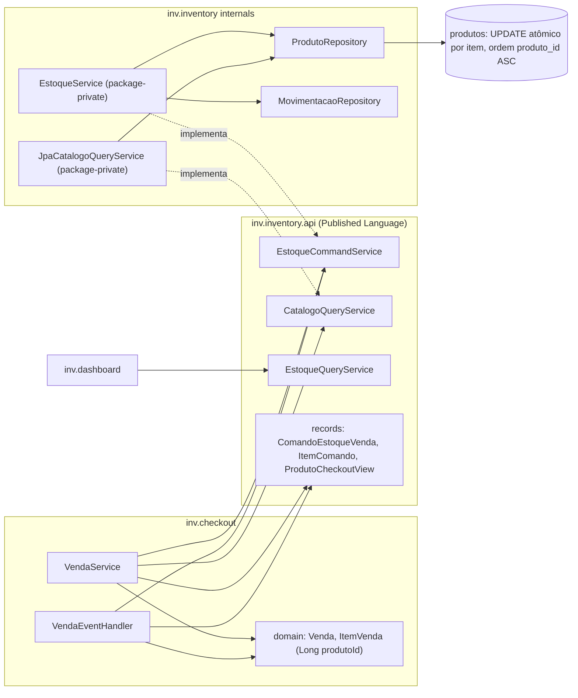

# DEBT-ARCH-002 — Desacoplar `inv.checkout` dos internos de `inv.inventory` (`inv-service`)

> **TL;DR:** o Checkout passa a falar com o Inventory **apenas** por um **Open Host Service síncrono e in-process** em `inv.inventory.api`, separado em **comandos** (`EstoqueCommandService`: reservar, confirmar baixa, estornar) e **consulta de catálogo** (`CatalogoQueryService` → `ProdutoCheckoutView`). Os comandos operam **em lote**, rodam com `Propagation.MANDATORY` na transação do chamador (ADR-0002) e a implementação **ordena os itens por `produtoId` crescente** antes dos `UPDATE ... RETURNING` atômicos, o que elimina o deadlock `40P01` entre carrinhos invertidos. No domínio, `ItemVenda` troca o `@ManyToOne Produto` por `Long produtoId`, sem migration estrutural. Antes, corrige-se o estorno duplicado em `cancelarVendaExpirada` (F2). Ao final, o `freeze(...)` de `inventory` sai de R7/R8 e as regras R13/R14 impedem regressões.

## Roadmap dos 4 PRs

| PR | Etapas | Runbook | Status |
| :---: | :--- | :--- | :--- |
| 1 | E0 rede de segurança, E1 correções bloqueantes (F1 parcial, F2, F7) | [E0-E1.md](./E0-E1.md) | concluído (PR #31) |
| 2 | E2 Published Language `inventory.api` (aditivo), E3 refatoração do Checkout | [E2.md](./E2.md), [E3.md](./E3.md) | concluído (PR #32) |
| 3 | E4 concorrência pesada, anti-deadlock e `@Retryable` (Q8) | [E4.md](./E4.md) | pendente |
| 4 | E5 remoção da catraca, R13/R14, ADRs e V6; E6 backlog Spring Modulith | [E5-E6.md](./E5-E6.md) | pendente |

### Progresso da Execução

- [x] **E0** — Rede de segurança (`CicloVendaEstoqueCharacterizationIT`, `VendaEventHandlerTest`, `VendaEventHandlerIT`)
- [x] **E1** — Correções bloqueantes (guard idempotente `F2`/`Q10` em `cancelarVendaExpirada`, remoção de código morto `F7`/`Q7` e `F1` parcial em `ArquiteturaTest`)
- [x] **E2** — Published Language `inv.inventory.api` (`EstoqueCommandService`, `CatalogoQueryService`, implementação aditiva em lote ordenado)
- [x] **E3** — Refatoração do Checkout (`ItemVenda.produtoId`, `VendaService` e `VendaEventHandler` via `inventory.api`, `EstoqueService` package-private)
- [ ] **E4** — Concorrência pesada, anti-deadlock (`CarrinhosInvertidosDeadlockIT`, `EstoqueMultiItemConcorrenciaIT`, `HandlerExpiracaoMesmaVendaIT`) e `@Retryable` (`Q8`)
- [ ] **E5** — Remoção definitiva da catraca (`archunit_store/`), regras R13/R14, migration V6 de metadados e ADRs
- [ ] **E6** — (Backlog) Spring Modulith


**Princípios transversais:** sem migration estrutural (só a V6 de metadados); rollout fatiado em 4 PRs atômicos; testes de regressão preservados integralmente.

---

## Pilar 1 — Topologia de pacotes e padrão arquitetural

### 1.1 Decisão: Open Host Service de comandos e catálogo em `inv.inventory.api`

| Alternativa | Veredito | Motivo |
|---|---|---|
| Acesso direto, só escondendo o `Produto` (Checkout segue injetando `EstoqueService`, agora com `Long`) | ❌ | Mantém a dependência em `inventory.usecase`; nada impede o retorno de `ProdutoRepository`. Não cria Published Language versionável. |
| Porta de saída do Checkout (`EstoquePort`) implementada **dentro de `inventory`** | ❌ | Inverte a direção: `inventory` passaria a depender de `checkout` (ciclo, quebra R4) e conflita com a ADR-0010 (`*.api` do **provedor** é o contrato). |
| Coreografia por eventos (reserva assíncrona) | ❌ | O PDV perde a resposta síncrona; exige compensação, estado `RESERVA_PENDENTE` e polling. Contraria a ADR-0002. Ver Pilar 3. |
| **OHS em `inv.inventory.api` (lote ordenado) + implementações package-private** | ✅ | Mesmo padrão de `VendaQueryService`/`EstoqueQueryService`. Direção `checkout → inventory.api ← inventory.*`. A semântica TCC (*Try* reservar, *Confirm* baixar, *Cancel* estornar) já está nomeada para extração futura. |

### 1.2 Árvore de pacotes — Antes vs Depois

#### 1.2.1 Antes (estado inicial do débito)

```plaintext
inv/
├── checkout/
│   ├── domain/model/
│   │   ├── ItemVenda  ──@ManyToOne──────────────────► inventory.domain.model.Produto ❌ (F3)
│   │   └── Venda.adicionarItem(Produto, qtd) ───────► Produto.getNome()/getPrecoVenda() ❌ (R8 congelada)
│   ├── usecase/VendaService
│   │   ├── ProdutoRepository.findAllById ───────────► inventory.infrastructure.persistence ❌ (F1: invisível ao R7)
│   │   ├── EstoqueService.{reservar…,confirmar…,estornar…}(Produto, …) ► inventory.usecase ❌ (F4)
│   │   ├── iteração em ordem arbitrária ─────────────► deadlock 40P01 ❌ (F5)
│   │   ├── cancelarVendaExpirada sem guard pós-lock ─► roubo de reserva ❌ (F2 — corrigido na E1)
│   │   └── processarPagamento + registrarOutboxVendaConcluida  (mortos ❌ F7 — removidos na E1)
│   └── infrastructure/messaging/VendaEventHandler ──► EstoqueService(item.getProduto()) ❌
├── inventory/
│   ├── api/{EstoqueQueryService, ResumoEstoque}       (só leitura, para o dashboard)
│   ├── domain/model/{Produto, MovimentacaoEstoque}
│   ├── usecase/EstoqueService                          (public, recebe entidade Produto)
│   └── infrastructure/{persistence/ProdutoRepository, query/JpaEstoqueQueryService}
└── (test) archunit_store/  ◄ R7/R8 inventory em freeze
```

#### 1.2.2 Depois (alvo)

```plaintext
inv/
├── checkout/
│   ├── domain/model/
│   │   ├── Venda.adicionarItem(Long, String, BigDecimal, BigDecimal)
│   │   └── ItemVenda           (Long produtoId — ID por referência; factory ItemVenda.criar)
│   ├── usecase/
│   │   └── VendaService        ──► inventory.api.{CatalogoQueryService, EstoqueCommandService}
│   └── infrastructure/messaging/VendaEventHandler ──► inventory.api.EstoqueCommandService
├── inventory/
│   ├── api/                                    ◄ Open Host Service / Published Language
│   │   ├── EstoqueQueryService, ResumoEstoque  (inalterados — Dashboard)
│   │   ├── EstoqueCommandService               (interface — reservar/confirmarBaixa/estornarReserva)
│   │   ├── ComandoEstoqueVenda, ItemComando    (records imutáveis)
│   │   ├── CatalogoQueryService                (interface)
│   │   └── ProdutoCheckoutView                 (record: id, nome, precoVenda)
│   ├── domain/model/{Produto, MovimentacaoEstoque}    (inalterados)
│   ├── usecase/EstoqueService                  (package-private, implements EstoqueCommandService)
│   └── infrastructure/
│       ├── persistence/ProdutoRepository       (+ buscarViewsCheckout, buscarMetadadosEstoque)
│       ├── persistence/ProdutoMetadadosEstoque (record interno: id, nome, estoqueMinimo)
│       └── query/{JpaEstoqueQueryService, JpaCatalogoQueryService}   (package-private)
└── (test) archunit_store/  ◄ REMOVIDO; R7/R8 sem freeze; R13/R14 novas
```

### 1.3 Fluxo unidirecional de dependências (alvo)



**Invariantes:** nenhuma classe de `inv.checkout` importa `inv.inventory.{domain,usecase,infrastructure}` nem qualquer subpacote futuro de `inventory` fora de `api` (R13, whitelist). Implementações de interfaces `*.api` não são públicas (R14). `inv.inventory` não conhece `inv.checkout` (R4). Entidades e repositórios só têm dependentes no próprio contexto (R7/R8 com `onlyHaveDependentClassesThat`).

### 1.4 Justificativa

- **DDD:**
  - **Open Host Service + Published Language:** o Inventory publica um protocolo estável (`EstoqueCommandService`, `CatalogoQueryService`) com records imutáveis. Os agregados (`Produto`, `Venda`) não atravessam a fronteira.
  - **IDs por referência entre agregados:** `ItemVenda` guarda `produtoId` (`Long`) e um **snapshot** escalar (nome e preço no momento da venda). É o desenho correto: o preço da venda não pode mudar se o catálogo mudar, e o domínio do Checkout não depende de tipos de `inv.inventory` (nem mesmo de `inv.inventory.api`).
- **Clean Architecture:** a regra de dependência aponta para a abstração do provedor (`inventory.api`). O caso de uso `VendaService` orquestra; a política de concorrência (ordem de locks, SQL atômico, alerta, auditoria) é detalhe **interno** do Inventory e deixa de vazar para o Checkout, que hoje precisa "saber" que deve passar a entidade pré-carregada.
- **Visibilidade e ArchUnit:** em Java, `package-private` só vale dentro do mesmo pacote. Por isso os contratos ficam públicos em `inv.inventory.api` (R9: só `interface`/`record`/`enum`, dependendo de `java..`, `common..` e `inv..api..`), e as implementações são package-private: `JpaCatalogoQueryService` em `infrastructure.query` (R10) e `EstoqueService` em `usecase` (nova R14). O Spring instancia e cria proxies CGLIB de classes package-private sem problema (o proxy é gerado no mesmo pacote; os métodos `@Transactional` são públicos por implementarem a interface).

---

## Pilar 3 — Consistência, concorrência e trade-offs

| Dimensão | **Opção A:** Coreografia assíncrona por eventos (reserva/baixa eventual) | **Opção B:** Síncrona via `inventory.api`, `Produto` oculto, chamadas **item a item** | **Opção C (recomendada):** Síncrona via `inventory.api`, **lote ordenado por `produtoId`** + SQL atômico (ADR-0002) |
|---|---|---|---|
| Latência do PDV (p95 estimado) | Resposta inicial rápida (~5 ms), mas o "reservado" só chega depois (100 ms a segundos), exigindo polling/long-polling (ADR-0003) | ~igual ao atual: 1 `SELECT` + N×(`UPDATE` + `INSERT`) | Atual **+1 `SELECT` indexado** de metadados (~sub-ms). O tempo de lock por linha não muda. |
| Zero overselling | Só com compensação: a venda pode ser aberta e depois rejeitada | ✅ (`UPDATE ... WHERE disponivel >= qtd`) | ✅ idem, inalterado |
| Deadlock em carrinho multi-item | Não se aplica (1 consumidor por vez), mas surge reordenação de mensagens | ❌ **Possível**: `[A, B]` vs `[B, A]` → ciclo de espera → `40P01` | ✅ **Impossível entre carrinhos**: ordem global de locks (`produtoId ASC`), sem ciclo no grafo de espera. |
| Integridade ACID | Perdida entre venda e estoque; exige Saga, estado intermediário e idempotência por mensagem | ✅ por operação (`MANDATORY`) | ✅ por operação (`MANDATORY`); o modelo reserva → baixa/estorno dá consistência entre operações |
| UX de erro | Assíncrona ("sua venda foi cancelada por falta de estoque") | Síncrona; "primeiro faltante" na ordem do request | Síncrona; "primeiro faltante" na ordem de `produtoId` (mesma mensagem, Q9) |
| Complexidade / risco | Alto: eventos novos, outbox, compensações, novos estados de `Venda` | Baixo | Baixo (+1 `sort` e 1 query de metadados) |
| Acoplamento | Mínimo (só eventos) | Contrato público, mas o protocolo "conversa demais" (N chamadas) | Contrato público com granularidade de **intenção de negócio** (1 chamada por fase) |
| Extração futura para microsserviço | Pronta | N RPCs por venda (latência × N) | **1 RPC por fase** (TCC: Try/Confirm/Cancel). Exigirá idempotência por `(vendaId, fase)` e TTL de reserva (o `VendaExpiracaoJob` já faz o papel de *timeout → Cancel*). |

**Prevenção de deadlocks: por que a ordenação determinística por `produtoId` elimina o ciclo `40P01`.** Um deadlock no PostgreSQL exige um **ciclo** no grafo de espera (*Wait-For Graph*). Com todos os escritores de `produtos` (`reservar`, `confirmarBaixa`, `estornarReserva`) adquirindo row locks (`FOR NO KEY UPDATE`) em ordem estritamente crescente de `produtoId`, uma transação $T_1$ que espera pelo lock de `id = k` só pode deter locks em linhas com `id < k`. Logo, nenhuma transação $T_2$ que detenha `id = k` pode estar bloqueada esperando por um lock $< k$ detido por $T_1$, tornando o ciclo matematicamente impossível entre comandos de estoque. O uso de `UPDATE ... FROM (VALUES ...)` foi descartado (Q3) porque o planejador do PostgreSQL não garante a ordem em que visita as tuplas durante um join. Já os `INSERT`s com FK (`itens_venda`, `movimentacoes_estoque`) adquirem apenas `FOR KEY SHARE` na linha pai de `produtos`, que é compatível com `FOR NO KEY UPDATE` (pois nenhuma coluna referenciada pela PK de `produtos` é alterada nos `UPDATE`s de saldo), portanto não introduzem arestas de bloqueio.

**Concorrência entre `VendaEventHandler` e `cancelarVendaExpirada` na mesma venda:** se a confirmação de pagamento e o job de expiração dispararem simultaneamente para o mesmo `vendaId`, ambos adquirem os row locks de `produtos` na **mesma ordem crescente** (`produtoId ASC`) dentro de `EstoqueService`, evitando deadlock nas linhas de estoque. Além disso, `Venda` possui `@Version` (lock otimista) e `cancelarVendaExpirada` adquire `PESSIMISTIC_WRITE` (`SELECT ... FOR UPDATE`) em `vendas`:
- Se `cancelarVendaExpirada` vencer a corrida e commitar primeiro, o flush final do `VendaEventHandler` falha com `OptimisticLockingFailureException` (ou `Venda.registrarPagamentoConfirmado` rejeita a venda `CANCELADA` com `BusinessException`), revertendo integralmente a baixa de estoque na mesma transação local (`Propagation.MANDATORY`).
- Se o `VendaEventHandler` vencer e commitar `CONCLUIDA` primeiro, `cancelarVendaExpirada` (desbloqueado no `findByIdWithLock`) lê o estado `CONCLUIDA` e é barrado imediatamente pelo novo guard pós-lock (`F2`/`Q10`), sem tocar no estoque.

**Integridade transacional:** reserva, baixa e estorno continuam **dentro** da transação do chamador (`Propagation.MANDATORY`). Se qualquer item falhar (ex.: 2º item sem saldo), a `BusinessException` faz rollback de toda a transação local, revertendo os `UPDATE`s dos itens anteriores, os `INSERT`s de `vendas`/`itens_venda` e as movimentações. O teste `EstoqueMultiItemConcorrenciaIT` (E4) valida que nenhum item anterior permanece reservado quando um item subsequente falha.

**Janela de deploy (rolling update):** enquanto pods antigos (sem ordenação) e novos (com ordenação) coexistirem brevemente durante o rollout da E3, ainda seria teoricamente possível um deadlock entre um pod antigo e um novo. Mitigação: deploy da E3/E4 fora do horário de pico e `@Retryable` incluindo `PessimisticLockingFailureException` (Q8) para absorver de forma transparente qualquer `40P01` residual.

**Gatilhos objetivos para reavaliar a Opção A (Coreografia/Saga):** extração física do `inv.inventory` para outro microsserviço/banco de dados, múltiplos canais independentes (ex.: e-commerce de alto volume + PDV físico) disputando o mesmo saldo com SLAs distintos, ou latência p95 de `iniciarVenda` superior a 300 ms por contenção de lock.

---

## Decisões (Q1–Q10)

### Q1 — Integração síncrona via Open Host Service
**Decisão:** chamada síncrona in-process via OHS em `inv.inventory.api`, com `Propagation.MANDATORY` na implementação.
**Por quê:** o ACID vale por operação: a reserva (`iniciarVenda`) e a baixa (`VendaEventHandler`, via webhook → evento → RabbitMQ) são transações distintas, ligadas pelo modelo reserva → baixa/estorno.
**Implementado em:** E2, E3 (concluído — PR #32).

### Q2 — Segregação comando/consulta
**Decisão:** `EstoqueCommandService` (reserva, baixa, estorno) e `CatalogoQueryService` (`ProdutoCheckoutView` com **apenas** `id`, `nome`, `precoVenda`; **sem** filtro de produto inativo). `EstoqueQueryService` (Dashboard) fica intacto.
**Por quê:** simetria com `VendaQueryService`/`EstoqueQueryService` (R9/R10). A implementação de catálogo é package-private em `infrastructure.query`; a de comandos é o próprio `EstoqueService`, package-private (R14).
**Implementado em:** E2 (concluído — PR #32).

### Q3 — Lote ordenado por `produtoId ASC` (anti-deadlock)
**Decisão:** os três comandos são em lote; a implementação ordena internamente por `produtoId` crescente (ordenação estável), independente do chamador, com **um `UPDATE` atômico por item**. É **proibido** `UPDATE ... FROM (VALUES ...)`: o PostgreSQL não garante a ordem de locks num único statement com join.
**Por quê:** ordem global de locks elimina o ciclo de espera (F5). As 3 queries atômicas de `ProdutoRepository` (ADR-0002) ficam inalteradas.
**Implementado em:** E2 (implementado — PR #32), E4 (prova sob barreira).

### Q4 — `ItemVenda.produtoId` escalar, FKs físicas mantidas
**Decisão:** `ItemVenda.produto` (`@ManyToOne Produto`) vira `Long produtoId`; `Venda.adicionarItem` recebe escalares e instancia `ItemVenda` via `ItemVenda.criar(...)`. `fk_itens_venda_produto` e `fk_movimentacoes_venda` **permanecem**, documentadas como *FKs de fronteira modular*.
**Por quê:** a coluna `produto_id` e as FKs já existem desde a V1 (também `fk_lancamento_venda`, Finance → Checkout), e as V2–V5 não tocam `itens_venda`: **nenhuma migration estrutural**. A V6 é só `COMMENT ON CONSTRAINT`. `MovimentacaoEstoque` já usa `Long vendaId`, então não surge ciclo em Java.
**Implementado em:** E3 (Java — PR #32), E5 (V6).

### Q5 — Fronteira com o DEBT-ARCH-003
**Decisão:** fora de escopo a devolução/cancelamento de venda já `CONCLUIDA` (`solicitarCancelamento`/`efetivarCancelamento`). Dentro: `cancelarVendaExpirada` (estorno disparado pelo `VendaExpiracaoJob`).
**Por quê:** `Venda.cancelar()` não muda; o guard da Q10 rejeita `CONCLUIDA` e `CANCELAMENTO_SOLICITADO` na expiração, sem implementar devolução.
**Implementado em:** informativo.

### Q6 — ArchUnit sem freeze e store limpo
**Decisão:** descongelar R7/R8, apagar `archunit_store/` e criar a regra "`checkout` só depende de `inventory.api`".
**Por quê:** R7/R8 trocam `onlyBeAccessed()` por `onlyHaveDependentClassesThat()` (fecha a brecha do F1). As 3 violações de R8 somem na E3. Novas R13 (whitelist) e R14. Testes cruzando módulos vão para `inv.it` (F8).
**Implementado em:** E5.

### Q7 — Remoção de código morto
**Decisão:** remover `VendaService.processarPagamento` (sem chamador; o `VendaEventHandler` é o único ponto de baixa), `registrarOutboxVendaConcluida` (sem produtor ativo nem consumidor; `vendas.exchange` não existe em `RabbitMQConfig`) e `VendaConcluidaEvent`.
**Por quê:** antes da exclusão, portar para `VendaEventHandlerTest` os cenários aplicáveis de `VendaServicePagamentoTest`. `VendaService` perde `PagamentoRepository`, `OutboxRepository`, `ObjectMapper` e `ApplicationEventPublisher`.
**Implementado em:** E0 (testes), E1 (remoção).

### Q8 — `@Retryable` com `PessimisticLockingFailureException`
**Decisão:** incluir `PessimisticLockingFailureException` no `@Retryable` de `iniciarVenda`. O `VendaEventHandler` **não** ganha retry de método: o container RabbitMQ (`max-attempts=3`, backoff exponencial) e a DLQ já cobrem.
**Por quê:** a ordenação (Q3) é a mitigação estrutural; o retry é rede de segurança. `@Recover` passa a receber `ConcurrencyFailureException` com a mesma mensagem ao usuário.
**Implementado em:** E4.

### Q9 — Paridade funcional de mensagens de erro
**Decisão:** o erro de indisponibilidade continua reportando só o **primeiro** produto faltante, com a mensagem exata `"Estoque insuficiente para o produto: " + nome`. Sem consolidar itens duplicados e sem validar produto inativo. Única exceção: o guard `CANCELADA` (Q10).
**Por quê:** com a ordenação, "primeiro faltante" passa a ser o primeiro em ordem de `produtoId` (só difere com 2+ faltantes no mesmo carrinho; formato idêntico).
**Implementado em:** E0 (caracterização), E2 e E3 (preservação — PR #32).

### Q10 — Guard de `CANCELADA` em `cancelarVendaExpirada`
**Decisão:** logo após `findByIdWithLock`: `CANCELADA` → log + `return` (idempotente); status fora de `{ABERTA, AGUARDANDO_PAGAMENTO}` → `BusinessException`. `Venda.cancelar()` não muda.
**Por quê:** corrige o bug F2 em commit isolado red-green (commit 1 = teste vermelho; commit 2 = fix). O guard também fecha o caminho `CANCELAMENTO_SOLICITADO`, que hoje estornaria reserva de uma venda já baixada.
**Implementado em:** E1.

---

## Achados da auditoria (F1–F10)

Os 🔴 impedem remover a catraca com segurança ou significam corrupção de estoque independente do refactor. As evidências (arquivo e linha) estão nos runbooks que tratam cada achado.

### F1 — 🔴 Falso positivo em R7/R8
`onlyBeAccessed()` só avalia *acessos* a membros **declarados** na classe-alvo. `ProdutoRepository.findAllById` é herdado de `CrudRepository`, e um campo do tipo do repositório não é um acesso. Resultado: R7/inventory registra **0 violações** com o acoplamento presente; o mesmo vale para R8 (o campo `ItemVenda.produto` não é detectado). "R7 verde" não prova nada. **Solução:** `onlyHaveDependentClassesThat()`, em `checkout`/`finance` na E1 e em `inventory` na E5. **Implementado em:** E1, E5.

### F2 — 🔴 Roubo de reserva / estorno duplicado pós-expiração
Sem guard de status após o lock pessimista, `cancelarVendaExpirada` numa venda já `CANCELADA` (job sobreposto, réplica, reprocessamento) chama o estorno de novo. O `WHERE estoque_reservado >= :qtd` passa se **outra venda** reservou o mesmo produto: a reserva alheia é consumida, o disponível é inflado e uma `CANCELAMENTO_RESERVA` duplicada é gravada. **Solução:** guard idempotente (Q10) em commit isolado, antes de qualquer refactor. **Implementado em:** E1.

### F3 — 🔴 Acoplamento de entidade JPA entre contextos
`ItemVenda` declara `@ManyToOne(fetch = LAZY) Produto produto` e `Venda.adicionarItem(Produto, BigDecimal)` lê `getNome()`/`getPrecoVenda()`: são as 3 violações congeladas em R8. **Solução:** `Long produtoId` + escalares + `ItemVenda.criar(...)` (Q4), mesma coluna física. **Implementado em:** E3 (concluído — PR #32).

### F4 — 🟠 Checkout injeta o caso de uso interno `EstoqueService`
`VendaService` e `VendaEventHandler` dependem de uma classe pública de `inventory.usecase` que recebe a entidade `Produto`. **Solução:** porta pública `EstoqueCommandService` (E2); `EstoqueService` vira package-private e a implementa (E3). **Implementado em:** E2, E3 (concluído — PR #32).

### F5 — 🟠 Risco de deadlock `40P01` em carrinhos multi-item
Reserva, baixa e estorno iteram os itens em ordem arbitrária. Carrinhos `[A, B]` e `[B, A]` simultâneos formam ciclo de espera nos row locks de `produtos`; o PostgreSQL aborta um deles e o operador vê erro 500. **Solução:** ordenação por `produtoId ASC` (Q3), provada na E4 com controle negativo. **Implementado em:** E2 (implementado — PR #32), E4.

### F6 — 🟠 `EstoqueService` depende da entidade `Produto` pré-carregada
Usada para (a) `saldoAnterior` lido **antes** do lock (obsoleto sob concorrência, race no anti-spam), (b) `estoqueMinimo`/`nome` e (c) `mov.setProduto(produto)`. **Solução:** (a) `saldoAnterior = novoSaldo + qtd` do `RETURNING` sob o lock; (b) metadados em lote por projeção interna; (c) `getReferenceById` (0 `SELECT`). **Implementado em:** E2 (concluído — PR #32).

### F7 — 🟠 Código morto em `VendaService` e handler sem testes
`processarPagamento` duplica a baixa do `VendaEventHandler`; `registrarOutboxVendaConcluida` publica numa exchange não declarada. O handler, **único** ponto real de baixa, não tem teste. **Solução:** testes na E0, remoção na E1 (Q7). **Implementado em:** E0-E1.

### F8 — 🟡 Teste de integração cruzando módulos
`EstoqueConcorrenciaIntegrationTest` fica em `inv.inventory` e importa classes de `checkout`; só passa no ArchUnit por causa de `ImportOption.DoNotIncludeTests`. **Solução:** na E4, mover para `inv.it`, preservando integralmente suas asserções de efeito. **Implementado em:** E4.

### F9 — 🟡 Fragilidades no `VendaEventHandler` (informativo)
O `catch (DataIntegrityViolationException)` com `uk_lancamento_referencia` tenta retornar com sucesso depois que a transação foi marcada `rollback-only` (→ `UnexpectedRollbackException` → DLQ); `uk_pagamento_uuid` é inalcançável nesse caminho. **Fora de escopo** (backlog DEBT-ARCH-004): a E0 só **caracteriza** o comportamento atual.

### F10 — ⚪ Devolução de venda concluída (informativo)
Cancelamento/devolução de venda `CONCLUIDA` pertence ao **DEBT-ARCH-003** (Q5).

---

## Rastreabilidade Q/F

| Tag | Tipo | Descrição resumida | Implementado em | Papel |
| :--- | :---: | :--- | :--- | :--- |
| **Q1** | Decisão | Integração síncrona OHS via `inventory.api` com `MANDATORY` | E2, E3 (concluído — PR #32) | Interfaces e services da API; consumo no Checkout |
| **Q2** | Decisão | Segregação `EstoqueCommandService` / `CatalogoQueryService` | E2 (concluído — PR #32) | Contratos da Published Language |
| **Q3** | Decisão | Lote ordenado por `produtoId ASC` (anti-deadlock) | E2 (implementado — PR #32), E4 | Implementado em `EstoqueService` (E2), testado sob barreira (E4) |
| **Q4** | Decisão | `ItemVenda.produtoId` escalar + FKs físicas mantidas | E3 (concluído em Java — PR #32), E5-E6 | Refatoração Java (E3) e migration V6 de comentários (E5) |
| **Q5** | Decisão | Fronteira com `DEBT-ARCH-003` (devolução fora de escopo) | — (informativo) | Limite de escopo |
| **Q6** | Decisão | ArchUnit sem freeze e store limpo | E5-E6 | Fechamento da governança |
| **Q7** | Decisão | Remoção de código morto (`processarPagamento`, outbox) | E0-E1 (concluído — PR #31) | Limpeza no PR 1 |
| **Q8** | Decisão | `@Retryable` com `PessimisticLockingFailureException` | E4 | Resiliência |
| **Q9** | Decisão | Paridade funcional de mensagens de erro | E0-E1 (E0 concluída), E2, E3 (concluído — PR #32) | Caracterizada na E0, preservada na E2/E3 |
| **Q10** | Decisão | Guard de `CANCELADA` em `cancelarVendaExpirada` (red-green) | E0-E1 (concluído — PR #31) | Correção em commit isolado na E1 |
| **F1** | Achado | Falso positivo R7/R8 (`onlyHaveDependentClassesThat`) | E0-E1 (concluído em checkout/finance), E5-E6 | Parcial em checkout/finance (E1), final em inventory (E5) |
| **F2** | Achado | Roubo de reserva / estorno duplo pós-expiração | E0-E1 (concluído — PR #31) | Bug resolvido na E1 via Q10 |
| **F3** | Achado | Acoplamento de entidade JPA (`ItemVenda.produto`) | E3 (concluído — PR #32) | Resolvido na E3 via Q4 |
| **F4** | Achado | Checkout injeta `EstoqueService` (caso de uso interno) | E2, E3 (concluído — PR #32) | Porta na E2, migração do Checkout na E3 |
| **F5** | Achado | Risco de deadlock 40P01 em carrinhos multi-item | E2 (implementado — PR #32), E4 | Ordenação (E2) e prova (E4) |
| **F6** | Achado | `EstoqueService` depende de entidade pré-carregada | E2 (concluído — PR #32) | Pré-imagem `novoSaldo + qtd` e `getReferenceById` |
| **F7** | Achado | Código morto em `VendaService` e handler sem testes | E0-E1 (concluído — PR #31) | Testes na E0, remoção na E1 via Q7 |
| **F8** | Achado | Teste de concorrência cruzando módulos | E4 | Mover `EstoqueConcorrenciaIntegrationTest` para `inv.it` |
| **F9** | Achado | Fragilidades no `VendaEventHandler` | — (informativo) | Backlog DEBT-ARCH-004 |
| **F10** | Achado | Devolução de venda concluída | — (informativo) | Fora de escopo (DEBT-ARCH-003) |

---

## Backlog: débitos de higiene e fragilidades mapeadas (fora do escopo; DEBT-ARCH-004)

Nenhum destes itens corrompe o estoque hoje. Todos ficam **caracterizados** (não corrigidos) pelos testes da E0.

1. **ACK idempotente no handler:** mensagens duplicadas para uma venda `CONCLUIDA` disparam 3 tentativas no container antes da DLQ. O log `"Voltará para a fila"` é impreciso; o certo seria reconhecer (ACK) de forma idempotente.
2. **Evento duplicado no webhook:** `PagamentoService.confirmarPagamentoWebhook` publica `PagamentoConfirmadoEvent` mesmo quando `Pagamento.confirmar` retorna cedo por idempotência.
3. **Rollback silencioso no handler (F9):** o `catch (uk_lancamento_referencia)` tenta retornar com sucesso depois que a transação foi marcada `rollback-only` pelo JPA → `UnexpectedRollbackException` → DLQ.
4. **Constraint inalcançável:** o tratamento de `uk_pagamento_uuid` no handler é código morto, porque a tabela de pagamentos não recebe `INSERT` nesse caminho.
5. **Fragilidade no registro de pagamento:** `Venda.registrarPagamentoConfirmado` não verifica se o pagamento já está atrelado à venda e confia exclusivamente no `INSERT` síncrono, com ID identity, do ledger.

---

## DoD global (Definição de Pronto, fonte única)

- [ ] Regras ArchUnit R7 e R8 sem `freeze`, com semântica `onlyHaveDependentClassesThat()`, e `archunit_store/` removido (0 entradas de `inventory`).
- [ ] Nova regra R13 (`checkoutNaoDeveDependerDeInventoryInterno`) garantindo que `checkout` dependa de Inventory **exclusivamente** via `inv.inventory.api`; R14 garantindo implementações não públicas.
- [ ] `CarrinhosInvertidosDeadlockIT` (`[A, B]` vs `[B, A]` simultâneos) sem deadlock, com controle negativo comprovando a sensibilidade do teste.
- [x] Testes de reserva, baixa e estorno com 100% de aprovação e **paridade de mensagens** (inclusive a nuance de ordem por `produtoId`, documentada).
- [x] `VendaEventHandlerTest` criado **antes** da migração (E0), acompanhado de `VendaEventHandlerIT` validando a fronteira de `@Transactional`.
- [x] Teste do guard de venda `CANCELADA`: vermelho antes do fix e verde depois (commits isolados na E1).
- [ ] `EstoqueConcorrenciaIntegrationTest` (50 threads / 5 unidades) verde em todas as etapas, preservando a integridade das asserções de efeito.
- [ ] `fk_itens_venda_produto`, `fk_movimentacoes_venda` (e `fk_lancamento_venda`) documentadas no schema (V6, só metadados) e na ADR-0001 como FKs de fronteira modular.
- [ ] ADR-0002 com adendo (ordem de locks, hierarquia `vendas → produtos`, pré-imagem do anti-spam) e ADR-0011 criada.
- [ ] Validação e suíte completa executadas com sucesso em Java 21 LTS com Docker ativo.
