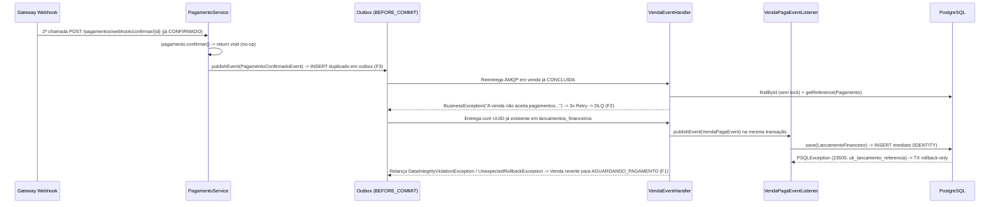

# DEBT-ARCH-003 — Runbook PR 1 (Parte 1): E0 (Rede de Segurança e Testes de Caracterização)

> Runbook executável e autocontido para a Parte 1 do PR 1. Contexto arquitetural, topologia e decisões globais: [README.md](./README.md). Continuação direta no mesmo PR: [E1.md](./E1.md).

## Status de Execução

- [x] **E0 — Caracterização determinística do pipeline de pagamento:** concluída (`2dc9eac`, `017ec4b`). Congelamento monothread do comportamento atual de webhook duplicado (`PagamentoServiceTest`), reentrega AMQP em venda `CONCLUIDA` (`VendaEventHandlerTest`) e colisão de chave única em `uk_lancamento_referencia` (`VendaEventHandlerIT`), sem alterações em código de produção.

---

## 1. Contexto & Invariantes

- **Escopo de Isolamento e Pré-condições (`Q1`):**
  - **Contexto:** Esta etapa inaugura o PR 1 no módulo `apps/inv-service` (Java 21 LTS, Spring Boot 3.4, PostgreSQL 15 e RabbitMQ via Testcontainers, Flyway `V1`–`V6` aplicadas) partindo do estado consolidado pelo `DEBT-ARCH-002` (catraca `archunit_store/` removida, `ArquiteturaTest` `R1`–`R14` e `ModulithTest` ativos).
  - **Invariante de Escopo:** A `E0` não modifica nenhuma classe de produção nem introduz migrations SQL. Seu papel é construir uma rede de segurança determinística e monothread que documenta e prova os modos de falha atuais (`F1`, `F2`, `F3`, `F4`, `F5`) antes que a [E1.md](./E1.md) aplique as correções de produção e inverta as asserções correspondentes.

- **F1 (Bloqueante) / Q1 — Colisão em `uk_lancamento_referencia` e corrupção da transação compartilhada no handler:**
  - **Problema:** [`VendaPagaEventListener.onVendaPaga`](../../../apps/inv-service/src/main/java/inv/finance/infrastructure/messaging/VendaPagaEventListener.java) é um `@EventListener` síncrono que executa `lancamentoRepository.save(lancamento)` dentro da mesma transação física de [`VendaEventHandler.handlePagamentoConfirmado`](../../../apps/inv-service/src/main/java/inv/checkout/infrastructure/messaging/VendaEventHandler.java). Como [`LancamentoFinanceiro`](../../../apps/inv-service/src/main/java/inv/finance/domain/model/LancamentoFinanceiro.java) utiliza `GenerationType.IDENTITY`, o Hibernate dispara o `INSERT` imediatamente no banco. Quando a `referencia` (`UUID`) já existe em `lancamentos_financeiros`, o PostgreSQL rejeita a instrução por violação de `uk_lancamento_referencia` ([`V1__Schema_Inicial.sql`](../../../apps/inv-service/src/main/resources/db/migration/V1__Schema_Inicial.sql)) e marca a transação física como `rollback-only`.
  - **Mecanismo da Falha:** No bloco `catch (DataIntegrityViolationException e)` de `VendaEventHandler`, a chamada `NestedExceptionUtils.getRootCause(e)` atravessa `org.hibernate.exception.ConstraintViolationException` e retorna a folha `org.postgresql.util.PSQLException`, que não é instância de `ConstraintViolationException`. Como consequência, o handler relança `DataIntegrityViolationException` (ou, se o ramo `return` fosse atingido, o interceptor transacional do Spring lançaria `UnexpectedRollbackException`), revertendo integralmente a conclusão da venda e a baixa de estoque e enviando a mensagem para retries e DLQ.
  - **Impacto na E0:** Deve ser caracterizado por um teste de integração determinístico em [`VendaEventHandlerIT.java`](../../../apps/inv-service/src/test/java/inv/it/VendaEventHandlerIT.java) que pré-insere um lançamento com o mesmo `UUID` via JDBC antes de invocar `handlePagamentoConfirmado`, provando o aborto transacional e a permanência da venda em `AGUARDANDO_PAGAMENTO`.

- **F2 (Alta) / Q1 — Ausência de lock pessimista e falha em reentrega AMQP para venda `CONCLUIDA`:**
  - **Problema:** `VendaEventHandler.handlePagamentoConfirmado` carrega a venda via `vendaRepository.findById` (sem `PESSIMISTIC_WRITE`) e obtém um proxy raso via `entityManager.getReference(Pagamento.class, event.pagamentoId())`, sem verificar se o pagamento já foi contabilizado.
  - **Impacto na E0:** Qualquer reentrega AMQP de `PagamentoConfirmadoEvent` após a venda ter atingido `StatusVenda.CONCLUIDA` invoca `venda.registrarPagamentoConfirmado`, que lança `BusinessException("A venda não aceita pagamentos no status: CONCLUIDA")`. O container RabbitMQ executa 3 tentativas antes de descartar a mensagem na fila `pdv.venda.pagamento.confirmado.queue.dlq`. Esse comportamento deve permanecer congelado em [`VendaEventHandlerTest.java`](../../../apps/inv-service/src/test/java/inv/checkout/infrastructure/messaging/VendaEventHandlerTest.java) (`vendaJaConcluidaDeveLancarExcecaoSemTocarNoEstoque`).

- **F3 (Alta) / Q1 — Publicação redundante de `PagamentoConfirmadoEvent` em chamadas repetidas ao webhook:**
  - **Problema:** Em [`Pagamento.java`](../../../apps/inv-service/src/main/java/inv/checkout/domain/model/Pagamento.java), o método `confirmar(BigDecimal, String)` é `void` e faz `return` silencioso quando `this.status == StatusPagamento.CONFIRMADO`. Porém, [`PagamentoService.confirmarPagamentoWebhook`](../../../apps/inv-service/src/main/java/inv/checkout/usecase/PagamentoService.java) executa `pagamentoRepository.save(pagamento)` e `eventPublisher.publishEvent(new PagamentoConfirmadoEvent(...))` incondicionalmente após a chamada.
  - **Impacto na E0:** Cada retry de webhook do gateway para um pagamento já `CONFIRMADO` grava uma nova linha duplicada na tabela `outbox` via [`PagamentoListener`](../../../apps/inv-service/src/main/java/inv/checkout/infrastructure/messaging/PagamentoListener.java) (`TransactionPhase.BEFORE_COMMIT`), amplificando tráfego duplicado para o broker RabbitMQ. Deve ser caracterizado em `PagamentoServiceTest`.

- **F4 (Alta) & F5 (Média) / Q1 — Hidratação `@OneToMany` sem deduplicação e catches inalcançáveis:**
  - **Problema:** Como `Pagamento` já nasce com `venda_id` em `criarIntencaoPagamento`, o Hibernate já o inclui em `venda.getPagamentos()` na primeira entrega, e `Venda.registrarPagamentoConfirmado` soma `valorPago` sem flag de contabilização prévia (`F4`). Além disso, `VendaEventHandler` captura `"uk_pagamento_uuid"`, que é código morto pois o handler nunca insere em `pagamentos` (`F5`).



---

## 2. Referência de Contratos (Published Language & DDL)

> [!NOTE]
> **Etapa de Caracterização Pura:**
> A `E0` não cria nem altera DDLs ou interfaces públicas. Os contratos e constraints abaixo compõem a fronteira existente exercitada pelos testes de caracterização.

### Constraint Física de Unicidade sob Teste (`V1__Schema_Inicial.sql`)
```sql
-- Constraint existente em lancamentos_financeiros que dispara o rollback-only caracterizado em F1:
CONSTRAINT uk_lancamento_referencia UNIQUE (referencia)
```

### Contratos e Eventos Existentes Exercitados (`inv.inventory.api` / `inv.shared.event`)
```java
// inv.inventory.api.EstoqueCommandService (OHS consolidado no DEBT-ARCH-002)
public interface EstoqueCommandService {
    void reservar(ComandoEstoqueVenda comando);
    void confirmarBaixa(ComandoEstoqueVenda comando);
    void estornarReserva(ComandoEstoqueVenda comando);
}

// inv.shared.event.VendaPagaEvent (evento síncrono entre Checkout e Finance)
public record VendaPagaEvent(
        Long vendaId,
        UUID uuidReferencia,
        BigDecimal valorRecebido
) {}
```

---

## 3. Passos de Implementação & Critérios de Teste

### Roteiro de Implementação

1. **Passo 1 — Criação da suíte unitária `PagamentoServiceTest` (`inv.checkout.usecase`):**
   - Criar `apps/inv-service/src/test/java/inv/checkout/usecase/PagamentoServiceTest.java` utilizando `@ExtendWith(MockitoExtension.class)`.
   - Cobrir a máquina de estados atual de `Pagamento.confirmar` para métodos que exigem processamento prévio (`CARTAO_CREDITO`, `CARTAO_DEBITO`, `PIX` exigindo `PROCESSANDO` ou `PENDENTE` conforme configuração do enum `MetodoPagamento`) e o comportamento de chamadas repetidas a `confirmarPagamentoWebhook`.
2. **Passo 2 — Verificação e consolidação da caracterização em `VendaEventHandlerTest` (`inv.checkout.infrastructure.messaging`):**
   - Inspecionar [`VendaEventHandlerTest.java`](../../../apps/inv-service/src/test/java/inv/checkout/infrastructure/messaging/VendaEventHandlerTest.java) garantindo que o cenário `vendaJaConcluidaDeveLancarExcecaoSemTocarNoEstoque` esteja presente e validando a falha atual em reentregas AMQP (`F2`) sem interagir com `EstoqueCommandService`.
3. **Passo 3 — Adição do cenário de colisão `uk_lancamento_referencia` em `VendaEventHandlerIT` (`inv.it`):**
   - Em [`VendaEventHandlerIT.java`](../../../apps/inv-service/src/test/java/inv/it/VendaEventHandlerIT.java), adicionar o teste de integração monothread determinístico que abre uma venda, cria e confirma uma intenção de pagamento com `uuidRef`, insere previamente uma linha em `lancamentos_financeiros` com a mesma `referencia = uuidRef` via `JdbcTemplate` e invoca `vendaEventHandler.handlePagamentoConfirmado(payload)`.
4. **Passo 4 — Validação cruzada da rede de segurança:**
   - Executar os testes unitários e de integração da `E0` junto com `CicloVendaEstoqueCharacterizationIT`, `ArquiteturaTest` e `ModulithTest`, garantindo 100% de aprovação contra o código atual antes de iniciar a `E1`.

### Critérios de Teste (Comportamento Esperado)

- **Cenário 1 — Webhook duplicado em pagamento já `CONFIRMADO` (`F3` em `PagamentoServiceTest`):**
  - *Condição:* Pagamento válido já confirmado na primeira chamada a `confirmarPagamentoWebhook(pagamentoId, valor, nsu)`.
  - *Ação/Gatilho:* Invocar `confirmarPagamentoWebhook(pagamentoId, valor, nsu)` uma segunda vez para o mesmo `pagamentoId`.
  - *Asserção/Resultado Esperado:* No estado atual (pré-`E1`), `pagamentoRepository.save` e `eventPublisher.publishEvent(any(PagamentoConfirmadoEvent.class))` são invocados **2 vezes** (`times(2)`), comprovando a geração de eventos redundantes no Outbox.
- **Cenário 2 — Transições de status em `Pagamento.confirmar` (`PagamentoServiceTest`):**
  - *Condição:* Instâncias de `Pagamento` nos estados `PENDENTE`, `PROCESSANDO`, `FALHOU` e `ESTORNADO` conforme a flag `metodo.isExigeProcessamento()`.
  - *Ação/Gatilho:* Invocar `confirmarPagamentoWebhook` para cada estado, além de um `pagamentoId` inexistente no repositório.
  - *Asserção/Resultado Esperado:* Transições válidas atualizam `status = CONFIRMADO`, `valorRecebido` e `nsuTransacao`; transições a partir de estados incompatíveis ou `pagamentoId` inexistente lançam `BusinessException` sem publicar `PagamentoConfirmadoEvent`.
- **Cenário 3 — Reentrega AMQP para venda já `CONCLUIDA` (`F2` em `VendaEventHandlerTest`):**
  - *Condição:* Venda existente já em `StatusVenda.CONCLUIDA` retornada por `vendaRepository.findById(10L)`.
  - *Ação/Gatilho:* Invocar `handler.handlePagamentoConfirmado(payload)` com o JSON `{"vendaId":10,"pagamentoId":50}`.
  - *Asserção/Resultado Esperado:* Lança `RuntimeException` com causa raiz `BusinessException`, `verifyNoInteractions(estoqueCommandService)` e `verify(vendaRepository, never()).save(any())`.
- **Cenário 4 — Colisão determinística em `uk_lancamento_referencia` na transação do handler (`F1` em `VendaEventHandlerIT`):**
  - *Condição:* Venda aberta em `AGUARDANDO_PAGAMENTO` com produto reservado (`10.000` iniciais, `2.000` reservados), pagamento confirmado com `uuidRef` e linha pré-inserida em `lancamentos_financeiros (venda_id, referencia, tipo, valor)` usando o mesmo `uuidRef`.
  - *Ação/Gatilho:* Invocar `vendaEventHandler.handlePagamentoConfirmado(payload)` para o pagamento da venda.
  - *Asserção/Resultado Esperado:* A chamada falha lançando `DataIntegrityViolationException` ou `UnexpectedRollbackException`; a transação sofre rollback integral, mantendo a venda no banco em `StatusVenda.AGUARDANDO_PAGAMENTO` e preservando o saldo reservado sem registrar movimentação `SAIDA`.

---

## 4. Commits Sugeridos e Definition of Done (DoD)

### Commits Sugeridos

- `test(checkout): caracteriza webhook duplicado e colisao uk_lancamento_referencia (E0)`

### Comandos de Validação

```bash
# 1. Auditoria estrutural instantânea na AST
ast-grep scan

# 2. Testes unitários de caracterização da E0 (Loop Rápido)
mvn test -pl apps/inv-service "-Dtest=PagamentoServiceTest,VendaEventHandlerTest"

# 3. Teste de integração da E0 e caracterização geral (com Docker ativo)
mvn test -pl apps/inv-service "-Dtest=VendaEventHandlerIT,CicloVendaEstoqueCharacterizationIT"

# 4. Validação de fronteiras arquiteturais (ArchUnit e Spring Modulith)
mvn test -pl apps/inv-service -am "-Dtest=ArquiteturaTest,ModulithTest" "-Dsurefire.failIfNoSpecifiedTests=false"
```

### Estratégia de Rollback

- Como a `E0` adiciona exclusivamente testes automatizados sem tocar em código de produção ou schema de banco de dados, o rollback consiste em `git revert` direto do commit de teste.

### Definition of Done (DoD)

- [x] `ast-grep scan` executa com zero violações estruturais.
- [x] `PagamentoServiceTest`, `VendaEventHandlerTest` e `VendaEventHandlerIT` verdes contra o código atual, comprovando deterministicamente os achados `F1`, `F2` e `F3`.
- [x] Zero alterações em classes de produção (`src/main/java`), migrations SQL (`src/main/resources/db/migration`) ou `pom.xml`.
- [x] `ArquiteturaTest` e `ModulithTest` verdes em Java 21 LTS.
- [x] Runbook em conformidade estrita com o Padrão Canônico dos 4 Blocos (zero métodos `@Test` ou classes internas coladas).
