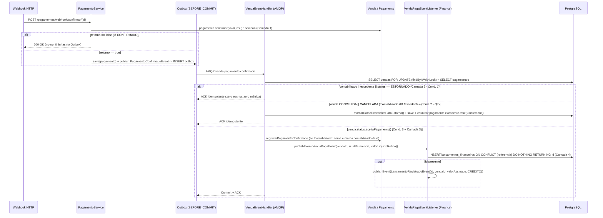

# DEBT-ARCH-003 — Runbook PR 1 (Parte 2): E1 (Saneamento Idempotente do Pipeline de Pagamento)

> Runbook executável e autocontido para a Parte 2 do PR 1. Contexto arquitetural, topologia e decisões globais: [README.md](./README.md). Rede de segurança prévia no mesmo PR: [E0.md](./E0.md).

## Status de Execução

- [x] **E1 — Saneamento idempotente em 5 camadas de defesa:** protocolo de drenagem, migration `V7__pagamento_contabilizado.sql`, reconciliação e deduplicação JPA-safe em `Venda`/`Pagamento` (`F4`, `Q8`); retorno `boolean` em `Pagamento.confirmar` e publicação condicional no webhook (`F3`); remoção de `"uk_pagamento_uuid"` (`F5`); `findByIdWithLock`, `PagamentoRepository.findById`, `MeterRegistry` e tabela pós-lock em `VendaEventHandler` (`F2`, `Q7`); `existsByReferencia` e `inserirIdempotente` (`ON CONFLICT DO NOTHING RETURNING id`) no Finance com gate de `LancamentoRegistradoEvent` e remoção do `catch` de `uk_lancamento_referencia` (`F1`, `F5`).

---

## 1. Contexto & Invariantes

- **F1 (Bloqueante) — Absorção de duplicatas em `uk_lancamento_referencia` sem `rollback-only`:**
  - **Problema:** [`VendaPagaEventListener.onVendaPaga`](../../../apps/inv-service/src/main/java/inv/finance/infrastructure/messaging/VendaPagaEventListener.java) é um `@EventListener` síncrono que executa `lancamentoRepository.save(lancamento)` (`GenerationType.IDENTITY`) na transação de [`VendaEventHandler.handlePagamentoConfirmado`](../../../apps/inv-service/src/main/java/inv/checkout/infrastructure/messaging/VendaEventHandler.java). Duplicatas de `referencia` (`UUID`) violam `uk_lancamento_referencia`, marcam a sessão JPA como `rollback-only` e fazem `NestedExceptionUtils.getRootCause(e)` retornar `PSQLException`, abortando a conclusão da venda com `DataIntegrityViolationException` ou `UnexpectedRollbackException`.
  - **Invariante / Solução:** Descarta-se `Propagation.REQUIRES_NEW` (que desacoplaria o commit do Ledger do commit da venda, violando a `ADR-0005`). [`LancamentoFinanceiroRepository`](../../../apps/inv-service/src/main/java/inv/finance/infrastructure/persistence/LancamentoFinanceiroRepository.java) passa a expor `existsByReferencia(UUID)` e a query nativa `inserirIdempotente` com `INSERT ... ON CONFLICT (referencia) DO NOTHING RETURNING id` (`Optional<Long>`). `VendaPagaEventListener` publica [`LancamentoRegistradoEvent`](../../../apps/inv-service/src/main/java/inv/finance/infrastructure/messaging/LancamentoRegistradoEvent.java) exclusivamente quando o `id` retorna preenchido, eliminando a exceção na origem e permitindo remover o bloco `catch (DataIntegrityViolationException)` de `VendaEventHandler`.

- **F2 (Alta) & Q7 — Lock pessimista (`findByIdWithLock`), tabela pós-lock e pagamento tardio/órfão:**
  - **Problema:** `VendaEventHandler` usa `findById` sem lock e `entityManager.getReference(Pagamento.class, ...)`, lançando `BusinessException` em reentregas AMQP de vendas já `CONCLUIDA` e gerando DLQ falso-positiva.
  - **Invariante / Solução:** Substituir `EntityManager` por `PagamentoRepository` e adicionar `MeterRegistry` (já presente no módulo via `spring-boot-starter-actuator`). Adquirir lock pessimista na venda via [`VendaRepository.findByIdWithLock`](../../../apps/inv-service/src/main/java/inv/checkout/infrastructure/persistence/VendaRepository.java) (`PESSIMISTIC_WRITE`, timeout `3000`, formalizando a hierarquia `vendas -> produtos` registrada na observação A5 da E4 do `DEBT-ARCH-002` e mantendo [`HandlerExpiracaoMesmaVendaIT`](../../../apps/inv-service/src/test/java/inv/it/HandlerExpiracaoMesmaVendaIT.java) verde) e carregar a entidade real com `pagamentoRepository.findById`. Avaliar em ordem estrita:
    0. `pagamento.getVenda().getId()` diferente de `event.vendaId()` -> lançar `BusinessException`;
    1. `pagamento.isContabilizado() || pagamento.isExcedente() || pagamento.getStatus() == StatusPagamento.ESTORNADO` -> `log.info` e retorno `ACK` idempotente (zero escrita, zero métrica);
    2. `venda.getStatus() == CONCLUIDA || venda.getStatus() == CANCELADA` (pagamento inédito tardio/órfão, `Q7`) -> invocar `pagamento.marcarComoExcedenteParaEstorno()`, salvar via `pagamentoRepository.save(pagamento)`, incrementar `meterRegistry.counter("pagamento.excedente.total").increment()`, registrar `log.warn` e retornar `ACK` (`StatusPagamento.ESTORNADO` representa apenas estorno contábil de valores faturados; o reembolso do excedente no gateway é operacional/manual);
    3. `venda.getStatus().aceitaPagamento()` -> calcular `trocoDestePagamento = max(trocoAtual - trocoAnterior, 0)` e `valorLiquidoRetido = max(valorRecebido - trocoDestePagamento, 0)` em volta de `venda.registrarPagamentoConfirmado(pagamento)`; se `venda.estaPaga()`, chamar `venda.concluir()` e `estoqueCommandService.confirmarBaixa(comando)`; salvar a venda e publicar `VendaPagaEvent(vendaId, uuidReferencia, valorLiquidoRetido)` + `VendaAtualizadaEvent`;
    4. Demais estados (`ABERTA`, `CANCELAMENTO_SOLICITADO`) -> lançar `BusinessException`.

- **F3 (Alta) & F5 (Média) — Publicação condicional no webhook e remoção de código morto:**
  - **Invariante / Solução:** Em [`Pagamento.java`](../../../apps/inv-service/src/main/java/inv/checkout/domain/model/Pagamento.java), alterar `confirmar(BigDecimal, String)` para retornar `boolean`: retorna `false` se `status == CONFIRMADO`, lança `BusinessException` se `status` for `FALHOU`, `ESTORNADO` ou incompatível com `metodo.isExigeProcessamento()`, e retorna `true` na transição real para `CONFIRMADO`. [`PagamentoService.confirmarPagamentoWebhook`](../../../apps/inv-service/src/main/java/inv/checkout/usecase/PagamentoService.java) só persiste e publica `PagamentoConfirmadoEvent` quando o retorno for `true`. Remover os tratamentos mortos/inválidos de `"uk_pagamento_uuid"` e `"uk_lancamento_referencia"` em `VendaEventHandler` (`F5`).

- **F4 (Alta) & Q8 (parcial) — Deduplicação JPA-safe com `Pagamento.contabilizado` (`V7`), drenagem e reconciliação:**
  - **Problema:** Em `PagamentoService.criarIntencaoPagamento`, o `Pagamento` já nasce com `venda_id = venda.id`. Ao hidratar `venda.getPagamentos()` (`@OneToMany(mappedBy = "venda")`), o pagamento já pertence à coleção na 1ª entrega AMQP; checar `pagamentos.contains(pagamento)` impediria a primeira contabilização (`valorPago` ficaria em `0.00`, quebrando [`CicloVendaEstoqueCharacterizationIT`](../../../apps/inv-service/src/test/java/inv/it/CicloVendaEstoqueCharacterizationIT.java) cenário 2), e a regra `R1` proíbe `inv.checkout` de consultar `lancamentos_financeiros`.
  - **Invariante / Solução:** A migration *expand-only* `V7__pagamento_contabilizado.sql` adiciona `contabilizado BOOLEAN NOT NULL DEFAULT FALSE` com backfill para pagamentos confirmados e não excedentes de vendas com `valor_pago > 0`. `Pagamento` expõe `isContabilizado()`, `marcarComoContabilizado()`, `equals` baseado em `instanceof Pagamento` + `getUuidReferencia()` e `hashCode()` retornando a constante `Pagamento.class.hashCode()` (seguro para proxies bytecode do Hibernate `Pagamento$HibernateProxy`, onde `getClass()` difere de `Pagamento.class`). `Venda.registrarPagamentoConfirmado` retorna cedo se `pagamento.isContabilizado()` for `true`, soma `valorPago`, atualiza `valorTroco` e invoca `pagamento.marcarComoContabilizado()`.



---

## 2. Referência de Contratos (Published Language & DDL)

### DDL / Migrations e Queries de Governança (`V7__pagamento_contabilizado.sql`)

```sql
-- 1. Pré-checagem de drenagem do Outbox antes de aplicar a V7 (toda linha em outbox é pendente):
SELECT count(*) FROM outbox WHERE event_type LIKE '%Pagamento%'; -- Esperado: 0

-- 2. Migration apps/inv-service/src/main/resources/db/migration/V7__pagamento_contabilizado.sql
ALTER TABLE pagamentos ADD COLUMN IF NOT EXISTS contabilizado BOOLEAN NOT NULL DEFAULT FALSE;

UPDATE pagamentos p
   SET contabilizado = TRUE
  FROM vendas v
 WHERE p.venda_id = v.id
   AND p.status = 'CONFIRMADO'
   AND p.excedente = FALSE
   AND v.valor_pago > 0;

-- 3. Query de reconciliação pós-backfill (Esperado: 0 linhas):
SELECT v.id,
       v.valor_pago,
       COALESCE(SUM(p.valor_recebido), 0) AS total_pagamentos_contabilizados
  FROM vendas v
  LEFT JOIN pagamentos p ON p.venda_id = v.id AND p.contabilizado = TRUE
 WHERE v.valor_pago > 0 OR p.id IS NOT NULL
 GROUP BY v.id, v.valor_pago
HAVING v.valor_pago <> COALESCE(SUM(p.valor_recebido), 0);
```

### Contratos Públicos e Eventos Compartilhados (`*.api` / `inv.shared.event`)

```java
// inv.inventory.api.EstoqueCommandService (invocado sob lock pessimista de Venda na Condição 3)
public interface EstoqueCommandService {
    void reservar(ComandoEstoqueVenda comando);
    void confirmarBaixa(ComandoEstoqueVenda comando);
    void estornarReserva(ComandoEstoqueVenda comando);
}

// inv.shared.event.VendaPagaEvent (transporta valorLiquidoRetido = valorRecebido - trocoDestePagamento)
public record VendaPagaEvent(Long vendaId, UUID uuidReferencia, BigDecimal valorRecebido) {}
```

---

## 3. Passos de Implementação & Critérios de Teste

### Roteiro de Implementação

1. **Passo 1 — Protocolo de drenagem, migration `V7` e reconciliação (`F4`, `Q8`):**
   - Em ambientes compartilhados/produção, bloquear temporariamente `POST /pagamentos/webhook/confirmar/**` no ingress de `inv-service:8083` (em `apps/api-gateway/src/main/resources/application.properties`, a rota `inv-service` expõe apenas `/produtos/**, /vendas/**, /movimentacoes/**, /dashboard/**`), comprovar `count(*) = 0` no Outbox e `0` mensagens em `pdv.venda.pagamento.confirmado.queue` (`.dlq`), aplicar `V7__pagamento_contabilizado.sql` e validar a query de reconciliação (0 linhas divergentes).
2. **Passo 2 — Deduplicação JPA-safe em `Pagamento` e `Venda` (`F4`):**
   - Em [`Pagamento.java`](../../../apps/inv-service/src/main/java/inv/checkout/domain/model/Pagamento.java), adicionar `@Column(nullable = false) private boolean contabilizado = false;`, `marcarComoContabilizado()`, `equals(Object)` por `instanceof Pagamento` + `getUuidReferencia()` e `hashCode()` retornando `Pagamento.class.hashCode()`.
   - Em [`Venda.java`](../../../apps/inv-service/src/main/java/inv/checkout/domain/model/Venda.java), ajustar `registrarPagamentoConfirmado(Pagamento)`: validar `this.status.aceitaPagamento()`, retornar cedo se `pagamento.isContabilizado()` for `true`, adicionar à coleção se ausente, somar `valorPago`, atualizar `valorTroco` e chamar `pagamento.marcarComoContabilizado()`.
3. **Passo 3 — Confirmação booleana e webhook condicional (`F3`):**
   - Alterar `Pagamento.confirmar(BigDecimal, String)` para retornar `boolean` (`false` se já `CONFIRMADO`; `BusinessException` se `FALHOU`, `ESTORNADO` ou status inválido para a modalidade; `true` ao confirmar).
   - Em [`PagamentoService.confirmarPagamentoWebhook`](../../../apps/inv-service/src/main/java/inv/checkout/usecase/PagamentoService.java), executar `pagamentoRepository.save(pagamento)` e `eventPublisher.publishEvent(new PagamentoConfirmadoEvent(...))` somente se `pagamento.confirmar(valor, nsu)` retornar `true`.
4. **Passo 4 — Lock pessimista, tabela pós-lock e limpeza de código morto em `VendaEventHandler` (`F2`, `F5`, `Q7`):**
   - Em [`VendaEventHandler.java`](../../../apps/inv-service/src/main/java/inv/checkout/infrastructure/messaging/VendaEventHandler.java), substituir `EntityManager` por `PagamentoRepository`, injetar `MeterRegistry` (constante `METRICA_PAGAMENTO_EXCEDENTE = "pagamento.excedente.total"`), carregar a venda com `vendaRepository.findByIdWithLock(event.vendaId())` e o pagamento com `pagamentoRepository.findById(event.pagamentoId())`, implementar as Condições 0 a 4 da seção 1 e remover `"uk_pagamento_uuid"`.
5. **Passo 5 — Inserção idempotente no Ledger do Finance e remoção final do `catch` (`F1`, `F5`):**
   - Em [`LancamentoFinanceiroRepository.java`](../../../apps/inv-service/src/main/java/inv/finance/infrastructure/persistence/LancamentoFinanceiroRepository.java), adicionar `boolean existsByReferencia(UUID referencia)` e a `@Query(nativeQuery = true)` `Optional<Long> inserirIdempotente(Long vendaId, UUID referencia, String tipo, BigDecimal valor)` com `INSERT INTO lancamentos_financeiros (venda_id, referencia, tipo, valor) VALUES (:vendaId, :referencia, :tipo, :valor) ON CONFLICT (referencia) DO NOTHING RETURNING id` (sem `@Modifying`).
   - Em [`VendaPagaEventListener.java`](../../../apps/inv-service/src/main/java/inv/finance/infrastructure/messaging/VendaPagaEventListener.java), checar `existsByReferencia`, invocar `inserirIdempotente` com `TipoLancamento.CREDITO.name()` e `event.valorRecebido().abs()`, e publicar `LancamentoRegistradoEvent` apenas quando `idGerado.isPresent()`. Remover integralmente o `catch (DataIntegrityViolationException)` de `VendaEventHandler`.

### Critérios de Teste (Comportamento Esperado)

- **Cenário 1 — Deduplicação sob `@OneToMany` e múltiplos pagamentos (`F4` em `VendaServiceTest` / domínio):**
  - *Condição:* Venda em `AGUARDANDO_PAGAMENTO` cujo `pagamento` já consta em `venda.getPagamentos()`, porém com `contabilizado == false`.
  - *Ação/Gatilho:* Chamar `venda.registrarPagamentoConfirmado(pagamento)` duas vezes seguidas, e depois com um segundo `Pagamento` distinto (`uuidReferencia` diferente, `contabilizado == false`).
  - *Asserção/Resultado Esperado:* A 1ª chamada soma `valorPago`, calcula `valorTroco` e marca `contabilizado = true`; a 2ª chamada com o mesmo pagamento é no-op; o 2º pagamento distinto é somado normalmente; proxies Hibernate mantêm simetria de `equals`/`hashCode`.
- **Cenário 2 — Idempotência de webhook (`F3` em `PagamentoServiceTest`):**
  - *Condição:* Pagamento já em `StatusPagamento.CONFIRMADO`.
  - *Ação/Gatilho:* Invocar `confirmarPagamentoWebhook` pela segunda vez.
  - *Asserção/Resultado Esperado:* `pagamento.confirmar` retorna `false`, `pagamentoRepository.save` e `eventPublisher.publishEvent` **não** são invocados (0 novas linhas no Outbox).
- **Cenário 3 — Tabela pós-lock no handler: reentrega vs pagamento tardio (`F2`, `Q7` em `VendaEventHandlerTest`):**
  - *Condição:* Venda carregada via `findByIdWithLock` em `CONCLUIDA` ou `CANCELADA`.
  - *Ação/Gatilho:* (a) Receber pagamento com `contabilizado == true`, `excedente == true` ou `status == ESTORNADO`; (b) receber pagamento inédito (`!contabilizado && !excedente`) duas vezes seguidas.
  - *Asserção/Resultado Esperado:* Em (a), retorna ACK sem exceção, `verifyNoInteractions(estoqueCommandService, eventPublisher)` e contador `pagamento.excedente.total == 0.0`; em (b), a 1ª entrega marca `excedente = true`, persiste 1x o pagamento e incrementa `pagamento.excedente.total` para `1.0`, enquanto a 2ª entrega cai na Condição 1 mantendo o contador em `1.0`.
- **Cenário 4 — Absorção de colisão em `uk_lancamento_referencia` e concorrência no Ledger (`F1` em `VendaEventHandlerIT`):**
  - *Condição:* (a) Linha pré-inserida em `lancamentos_financeiros` com o mesmo `uuidRef` antes de `handlePagamentoConfirmado`; (b) 2 threads disparadas via `CountDownLatch` invocando `vendaPagaEventListener.onVendaPaga(mesmoEvento)` dentro de `TransactionTemplate`.
  - *Ação/Gatilho:* Executar o handler em (a) e a corrida concorrente em (b).
  - *Asserção/Resultado Esperado:* Zero `DataIntegrityViolationException` ou `UnexpectedRollbackException`; a venda transiciona para `CONCLUIDA`, o estoque é baixado, `lancamentos_financeiros` mantém exatamente 1 linha para a `referencia` e apenas 1 `LancamentoRegistradoEvent` é emitido.

---

## 4. Commits Sugeridos e Definition of Done (DoD)

### Commits Sugeridos

- `feat(checkout): adiciona Pagamento.contabilizado (V7) e deduplicacao JPA-safe em Venda (F4, Q8)`
- `fix(checkout): publica PagamentoConfirmadoEvent apenas em transicao real de status (F3)`
- `refactor(checkout): remove captura inalcancavel de uk_pagamento_uuid no VendaEventHandler (F5)`
- `feat(checkout): ACK idempotente pos-lock e marcacao de pagamento excedente no VendaEventHandler (F2, Q7)`
- `fix(finance): elimina UnexpectedRollbackException via INSERT ON CONFLICT RETURNING id no Ledger (F1, F5)`

### Comandos de Validação

```powershell
# 1. Auditoria estrutural instantânea na AST
ast-grep scan

# 2. Testes unitários focados da E1
$env:JAVA_HOME = "C:\Program Files\Java\corretto-21.0.13"; $env:Path = "$env:JAVA_HOME\bin;$env:Path"; mvn test -pl apps/inv-service "-Dtest=VendaEventHandlerTest,PagamentoServiceTest,VendaServiceTest,VendaServiceCancelamentoTest"

# 3. Testes de integração e concorrência (com Docker ativo)
$env:JAVA_HOME = "C:\Program Files\Java\corretto-21.0.13"; $env:Path = "$env:JAVA_HOME\bin;$env:Path"; mvn test -pl apps/inv-service "-Dtest=VendaEventHandlerIT,CicloVendaEstoqueCharacterizationIT,HandlerExpiracaoMesmaVendaIT"

# 4. Gates de arquitetura (ArchUnit e Spring Modulith)
$env:JAVA_HOME = "C:\Program Files\Java\corretto-21.0.13"; $env:Path = "$env:JAVA_HOME\bin;$env:Path"; mvn test -pl apps/inv-service -am "-Dtest=ArquiteturaTest,ModulithTest"
```

### Rollback e Contingência Operacional

- **Preservação obrigatória de `V7__pagamento_contabilizado.sql`:** caso seja necessário reverter o código Java do PR 1 após a execução do Flyway, **mantenha o arquivo `V7__pagamento_contabilizado.sql` no repositório** para evitar `FlywayValidateException` (`Resolved migration not found`). Como a coluna possui `BOOLEAN NOT NULL DEFAULT FALSE`, ela é transparentemente ignorada por versões anteriores do código Java.

### Definition of Done (DoD)

- [x] `ast-grep scan` executa com zero violações.
- [x] Migration `V7` aplicada e query de reconciliação validada com 0 divergências.
- [x] `PagamentoServiceTest`, `VendaEventHandlerTest`, `VendaEventHandlerIT`, `CicloVendaEstoqueCharacterizationIT` e `HandlerExpiracaoMesmaVendaIT` 100% verdes sem enfraquecer asserções.
- [x] `ArquiteturaTest` e `ModulithTest` verdes em Java 21 LTS com Docker ativo.
- [x] Nenhuma classe ou método interno de produção ou método `@Test` copiado no runbook.
