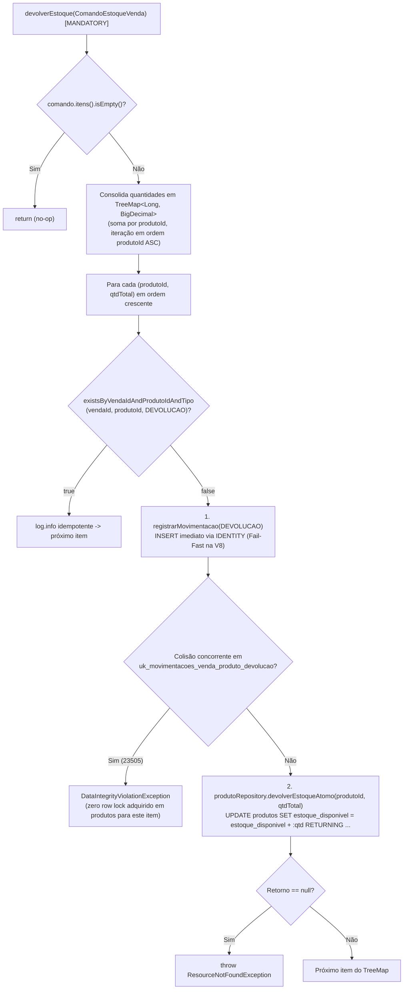

# DEBT-ARCH-003 — Runbook PR 2: E2 (Open Host Service `devolverEstoque` e Índice Único Parcial `V8`)

> Runbook executável e autocontido para o PR 2. Contexto arquitetural, topologia e decisões globais: [README.md](./README.md). Evolução estritamente aditiva no Bounded Context `inv.inventory`; o consumo pelo Checkout ocorre no PR 3 ([E3.md](./E3.md)).

## Status de Execução

- [ ] **E2 — OHS `devolverEstoque` e índice único parcial `V8`:** adição de `TipoMovimentacao.DEVOLUCAO`, migration concorrente `V8__indice_movimentacoes_estoque_devolucao.sql` (+ `.conf`), queries de persistência em `MovimentacaoRepository` e `ProdutoRepository`, contrato público `EstoqueCommandService.devolverEstoque(ComandoEstoqueVenda)` e implementação `package-private` em `EstoqueService` (`TreeMap`, `produtoId ASC`, `Propagation.MANDATORY`, sequência Fail-Fast) (`F7`, `Q3`, `Q4`, `Q5`, `Q8`).

---

## 1. Contexto & Invariantes

- **F7 (Alta) & Q3 — Extensão aditiva do Open Host Service e agregação interna em `TreeMap`:**
  - **Problema:** [`EstoqueCommandService`](../../../apps/inv-service/src/main/java/inv/inventory/api/EstoqueCommandService.java) contempla o ciclo Try-Confirm-Cancel de reservas (`reservar`, `confirmarBaixa`, `estornarReserva`), mas não possui operação para reincorporar ao `estoque_disponivel` mercadoria cuja saída definitiva (`TipoMovimentacao.SAIDA`) já foi consumada.
  - **Invariante / Solução:** Adicionar `devolverEstoque(ComandoEstoqueVenda)` à Published Language `inv.inventory.api.EstoqueCommandService`, mantendo [`EstoqueService`](../../../apps/inv-service/src/main/java/inv/inventory/usecase/EstoqueService.java) com visibilidade `package-private` (regra ArchUnit `R14` / `api-impl-not-public`). Para preservar a paridade funcional da decisão Q9 do [DEBT-ARCH-002](../DEBT-ARCH-002/README.md) (onde itens duplicados `[A:1, A:2]` em `reservar` geram 2 movimentações sem consolidação, validado por [`CicloVendaEstoqueCharacterizationIT`](../../../apps/inv-service/src/test/java/inv/it/CicloVendaEstoqueCharacterizationIT.java) cenário 8), os records [`ComandoEstoqueVenda`](../../../apps/inv-service/src/main/java/inv/inventory/api/ComandoEstoqueVenda.java) e `ItemComando` permanecem intocados. A consolidação de itens com o mesmo `produtoId` é realizada internamente em `EstoqueService.devolverEstoque` utilizando `TreeMap<Long, BigDecimal>` (`merge(item.produtoId(), item.quantidade(), BigDecimal::add)`), garantindo exatamente uma movimentação `DEVOLUCAO` e um `UPDATE` atômico por `(vendaId, produtoId)`.

- **Q4 — Ordenação determinística `produtoId ASC` (`ORDEM_DE_LOCK`) e prevenção de deadlocks `40P01`:**
  - **Invariante / Solução:** Como `TreeMap<Long, BigDecimal>` itera suas entradas na ordem natural crescente da chave `Long produtoId`, a aquisição de locks em `devolverEstoque` obedece à mesma ordem global `produtoId ASC` (`ORDEM_DE_LOCK`) aplicada por `reservar`, `confirmarBaixa` e `estornarReserva` (`ADR-0002`, adendo `DEBT-ARCH-002`). O método exige `@Transactional(propagation = Propagation.MANDATORY)` para participar atomicamente da transação do chamador, eliminando ciclos de espera (`SQLState 40P01`) entre devoluções e reservas/baixas simultâneas.

- **Q5 — Idempotência física via índice único parcial (`V8`) e sequência Fail-Fast:**
  - **Problema:** O comando `UPDATE produtos SET estoque_disponivel = estoque_disponivel + :qtd WHERE id = :id RETURNING estoque_disponivel` não possui pré-condição natural de trava (diferente de `estoque_reservado >= :qtd`), e `EstoqueService` em `inv.inventory` não pode adquirir lock na tabela `vendas` sem violar o isolamento modular (`R4`/`R7`/`R8`/`ModulithTest`).
  - **Invariante / Solução:** A unicidade física é imposta pelo banco em três passos:
    1. A migration `V8__indice_movimentacoes_estoque_devolucao.sql` cria o índice único parcial `uk_movimentacoes_venda_produto_devolucao ON movimentacoes_estoque (venda_id, produto_id) WHERE tipo = 'DEVOLUCAO'` com `CONCURRENTLY`.
    2. Para cada par `(produtoId, quantidadeTotal)` do `TreeMap`, `devolverEstoque` consulta `movimentacaoRepository.existsByVendaIdAndProdutoIdAndTipo(comando.vendaId(), produtoId, TipoMovimentacao.DEVOLUCAO)`. Como [`MovimentacaoEstoque`](../../../apps/inv-service/src/main/java/inv/inventory/domain/model/MovimentacaoEstoque.java) mapeia `vendaId` como escalar (`Long`) e `produto` como `@ManyToOne(fetch = LAZY)`, a query é declarada com `@Query` JPQL explícita sobre `m.produto.id` (sem `JOIN` com `produtos`). Se retornar `true`, registra `log.info` e avança (no-op idempotente para chamadas sequenciais). Sob PgJDBC (`prepareThreshold=5`), o plano `EXPLAIN` é auditado em `force_custom_plan` e `force_generic_plan`; caso o planejador genérico não infira o predicado parcial a partir de `tipo = $3`, utiliza-se o literal constante `TipoMovimentacao.DEVOLUCAO` na query.
    3. **Sequência Fail-Fast:** quando `existsBy...` retorna `false`, `devolverEstoque` **persiste primeiro a `MovimentacaoEstoque`** (`movimentacaoRepository.save(mov)` — `GenerationType.IDENTITY` dispara o `INSERT` imediatamente no PostgreSQL) **antes** de executar `produtoRepository.devolverEstoqueAtomo(produtoId, quantidadeTotal)`. Em chamadas concorrentes duplicadas para o mesmo `(venda_id, produto_id)`, a segunda transação aguarda o desfecho (`XactLockTableWait`) da primeira no índice único de `movimentacoes_estoque` e falha com `SQLState 23505` (`DataIntegrityViolationException`) sem jamais adquirir row lock (`FOR NO KEY UPDATE`) na tabela `produtos`.

- **Q8 (parcial) — Evolução *expand-only* sem DDL de tabela e execução fora de transação:**
  - **Invariante / Solução:** Como `movimentacoes_estoque.tipo` é `VARCHAR(50)` (`@Enumerated(EnumType.STRING)`), a inclusão de `TipoMovimentacao.DEVOLUCAO` em [`TipoMovimentacao.java`](../../../apps/inv-service/src/main/java/inv/inventory/domain/model/TipoMovimentacao.java) não exige alteração de coluna. O índice `V8` usa `CREATE UNIQUE INDEX CONCURRENTLY IF NOT EXISTS` acompanhado do sidecar `V8__indice_movimentacoes_estoque_devolucao.sql.conf` com `executeInTransaction=false` (padrão já homologado em `V5__indices_dashboard.sql.conf`).



---

## 2. Referência de Contratos (Published Language & DDL)

### DDL / Migrations e Governança de Catálogo (`V8`)

```sql
-- 1. apps/inv-service/src/main/resources/db/migration/V8__indice_movimentacoes_estoque_devolucao.sql
-- Requer sidecar V8__indice_movimentacoes_estoque_devolucao.sql.conf com: executeInTransaction=false
CREATE UNIQUE INDEX CONCURRENTLY IF NOT EXISTS uk_movimentacoes_venda_produto_devolucao
    ON movimentacoes_estoque (venda_id, produto_id)
    WHERE tipo = 'DEVOLUCAO';

-- 2. Diagnóstico de saúde pós-criação (indisvalid deve ser TRUE):
SELECT i.relname AS index_name, ix.indisvalid
  FROM pg_class i
  JOIN pg_index ix ON ix.indexrelid = i.oid
 WHERE i.relname = 'uk_movimentacoes_venda_produto_devolucao';

-- 3. Contingência caso CREATE INDEX CONCURRENTLY falhe deixando índice INVALID (indisvalid = false):
DROP INDEX CONCURRENTLY IF EXISTS uk_movimentacoes_venda_produto_devolucao;
```

### Contratos Públicos (`inv.inventory.api`)

```java
package inv.inventory.api;

public interface EstoqueCommandService {

    void reservar(ComandoEstoqueVenda comando);

    void confirmarBaixa(ComandoEstoqueVenda comando);

    void estornarReserva(ComandoEstoqueVenda comando);

    /**
     * Devolução física de venda concluída: exige transação ativa (Propagation.MANDATORY),
     * consolida quantidades repetidas por produtoId em ordem crescente (produtoId ASC)
     * e registra movimentação DEVOLUCAO idempotente por (vendaId, produtoId) antes de
     * recompor o saldo disponível.
     */
    void devolverEstoque(ComandoEstoqueVenda comando);
}
```

---

## 3. Passos de Implementação & Critérios de Teste

### Roteiro de Implementação

1. **Passo 1 — Evolução do enum `TipoMovimentacao` e migration concorrente `V8` (`Q5`, `Q8`):**
   - Adicionar o literal `DEVOLUCAO` ao enum [`TipoMovimentacao.java`](../../../apps/inv-service/src/main/java/inv/inventory/domain/model/TipoMovimentacao.java).
   - Criar `V8__indice_movimentacoes_estoque_devolucao.sql` e o respectivo arquivo `V8__indice_movimentacoes_estoque_devolucao.sql.conf` contendo `executeInTransaction=false` em `apps/inv-service/src/main/resources/db/migration/`.
2. **Passo 2 — Queries de persistência nos repositórios internos de Inventory (`F7`, `Q5`):**
   - Em [`MovimentacaoRepository.java`](../../../apps/inv-service/src/main/java/inv/inventory/infrastructure/persistence/MovimentacaoRepository.java), declarar `boolean existsByVendaIdAndProdutoIdAndTipo(Long vendaId, Long produtoId, TipoMovimentacao tipo)` com `@Query` JPQL explícita filtrando `m.vendaId = :vendaId AND m.produto.id = :produtoId AND m.tipo = :tipo`.
   - Em [`ProdutoRepository.java`](../../../apps/inv-service/src/main/java/inv/inventory/infrastructure/persistence/ProdutoRepository.java), declarar a query nativa `BigDecimal devolverEstoqueAtomo(@Param("id") Long id, @Param("qtd") BigDecimal qtd)` executando `UPDATE produtos SET estoque_disponivel = estoque_disponivel + :qtd WHERE id = :id RETURNING estoque_disponivel`.
3. **Passo 3 — Contrato `EstoqueCommandService.devolverEstoque` e implementação em `EstoqueService` (`F7`, `Q3`, `Q4`, `Q5`):**
   - Adicionar a assinatura `void devolverEstoque(ComandoEstoqueVenda comando)` em [`EstoqueCommandService.java`](../../../apps/inv-service/src/main/java/inv/inventory/api/EstoqueCommandService.java).
   - Implementar `devolverEstoque` em [`EstoqueService.java`](../../../apps/inv-service/src/main/java/inv/inventory/usecase/EstoqueService.java) (mantendo a classe `package-private`) anotado com `@Transactional(propagation = Propagation.MANDATORY)`: retornar imediatamente se `comando.itens().isEmpty()`, agregar itens em `NavigableMap<Long, BigDecimal> consolidado = new TreeMap<>()` com `BigDecimal::add`, verificar `existsByVendaIdAndProdutoIdAndTipo`, registrar a movimentação `DEVOLUCAO` (`"Devolução de venda concluída. Venda #" + comando.vendaId()`) **antes** de `devolverEstoqueAtomo`, e lançar `ResourceNotFoundException` caso o retorno do `UPDATE` seja `null`.
4. **Passo 4 — Suíte de testes unitários e de integração de Inventory:**
   - Estender [`EstoqueServiceLoteTest.java`](../../../apps/inv-service/src/test/java/inv/inventory/usecase/EstoqueServiceLoteTest.java) e [`EstoqueCommandServiceIT.java`](../../../apps/inv-service/src/test/java/inv/inventory/EstoqueCommandServiceIT.java) cobrindo todos os critérios comportamentais abaixo.

### Critérios de Teste (Comportamento Esperado)

- **Cenário 1 — Consolidação de duplicados e ordenação estrita `produtoId ASC` (`Q3`, `Q4` em `EstoqueServiceLoteTest`):**
  - *Condição:* `ComandoEstoqueVenda` com itens fora de ordem e `produtoId` repetido: `[P3: 1.000, P1: 2.000, P2: 1.500, P1: 0.500]`.
  - *Ação/Gatilho:* Executar `estoqueService.devolverEstoque(comando)`.
  - *Asserção/Resultado Esperado:* `P1` é consolidado em `2.500` e as chamadas a `existsByVendaIdAndProdutoIdAndTipo`, `movimentacaoRepository.save` e `produtoRepository.devolverEstoqueAtomo` ocorrem na ordem estrita `(1L, 2.500)`, `(2L, 1.500)`, `(3L, 1.000)` verificada via `InOrder`.
- **Cenário 2 — Precedência Fail-Fast do `INSERT` sobre o `UPDATE` (`Q5` em `EstoqueServiceLoteTest`):**
  - *Condição:* Comando de devolução com 1 ou mais itens inéditos (`existsBy... == false`).
  - *Ação/Gatilho:* Executar `estoqueService.devolverEstoque(comando)`.
  - *Asserção/Resultado Esperado:* Para cada produto, `movimentacaoRepository.save` (com `TipoMovimentacao.DEVOLUCAO`) é invocado **antes** de `produtoRepository.devolverEstoqueAtomo`.
- **Cenário 3 — Idempotência por produto, lista vazia e produto inexistente (`Q5` em `EstoqueServiceLoteTest`):**
  - *Condição:* (a) `existsByVendaIdAndProdutoIdAndTipo` retorna `true` para `P1` e `false` para `P2`; (b) comando com `List.of()`; (c) `devolverEstoqueAtomo` retorna `null`.
  - *Ação/Gatilho:* Executar `devolverEstoque` em cada condição.
  - *Asserção/Resultado Esperado:* Em (a), `P1` é ignorado sem `save` nem `UPDATE` e `P2` é processado normalmente; em (b), retorna sem interagir com repositórios; em (c), lança `ResourceNotFoundException`.
- **Cenário 4 — Obrigatoriedade de transação ativa (`Propagation.MANDATORY` em `EstoqueCommandServiceIT`):**
  - *Condição:* Chamada a `estoqueCommandService.devolverEstoque(comando)` sem transação aberta na thread chamadora.
  - *Ação/Gatilho:* Executar o método diretamente fora de `@Transactional` / `TransactionTemplate`.
  - *Asserção/Resultado Esperado:* Lança `IllegalTransactionStateException`.
- **Cenário 5 — Ciclo completo `reservar -> confirmarBaixa -> devolverEstoque` e idempotência sequencial (`EstoqueCommandServiceIT`):**
  - *Condição:* Produtos `P1` e `P2` com saldo inicial `20.000`, submetidos a reserva e baixa com itens `[P2: 1.000, P1: 2.000, P2: 3.000]`.
  - *Ação/Gatilho:* Invocar `devolverEstoque(comando)` duas vezes consecutivas para a mesma venda.
  - *Asserção/Resultado Esperado:* Na 1ª chamada, `estoque_disponivel` volta a `20.000` em ambos, `estoque_reservado` permanece `0.000` e são gravadas exatamente 2 movimentações `DEVOLUCAO` (`P1: 2.000`, `P2: 4.000`); a 2ª chamada é no-op idempotente mantendo saldos e contagem de movimentações inalterados.
- **Cenário 6 — Validação de catálogo, plano `EXPLAIN` e violação física da `V8` (`EstoqueCommandServiceIT`):**
  - *Condição:* Banco PostgreSQL do Testcontainers com a migration `V8` aplicada.
  - *Ação/Gatilho:* Consultar `pg_index`, rodar `EXPLAIN (FORMAT TEXT)` com `SET LOCAL enable_seqscan = off` sob `force_custom_plan` e `force_generic_plan`, e tentar inserir diretamente uma segunda `MovimentacaoEstoque` com `tipo = DEVOLUCAO` para o mesmo `(vendaId, produtoId)`.
  - *Asserção/Resultado Esperado:* `indisvalid == true` para `uk_movimentacoes_venda_produto_devolucao`; o plano utiliza o índice único parcial; a inserção duplicada direta lança `DataIntegrityViolationException` (`SQLState 23505`).

---

## 4. Commits Sugeridos e Definition of Done (DoD)

### Commits Sugeridos

- `feat(inventory): adiciona TipoMovimentacao.DEVOLUCAO, indice unico parcial V8 e queries de devolucao (F7, Q5, Q8)`
- `feat(inventory): implementa EstoqueCommandService.devolverEstoque com agregacao ordenada e idempotencia (F7, Q3, Q4, Q5)`

### Comandos de Validação

```bash
# 1. Auditoria estrutural instantânea na AST
ast-grep scan

# 2. Testes unitários de Inventory (Loop Rápido)
mvn test -pl apps/inv-service "-Dtest=EstoqueServiceLoteTest,EstoqueServiceTest"

# 3. Testes de integração do OHS e caracterização (com Docker ativo)
mvn test -pl apps/inv-service "-Dtest=EstoqueCommandServiceIT,CicloVendaEstoqueCharacterizationIT"

# 4. Gates de arquitetura (ArchUnit R1-R14 e Spring Modulith)
mvn test -pl apps/inv-service -am "-Dtest=ArquiteturaTest,ModulithTest" "-Dsurefire.failIfNoSpecifiedTests=false"
```

### Rollback e Contingência Operacional

- **Preservação do histórico do Flyway (`V8`):** em caso de rollback do código Java do PR 2, **mantenha `V8__indice_movimentacoes_estoque_devolucao.sql` e `.conf` no repositório** para evitar `FlywayValidateException`. O índice parcial `WHERE tipo = 'DEVOLUCAO'` tem impacto zero sobre `RESERVA`, `SAIDA`, `CANCELAMENTO_RESERVA` e `ENTRADA`.
- **Contingência para índice `INVALID`:** se a criação concorrente falhar por queda de conexão (`indisvalid = false`), executar `DROP INDEX CONCURRENTLY IF EXISTS uk_movimentacoes_venda_produto_devolucao;` antes de reaplicar.

### Definition of Done (DoD)

- [ ] `ast-grep scan` executa com zero violações.
- [ ] `TipoMovimentacao.DEVOLUCAO`, migration `V8` + `.conf` (`indisvalid = true`) e `EstoqueCommandService.devolverEstoque` (`package-private` em `EstoqueService`, `MANDATORY`, `TreeMap`, Fail-Fast) implementados sem modificar `ComandoEstoqueVenda` ou `ItemComando`.
- [ ] `EstoqueServiceLoteTest`, `EstoqueCommandServiceIT`, `ArquiteturaTest` e `ModulithTest` verdes em Java 21 LTS com Docker ativo.
- [ ] Nenhuma classe interna ou método `@Test` colado no runbook.
