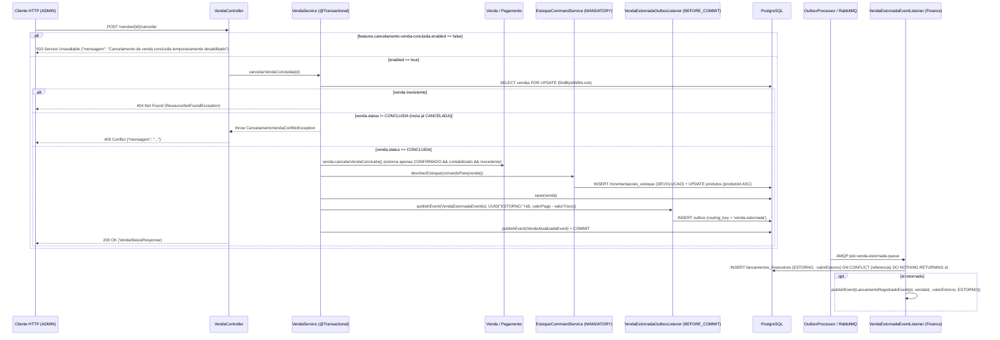

# DEBT-ARCH-003 — Runbook PR 3: E3 (Cancelamento em Fase Única `CONCLUIDA -> CANCELADA`, Outbox e Estorno Contábil)

> Runbook executável e autocontido para o PR 3. Contexto arquitetural, topologia e decisões globais: [README.md](./README.md). Consome o pipeline idempotente do PR 1 ([E0.md](./E0.md), [E1.md](./E1.md)) e o contrato OHS `devolverEstoque` do PR 2 ([E2.md](./E2.md)).

## Status de Execução

- [x] **E3 — Cancelamento em fase única `CONCLUIDA -> CANCELADA`, Outbox e estorno contábil:** evolução de domínio (`Pagamento.estornar()`, `Venda.cancelarVendaConcluida()`, guard `podeSerCancelada()` em `Venda.cancelar()`) (`F6`, `Q2`); evento compartilhado `VendaEstornadaEvent`, fila `pdv.venda.estornada.queue` (+ `.dlq`) em `RabbitMQConfig` e `VendaEstornadaOutboxListener` (`BEFORE_COMMIT`) (`Q2`, `Q6`); `VendaService.cancelarVendaConcluida(Long)`, endpoint `POST /vendas/{id}/cancelar` (HTTP 409/503/404) e feature flag (`F6`, `Q2`, `Q6`); consumidor `VendaEstornadaEventListener` no Finance e `CancelamentoVendaConcluidaIT` (`F1`, `F6`, `Q2`, `Q6`).

---

## 1. Contexto & Invariantes

- **F6 (Alta) & Q2 — Cancelamento atômico em fase única (`CONCLUIDA -> CANCELADA`) e proteção de `Venda.cancelar()`:**
  - **Problema:** [`Venda.cancelar()`](../../../apps/inv-service/src/main/java/inv/checkout/domain/model/Venda.java) rejeita `StatusVenda.CONCLUIDA` e sobrescreve `this.status = StatusVenda.CANCELADA` sem consultar [`StatusVenda.podeSerCancelada()`](../../../apps/inv-service/src/main/java/inv/checkout/domain/model/StatusVenda.java), permitindo cancelamento repetido sobre estados terminais no domínio e impedindo a reversão de vendas faturadas.
  - **Invariante / Solução:** Endurecer `Venda.cancelar()` com `if (!this.status.podeSerCancelada())` (rejeitando `CONCLUIDA`, `CANCELADA` e `CANCELAMENTO_SOLICITADO` no domínio sem afetar chamadores legítimos como `cancelarVendaExpirada`, que possui guard idempotente pós-lock) e criar `Venda.cancelarVendaConcluida()`. A transição ocorre em **fase única atômica** (`CONCLUIDA -> CANCELADA`) na transação do Checkout: o literal `StatusVenda.CANCELAMENTO_SOLICITADO` permanece no enum exclusivamente para não quebrar `StatusVenda.FATURADAS` em [`JdbcVendaQueryService.java`](../../../apps/inv-service/src/main/java/inv/checkout/infrastructure/query/JdbcVendaQueryService.java) nem o predicado do índice parcial `idx_vendas_concluidas` ([`V5__indices_dashboard.sql`](../../../apps/inv-service/src/main/resources/db/migration/V5__indices_dashboard.sql)).

- **Q2 — Isolamento de pagamentos em trânsito e simetria contábil de `valorEstorno`:**
  - **Isolamento de Pagamentos:** `Venda.cancelarVendaConcluida()` invoca `pagamento.estornar()` (`StatusPagamento.ESTORNADO`) **estritamente** nos pagamentos com `status == StatusPagamento.CONFIRMADO && isContabilizado() && !isExcedente()`. Pagamentos em trânsito (`contabilizado == false`) não são tocados; quando sua mensagem AMQP chegar ao `VendaEventHandler`, a Condição 2 (PR 1 / `Q7`) encontrará a venda em `StatusVenda.CANCELADA` e os marcará deterministicamente como `excedente = true` com incremento de `pagamento.excedente.total`.
  - **Fórmula Exata e Projeções CQRS:** Como o Finance creditou na conclusão da venda o valor líquido retido (`valorPago - valorTroco`), o estorno contábil reverte exatamente `valorEstorno = venda.getValorPago().subtract(coalesce(venda.getValorTroco(), ZERO))`. `VendaEstornadaEventListener` persiste `TipoLancamento.ESTORNO` com valor assinado negativo (`-valorEstorno.abs()`), que tanto [`FinancialProjectionListener.java`](../../../apps/inv-service/src/main/java/inv/finance/infrastructure/messaging/FinancialProjectionListener.java) quanto [`ProjecaoReceitaDiariaRepository.java`](../../../apps/inv-service/src/main/java/inv/finance/infrastructure/persistence/ProjecaoReceitaDiariaRepository.java) (`GREATEST(-lf.valor, 0)`) já processam nativamente, zerando `financial_projection_venda.saldo` e somando em `financial_projection_diaria.total_debitos` na data do estorno (regime de caixa).

- **Q6 — Chave determinística de estorno e desacoplamento via Outbox/AMQP (`R1`/`R2`):**
  - **Invariante / Solução:** Para respeitar `ArquiteturaTest` (`R1`/`R2`) e `ModulithTest` (`checkout` depende apenas de `inventory::api` e `shared`), a integração com o Finance ocorre via `inv.shared.event.VendaEstornadaEvent`, gravado na tabela `outbox` em `TransactionPhase.BEFORE_COMMIT` por `VendaEstornadaOutboxListener` (`routing_key = 'venda.estornada'`). A chave de idempotência `uuidReferenciaEstorno` é derivada deterministicamente por `UUID.nameUUIDFromBytes(("ESTORNO:" + vendaId).getBytes(StandardCharsets.UTF_8))` (UUID tipo 3): como cada venda transiciona de `CONCLUIDA` para `CANCELADA` uma única vez, o UUID é invariante a retries do [`OutboxProcessor`](../../../apps/inv-service/src/main/java/inv/shared/outbox/scheduler/OutboxProcessor.java), reentregas AMQP e replays de DLQ.

- **Q2 — Semântica HTTP (200/404/409/503), precedência de `@ExceptionHandler` e Kill Switch:**
  - **Invariante / Solução:** A flag `features.cancelamento-venda-concluida.enabled=false` em `application.properties` é avaliada no início de `VendaService.cancelarVendaConcluida(Long)` antes de qualquer lock ou escrita, lançando `CancelamentoVendaDesabilitadoException` quando `false`. Em [`VendaController.java`](../../../apps/inv-service/src/main/java/inv/checkout/infrastructure/web/controller/VendaController.java), métodos `@ExceptionHandler` locais traduzem `CancelamentoVendaConflitoException` (HTTP 409) e `CancelamentoVendaDesabilitadoException` (HTTP 503): no `ExceptionHandlerExceptionResolver` do Spring MVC, handlers locais ao `@RestController` têm precedência sobre o `@RestControllerAdvice` [`GlobalExceptionHandler.java`](../../../apps/common-lib/src/main/java/common/exception/GlobalExceptionHandler.java) (cujo `@ExceptionHandler(Exception.class)` seria avaliado antes do `ResponseStatusExceptionResolver`, convertendo `@ResponseStatus` em HTTP 500 e `BusinessException` em HTTP 400), dispensando alterações em `apps/common-lib`.



---

## 2. Referência de Contratos (Published Language & DDL)

### Queries de Governança do Outbox (`PostgreSQL`)

```sql
-- Verificação de drenagem obrigatória antes de rollback de binário Java da E3:
SELECT count(*) FROM outbox WHERE routing_key = 'venda.estornada'; -- Esperado: 0
```

### Contratos Públicos e Eventos Compartilhados (`*.api` / `inv.shared.event`)

```java
// inv.inventory.api.EstoqueCommandService (consumido pelo Checkout via devolverEstoque)
public interface EstoqueCommandService {
    void reservar(ComandoEstoqueVenda comando);
    void confirmarBaixa(ComandoEstoqueVenda comando);
    void estornarReserva(ComandoEstoqueVenda comando);
    void devolverEstoque(ComandoEstoqueVenda comando);
}

// inv.shared.event.VendaEstornadaEvent (R12: depende apenas de java.lang, java.util.UUID e java.math.BigDecimal)
public record VendaEstornadaEvent(
        Long vendaId,
        UUID uuidReferenciaEstorno,
        BigDecimal valorEstorno
) {}
```

---

## 3. Passos de Implementação & Critérios de Teste

### Roteiro de Implementação

1. **Passo 1 — Evolução das entidades de domínio `Pagamento` e `Venda` (`F6`, `Q2`):**
   - Em [`Pagamento.java`](../../../apps/inv-service/src/main/java/inv/checkout/domain/model/Pagamento.java), adicionar `public void estornar()`, validando `this.status == StatusPagamento.CONFIRMADO && this.contabilizado && !this.excedente` (lançando `BusinessException` caso contrário) e atribuindo `this.status = StatusPagamento.ESTORNADO`.
   - Em [`Venda.java`](../../../apps/inv-service/src/main/java/inv/checkout/domain/model/Venda.java), adicionar o guard `if (!this.status.podeSerCancelada())` em `cancelar()` e implementar `public void cancelarVendaConcluida()`: exigir `this.status == StatusVenda.CONCLUIDA`, iterar sobre `this.pagamentos` invocando `pagamento.estornar()` apenas para aqueles com `CONFIRMADO && isContabilizado() && !isExcedente()`, e definir `this.status = StatusVenda.CANCELADA`.
2. **Passo 2 — Contrato `VendaEstornadaEvent`, topologia AMQP e listener de Outbox (`Q2`, `Q6`):**
   - Criar `VendaEstornadaEvent` em `inv.shared.event` (dependendo exclusivamente de `java.lang`, `java.util.UUID` e `java.math.BigDecimal`, respeitando a regra ArchUnit `R12`).
   - Em [`RabbitMQConfig.java`](../../../apps/inv-service/src/main/java/inv/shared/config/RabbitMQConfig.java), declarar a fila durável `pdv.venda.estornada.queue` (com `x-dead-letter-exchange = pdv.exchange.dlx` e `x-dead-letter-routing-key = venda.estornada.dlq`), a fila `pdv.venda.estornada.queue.dlq` e seus respectivos `Binding`s.
   - Criar `VendaEstornadaOutboxListener` em `inv.checkout.infrastructure.messaging` (`R11`), escutando `VendaEstornadaEvent` com `@TransactionalEventListener(phase = TransactionPhase.BEFORE_COMMIT)` e persistindo a entidade `Outbox` (`exchange = PDV_EXCHANGE`, `routingKey = ROUTING_KEY_VENDA_ESTORNADA`, `eventType = event.getClass().getName()`). Em caso de erro de serialização/persistência, lançar `BusinessException` para acionar rollback integral do cancelamento.
3. **Passo 3 — Caso de uso `VendaService.cancelarVendaConcluida`, endpoint HTTP e feature flag (`F6`, `Q2`, `Q6`):**
   - Adicionar `features.cancelamento-venda-concluida.enabled=false` em `application.properties` e criar `CancelamentoVendaConflitoException` e `CancelamentoVendaDesabilitadoException` em `inv.checkout.usecase`.
   - Em [`VendaService.java`](../../../apps/inv-service/src/main/java/inv/checkout/usecase/VendaService.java), injetar `ApplicationEventPublisher` e `@Value("${features.cancelamento-venda-concluida.enabled:false}")` (via setter `@Autowired(required = false)` mantendo default `true` para testes unitários puros com `@InjectMocks`). Implementar `@Transactional public VendaStatusResponse cancelarVendaConcluida(Long vendaId)`: validar a flag -> adquirir lock via `vendaRepository.findByIdWithLock(vendaId)` (`ResourceNotFoundException` se ausente) -> validar `venda.getStatus() == StatusVenda.CONCLUIDA` (`CancelamentoVendaConflitoException` se diferente) -> executar `venda.cancelarVendaConcluida()` -> invocar `estoqueCommandService.devolverEstoque(comandoPara(venda))` -> salvar a venda -> publicar `VendaEstornadaEvent(vendaId, UUID.nameUUIDFromBytes(("ESTORNO:" + vendaId).getBytes(UTF_8)), valorPago - valorTroco)` e `VendaAtualizadaEvent`.
   - Em [`VendaController.java`](../../../apps/inv-service/src/main/java/inv/checkout/infrastructure/web/controller/VendaController.java), expor `@PostMapping("/{id}/cancelar")` e declarar os dois métodos `@ExceptionHandler` locais retornando HTTP 503 e HTTP 409 com corpo `Map.of("mensagem", ex.getMessage())`.
4. **Passo 4 — Consumidor `VendaEstornadaEventListener` no Finance e suíte de testes (`F1`, `F6`, `Q2`, `Q6`):**
   - Criar `VendaEstornadaEventListener` em `inv.finance.infrastructure.messaging` (`@RabbitListener(queues = RabbitMQConfig.QUEUE_VENDA_ESTORNADA)`, `@Transactional`), deserializando `VendaEstornadaEvent`, verificando `existsByReferencia(event.uuidReferenciaEstorno())`, executando `lancamentoRepository.inserirIdempotente(vendaId, uuidReferenciaEstorno, TipoLancamento.ESTORNO.name(), event.valorEstorno().abs().negate())` e publicando `LancamentoRegistradoEvent` somente quando o `id` for retornado.

### Critérios de Teste (Comportamento Esperado)

- **Cenário 1 — Isolamento de pagamentos no domínio (`F6`, `Q2` em `VendaServiceTest`):**
  - *Condição:* Venda `CONCLUIDA` com 4 pagamentos: (a) `CONFIRMADO && contabilizado && !excedente`; (b) em trânsito (`CONFIRMADO && !contabilizado`); (c) `CONFIRMADO && excedente`; (d) `FALHOU`.
  - *Ação/Gatilho:* Invocar `venda.cancelarVendaConcluida()`.
  - *Asserção/Resultado Esperado:* A venda muda para `CANCELADA`; apenas o pagamento (a) muda para `ESTORNADO`; os pagamentos (b), (c) e (d) permanecem com seus status e flags originais inalterados.
- **Cenário 2 — Cálculo de `valorEstorno` líquido, chave determinística e guards (`Q2`, `Q6` em `VendaServiceCancelamentoTest`):**
  - *Condição:* Venda `CONCLUIDA` com `valorPago = 120.00` e `valorTroco = 20.00`; vendas em `ABERTA`, `AGUARDANDO_PAGAMENTO` e `CANCELADA`; venda inexistente; flag `enabled = false`.
  - *Ação/Gatilho:* Invocar `vendaService.cancelarVendaConcluida(id)` em cada condição.
  - *Asserção/Resultado Esperado:* Na venda `CONCLUIDA`, invoca `devolverEstoque` e publica `VendaEstornadaEvent` com `valorEstorno = 100.00` e `UUID.nameUUIDFromBytes(("ESTORNO:" + id).getBytes(UTF_8))`; nos demais status lança `CancelamentoVendaConflitoException` sem tocar em estoque/eventos; se inexistente lança `ResourceNotFoundException`; com flag `false` lança `CancelamentoVendaDesabilitadoException` sem tocar no repositório.
- **Cenário 3 — Fluxo ponta a ponta com troco, replay idempotente e HTTP 200/409/503 (`CancelamentoVendaConcluidaIT`):**
  - *Condição:* Venda de `100.00` paga com `120.00` (`troco = 20.00`) e concluída (`features.cancelamento-venda-concluida.enabled=true`).
  - *Ação/Gatilho:* Chamar `POST /vendas/{id}/cancelar` duas vezes; processar o payload do Outbox duas vezes em `VendaEstornadaEventListener`; testar o endpoint com a flag `false`.
  - *Asserção/Resultado Esperado:* 1º POST retorna HTTP 200 (`CANCELADA`), recompõe `estoque_disponivel`, grava `DEVOLUCAO`, marca pagamento como `ESTORNADO` e insere 1 `venda.estornada` no Outbox; o listener grava 1 único `ESTORNO` de `-100.00` (mesmo após segunda entrega do payload) e zera `financial_projection_venda.saldo` (`0.00`, `total_creditos = 100.00`, `total_estornos = 100.00`); 2º POST retorna HTTP 409 Conflict; com flag `false` retorna HTTP 503; falha simulada em `devolverEstoque` ou Outbox reverte integralmente a transação mantendo a venda `CONCLUIDA`.

---

## 4. Commits Sugeridos e Definition of Done (DoD)

### Commits Sugeridos

- `feat(checkout): implementa Venda.cancelarVendaConcluida e Pagamento.estornar isolando pagamentos em transito (F6, Q2)`
- `feat(checkout): adiciona VendaEstornadaEvent, fila AMQP e VendaEstornadaOutboxListener BEFORE_COMMIT (Q2, Q6)`
- `feat(checkout): implementa VendaService.cancelarVendaConcluida, endpoint POST /vendas/{id}/cancelar e feature flag (F6, Q2, Q6)`
- `feat(finance): adiciona VendaEstornadaEventListener idempotente e CancelamentoVendaConcluidaIT (F1, F6, Q2, Q6)`

### Comandos de Validação

```bash
# 1. Testes unitários focados da E3
mvn test -pl apps/inv-service "-Dtest=VendaServiceTest,VendaServiceCancelamentoTest,VendaEventHandlerTest"

# 2. Testes de integração ponta a ponta e projeções financeiras (com Docker ativo)
mvn test -pl apps/inv-service "-Dtest=CancelamentoVendaConcluidaIT,CicloVendaEstoqueCharacterizationIT,ProjecaoReceitaDiariaIT"

# 3. Gates de arquitetura (ArchUnit R1-R14 e Spring Modulith)
mvn test -pl apps/inv-service -am "-Dtest=ArquiteturaTest,ModulithTest" "-Dsurefire.failIfNoSpecifiedTests=false"
```

### Rollback e Contingência Operacional

- **Kill Switch Imediato:** definir `features.cancelamento-venda-concluida.enabled=false` para responder HTTP 503 na borda sem adquirir locks no banco.
- **Drenagem Pré-Rollback de Binário:** como `OutboxProcessor` executa `Class.forName(message.getEventType())`, antes de reverter o deploy Java aguarde `SELECT count(*) FROM outbox WHERE routing_key = 'venda.estornada'` = `0` e o esvaziamento de `pdv.venda.estornada.queue` (+ `.dlq`) para evitar `ClassNotFoundException`.

### Definition of Done (DoD)

- [x] Cancelamento atômico em fase única, Outbox `BEFORE_COMMIT`, consumer idempotente no Finance e feature flag operacionais.
- [x] `VendaServiceTest`, `VendaServiceCancelamentoTest`, `CancelamentoVendaConcluidaIT`, `ArquiteturaTest` e `ModulithTest` verdes em Java 21 LTS com Docker ativo.
- [x] Nenhuma classe interna ou método `@Test` colado no runbook.
