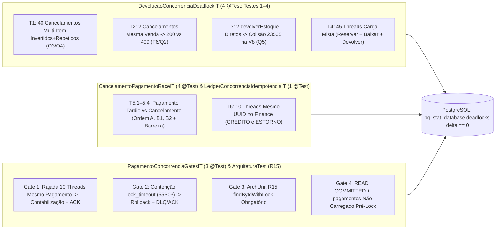

# DEBT-ARCH-003 — Runbook PR 4: E4 (Concorrência Pesada em `inv.it`, ADR-0012 e Governança Final)

> Runbook executável e autocontido para o PR 4. Contexto arquitetural, topologia e decisões globais: [README.md](./README.md). Consolida a prova de concorrência pesada das etapas [E0.md](./E0.md), [E1.md](./E1.md), [E2.md](./E2.md) e [E3.md](./E3.md) e formaliza a documentação arquitetural (`ADR-0012` e adendos às ADRs `0001`, `0002` e `0005`).

## Status de Execução

- [x] **E4 — Concorrência pesada em `inv.it` (4 suítes / 12 métodos `@Test`), `R15` em `ArquiteturaTest`, `ADR-0012` e governança final:** suíte de concorrência multi-item e devolução (`DevolucaoConcorrenciaDeadlockIT`: Testes 1 a 4, 4 `@Test`) (`F6`, `Q2`–`Q5`); corrida entre pagamento tardio e cancelamento na mesma venda (`CancelamentoPagamentoRaceIT`: Teste 5 subdividido nos `@Test` 5.1 a 5.4, 4 `@Test`) (`F2`, `F6`, `Q7`); concorrência de chaves idempotentes no Ledger (`LedgerConcorrenciaIdempotenciaIT`: Teste 6, 1 `@Test`) (`F1`, `Q6`); gates de rajada de webhooks, `lock_timeout` e isolamento `READ COMMITTED` (`PagamentoConcorrenciaGatesIT`: Gates 1, 2 e 4, 3 `@Test`) e regra estática `R15` em `ArquiteturaTest` (Gate 3); publicação da `ADR-0012` e adendos às ADRs `0001`, `0002` e `0005` (`Q1`–`Q8`, `F1`–`F7`).

---

## 1. Contexto & Invariantes

- **Invariante 1 (Q4) — Ausência física de deadlocks (`SQLState 40P01`) aferida no servidor PostgreSQL:**
  - **Problema:** Asserções restritas ao código Java podem ser mascaradas caso um `@Retryable` ou bloco `catch` absorva uma falha transiente.
  - **Invariante / Solução:** Assim como em [`CarrinhosInvertidosDeadlockIT`](../../../apps/inv-service/src/test/java/inv/it/CarrinhosInvertidosDeadlockIT.java) e [`HandlerExpiracaoMesmaVendaIT`](../../../apps/inv-service/src/test/java/inv/it/HandlerExpiracaoMesmaVendaIT.java), todas as suítes de concorrência em `inv.it` forçam `pg_stat_force_next_flush()` e consultam `SELECT deadlocks FROM pg_stat_database WHERE datname = current_database()` antes e imediatamente após o término das threads, exigindo `deadlocksFim - deadlocksInicio == 0`. Todos os ITs cross-context residem no pacote `inv.it`, respeitando `ImportOption.DoNotIncludeTests` de [`ArquiteturaTest.java`](../../../apps/inv-service/src/test/java/inv/architect/ArquiteturaTest.java).

- **Invariante 2 (Q3, Q4) — Equação de conservação de saldo físico sob carga mista:**
  - **Invariante / Solução:** Após $N$ aberturas de vendas (`reservar`), $M$ confirmações de baixa (`confirmarBaixa`), $E$ expirações (`estornarReserva`) e $C$ cancelamentos de vendas concluídas (`devolverEstoque`) executando simultaneamente sobre produtos com saldo inicial $S_0$, a conservação física de estoque deve satisfazer:
    $$\text{estoqueDisponivel} + \text{estoqueReservado} = S_0 - (\text{baixasConfirmadas} - \text{devolucoesConcluidas})$$
    e $\text{estoqueReservado} = \text{reservasAtivasNaoBaixadasNemExpiradas}$, com zero overselling e exatamente 1 movimentação `DEVOLUCAO` por par `(vendaId, produtoId)` cancelado.

- **Invariante 3 (Q5) — Serialização física no índice parcial `V8` sem contenção em `produtos`:**
  - **Invariante / Solução:** Quando duas transações concorrentes invocam diretamente `EstoqueCommandService.devolverEstoque` para a mesma `vendaId` sem passar pelo lock pessimista de `vendas` e ambas leem `existsByVendaIdAndProdutoIdAndTipo == false` antes do commit uma da outra, o PostgreSQL serializa o `INSERT` imediato (`GenerationType.IDENTITY`) na chave `(venda_id, produto_id) WHERE tipo = 'DEVOLUCAO'`. A vencedora commita a movimentação e o `UPDATE` em `produtos`; a perdedora aguarda (`XactLockTableWait`) no índice único `uk_movimentacoes_venda_produto_devolucao` e aborta com `DataIntegrityViolationException` (`SQLState 23505`) antes de chamar `devolverEstoqueAtomo`, recompondo o saldo disponível uma única vez.

- **Invariante 4 (F1, F2, F6, Q6, Q7) — Convergência determinística nas corridas `handlePagamentoConfirmado` vs `cancelarVendaConcluida` e no Ledger:**
  - **Invariante / Solução:** Como uma `CyclicBarrier` livre pode favorecer uma thread conforme o escalonador do SO, o Teste 5 (implementado em 4 métodos `@Test`: 5.1, 5.2, 5.3 e 5.4) exercita tanto a corrida livre em barreira quanto as ordens determinísticas de aquisição do lock pessimista (`SELECT ... FOR UPDATE`) em `vendas` via `CountDownLatch`:
    - *Ordem A (Teste 5.1 — cancelamento vence o lock antes do pagamento tardio em trânsito):* o cancelamento estorna o pagamento contabilizado (`ESTORNADO`), devolve o estoque e grava `CANCELADA`; ao desbloquear, o handler lê `CANCELADA`, marca o pagamento tardio como `excedente = true`, incrementa `pagamento.excedente.total` em `+1.0` e retorna ACK.
    - *Ordem B (Testes 5.2 e 5.3 — handler vence o lock antes do cancelamento):* se a venda estava `AGUARDANDO_PAGAMENTO` (B1 / Teste 5.2), o handler conclui a venda e baixa o estoque, e o cancelamento em seguida reverte a venda concluída e devolve o estoque; se a venda já estava `CONCLUIDA` recebendo pagamento tardio (B2 / Teste 5.3), o handler marca o pagamento tardio como `excedente = true` e o cancelamento em seguida estorna apenas o pagamento contabilizado (`!excedente`).

- **Invariante 5 — 4 Gates Obrigatórios de Concorrência e Governança do PR 4:**
  1. *Gate de Webhooks Simultâneos (`PagamentoConcorrenciaGatesIT`):* Teste no Testcontainers simulando rajada concorrente de 10 threads para o mesmo `pagamentoId` em `confirmarPagamentoWebhook` (Camada 1) e `handlePagamentoConfirmado` (Camada 2), comprovando absorção determinística (1 contabilização, 1 baixa de estoque, 1 lançamento financeiro `CREDITO`, 1 `LancamentoRegistradoEvent` e descarte das demais chamadas com ACK sem incrementar `pagamento.excedente.total`).
  2. *Gate de `lock_timeout` PostgreSQL (`PagamentoConcorrenciaGatesIT`):* Validação da propriedade `lock_timeout` (`-c lock_timeout=500ms`, `SQLState 55P03`) sob contenção de lock pessimista em `vendas`: quando uma transação retém `findByIdWithLock`, a tentativa concorrente em `handlePagamentoConfirmado` aborta com `PessimisticLockingFailureException` (`55P03`) e faz rollback integral (acionando retry/DLQ sob `default-requeue-rejected=false`), sendo absorvida com ACK após liberação do lock, enquanto falhas não-retentáveis (`BusinessException`/JSON inválido) lançam `AmqpRejectAndDontRequeueException` para envio imediato à DLQ.
  3. *Gate de Governança em `Venda` (`R15` em `ArquiteturaTest`):* Regra ArchUnit `escritasEmVendaDevemUsarFindByIdWithLock` garantindo que toda operação de escrita ou transição de estado em `Venda` existente invoque previamente `VendaRepository.findByIdWithLock`, vedando setters públicos/package-private em `Venda` e queries `@Modifying` em `VendaRepository`.
  4. *Gate de Isolamento (`PagamentoConcorrenciaGatesIT`):* Comprovação em transação ativa de `SHOW transaction_isolation == "read committed"`, mapeamento `FetchType.LAZY` em `Venda.pagamentos` e verificação via `PersistenceUnitUtil.isLoaded(venda, "pagamentos") == false` de que `pagamentos` não é carregado na sessão JPA antes/durante `findByIdWithLock`, garantindo leitura fresca do estado pós-lock.



---

## 2. Referência de Contratos (Published Language & DDL)

> [!NOTE]
> **Escopo de Verificação e Governança Pura:**
> O PR 4 não altera classes de produção nem migrations SQL. Os testes em `inv.it` e a regra `R15` em `ArquiteturaTest` auditam os contratos consolidados nos PRs 1 a 3 e validam o contador físico de deadlocks, `lock_timeout` e isolamento do PostgreSQL.

### Consultas de Catálogo e Sessão para Aferição no `PostgreSQL`

```sql
-- 1. Executada antes e depois de cada bateria concorrente em inv.it (delta exigido == 0):
SELECT deadlocks FROM pg_stat_database WHERE datname = current_database();

-- 2. Aferição efetiva de timeout de lock pessimista e nível de isolamento na sessão (Gates 2 e 4):
SHOW lock_timeout;
SHOW transaction_isolation;
```

### Contratos Públicos e Eventos Exercitados em `inv.it`

```java
// inv.inventory.api.EstoqueCommandService (PR 2 / E2)
public interface EstoqueCommandService {
    void reservar(ComandoEstoqueVenda comando);
    void confirmarBaixa(ComandoEstoqueVenda comando);
    void estornarReserva(ComandoEstoqueVenda comando);
    void devolverEstoque(ComandoEstoqueVenda comando);
}

// inv.shared.event.VendaPagaEvent & VendaEstornadaEvent (PR 1 / PR 3)
public record VendaPagaEvent(Long vendaId, UUID uuidReferencia, BigDecimal valorRecebido) {}
public record VendaEstornadaEvent(Long vendaId, UUID uuidReferenciaEstorno, BigDecimal valorEstorno) {}
```

---

## 3. Passos de Implementação & Critérios de Teste

### Roteiro de Implementação

1. **Passo 1 — Suíte de concorrência de devolução e carga mista em `DevolucaoConcorrenciaDeadlockIT` (`inv.it`, 4 `@Test`):**
   - Criar `apps/inv-service/src/test/java/inv/it/DevolucaoConcorrenciaDeadlockIT.java` com `@Testcontainers`, `@SpringBootTest(classes = InvServiceApplication.class)` e `deadlock_timeout=100ms`, implementando os Testes 1, 2, 3 e 4 especificados abaixo.
2. **Passo 2 — Suítes de corrida pagamento/cancelamento e idempotência concorrente no Ledger (`inv.it`, 5 `@Test`):**
   - Criar `apps/inv-service/src/test/java/inv/it/CancelamentoPagamentoRaceIT.java` implementando o Teste 5 em 4 métodos `@Test` (5.1 Ordem A, 5.2 Ordem B1 e 5.3 Ordem B2 sincronizadas por `CountDownLatch`, além de 5.4 com 20 repetições livres em `CyclicBarrier(2)`).
   - Criar `apps/inv-service/src/test/java/inv/it/LedgerConcorrenciaIdempotenciaIT.java` (`@RecordApplicationEvents`, `finance.projection.diaria.enabled=true`) implementando o Teste 6 com 10 threads em `CyclicBarrier(10)` para `VendaPagaEventListener.onVendaPaga` (`CREDITO`) e `VendaEstornadaEventListener.handleVendaEstornada` (`ESTORNO`).
3. **Passo 3 — Gates de concorrência e isolamento em `PagamentoConcorrenciaGatesIT` (`inv.it`, 3 `@Test`) e regra `R15` em `ArquiteturaTest` (`inv.architect`):**
   - Criar `apps/inv-service/src/test/java/inv/it/PagamentoConcorrenciaGatesIT.java` com PostgreSQL parametrizado com `-c deadlock_timeout=100ms -c lock_timeout=500ms`, implementando os testes dos Gates 1, 2 e 4 da Invariante 5.
   - Adicionar em [`ArquiteturaTest.java`](../../../apps/inv-service/src/test/java/inv/architect/ArquiteturaTest.java) a regra `R15` (`escritasEmVendaDevemUsarFindByIdWithLock`, Gate 3), sem `FreezingArchRule` e sem tocar em `archunit_store/`.
4. **Passo 4 — Publicação da `ADR-0012` e adendos às ADRs `0001`, `0002` e `0005` (`docs/adr/`):**
   - Criar `docs/adr/0012-idempotent-payment-pipeline-and-single-phase-sale-reversal.md` seguindo as 7 seções de `docs/adr/template.md` (`F1`–`F7`, `Q1`–`Q8`, 5 camadas de defesa, `V7`, `ON CONFLICT DO NOTHING RETURNING id`, OHS `devolverEstoque` com `V8` e cancelamento em fase única `CONCLUIDA -> CANCELADA` + Outbox).
   - Aplicar adendos em [`0001-modular-monolith-bounded-contexts.md`](../../../docs/adr/0001-modular-monolith-bounded-contexts.md), [`0002-atomic-sql-inventory-and-hybrid-locking.md`](../../../docs/adr/0002-atomic-sql-inventory-and-hybrid-locking.md) e [`0005-append-only-financial-ledger-and-idempotency.md`](../../../docs/adr/0005-append-only-financial-ledger-and-idempotency.md).

### Critérios de Teste (Comportamento Esperado)

- **Teste 1 — Cancelamentos multi-item com ordens invertidas combinadas com itens repetidos (`Q3`, `Q4` em `DevolucaoConcorrenciaDeadlockIT`):**
  - *Condição:* 2 produtos (`prodA`, `prodB`) com `estoqueDisponivel = 100.000`; 40 vendas `CONCLUIDA` (20 com itens na ordem direta `[prodA: 1.000, prodB: 2.000]` e 20 combinando ordem invertida e itens repetidos `[prodB: 1.000, prodA: 1.000, prodB: 1.000]`, totalizando `B: 2.000` e `A: 1.000` por venda).
  - *Ação/Gatilho:* `CyclicBarrier(40)` liberando 40 threads que executam `vendaService.cancelarVendaConcluida(vendaId)` simultaneamente.
  - *Asserção/Resultado Esperado:* Delta de `pg_stat_database.deadlocks == 0`; 40 sucessos e 0 exceções; `estoqueDisponivel` restaurado a `100.000` e `estoqueReservado == 0.000` em ambos os produtos; 80 movimentações `DEVOLUCAO` (1 por `(vendaId, produtoId)`) e 40 eventos `venda.estornada` na tabela `outbox`.
- **Teste 2 — Dois cancelamentos simultâneos da mesma venda `CONCLUIDA` (`F6`, `Q2`, `Q5` em `DevolucaoConcorrenciaDeadlockIT`):**
  - *Condição:* Venda `CONCLUIDA` com 2 produtos (`p1: 3.000`, `p2: 4.000`, saldo inicial `20.000` cada; pós-baixa `17.000` e `16.000`).
  - *Ação/Gatilho:* `CyclicBarrier(2)` liberando 2 threads que invocam `vendaService.cancelarVendaConcluida(vendaId)` para o mesmo ID.
  - *Asserção/Resultado Esperado:* Exatamente 1 sucesso, 1 `CancelamentoVendaConflitoException` (HTTP 409) e 0 erros inesperados; saldos finais recompostos uma única vez (`20.000` e `20.000`); 2 movimentações `DEVOLUCAO` e 1 única linha `venda.estornada` no Outbox.
- **Teste 3 — Duas chamadas diretas simultâneas a `devolverEstoque` sem lock de Checkout (`Q5` em `DevolucaoConcorrenciaDeadlockIT`):**
  - *Condição:* Venda faturada (`p1: 3.000`, saldo pós-baixa `7.000` de `10.000` iniciais).
  - *Ação/Gatilho:* Duas threads invocando `estoqueCommandService.devolverEstoque(comando)` diretamente via `TransactionTemplate`: (a) em corrida livre com `CyclicBarrier(2)` e (b) sincronizadas por `CountDownLatch` para que ambas leiam `existsByVendaIdAndProdutoIdAndTipo == false` antes de qualquer `INSERT`/commit.
  - *Asserção/Resultado Esperado:* Em (b), 1 transação commita a `DEVOLUCAO` e 1 falha com `DataIntegrityViolationException` (`uk_movimentacoes_venda_produto_devolucao`, `SQLState 23505`) sem adquirir row lock em `produtos`; em ambos os subcenários, `p1.estoqueDisponivel` termina em `10.000` e existe apenas 1 movimentação `DEVOLUCAO`.
- **Teste 4 — Carga mista de novas reservas, confirmações de baixa e devoluções nos mesmos produtos (`Q4` em `DevolucaoConcorrenciaDeadlockIT`):**
  - *Condição:* `prodA` e `prodB` (`100.000` iniciais) com 15 vendas `CONCLUIDA` e 15 vendas `AGUARDANDO_PAGAMENTO` (`estoqueDisponivel = 70.000`, `estoqueReservado = 15.000`).
  - *Ação/Gatilho:* `CyclicBarrier(45)` disparando simultaneamente 15 `iniciarVenda([prodB: 1.000, prodA: 1.000])`, 15 `handlePagamentoConfirmado` nas vendas pendentes e 15 `cancelarVendaConcluida` nas vendas concluídas.
  - *Asserção/Resultado Esperado:* Delta de `pg_stat_database.deadlocks == 0` e 0 exceções; conservação contábil exata: `estoqueDisponivel == 70.000` (`70 - 15 + 15`), `estoqueReservado == 15.000` (`15 - 15 + 15`) e `disponivel + reservado == 85.000`.
- **Teste 5 (Testes 5.1 a 5.4) — Corrida entre pagamento tardio em trânsito e cancelamento na mesma venda (`F2`, `F6`, `Q7` em `CancelamentoPagamentoRaceIT`):**
  - *Condição:* Venda faturada com `pag1` (`contabilizado = true`) e segundo pagamento `pag2` confirmado no webhook mas não contabilizado (`contabilizado = false`), além do subcenário B1 com venda em `AGUARDANDO_PAGAMENTO`.
  - *Ação/Gatilho:* Executar 4 métodos `@Test`: 5.1 Ordem A (`cancelarVendaConcluida` adquire o lock antes de `handlePagamentoConfirmado(pag2)` via `CountDownLatch`), 5.2 Ordem B1 (`handlePagamentoConfirmado` vence o lock em venda `AGUARDANDO_PAGAMENTO`), 5.3 Ordem B2 (`handlePagamentoConfirmado` vence o lock em venda `CONCLUIDA` com pagamento tardio) e 5.4 Bateria Livre (20 repetições sob `CyclicBarrier(2)`).
  - *Asserção/Resultado Esperado:* Delta de `deadlocks == 0` e 0 exceções inesperadas; em 100% das execuções de `pag2` tardio, a venda termina `CANCELADA`, `pag1` termina `ESTORNADO`, `pag2` termina com `excedente == true` e `contabilizado == false`, o contador `pagamento.excedente.total` soma `+1.0` por corrida, o estoque é restaurado 1x e 1 `VendaEstornadaEvent` é gravado no Outbox.
- **Teste 6 — Entregas simultâneas do mesmo `uuidReferencia` no Finance (`F1`, `Q6` em `LedgerConcorrenciaIdempotenciaIT`):**
  - *Condição:* 10 threads alinhadas em `CyclicBarrier(10)` para o mesmo `VendaPagaEvent(vendaId, refCredito, 100.00)` (via `TransactionTemplate`) e, em seguida, 10 threads em `CyclicBarrier(10)` para o mesmo `VendaEstornadaEvent(vendaId, UUID("ESTORNO:" + vendaId), 100.00)`.
  - *Ação/Gatilho:* Disparar simultaneamente `vendaPagaEventListener.onVendaPaga` (10 threads) e depois `vendaEstornadaEventListener.handleVendaEstornada` (10 threads).
  - *Asserção/Resultado Esperado:* Zero `UnexpectedRollbackException` ou `DataIntegrityViolationException`; exatamente 1 linha `CREDITO` (`+100.00`) e 1 linha `ESTORNO` (`-100.00`) em `lancamentos_financeiros`; exatamente 1 `LancamentoRegistradoEvent` emitido por operação (`ApplicationEvents`: 1 `CREDITO` e 1 `ESTORNO`); `financial_projection_venda` termina com `saldo == 0.00`, `total_creditos == 100.00` e `total_estornos == 100.00`; `financial_projection_diaria` filtrada explicitamente por `data_referencia` consolida `total_creditos == 100.00`, `total_debitos == 100.00` e receita líquida == `0.00`, reconciliada com `SUM(valor)` do ledger e delta de `deadlocks == 0`.
- **Gates 1, 2, 3 e 4 (`PagamentoConcorrenciaGatesIT` e `R15` em `ArquiteturaTest`):**
  - *Gate 1 (Rajada de Webhooks do Mesmo Pagamento):* 10 threads simultâneas em `CyclicBarrier(10)` invocando `confirmarPagamentoWebhook` e 10 threads simultâneas invocando `handlePagamentoConfirmado` para o mesmo `pagamentoId` resultam em 0 exceções, `deadlocks == 0`, 1 única contabilização (`valorPago == 100.00`, `contabilizado == true`, `excedente == false`, delta de `pagamento.excedente.total == 0.0`), 1 baixa de estoque (`SAIDA`), 1 lançamento `CREDITO` e 1 `LancamentoRegistradoEvent`, descartando as 9 chamadas excedentes com ACK na Condição 1.
  - *Gate 2 (`lock_timeout` sob Contenção e Política de DLQ/ACK):* Com `SHOW lock_timeout == "500ms"`, enquanto uma transação retém `findByIdWithLock(vendaId)` via `CountDownLatch`, a chamada concorrente a `handlePagamentoConfirmado` estoura `lock_timeout` lançando `RuntimeException` causada por `PessimisticLockingFailureException` (`SQLState 55P03`) com rollback integral (habilitando retry/DLQ sob `default-requeue-rejected=false`); após liberação do lock, a reentrega conclui a venda e reentregas adicionais retornam ACK idempotente, enquanto erros não-retentáveis (`BusinessException`) lançam `AmqpRejectAndDontRequeueException` (DLQ imediata).
  - *Gate 3 (Governança `R15` em `ArquiteturaTest`):* A regra `escritasEmVendaDevemUsarFindByIdWithLock` valida na AST/bytecode que `Venda` possui apenas campos `private` sem setters públicos/package-private, `VendaRepository` não possui queries `@Modifying` e todo método que muta ou remove uma `Venda` existente invoca `VendaRepository.findByIdWithLock` antes da mutação e de qualquer leitura de `Pagamento`/`pagamentos`.
  - *Gate 4 (Isolamento `READ COMMITTED` e `pagamentos` Não Carregado Pré-Lock):* Em disputa sincronizada via `CountDownLatch` e `pg_locks WHERE NOT granted`, comprova-se `SHOW transaction_isolation == "read committed"`, `Venda.pagamentos` mapeado como `FetchType.LAZY`, zero entidades pré-carregadas na sessão JPA antes do lock e `PersistenceUnitUtil.isLoaded(venda, "pagamentos") == false` imediatamente após `findByIdWithLock`, permitindo que `pagamentoRepository.findById` e `handlePagamentoConfirmado` pós-lock leiam o estado recém-comitado (`contabilizado == true`, `excedente == false`).

---

## 4. Commits Sugeridos e Definition of Done (DoD)

### Commits Sugeridos

- `test(it): adiciona DevolucaoConcorrenciaDeadlockIT cobrindo testes 1 a 4 sob alta concorrencia (F6, Q2-Q5)`
- `test(it): adiciona CancelamentoPagamentoRaceIT e LedgerConcorrenciaIdempotenciaIT cobrindo testes 5 e 6 (F1, F2, Q6, Q7)`
- `docs(adr): publica ADR-0012 e adiciona adendos do DEBT-ARCH-003 nas ADRs 0001, 0002 e 0005`
- `test(it): adiciona assercoes de deadlocks no ledger e aprimora robustez das suites concorrentes (Q4, Invariante 1)` (`d1c37f3`)
- `test(inv): implementa gates 1 a 4 da Invariante 5 (PagamentoConcorrenciaGatesIT, R15 ArchUnit) e alinha E4`

### Comandos de Validação

```bash
# 1. Suítes de concorrência pesada da E4 (4 classes / 12 @Test — executar 3x consecutivas com Docker ativo)
mvn test -pl apps/inv-service "-Dtest=DevolucaoConcorrenciaDeadlockIT,CancelamentoPagamentoRaceIT,LedgerConcorrenciaIdempotenciaIT,PagamentoConcorrenciaGatesIT"

# 2. Suíte acumulada de concorrência e caracterização (DEBT-ARCH-001, 002 e 003)
mvn test -pl apps/inv-service "-Dtest=EstoqueConcorrenciaIntegrationTest,CarrinhosInvertidosDeadlockIT,EstoqueMultiItemConcorrenciaIT,HandlerExpiracaoMesmaVendaIT,CicloVendaEstoqueCharacterizationIT,CancelamentoVendaConcluidaIT,DevolucaoConcorrenciaDeadlockIT,CancelamentoPagamentoRaceIT,LedgerConcorrenciaIdempotenciaIT,PagamentoConcorrenciaGatesIT"

# 3. Gates finais de arquitetura (ArchUnit R1-R15 e Spring Modulith)
mvn test -pl apps/inv-service -am "-Dtest=ArquiteturaTest,ModulithTest" "-Dsurefire.failIfNoSpecifiedTests=false"
```

### Rollback e Contingência Operacional

- Como o PR 4 introduz exclusivamente classes de teste em `apps/inv-service/src/test/java/inv/` e documentação em `docs/`, o rollback é um `git revert` direto sem efeito sobre código de produção, banco de dados, filas AMQP ou histórico do Flyway.

### Definition of Done (DoD)

- [x] As 4 suítes de concorrência da E4 totalizando 12 métodos `@Test` (`DevolucaoConcorrenciaDeadlockIT` [4], `CancelamentoPagamentoRaceIT` [4], `LedgerConcorrenciaIdempotenciaIT` [1] e `PagamentoConcorrenciaGatesIT` [3]) passam em 3 execuções consecutivas com `pg_stat_database.deadlocks` delta = `0`, emissão única de `LancamentoRegistradoEvent` por operação e conciliação integral em `financial_projection_venda` e `financial_projection_diaria` (filtrada por `data_referencia`).
- [x] Os 4 Gates obrigatórios da Invariante 5 estão implementados e verdes: Gate 1 (rajada de webhooks do mesmo pagamento), Gate 2 (`lock_timeout` `55P03` e descarte/DLQ), Gate 3 (regra `R15` em `ArquiteturaTest` exigindo `findByIdWithLock`) e Gate 4 (`READ COMMITTED` e `pagamentos` não carregado antes do lock).
- [x] Toda a suíte do módulo `inv-service` (incluindo a suíte legada `DEBT-ARCH-001`/`002`), `ArquiteturaTest` (`R1`–`R15`) e `ModulithTest` verdes em Java 21 LTS com Docker ativo.
- [x] `ADR-0012` publicada e adendos aplicados às ADRs `0001`, `0002` e `0005`.
- [x] Nenhuma classe interna ou método `@Test` colado no runbook (respeitando o padrão canônico de 4 blocos e a faixa de 150 a 250 linhas).
