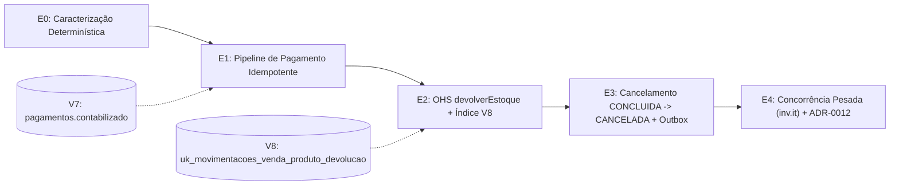

# DEBT-ARCH-003 — Pipeline Idempotente de Pagamento e Cancelamento de Venda Concluída (`inv-service`)

> **TL;DR:** Este épico saneia os 5 débitos de higiene do pipeline de pagamento mapeados no [DEBT-ARCH-002](../DEBT-ARCH-002/README.md) (`DEBT-ARCH-004`) e implementa o cancelamento reversível de vendas concluídas em 4 PRs atômicos. O **PR 1 (`E0`–`E1`)** estabelece cinco camadas de defesa para pagamentos: migration `V7__pagamento_contabilizado.sql` (`pagamentos.contabilizado` com drenagem prévia e query de reconciliação), webhook que publica `PagamentoConfirmadoEvent` apenas em transição real, `VendaEventHandler` com lock pessimista (`findByIdWithLock`) e tabela de decisão pós-lock (ACK idempotente e marcação de pagamento tardio como `excedente` com métrica `pagamento.excedente.total`), deduplicação JPA-safe em `Venda` e inserção idempotente no Ledger do Finance via `INSERT ... ON CONFLICT (referencia) DO NOTHING RETURNING id`. O **PR 2 (`E2`)** estende a Published Language `inv.inventory.api.EstoqueCommandService` com `devolverEstoque` (`Propagation.MANDATORY`, agregação por `produtoId` em `TreeMap` na ordem `produtoId ASC` e sequência Fail-Fast) respaldado pelo índice único parcial concorrente `uk_movimentacoes_venda_produto_devolucao` (`V8`). O **PR 3 (`E3`)** implementa o cancelamento atômico em fase única `CONCLUIDA -> CANCELADA` no Checkout, estornando apenas pagamentos contabilizados, calculando `valorEstorno = valorPago - valorTroco` e publicando `VendaEstornadaEvent` via Outbox (`BEFORE_COMMIT`) com chave determinística `UUID.nameUUIDFromBytes("ESTORNO:" + vendaId)` e feature flag em `application.properties`. O **PR 4 (`E4`)** comprova a invariância sob concorrência pesada em `inv.it` e publica a `ADR-0012` com adendos às ADRs `0001`, `0002` e `0005`.

---

## 1. Roadmap dos 4 PRs e Status

| PR | Etapas | Runbooks | Entregáveis Chave | Status |
| :---: | :--- | :--- | :--- | :---: |
| **1** | **E0** (Caracterização) + **E1** (Pipeline de Pagamento) | [E0.md](./E0.md), [E1.md](./E1.md) | Suíte de caracterização (`F1`–`F3`), migration `V7` + reconciliação, 5 camadas de idempotência (`F1`–`F5`, `Q1`, `Q7`, `Q8`) | `[x]` Concluído (PR #50) |
| **2** | **E2** (OHS `devolverEstoque` e Índice Parcial `V8`) | [E2.md](./E2.md) | `TipoMovimentacao.DEVOLUCAO`, migration `V8` + `.conf`, `EstoqueCommandService.devolverEstoque` (`F7`, `Q3`–`Q5`, `Q8`) | `[x]` Concluído (PR #51) |
| **3** | **E3** (Cancelamento em Fase Única e Outbox) | [E3.md](./E3.md) | `Venda.cancelarVendaConcluida`, `POST /vendas/{id}/cancelar` (HTTP 409/503), `VendaEstornadaEvent` + consumer Finance (`F6`, `Q2`, `Q6`) | `[ ]` Pendente |
| **4** | **E4** (Concorrência Pesada e Governança ADR) | [E4.md](./E4.md) | 6 ITs de concorrência em `inv.it`, `ADR-0012` e adendos às ADRs `0001`, `0002` e `0005` | `[ ]` Pendente |



**Princípios Transversais Inegociáveis:**
- **Evolução de Schema Expand-Only (`Q8`):** apenas adições compatíveis (`V7` com `DEFAULT FALSE` e `V8` como índice parcial `CONCURRENTLY`); nenhuma coluna ou FK existente é removida.
- **Integridade de Build e Arquitetura:** `pom.xml` e `archunit_store/` intocados; conformidade estrita com `ArquiteturaTest` (`R1`–`R14`) e `ModulithTest`.
- **Preservação de Gates de Qualidade:** nenhuma asserção dos testes de caracterização ou concorrência do `DEBT-ARCH-001` e `DEBT-ARCH-002` pode ser enfraquecida.

---

## 2. Topologia Arquitetural, Dependências e Hierarquia de Locks

### 2.1 Decisão Arquitetural Central
- **Escolhida — Fase Única Síncrona no Checkout (`CONCLUIDA -> CANCELADA`) + Consistência Eventual no Finance via Outbox/AMQP:** garante atomicidade ACID entre status da venda, estorno contábil dos pagamentos, recomposição física do estoque via Open Host Service (`Propagation.MANDATORY`) e gravação de `VendaEstornadaEvent` no Outbox (`TransactionPhase.BEFORE_COMMIT`). O Finance consome a fila `pdv.venda.estornada.queue` de forma idempotente usando chave UUID determinística (`Q6`) e `ON CONFLICT (referencia) DO NOTHING RETURNING id` (`F1`).
- **Alternativas Descartadas:** (a) *Saga com `CANCELAMENTO_SOLICITADO`* (introduz janela de inconsistência e colide com `StatusVenda.FATURADAS` e o índice parcial `idx_vendas_concluidas` da `V5`); (b) *Escrita direta do Checkout em `lancamentos_financeiros`* (viola `R1` e `ModulithTest`); (c) *`Propagation.REQUIRES_NEW` no listener do Finance* (desacopla o commit do Ledger do commit da venda, violando a `ADR-0005`).

```mermaid
flowchart LR
    subgraph CHK["inv.checkout (allowed: inventory::api, shared)"]
        VS["VendaService.cancelarVendaConcluida"]
        VEH["VendaEventHandler"]
        VOL["VendaEstornadaOutboxListener (BEFORE_COMMIT)"]
    end
    subgraph INVAPI["inv.inventory.api (@NamedInterface api)"]
        ECS["EstoqueCommandService.devolverEstoque"]
        CMD["ComandoEstoqueVenda / ItemComando"]
    end
    subgraph INV["inv.inventory (internals)"]
        ES["EstoqueService (package-private, R14)"]
        REPO_I["MovimentacaoRepository / ProdutoRepository (R7)"]
    end
    subgraph SH["inv.shared (OPEN)"]
        EVT["event.VendaEstornadaEvent / VendaPagaEvent"]
        OB["outbox.OutboxRepository + config.RabbitMQConfig"]
    end
    subgraph FIN["inv.finance (allowed: shared)"]
        VPL["VendaPagaEventListener"]
        VEL["VendaEstornadaEventListener (@RabbitListener, R11)"]
        LFR["LancamentoFinanceiroRepository (R7)"]
    end
    VS --> ECS & CMD
    VEH --> ECS
    VS -. publishEvent .-> EVT
    VOL --> OB
    ES -. implementa .-> ECS
    ES --> REPO_I
    OB -. AMQP venda.estornada .-> VEL
    VEH -. publishEvent VendaPagaEvent .-> VPL
    VPL & VEL --> LFR
```

### 2.2 Hierarquia Global de Locks, Ausência de Deadlock (`40P01`) e Consistência
Toda operação de escrita em venda existente (`handlePagamentoConfirmado`, `cancelarVendaExpirada`, `cancelarVendaConcluida`) adquire **1º o lock pessimista (`SELECT ... FOR UPDATE`) de exatamente uma linha em `vendas`** e **2º os locks em `produtos` na ordem estritamente crescente `produtoId ASC`**:
1. Uma transação bloqueada aguardando `vendas(v)` ainda não detém locks em `produtos`, não podendo formar ciclo em `produtos`.
2. Entre transações que já passaram por `vendas`, a ordem total `produtoId ASC` impede ciclos (`T1` esperando `produto k` só detém `produtos j < k`).
3. Em `devolverEstoque` (`Q5`), o `INSERT` em `movimentacoes_estoque` precede o `UPDATE` em `produtos` para cada item $k$: em chamadas duplicadas concorrentes sem lock de `vendas`, a segunda transação aguarda no índice único `uk_movimentacoes_venda_produto_devolucao` e recebe `SQLState 23505` sem adquirir row lock em `produtos`.

| Leitura / Cenário de Falha | Comportamento e Garantias de Consistência |
| :--- | :--- |
| **Dashboard (`JdbcVendaQueryService`)** | Venda sai de `StatusVenda.FATURADAS` no commit do cancelamento (visível após TTL do cache Caffeine `dashboard.cache.ttl=15s`). |
| **Projeções Financeiras e Fechamento D+0** | `ESTORNO` negativo (`-(valorPago - valorTroco)`) zera `financial_projection_venda.saldo` e entra como `total_debitos` na data do estorno (`financial_projection_diaria` e high-watermark `id > :ultimoId` do D+0). |
| **Falha em `devolverEstoque` ou no Outbox (`BEFORE_COMMIT`)** | Rollback ACID total: venda segue `CONCLUIDA`, pagamentos seguem `CONFIRMADO`, estoque inalterado e zero linhas no Outbox. |
| **Indisponibilidade do RabbitMQ ou falha no Finance** | Venda `CANCELADA` e estoque devolvido; evento retido em `outbox` (`FOR UPDATE SKIP LOCKED`) ou reprocessado via retries/DLQ de forma idempotente (`Q6` + `ON CONFLICT DO NOTHING`). |

---

## 3. Matriz de Rastreabilidade Transversal (`Q1`–`Q8` e `F1`–`F7`)

| ID | Tipo / Sev. | Regra Arquitetural / Causa Raiz e Solução | Origem | Consumo |
| :---: | :---: | :--- | :---: | :---: |
| **F1** | Bloqueante | `VendaPagaEventListener` usa `save` (`IDENTITY`) na transação do handler; duplicata em `uk_lancamento_referencia` marca `rollback-only` e lança `DataIntegrityViolationException`/`UnexpectedRollbackException`. **Solução:** `INSERT ... ON CONFLICT (referencia) DO NOTHING RETURNING id` + gate de `LancamentoRegistradoEvent`. | E0, E1 | E3, E4 |
| **F2** | Alta | `VendaEventHandler` usa `findById` sem lock e lança `BusinessException` em reentregas AMQP para vendas `CONCLUIDA`. **Solução:** `findByIdWithLock` + tabela de decisão pós-lock com ACK idempotente. | E0, E1 | E3, E4 |
| **F3** | Alta | `PagamentoService.confirmarPagamentoWebhook` publica `PagamentoConfirmadoEvent` no Outbox mesmo quando `Pagamento.confirmar` é no-op. **Solução:** `confirmar` retorna `boolean`; publicação condicional. | E0, E1 | — |
| **F4** | Alta | Sob `@OneToMany(mappedBy = "venda")`, `Pagamento` já integra `venda.getPagamentos()` na 1ª entrega e `registrarPagamentoConfirmado` soma sem deduplicar. **Solução:** `Pagamento.contabilizado` (`V7`) + `equals`/`hashCode` JPA-safe (`Pagamento.class.hashCode()`). | E1 | E3 |
| **F5** | Média | Código morto capturando `"uk_pagamento_uuid"` e `catch` inválido de `"uk_lancamento_referencia"` em `VendaEventHandler`. **Solução:** remoção integral dos catches obsoletos. | E1 | — |
| **F6** | Alta | Impossibilidade de cancelar venda `CONCLUIDA` e ausência de guard `podeSerCancelada()` em `Venda.cancelar()`. **Solução:** `Venda.cancelarVendaConcluida()`, `VendaService.cancelarVendaConcluida(Long)` e `POST /vendas/{id}/cancelar`. | E3 | E4 |
| **F7** | Alta | OHS `EstoqueCommandService` não possui operação inversa à `SAIDA`. **Solução:** `devolverEstoque(ComandoEstoqueVenda)` em `inv.inventory.api`. | E2 | E3, E4 |
| **Q1** | Decisão | Saneamento prévio do pipeline de pagamento no PR 1 (1 commit de caracterização na `E0` + 5 commits de correção na `E1`) antes de implementar o cancelamento. | E0, E1 | E3, E4 |
| **Q2** | Decisão | Cancelamento em fase única `CONCLUIDA -> CANCELADA` + Outbox `BEFORE_COMMIT`, estornando apenas pagamentos `contabilizado && !excedente`, com `valorEstorno = valorPago - valorTroco` e handlers HTTP 409/503 locais em `VendaController`. | E3 | E4 |
| **Q3** | Decisão | `devolverEstoque` consolida itens repetidos internamente via `TreeMap<Long, BigDecimal>`, mantendo `ComandoEstoqueVenda` e `ItemComando` inalterados (paridade Q9 do `DEBT-ARCH-002`). | E2 | E3, E4 |
| **Q4** | Decisão | Aquisição de locks na devolução em ordem `produtoId ASC` (iteração natural do `TreeMap`), simétrica a `reservar`, `confirmarBaixa` e `estornarReserva`. | E2 | E4 |
| **Q5** | Decisão | Idempotência física da devolução via índice parcial `uk_movimentacoes_venda_produto_devolucao` (`V8`), pré-checagem `existsByVendaIdAndProdutoIdAndTipo` e sequência Fail-Fast (`INSERT` da movimentação antes do `UPDATE` em `produtos`). | E2 | E4 |
| **Q6** | Decisão | Chave de idempotência de estorno determinística por venda: `UUID.nameUUIDFromBytes(("ESTORNO:" + vendaId).getBytes(UTF_8))`. | E3 | E4 |
| **Q7** | Decisão | Pagamento tardio/órfão (`!contabilizado && !excedente`) em venda `CONCLUIDA` ou `CANCELADA` é marcado `excedente = true`, incrementa `pagamento.excedente.total` e retorna ACK. | E1 | E3, E4 |
| **Q8** | Decisão | Evolução de schema *expand-only*: `TipoMovimentacao.DEVOLUCAO` sem DDL de coluna, `V7` na `E1` (com drenagem no ingress `inv-service:8083` e reconciliação) e `V8` concorrente na `E2`. | E1, E2 | E3 |

---

## 4. Governança Operacional, Feature Flag e Rollback por PR

- **Feature Flag (Kill Switch em `apps/inv-service/src/main/resources/application.properties`):**
  `features.cancelamento-venda-concluida.enabled=false` (avaliada em `VendaService` antes de qualquer lock; quando `false`, `POST /vendas/{id}/cancelar` responde **HTTP 503** imediatamente).

| PR | Estratégia de Rollback e Contingência |
| :---: | :--- |
| **PR 1 (`E0`–`E1`)** | Reverter apenas os commits de código Java, **mantendo `V7__pagamento_contabilizado.sql` no repositório** para evitar `FlywayValidateException`. A coluna `contabilizado` possui `DEFAULT FALSE` e é ignorada pelo código anterior. |
| **PR 2 (`E2`)** | Reverter o código Java **mantendo `V8__indice_movimentacoes_estoque_devolucao.sql` e `.conf`**. Se o índice `CONCURRENTLY` falhar com `indisvalid = false`, executar `DROP INDEX CONCURRENTLY IF EXISTS uk_movimentacoes_venda_produto_devolucao;` antes de repetir. |
| **PR 3 (`E3`)** | Desativar imediatamente via `features.cancelamento-venda-concluida.enabled=false` (HTTP 503). Antes de reverter o binário Java, aguardar drenagem de `SELECT count(*) FROM outbox WHERE routing_key = 'venda.estornada'` = `0` e das filas `pdv.venda.estornada.queue`/`.dlq` para evitar `ClassNotFoundException` no `OutboxProcessor`. |
| **PR 4 (`E4`)** | `git revert` direto (contém exclusivamente testes em `inv.it` e documentação em `docs/adr/`). |

**Backlog Fora de Escopo (Registrado):** (1) validação de status da venda na criação de intenção de pagamento (`PagamentoService.criarIntencaoPagamento`); (2) reembolso operacional externo no adquirente para pagamentos `excedente = true` e `ESTORNADO`; (3) verificação de `SAIDA` prévia em `devolverEstoque`; (4) migração futura dos handlers HTTP 409/503 para `GlobalExceptionHandler` na `common-lib`.

---

## 5. Definition of Done (DoD) Global

- [ ] `V7` aplicada após drenagem comprovada (Outbox e filas `pdv.venda.pagamento.confirmado.queue`/`.dlq` zeradas) e query de reconciliação pós-backfill retornando 0 divergências.
- [ ] Webhook duplicado gera 0 linhas novas no Outbox; reentrega AMQP retorna ACK sem escrita; pagamento tardio marca `excedente = true` e incrementa `pagamento.excedente.total`.
- [ ] Duplicatas de `referencia` no Ledger (`CREDITO` e `ESTORNO`) são absorvidas via `ON CONFLICT DO NOTHING RETURNING id` sem `UnexpectedRollbackException` e sem duplicar eventos CQRS ou fechamento D+0.
- [ ] `EstoqueCommandService.devolverEstoque` implementado (`package-private` em `EstoqueService`, `MANDATORY`, `TreeMap`, Fail-Fast) com índice `V8` válido (`indisvalid = true`) e plano `EXPLAIN` auditado.
- [ ] Cancelamento de venda concluída respondendo HTTP 200 (1º request), HTTP 409 (concorrente/repetido), HTTP 503 (flag desligada) e HTTP 404 (inexistente), zerando o saldo líquido da venda no Finance (`-(valorPago - valorTroco)`).
- [ ] Os 6 cenários de concorrência pesada da `E4` e toda a suíte legada (`DEBT-ARCH-001`/`002`) verdes em 3 execuções consecutivas com `pg_stat_database.deadlocks` delta = `0`, `ArquiteturaTest` e `ModulithTest` aprovados em Java 21 LTS.
- [ ] `ADR-0012` publicada e adendos registrados nas ADRs `0001`, `0002` e `0005`.
