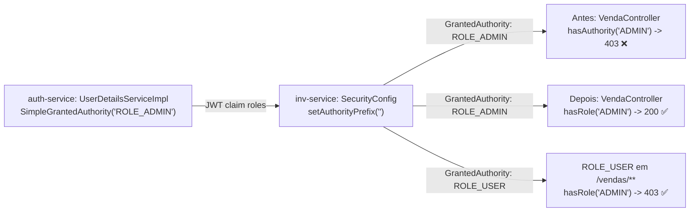

# DEBT-ARCH-004 — Runbook PR 1: E1 (Autorização `ROLE_ADMIN`, Filtros JWT e Parametrização da Flag)

> Runbook executável e autocontido para o PR 1. Contexto transversal, topologia e backlog separado: [README.md](./README.md).

## Status de Execução

- [ ] **E1 — Autorização `hasRole('ADMIN')`, testes na cadeia real de filtros JWT e parametrização da flag:** correção em `VendaController` (`F1`, `Q1`), atualização de `SimpleGrantedAuthority("ROLE_ADMIN")` nos `*IT`, criação de `VendaSecurityFilterTest` (red → green) e `ProdutoSecurityFilterTest` (caracterização), parametrização de `FEATURES_CANCELAMENTO_VENDA_CONCLUIDA_ENABLED` (`false` por padrão) e atualização de `docs/domains/security.md` e `apps/inv-service/README.md`.

---

## 1. Contexto & Invariantes

- **Pré-condições Técnicas e Fronteira Afetada:**
  - [`UserDetailsServiceImpl`](../../../apps/auth-service/src/main/java/auth/security/user/UserDetailsServiceImpl.java#L70) no `auth-service` gera autoridades prefixadas (`"ROLE_ADMIN"`, `"ROLE_USER"`) gravadas na claim `"roles"` do JWT; no `inv-service`, [`SecurityConfig`](../../../apps/inv-service/src/main/java/inv/shared/config/SecurityConfig.java#L66) configura `roleConverter.setAuthorityPrefix("")`, preservando integralmente o valor `"ROLE_ADMIN"` na `GrantedAuthority` do Spring Security.
  - A política de negócio de exigir perfil administrativo (`ADMIN`) em [`VendaController`](../../../apps/inv-service/src/main/java/inv/checkout/infrastructure/web/controller/VendaController.java#L31) permanece inalterada neste PR; a eventual liberação de PDV para `ROLE_USER` é decisão futura isolada no backlog separado.

- **F1 / Q1 — Mismatch `@PreAuthorize("hasAuthority('ADMIN')")` vs `hasRole('ADMIN')`:**
  - **Problema:** `VendaController` está anotado com `@PreAuthorize("hasAuthority('ADMIN')")` (linha 31). Como o token real carrega `"ROLE_ADMIN"` e o prefixo padrão do `SecurityExpressionRoot` para `hasRole('ADMIN')` é `"ROLE_"`, `hasAuthority('ADMIN')` busca exatamente `"ADMIN"` e bloqueia administradores legítimos com HTTP 403. O bug foi mascarado porque [`CancelamentoVendaConcluidaIT`](../../../apps/inv-service/src/test/java/inv/it/CancelamentoVendaConcluidaIT.java#L155) e [`CicloVendaEstoqueCharacterizationIT`](../../../apps/inv-service/src/test/java/inv/it/CicloVendaEstoqueCharacterizationIT.java#L433) usam `@AutoConfigureMockMvc(addFilters = false)` e injetam `SimpleGrantedAuthority("ADMIN")` no `SecurityContextHolder`.
  - **Invariante / Solução:** Alterar `VendaController` para `@PreAuthorize("hasRole('ADMIN')")` (alinhado ao [`ProdutoController`](../../../apps/inv-service/src/main/java/inv/inventory/infrastructure/web/controller/ProdutoController.java#L32)) e atualizar os dois `*IT` para `"ROLE_ADMIN"`.

- **Q1 — Prova na Cadeia Real de Filtros JWT (`VendaSecurityFilterTest` e `ProdutoSecurityFilterTest`):**
  - **Invariante / Solução:** Replicar o molde de [`PagamentoSecurityFilterTest`](../../../apps/inv-service/src/test/java/inv/checkout/infrastructure/web/controller/PagamentoSecurityFilterTest.java) (`@SpringJUnitConfig`, `@WebAppConfiguration`, `springSecurityFilterChain`, `@EnableWebSecurity`, `@EnableMethodSecurity` já declarada em `SecurityConfig`, `GlobalExceptionHandler`, controller alvo, `@MockitoBean` do service e chave RSA gerada em runtime via `RsaKeyUtils`):
    - **`VendaSecurityFilterTest`** atua como prova **red → green**: deve falhar para `ROLE_ADMIN` antes da correção em `VendaController` e passar após a troca para `hasRole('ADMIN')`.
    - **`ProdutoSecurityFilterTest`** atua como teste de **caracterização**: `ProdutoController` já usa `hasRole('ADMIN')`, devendo passar antes e depois do PR.

- **Q1 — Parametrização da Env Var vs Ativação Operacional da Feature Flag:**
  - **Problema:** Hoje `application.properties` fixa `features.cancelamento-venda-concluida.enabled=false` sem placeholder de ambiente, e nem `docker-compose.yml` nem `.env.example` declaram a variável.
  - **Invariante / Solução:** Expor `FEATURES_CANCELAMENTO_VENDA_CONCLUIDA_ENABLED` mantendo **`false` como padrão** em todos os artefatos. O cancelamento atual executa estorno interno/contábil; a integração real com adquirente pertence a **`DEBT-PAY-001`**. Ativar `true` em ambiente com pagamentos reais exige: (1) PR 1 a PR 4 entregues e validados com `*IT` verdes; (2) procedimento operacional de conciliação manual no adquirente validado para pagamentos `ESTORNADO` e `excedente = true`.



---

## 2. Referência de Contratos (Published Language & DDL)

> Sem alteração de schema SQL (`Flyway`) ou interfaces `*.api` nesta etapa.

### Contrato de Autorização e Claims JWT

```java
// inv.checkout.infrastructure.web.controller.VendaController
@RestController
@RequestMapping("/vendas")
@PreAuthorize("hasRole('ADMIN')")
public class VendaController { ... }
```

```json
// Payload da claim no Access Token JWT emitido pelo auth-service (comparar com /usuarios/me que expõe ["ADMIN"])
{
  "sub": "admin@petshop.com",
  "roles": ["ROLE_ADMIN"]
}
```

### Parametrização de Ambiente (Default Seguro `false`)

```properties
# apps/inv-service/src/main/resources/application.properties
features.cancelamento-venda-concluida.enabled=${FEATURES_CANCELAMENTO_VENDA_CONCLUIDA_ENABLED:false}
```

```yaml
# docker-compose.yml (bloco environment de inv-service)
- FEATURES_CANCELAMENTO_VENDA_CONCLUIDA_ENABLED=${FEATURES_CANCELAMENTO_VENDA_CONCLUIDA_ENABLED:-false}
```

```dotenv
# .env.example — Habilita POST /vendas/{id}/cancelar somente após cumprir pré-condições operacionais
FEATURES_CANCELAMENTO_VENDA_CONCLUIDA_ENABLED=false
```

---

## 3. Passos de Implementação & Critérios de Teste

### Roteiro de Implementação

1. **Passo 1 — Suíte de filtros JWT (`VendaSecurityFilterTest` e `ProdutoSecurityFilterTest`) (`Q1`):**
   - Criar `VendaSecurityFilterTest` em `inv.checkout.infrastructure.web.controller` e `ProdutoSecurityFilterTest` em `inv.inventory.infrastructure.web.controller` seguindo a estrutura de [`PagamentoSecurityFilterTest`](../../../apps/inv-service/src/test/java/inv/checkout/infrastructure/web/controller/PagamentoSecurityFilterTest.java), com `SecurityConfig`, `GlobalExceptionHandler` e `springSecurityFilterChain` reais (e `VendaStatusRegistry` mockado no contexto de `VendaController`).
   - Executar `VendaSecurityFilterTest` antes do ajuste em `VendaController` para comprovar a falha (`403` indevido para `ROLE_ADMIN` — estado *red*), e confirmar que `ProdutoSecurityFilterTest` já passa integralmente.
2. **Passo 2 — Correção de `@PreAuthorize` e atualização dos `*IT` (`F1`, `Q1`):**
   - Em [`VendaController.java`](../../../apps/inv-service/src/main/java/inv/checkout/infrastructure/web/controller/VendaController.java#L31), substituir `@PreAuthorize("hasAuthority('ADMIN')")` por `@PreAuthorize("hasRole('ADMIN')")`.
   - Em [`CancelamentoVendaConcluidaIT.java`](../../../apps/inv-service/src/test/java/inv/it/CancelamentoVendaConcluidaIT.java#L155) e [`CicloVendaEstoqueCharacterizationIT.java`](../../../apps/inv-service/src/test/java/inv/it/CicloVendaEstoqueCharacterizationIT.java#L433), atualizar `new SimpleGrantedAuthority("ADMIN")` para `new SimpleGrantedAuthority("ROLE_ADMIN")`.
3. **Passo 3 — Parametrização da feature flag (`Q1`):**
   - Atualizar [`application.properties`](../../../apps/inv-service/src/main/resources/application.properties#L67), [`docker-compose.yml`](../../../docker-compose.yml#L171-L183) e [`.env.example`](../../../.env.example) expondo `FEATURES_CANCELAMENTO_VENDA_CONCLUIDA_ENABLED` com default `false`.
4. **Passo 4 — Documentação de segurança e operacional:**
   - Atualizar [`docs/domains/security.md`](../../../docs/domains/security.md#L105-L108) distinguindo `"ROLE_ADMIN"`/`"ROLE_USER"` na claim `"roles"` do JWT de `"ADMIN"`/`"USER"` no payload de `GET /usuarios/me`.
   - Atualizar [`apps/inv-service/README.md`](../../../apps/inv-service/README.md) documentando `POST /vendas/{id}/cancelar`, referência à `ADR-0012`, variável `FEATURES_CANCELAMENTO_VENDA_CONCLUIDA_ENABLED`, pré-condições de ativação e guia operacional de conciliação manual no adquirente (`ESTORNADO` e `excedente = true`).

### Critérios de Teste (Comportamento Esperado)

- **Cenário 1 — `ROLE_ADMIN` autorizado na cadeia real JWT (`VendaSecurityFilterTest`, `ProdutoSecurityFilterTest`):**
  - *Condição:* JWT válido assinado pela chave RSA confiável contendo `"roles": ["ROLE_ADMIN"]`.
  - *Ação/Gatilho:* Executar requisições com `Authorization: Bearer <token>` para `/vendas` (`POST`), `/vendas/{id}/status` (`GET`), `/vendas/aberta` (`GET`), `/vendas/{id}/cancelar` (`POST`) e `/produtos` (`POST`).
  - *Asserção/Resultado Esperado:* A cadeia de filtros e `@EnableMethodSecurity` autorizam o acesso, invocando o service mockado e retornando HTTP 200 (ou 204 conforme o caso de teste).
- **Cenário 2 — `ROLE_USER` bloqueado com HTTP 403 (`VendaSecurityFilterTest`, `ProdutoSecurityFilterTest`):**
  - *Condição:* JWT válido contendo `"roles": ["ROLE_USER"]`.
  - *Ação/Gatilho:* Executar requisições para `/vendas/**` (`POST /vendas`, `GET /vendas/{id}/status`, `GET /vendas/aberta`, `POST /vendas/{id}/cancelar`) e `POST /produtos`.
  - *Asserção/Resultado Esperado:* Retorna **HTTP 403 Forbidden** (`ProblemDetail` `title: "Acesso Negado"`), com `verifyNoInteractions` no service.
- **Cenário 3 — Sem autenticação ou token inválido bloqueado com HTTP 401 (`VendaSecurityFilterTest`, `ProdutoSecurityFilterTest`):**
  - *Condição:* Requisição sem header `Authorization`, sem prefixo `Bearer`, token malformado, expirado ou assinado por chave não confiável.
  - *Ação/Gatilho:* Chamar `/vendas/**` e `POST /produtos`.
  - *Asserção/Resultado Esperado:* Retorna **HTTP 401 Unauthorized**, sem interação com o service.
- **Cenário 4 — Regressão dos `*IT` com `"ROLE_ADMIN"` (`CancelamentoVendaConcluidaIT`, `CicloVendaEstoqueCharacterizationIT`):**
  - *Condição:* Contexto `SpringBootTest` com PostgreSQL Testcontainers e `SimpleGrantedAuthority("ROLE_ADMIN")` no `SecurityContextHolder`.
  - *Ação/Gatilho:* Executar todos os cenários das duas suítes `*IT`.
  - *Asserção/Resultado Esperado:* 100% verdes com `skipped = 0`, `failures = 0`, `errors = 0`.
- **Cenário 5 — Verificação Manual Local Ponta a Ponta (Sem Pagamentos Reais):**
  - *Condição:* Stack local com `auth-service` + `inv-service` e `FEATURES_CANCELAMENTO_VENDA_CONCLUIDA_ENABLED=false`.
  - *Ação/Gatilho:* Autenticar no `auth-service` obtendo JWTs de `ROLE_ADMIN` e `ROLE_USER` e requisitar `GET /vendas/aberta` e `POST /vendas/{id}/cancelar`.
  - *Asserção/Resultado Esperado:* `ROLE_ADMIN` recebe `200`/`204` na consulta e `503` no cancelamento (flag `false`); `ROLE_USER` recebe `403`.

---

## 4. Commits Sugeridos e Definition of Done (DoD)

### Commits Sugeridos

- `test(security): adiciona VendaSecurityFilterTest e ProdutoSecurityFilterTest com cadeia real JWT (Q1)`
- `fix(checkout): ajusta @PreAuthorize para hasRole('ADMIN') em VendaController e fixtures IT (F1, Q1)`
- `chore(config): parametriza FEATURES_CANCELAMENTO_VENDA_CONCLUIDA_ENABLED com default false (Q1)`
- `docs(security): documenta roles JWT, cancelamento e conciliacao operacional da flag (Q1)`

### Comandos de Validação

```bash
# 1. Testes unitários e de cadeia de filtros JWT
mvn test -pl apps/inv-service "-Dtest=VendaSecurityFilterTest,ProdutoSecurityFilterTest,PagamentoSecurityFilterTest,SecurityConfigTest,VendaControllerTest"

# 2. Testes de integração afetados (Docker ativo obrigatório)
mvn test -pl apps/inv-service "-Dtest=CancelamentoVendaConcluidaIT,CicloVendaEstoqueCharacterizationIT"

# 3. Gates de arquitetura (ArchUnit e Spring Modulith)
mvn test -pl apps/inv-service -am "-Dtest=ArquiteturaTest,ModulithTest" "-Dsurefire.failIfNoSpecifiedTests=false"

# 4. Evidência obrigatória de execução real dos *IT nos relatórios Surefire
# Verificar em apps/inv-service/target/surefire-reports/TEST-*IT.xml: skipped="0" failures="0" errors="0"
```

### Rollback e Contingência Operacional

- **Rollback de código:** `git revert` direto dos commits do PR 1 sem impacto em banco de dados ou contratos HTTP de payload.
- **Contingência da flag:** manter `FEATURES_CANCELAMENTO_VENDA_CONCLUIDA_ENABLED=false` bloqueia **novos** cancelamentos com HTTP 503 sem reverter vendas já canceladas.

### Definition of Done (DoD)

- [ ] `VendaController` alterado para `@PreAuthorize("hasRole('ADMIN')")` e prova red → green registrada em `VendaSecurityFilterTest`.
- [ ] `ProdutoSecurityFilterTest`, `CancelamentoVendaConcluidaIT` e `CicloVendaEstoqueCharacterizationIT` verdes com `"ROLE_ADMIN"`.
- [ ] Evidência em `apps/inv-service/target/surefire-reports/` confirmando execução integral dos `*IT` (`skipped = 0`, `failures = 0`, `errors = 0`).
- [ ] `FEATURES_CANCELAMENTO_VENDA_CONCLUIDA_ENABLED` parametrizada como `false` em `application.properties`, `docker-compose.yml` e `.env.example`, com documentação atualizada.
- [ ] `ArquiteturaTest` e `ModulithTest` verdes em Java 21 LTS; verificação manual em ambiente local sem pagamentos reais (`ROLE_ADMIN` → `200`/`503` vs `ROLE_USER` → `403`).
