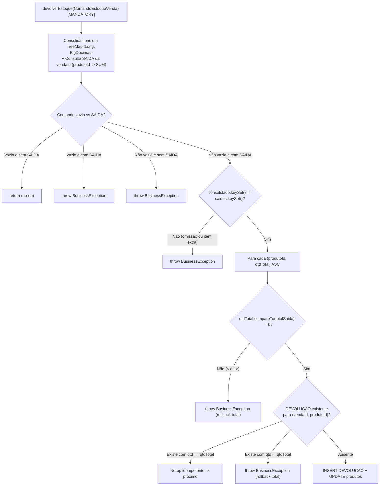

# DEBT-ARCH-004 — Runbook PR 4: E4 (Invariantes Estritas de Devolução Integral e Avaliação de Índice `V9`)

> Runbook executável e autocontido para o PR 4. Contexto transversal, topologia e backlog separado: [README.md](./README.md).

## Status de Execução

- [ ] **E4 — Devolução estritamente integral e avaliação condicional de índice `V9`:** atualização do contrato Javadoc em `EstoqueCommandService.devolverEstoque`, novas queries de `SAIDA` e `DEVOLUCAO` em `MovimentacaoRepository`, matriz completa de integralidade e repetição em `EstoqueService.devolverEstoque`, avaliação via `EXPLAIN (ANALYZE, BUFFERS)` para decidir sobre `V9`, atualização das suítes unitárias/`*IT` e de `docs/domains/inventory.md` (`F4`, `Q4`).

---

## 1. Contexto & Invariantes

- **Pré-condições Técnicas e Fronteira Afetada:**
  - O índice único parcial `uk_movimentacoes_venda_produto_devolucao` (`V8`) garante no máximo 1 linha `DEVOLUCAO` por `(venda_id, produto_id)`, restringindo o domínio a **devolução integral única** (devoluções parciais sucessivas não são suportadas).
  - O **Checkout** ([`VendaService.cancelarVendaConcluida`](../../../apps/inv-service/src/main/java/inv/checkout/usecase/VendaService.java#L157), sob `findByIdWithLock(vendaId)`) envia todos os `itens_venda` da venda. Dentro da fronteira do Bounded Context `inv.inventory` (sem acoplar em `vendas` ou `itens_venda`, preservando `R4`/`R7`/`R8`/`R13`/`ModulithTest`), [`EstoqueService`](../../../apps/inv-service/src/main/java/inv/inventory/usecase/EstoqueService.java#L100) audita a integralidade diretamente contra todas as movimentações `TipoMovimentacao.SAIDA` registradas para `vendaId`.

- **F4 / Q4 — Matriz Fechada de Decisão (Comando Vazio vs `SAIDA`s Registradas):**
  - **Problema:** Hoje `EstoqueService.devolverEstoque` executa `if (comando.itens().isEmpty()) return;` antes de consultar o banco, nunca verifica as movimentações `SAIDA` da venda e ignora silenciosamente qualquer item que já possua `DEVOLUCAO` (`existsByVendaIdAndProdutoIdAndTipo`), aceitando devoluções parciais, acima do vendido, omissões de itens ou repetições com quantidades divergentes.
  - **Invariante / Solução:** Remover o `return` antecipado para comando vazio; consolidar o comando por `produtoId` em `TreeMap<Long, BigDecimal>` (`produtoId ASC`) e consultar em [`MovimentacaoRepository`](../../../apps/inv-service/src/main/java/inv/inventory/infrastructure/persistence/MovimentacaoRepository.java) o mapa `produtoId -> SUM(quantidade)` de `SAIDA`s da `vendaId`:
    1. Comando **vazio** e **nenhuma** `SAIDA` na venda → **no-op** (nada a devolver).
    2. Comando **vazio** e **com** `SAIDA` na venda → `BusinessException` (omissão total de itens).
    3. Comando **não vazio** e **nenhuma** `SAIDA` na venda → `BusinessException`.
    4. Comando **não vazio** e **com** `SAIDA`: exigir **igualdade dos conjuntos** de `produtoId` (`consolidado.keySet().equals(saidasPorProduto.keySet())`; item faltante ou item sem `SAIDA` → `BusinessException`) e, na iteração em ordem `produtoId ASC`, exigir **`quantidadeTotal.compareTo(totalSaida) == 0`** (rejeitar `<` e `>` com `BusinessException`).

- **Q4 — Repetição Idêntica (No-Op) vs Divergente (`BusinessException`) e Rollback Total:**
  - **Invariante / Solução:** Substituir `existsByVendaIdAndProdutoIdAndTipo` por consulta que retorna a quantidade da `DEVOLUCAO` existente para `(vendaId, produtoId)`: se presente com `quantidadeRegistrada.compareTo(quantidadeTotal) == 0`, registrar log e prosseguir como no-op idempotente (sem alterar saldo); se presente com quantidade divergente (`compareTo != 0`), lançar **`BusinessException`**. Caso contrário, executar `INSERT` (`DEVOLUCAO`) antes do `UPDATE` atômico em `produtos`. Qualquer falha em qualquer item reverte integralmente o lote (`Propagation.MANDATORY`).

- **Q4 — Avaliação Condicional do Índice `V9` (`EXPLAIN (ANALYZE, BUFFERS)`):**
  - **Invariante / Solução:** Executar análise de volume/seletividade e `EXPLAIN (ANALYZE, BUFFERS)` na consulta por `(venda_id, tipo = 'SAIDA')` seguindo o molde de [`EstoqueCommandServiceIT`](../../../apps/inv-service/src/test/java/inv/inventory/EstoqueCommandServiceIT.java#L411-L428). Criar a migration `V9` (`CREATE INDEX CONCURRENTLY IF NOT EXISTS ... ON movimentacoes_estoque (venda_id) WHERE tipo = 'SAIDA'` + sidecar `.conf` com `executeInTransaction=false`) **somente** se o plano de execução e a seletividade justificarem o ganho; caso contrário, registrar a evidência de que o índice parcial não é necessário.



---

## 2. Referência de Contratos (Published Language & DDL)

### Contrato Público Atualizado (`inv.inventory.api.EstoqueCommandService`)

```java
/**
 * Devolução estritamente integral e única por venda: exige transação ativa (Propagation.MANDATORY),
 * consolida quantidades por produtoId em ordem crescente (produtoId ASC) e audita contra todas as
 * movimentações SAIDA registradas para vendaId (a origem integral dos itens cabe ao Checkout).
 * Rejeita omissões, excessos, faltas ou repetição com quantidade divergente via BusinessException.
 */
void devolverEstoque(ComandoEstoqueVenda comando);
```

### Queries em `MovimentacaoRepository` e DDL Condicional (`V9`)

```java
// Projeção/agregação das SAIDA registradas para a venda (inv.inventory.infrastructure.persistence)
// SELECT m.produto.id, SUM(m.quantidade) FROM MovimentacaoEstoque m
// WHERE m.vendaId = :vendaId AND m.tipo = inv.inventory.domain.model.TipoMovimentacao.SAIDA GROUP BY m.produto.id

// Consulta da quantidade de DEVOLUCAO já registrada para (vendaId, produtoId)
Optional<BigDecimal> buscarQuantidadeDevolucao(
        @Param("vendaId") Long vendaId,
        @Param("produtoId") Long produtoId
);
```

```sql
-- DDL condicional V9__indice_movimentacoes_estoque_saida.sql (criar SOMENTE se EXPLAIN/volume justificar)
-- Requer sidecar .conf com: executeInTransaction=false
CREATE INDEX CONCURRENTLY IF NOT EXISTS idx_movimentacoes_venda_saida
    ON movimentacoes_estoque (venda_id)
    WHERE tipo = 'SAIDA';
```

---

## 3. Passos de Implementação & Critérios de Teste

### Roteiro de Implementação

1. **Passo 1 — Contrato Javadoc e queries em `MovimentacaoRepository` (`F4`, `Q4`):**
   - Atualizar o Javadoc de `devolverEstoque` em [`EstoqueCommandService.java`](../../../apps/inv-service/src/main/java/inv/inventory/api/EstoqueCommandService.java) explicitando a devolução integral única por venda e a responsabilidade de envio pelo Checkout vs auditoria pelo Inventory.
   - Em [`MovimentacaoRepository.java`](../../../apps/inv-service/src/main/java/inv/inventory/infrastructure/persistence/MovimentacaoRepository.java), adicionar a consulta agregada das `SAIDA`s por `vendaId` e a consulta `Optional<BigDecimal>` da quantidade de `DEVOLUCAO` por `(vendaId, produtoId)` (mantendo `existsByVendaIdAndProdutoIdAndTipo` apenas se ainda utilizada por testes existentes até sua migração).
2. **Passo 2 — Matriz de integralidade e repetição em `EstoqueService` (`F4`, `Q4`):**
   - Em [`EstoqueService.java`](../../../apps/inv-service/src/main/java/inv/inventory/usecase/EstoqueService.java#L100), remover o `return` antecipado de `comando.itens().isEmpty()`, consultar o mapa de `SAIDA`s da `vendaId`, aplicar os 4 casos da matriz fechada (`F4`/`Q4`) e comparar a quantidade de eventual `DEVOLUCAO` existente antes de persistir `DEVOLUCAO` + `devolverEstoqueAtomo`.
3. **Passo 3 — Avaliação condicional de `V9` (`Q4`):**
   - Rodar `EXPLAIN (ANALYZE, BUFFERS)` no PostgreSQL Testcontainers para a consulta por `(venda_id, tipo = 'SAIDA')`; adicionar a migration `V9` + `.conf` (`executeInTransaction=false`) **apenas** se justificada pelo plano/seletividade, registrando o resultado no PR/documentação.
4. **Passo 4 — Atualização de fixtures/testes existentes, novos cenários e documentação:**
   - Atualizar [`EstoqueServiceLoteTest.java`](../../../apps/inv-service/src/test/java/inv/inventory/usecase/EstoqueServiceLoteTest.java#L531-L675) com mocks de `SAIDA` e de quantidade `DEVOLUCAO`.
   - Em [`DevolucaoConcorrenciaDeadlockIT.java`](../../../apps/inv-service/src/test/java/inv/it/DevolucaoConcorrenciaDeadlockIT.java), registrar `SAIDA` prévia nas fixtures SubA e SubB do Teste 3 e migrar a interceptação do spy de `existsByVendaIdAndProdutoIdAndTipo` para `buscarQuantidadeDevolucao`: ambas as threads devem atingir o `CountDownLatch` e receber `Optional.empty()` antes do INSERT. Preservar a carga, os timeouts e a exigência de exatamente um commit e uma falha com SQLState `23505` no subcenário sincronizado.
   - Em [`EstoqueCommandServiceIT.java`](../../../apps/inv-service/src/test/java/inv/inventory/EstoqueCommandServiceIT.java#L537-L560), substituir o segundo produto inexistente por produto real com ID maior que P1 e registrar `SAIDA`s válidas para ambos. Provocar falha determinística em P2 após o INSERT e o UPDATE de P1; verificar o ponto da falha e o tipo/motivo da exceção, sem aceitar uma rejeição antecipada de integralidade como prova de rollback.
   - Adicionar os novos testes unitários e `*IT` da matriz abaixo e atualizar [`docs/domains/inventory.md`](../../../docs/domains/inventory.md).

### Critérios de Teste (Comportamento Esperado)

- **Cenário 1 — Comando vazio com e sem `SAIDA` registrada (`EstoqueServiceLoteTest`, `EstoqueCommandServiceIT`):**
  - *Condição:* Venda sem movimentação `SAIDA` vs venda com `SAIDA` registrada para pelo menos 1 produto.
  - *Ação/Gatilho:* Invocar `devolverEstoque` passando `List.of()`.
  - *Asserção/Resultado Esperado:* Sem `SAIDA` retorna no-op sem alterar `produtos` ou inserir `DEVOLUCAO`; com `SAIDA` lança `BusinessException` por omissão total de itens.
- **Cenário 2 — Comando não vazio sem `SAIDA` prévia (`EstoqueServiceLoteTest`, `EstoqueCommandServiceIT`):**
  - *Condição:* Venda sem nenhuma movimentação `SAIDA` registrada.
  - *Ação/Gatilho:* Invocar `devolverEstoque` com itens `[P1: 2.000]`.
  - *Asserção/Resultado Esperado:* Lança `BusinessException` sem inserir `DEVOLUCAO` nem alterar `estoque_disponivel`.
- **Cenário 3 — Omissão de item e item estranho à venda (`EstoqueServiceLoteTest`, `EstoqueCommandServiceIT`):**
  - *Condição:* Venda com `SAIDA`s `[P1: 2.000, P2: 3.000]`.
  - *Ação/Gatilho:* Enviar `[P1: 2.000]` (omissão de `P2`) e enviar `[P1: 2.000, P2: 3.000, P3: 1.000]` (item `P3` sem `SAIDA`).
  - *Asserção/Resultado Esperado:* Ambos rejeitados com `BusinessException` antes de mutar saldo ou gravar movimentação.
- **Cenário 4 — Devolução parcial (`< totalSaida`) ou excedente (`> totalSaida`) (`EstoqueServiceLoteTest`, `EstoqueCommandServiceIT`):**
  - *Condição:* Venda com `SAIDA`s `[P1: 2.000, P2: 3.000]`.
  - *Ação/Gatilho:* Enviar `[P1: 1.000, P2: 3.000]` (parcial) e `[P1: 3.000, P2: 3.000]` (acima da saída).
  - *Asserção/Resultado Esperado:* Ambos rejeitados com `BusinessException`; `estoque_disponivel` e `movimentacoes_estoque` permanecem intactos após rollback.
- **Cenário 5 — Repetição idêntica no-op vs repetição divergente (`EstoqueServiceLoteTest`, `EstoqueCommandServiceIT`):**
  - *Condição:* `P1` com `SAIDA` de `2.000` e `DEVOLUCAO` já persistida de `2.000`.
  - *Ação/Gatilho:* Reenviar `P1: 2.000` (idêntica) vs enviar comando com quantidade divergente para `DEVOLUCAO` existente.
  - *Asserção/Resultado Esperado:* Repetição idêntica age como no-op idempotente sem `UPDATE`; quantidade divergente lança `BusinessException`.
- **Cenário 6 — Rollback integral do lote (`EstoqueCommandServiceIT`, `DevolucaoConcorrenciaDeadlockIT`):**
  - *Condição:* Lote `[P1: 2.000, P2: 1.000]` com dois produtos existentes (`P1.id < P2.id`), `SAIDA`s prévias nas mesmas quantidades e nenhuma devolução em P1. Registrar saldos e movimentações iniciais; preparar em P2 uma `DEVOLUCAO` divergente ou falha simulada determinística no segundo item.
  - *Ação/Gatilho:* Executar `devolverEstoque` dentro de `TransactionTemplate` (`Propagation.MANDATORY`), comprovando que o INSERT e o UPDATE de P1 ocorreram antes da falha esperada em P2; verificar o tipo/motivo específico da exceção.
  - *Asserção/Resultado Esperado:* Após o rollback, consultar em nova transação e comparar saldos, quantidades e contagens de movimentações com o estado inicial: nenhuma nova `DEVOLUCAO` persiste e qualquer devolução preexistente de P2 permanece intacta. No Teste 3 de `DevolucaoConcorrenciaDeadlockIT`, o latch na nova consulta força duas leituras vazias antes dos INSERTs: exatamente um commit e uma falha `23505`, uma única `DEVOLUCAO` e saldo recomposto uma única vez.

---

## 4. Commits Sugeridos e Definition of Done (DoD)

### Commits Sugeridos

- `feat(inventory): impoe devolucao estritamente integral contra movimentacoes SAIDA (F4, Q4)`
- `perf(inventory): avalia indice parcial V9 para consultas SAIDA por venda (Q4)` *(somente se `V9` for justificada)*
- `test(inventory): adapta fixtures e cobre matriz completa de devolucao integral e rollback (F4, Q4)`
- `docs(inventory): atualiza invariantes de devolucao integral em inventory.md`

### Comandos de Validação

```bash
# 1. Testes unitários de Inventory
mvn test -pl apps/inv-service "-Dtest=EstoqueServiceLoteTest,EstoqueServiceTest"

# 2. Testes de integração de devolução, concorrência e cancelamento (Docker ativo obrigatório)
mvn test -pl apps/inv-service "-Dtest=EstoqueCommandServiceIT,DevolucaoConcorrenciaDeadlockIT,CancelamentoVendaConcluidaIT,CancelamentoPagamentoRaceIT,CicloVendaEstoqueCharacterizationIT"

# 3. Gates de arquitetura e evidência Surefire
mvn test -pl apps/inv-service -am "-Dtest=ArquiteturaTest,ModulithTest" "-Dsurefire.failIfNoSpecifiedTests=false"
# Verificar em apps/inv-service/target/surefire-reports/TEST-*IT.xml: skipped="0" failures="0" errors="0"
```

### Rollback e Contingência Operacional

- **Rollback de código:** `git revert` direto dos commits Java e de testes.
- **Preservação do histórico do Flyway (`V9`):** caso `V9` tenha sido criada e aplicada em ambiente compartilhado/produção, **mantê-la** no repositório (política Flyway de não remover migrations aplicadas; o índice `CONCURRENTLY` parcial `WHERE tipo = 'SAIDA'` não altera dados nem contratos).

### Definition of Done (DoD)

- [ ] `EstoqueCommandService.devolverEstoque` documentado e `EstoqueService.devolverEstoque` validando a matriz integral contra `SAIDA`s e comparando quantidade de `DEVOLUCAO` existente.
- [ ] Avaliação via `EXPLAIN (ANALYZE, BUFFERS)` executada e decisão sobre `V9` documentada/aplicada conforme critério objetivo.
- [ ] `EstoqueServiceLoteTest`, `EstoqueCommandServiceIT`, `DevolucaoConcorrenciaDeadlockIT` e suíte completa `*IT` verdes com evidência `skipped = 0`, `failures = 0`, `errors = 0` em `apps/inv-service/target/surefire-reports/`.
- [ ] `ArquiteturaTest`, `ModulithTest` e atualização de `docs/domains/inventory.md` concluídos em Java 21 LTS.
