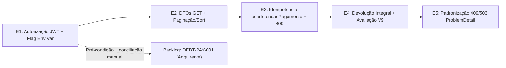
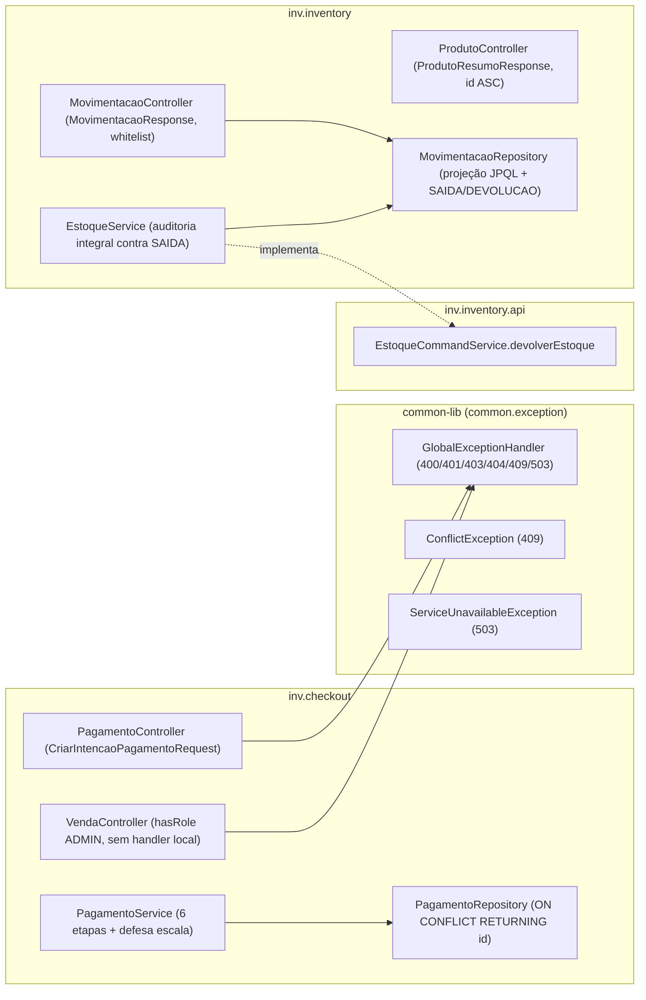

# DEBT-ARCH-004 — Autorização JWT, Contratos HTTP de Catálogo/Auditoria, Idempotência de Pagamento, Devolução Integral e RFC 7807 (`inv-service` & `common-lib`)

> **TL;DR:** Este épico executa o próximo ciclo de saneamento técnico do `inv-service` e da `common-lib` em **5 PRs incrementais** (`E1`–`E5`) mais um **backlog separado** (`DEBT-PAY-001` e higiene futura). O **PR 1 (`E1`)** corrige a divergência de autorização em `VendaController` (`hasAuthority('ADMIN')` → `hasRole('ADMIN')`), prova a cadeia real de filtros JWT em `VendaSecurityFilterTest` e `ProdutoSecurityFilterTest` e parametriza a env var `FEATURES_CANCELAMENTO_VENDA_CONCLUIDA_ENABLED` (default `false`, condicionada à conciliação operacional). O **PR 2 (`E2`)** elimina a `LazyInitializationException` em `GET /movimentacoes` via projeção JPQL (`MovimentacaoResponse`), adota `ProdutoResumoResponse` preservando `estoqueDisponivel` em `GET /produtos*` e fecha o contrato determinístico de paginação e ordenação. O **PR 3 (`E3`)** implementa o protocolo de idempotência em 6 etapas em `PagamentoService.criarIntencaoPagamento` (lock pessimista em `vendas`, reconsulta pós-lock, `INSERT ... ON CONFLICT DO NOTHING RETURNING id` e rejeição de escala `> 2` casas decimais) e introduz `ConflictException` (`409 ProblemDetail`) em `common-lib`. O **PR 4 (`E4`)** impõe devolução estritamente integral em `EstoqueService.devolverEstoque` contra as `SAIDA`s da venda e avalia condicionalmente o índice `V9`. O **PR 5 (`E5`)** padroniza HTTP `409`/`503` em `ProblemDetail` (`ServiceUnavailableException` em `common-lib`) removendo os `@ExceptionHandler` locais de `VendaController`.

---

## 1. Roadmap dos 5 PRs e Status

| PR | Etapa | Runbook | Entregáveis Chave | Status |
| :---: | :---: | :--- | :--- | :---: |
| **1** | **E1** | [E1.md](./E1.md) | `hasRole('ADMIN')` em `VendaController`, `VendaSecurityFilterTest` (red → green), `ProdutoSecurityFilterTest`, env var da flag (`false`) e docs (`F1`, `Q1`) | `[ ]` Pendente |
| **2** | **E2** | [E2.md](./E2.md) | `MovimentacaoResponse` via JPQL + `countQuery`, `ProdutoResumoResponse` (`estoqueDisponivel`), normalização de `page`/`size`, whitelist de `sort` + HTTP 400 (`F2`, `Q2`) | `[ ]` Pendente |
| **3** | **E3** | [E3.md](./E3.md) | Protocolo em 6 etapas em `criarIntencaoPagamento`, `ON CONFLICT DO NOTHING RETURNING id`, rejeição de escala `> 2`, `ConflictException` (`409`) em `common-lib` (`F3`, `Q3`) | `[ ]` Pendente |
| **4** | **E4** | [E4.md](./E4.md) | Devolução estritamente integral (`SAIDA`s vs comando e `DEVOLUCAO`), remoção do `return` antecipado, rollback de lote e avaliação condicional de `V9` (`F4`, `Q4`) | `[ ]` Pendente |
| **5** | **E5** | [E5.md](./E5.md) | `ServiceUnavailableException` (`503 ProblemDetail`) em `common-lib`, remoção dos handlers locais de `VendaController` e alinhamento de consumidores (`F5`, `Q5`) | `[ ]` Pendente |

**Princípios Transversais Inegociáveis:**
- **Evolução Compatível e Preservação de Fronteiras:** `pom.xml` (exceto dependências já declaradas), `archunit_store/` (ausente) e regras `R1`–`R15` (`ArquiteturaTest`) e `ModulithTest` permanecem estritamente respeitados.
- **Execução Real dos `*IT`:** como `apps/inv-service/pom.xml` usa `maven-surefire-plugin` sem `maven-failsafe-plugin`, `mvn clean test` não garante por si a cobertura dos `*IT` se filtrados; cada PR deve invocar explicitamente os `*IT` pertinentes com Docker ativo e inspecionar `apps/inv-service/target/surefire-reports/` comprovando `skipped = 0`, `failures = 0` e `errors = 0`.
- **Coordenação de Contratos Externos:** busca nos demais módulos Java (`auth-service`, `mail-service`, `api-gateway`) confirma que nenhum serviço interno desserializa `/produtos`, `/movimentacoes` ou `/vendas/{id}/cancelar` (`api-gateway` apenas roteia). Os consumidores diretos são clientes externos (SPA / PDV) fora deste repositório, exigindo alinhamento prévio antes do deploy dos PRs 2, 3 e 5.

---

## 2. Topologia Arquitetural, Fronteiras Afetadas e Consumidores

| Frente | Consumidor Interno (`apps/`) | Consumidor Externo (SPA / PDV) | Coordenação Obrigatória |
| :--- | :--- | :--- | :--- |
| **`PR 1` (`VendaController`)** | Nenhum | PDV / Painel Administrativo | Token emitido pelo `auth-service` já carrega `"ROLE_ADMIN"`; comportamento passa a autorizar `ROLE_ADMIN` e manter `ROLE_USER` com `403`. |
| **`PR 2` (`/produtos*`, `/movimentacoes`)** | Nenhum (`api-gateway` apenas encaminha) | SPA / PDV | Confirmar ausência de uso de `estoqueMinimo`, `estoqueReservado` e `version` em `/produtos*`; alinhar formato plano `MovimentacaoResponse`, teto `size <= 50` e `400` para `sort` inválido. |
| **`PR 3` (`POST /pagamentos/intencao/{vendaId}`)** | Nenhum | PDV / Orquestrador de Checkout | Clientes não devem enviar `valor` com mais de 2 casas decimais (`400`); tratar `404` (venda inexistente) e `409 ProblemDetail` (status incompatível ou UUID divergente). |
| **`PR 5` (`POST /vendas/{id}/cancelar`)** | Nenhum | Painel Administrativo / PDV | Migrar leitura de erro `409`/`503` de `$.mensagem` para `ProblemDetail` (`$.title`, `$.detail`, `$.status`, `$.type`). |

---

## 3. Matriz de Rastreabilidade Transversal (`F1`–`F5` e `Q1`–`Q5`)

| ID | Tipo | Descrição, Causa Raiz e Decisão Fechada | PR / Etapa |
| :---: | :---: | :--- | :---: |
| **F1** | Bug | `auth-service` grava `"ROLE_ADMIN"`/`"ROLE_USER"` na claim `"roles"` e `SecurityConfig` usa `setAuthorityPrefix("")`, mas `VendaController` exige `@PreAuthorize("hasAuthority('ADMIN')")`, bloqueando administradores reais com HTTP 403. | PR 1 / E1 |
| **Q1** | Decisão | Trocar para `@PreAuthorize("hasRole('ADMIN')")` (mantendo política administrativa), provar com `VendaSecurityFilterTest` (red → green) e `ProdutoSecurityFilterTest` (caracterização), e parametrizar `FEATURES_CANCELAMENTO_VENDA_CONCLUIDA_ENABLED` com default `false`. | PR 1 / E1 |
| **F2** | Bug | `MovimentacaoController` expõe `@Entity MovimentacaoEstoque` (`@ManyToOne LAZY Produto`) sob `open-in-view=false`, quebrando com `LazyInitializationException`; `ProdutoController` expõe `@Entity Produto` com campos internos (`estoqueMinimo`, `estoqueReservado`, `version`) e sem normalização de `page`/`size`. | PR 2 / E2 |
| **Q2** | Decisão | Projeção JPQL `MovimentacaoResponse` com `countQuery` explícito; `ProdutoResumoResponse` preservando `estoqueDisponivel`; normalização (`page < 0 -> 0`; `size < 1 -> default`; `size > 50 -> 50`); `id ASC` fixo em produtos; whitelist `{id, dataHora, tipo, quantidade}` + HTTP 400 + desempate `id ASC` em movimentações. | PR 2 / E2 |
| **F3** | Fragilidade | `PagamentoService.criarIntencaoPagamento` usa `findById` (400 se ausente), não valida `venda.getStatus().aceitaPagamento()`, não checa divergência de payload no mesmo UUID, sofre corrida em `save()` e aceita escala `> 2` em `BigDecimal` com risco de falso `409` por arredondamento em `NUMERIC(10,2)`. | PR 3 / E3 |
| **Q3** | Decisão | Antecipar `ConflictException` (`409 ProblemDetail`) em `common-lib`; executar protocolo em 6 etapas (consulta rápida → `findByIdWithLock` → reconsulta pós-lock → `aceitaPagamento()` → `ON CONFLICT DO NOTHING RETURNING id` a partir de instância `Pagamento` → fallback); rejeitar escala `> 2` (nunca arredondar) com normalização em `CriarIntencaoPagamentoRequest` + defesa no service. | PR 3 / E3 |
| **F4** | Fragilidade | `EstoqueService.devolverEstoque` retorna cedo para lista vazia e não audita contra as `SAIDA`s registradas na venda nem compara a quantidade de `DEVOLUCAO` já persistida, aceitando devolução parcial, omissão de item ou repetição com quantidade divergente. | PR 4 / E4 |
| **Q4** | Decisão | Remover `return` antecipado; consultar `SAIDA`s da venda em `MovimentacaoRepository`; impor igualdade de conjuntos de `produtoId`, `quantidadeTotal.compareTo(totalSaida) == 0` e comparação de quantidade em `DEVOLUCAO` existente (igual → no-op; diferente → `BusinessException`); avaliar índice `V9` somente se justificado por volume e `EXPLAIN (ANALYZE, BUFFERS)`. | PR 4 / E4 |
| **F5** | Dívida | `VendaController` mantém `@ExceptionHandler` locais retornando `{"mensagem": "..."}` para `409`/`503`, divergindo do padrão RFC 7807 (`ProblemDetail`) do `GlobalExceptionHandler`. | PR 5 / E5 |
| **Q5** | Decisão | Introduzir `ServiceUnavailableException` (`503 ProblemDetail`) em `common-lib`; fazer `CancelamentoVendaConflitoException` estender `ConflictException` e `CancelamentoVendaDesabilitadoException` estender `ServiceUnavailableException`; remover handlers locais de `VendaController` e atualizar testes e clientes. | PR 5 / E5 |

---

## 4. Governança da Feature Flag, Estratégia de Rollback e Backlog Separado

### 4.1 Feature Flag `FEATURES_CANCELAMENTO_VENDA_CONCLUIDA_ENABLED`
- **Parametrização (PR 1):** variável exposta em `application.properties`, `docker-compose.yml` e `.env.example` com default **`false`**.
- **Natureza do Estorno Atual:** o cancelamento atual executa estorno interno/contábil (`StatusPagamento.ESTORNADO`, lançamento `ESTORNO` no Finance e recomposição física de estoque); o reembolso real no adquirente pertence ao épico **`DEBT-PAY-001`**.
- **Pré-condições para Ativação (`true`) com Pagamentos Reais:** (1) PR 1 a PR 4 entregues e validados com `*IT` verdes; (2) procedimento operacional de conciliação manual no adquirente documentado e validado para pagamentos `ESTORNADO` e `excedente = true`.
- **Rollback Operacional:** definir a flag como `false` bloqueia **novos** cancelamentos com HTTP 503 sem desfazer cancelamentos já concluídos.

### 4.2 Estratégia de Rollback por PR

| PR | Estratégia de Rollback e Contingência |
| :---: | :--- |
| **PR 1 (`E1`)** | `git revert` direto do código Java e testes; manter `FEATURES_CANCELAMENTO_VENDA_CONCLUIDA_ENABLED=false` impede novos cancelamentos sem reverter vendas já canceladas. |
| **PR 2 (`E2`)** | **Atenção:** se clientes externos já tiverem migrado para `MovimentacaoResponse` plano ou `ProdutoResumoResponse`, **`git revert` isolado no servidor quebrará esses clientes**. Coordenar janela com downgrade dos clientes ou camada temporária de compatibilidade antes de reverter. |
| **PR 3 (`E3`)** | Rollback coordenado entre `common-lib` (`ConflictException`) e `inv-service`, sem alteração de DDL. Coordenar também com clientes que já tratem `404`/`409 ProblemDetail` ou a rejeição `400` de escala `> 2`. |
| **PR 4 (`E4`)** | `git revert` do código Java e testes. Caso a migration condicional `V9` tenha sido criada e aplicada no banco, **mantê-la** no repositório pela política de imutabilidade do Flyway (ou remover índice `CONCURRENTLY` somente se explicitamente gerido fora do histórico aplicado). |
| **PR 5 (`E5`)** | Coordenado entre `common-lib` (`ServiceUnavailableException`), `inv-service` e consumidores externos caso os clientes já tenham migrado de `$.mensagem` para `ProblemDetail`. |

### 4.3 Backlog Separado (Fora dos PRs 1–5)
- **`DEBT-PAY-001` — Integração Real com Adquirente:** port/adapter de reembolso externo para pagamentos `ESTORNADO` e `excedente = true`, worker com retry/DLQ e conciliação automatizada.
- **Liberação de PDV para `ROLE_USER`:** decisão de autorização dedicada fora do hotfix do PR 1.
- **Padronização ampla de `Clock`:** injeção de `java.time.Clock` nas classes de `inv-service` e `GlobalExceptionHandler` (mantendo construtor sem argumentos com `Clock.systemUTC()`).
- **Teste negativo sintético da regra `R15`:** validação isolada via `ClassFileImporter` em `ArquiteturaTest`.
- **Remoção futura de `StatusVenda.CANCELAMENTO_SOLICITADO`:** mantido por ora; remoção condicionada à verificação de dados persistidos em `vendas`, ajuste de `StatusVenda.FATURADAS` e recriação `CONCURRENTLY` de `idx_vendas_concluidas` (`V5`).
- **Maven Failsafe / `verify`:** configuração formal separando unitários (`*Test`) de integração (`*IT`) no ciclo `mvn verify` e no CI.

---

## 5. Definition of Done (DoD) Global

- [ ] **PR 1 (`E1`):** `VendaController` exige `hasRole('ADMIN')`, `VendaSecurityFilterTest` e `ProdutoSecurityFilterTest` provam `200`/`403`/`401` na cadeia real de filtros JWT e `FEATURES_CANCELAMENTO_VENDA_CONCLUIDA_ENABLED` parametrizada com default `false`.
- [ ] **PR 2 (`E2`):** `GET /movimentacoes` e `GET /produtos*` retornam `MovimentacaoResponse` e `ProdutoResumoResponse` (`estoqueDisponivel`), sem `LazyInitializationException`, com paginação normalizada e ordenação/whitelist testadas após alinhamento com consumidores.
- [ ] **PR 3 (`E3`):** `ConflictException` (`409 ProblemDetail`) em `common-lib`; `criarIntencaoPagamento` executa o protocolo de 6 etapas (`ON CONFLICT DO NOTHING RETURNING id`) e rejeita `> 2` casas decimais sem arredondar, provado por testes unitários e `*IT` concorrentes em PostgreSQL.
- [ ] **PR 4 (`E4`):** `EstoqueService.devolverEstoque` impõe devolução estritamente integral contra `SAIDA`s e valida quantidade em repetição de `DEVOLUCAO`, com avaliação `EXPLAIN (ANALYZE, BUFFERS)` documentada para `V9`.
- [ ] **PR 5 (`E5`):** `ServiceUnavailableException` (`503 ProblemDetail`) em `common-lib`; handlers locais removidos de `VendaController`; consumidores e suítes (`GlobalExceptionHandlerTest`, `VendaControllerTest`, `CancelamentoVendaConcluidaIT`) migrados para `ProblemDetail`.
- [ ] **Evidência Surefire e Gates:** todos os unitários, `*IT` pertinentes (inspecionados em `apps/inv-service/target/surefire-reports/` com `skipped = 0`, `failures = 0`, `errors = 0`), `ArquiteturaTest` (`R1`–`R15`) e `ModulithTest` verdes em Java 21 LTS com Docker ativo.
