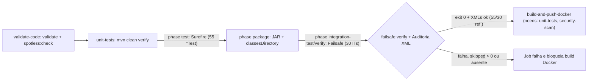

# DEBT-ARCH-005 — Runbook PR 1: E1 (Execução dos Testes de Integração via Failsafe e CI)

> Runbook executável e autocontido para o PR 1. Contexto transversal, divergências de inventário e roadmap: [README.md](./README.md).

## Status de Execução

- [x] **E1 concluída.** O job `unit-tests` executa `mvn clean verify` e audita os XMLs antes do build das imagens Docker (`F1`, `F2`, `Q1`, `Q2`).

Na validação local com Java 21, `mvn clean test` executou 589 casos em 55 classes. Com Docker, `mvn clean verify` executou também 141 casos em 30 classes de integração. A auditoria conciliou os 85 relatórios com os fontes. No ensaio reversível, o Failsafe registrou uma falha em `InventarioHttpIT` e o Maven encerrou `verify` com código 1.

---

## 1. Contexto & Invariantes

O diagnóstico e o inventário desta seção registram a situação anterior à E1.

- **F1 / Q1 — Comportamento Observado Hoje vs Partição Proposta (Surefire vs Failsafe):**
  - **Observado nos POMs:** O [`pom.xml`](../../../pom.xml) raiz herda `spring-boot-starter-parent:3.4.13`, que já declara no `<pluginManagement>` `maven-surefire-plugin:3.5.4` e `maven-failsafe-plugin:3.5.4` (goals `integration-test` e `verify`, com `<classesDirectory>${project.build.outputDirectory}</classesDirectory>`). Contudo, nenhum POM declara `<excludes>` no Surefire ou ativa o Failsafe em `<build><plugins>`.
  - **Impacto observado no Surefire:** Pelos padrões default (`**/Test*.java`, `**/*Test.java`, `**/*Tests.java`, `**/*TestCase.java`), `mvn test` seleciona `55 *Test` + `4 *IntegrationTest` (`59` classes, exigindo Docker em `inv-service` e `mail-service`) e deixa de fora todas as **`26 *IT`** do `inv-service`.
  - **Classes fora dos padrões padrão:** [`ProjecaoDuravelSupport`](../../../apps/inv-service/src/test/java/inv/it/ProjecaoDuravelSupport.java) (`abstract`, sem `@Test`) e [`OutboxConcurrencyManualRunner`](../../../apps/inv-service/src/test/java/inv/scheduler/OutboxConcurrencyManualRunner.java) (diagnóstico manual com `@EnabledIfEnvironmentVariable(named = "DOCKER_READY", matches = "true")` apontando para `localhost:5435`). No histórico do `DEBT-ARCH-004`, o runner manual só apareceu como ignorado quando `-Dtest=!*IT,!*IntegrationTest` substituiu os `<includes>` padrão do Surefire por negação pura.
  - **Mudança proposta para implementação futura:** No `<pluginManagement>` do POM raiz, configurar `<excludes>` do Surefire incluindo `**/*$*`, `**/*IT.java` e `**/*IntegrationTest.java` (pois definir `<excludes>` substitui o padrão default `**/*$*` do Surefire `3.5.4`; mantê-lo preserva a exclusão de classes internas `*Tests` e a descoberta de `@Nested` pela classe externa sem risco de duplicação) e configurar `<includes>` do Failsafe com `**/*IT.java` e `**/*IntegrationTest.java`, ativando o Failsafe no `<build><plugins>` (não há wrapper `mvnw` no repositório). Assim, `mvn test` executa `55` unitários sem Docker e `mvn verify` executa `55` unitários no Surefire + `30` integrações no Failsafe, mantendo `ProjecaoDuravelSupport` e `OutboxConcurrencyManualRunner` fora de ambos.

- **F2 / Q1 — Preservação de Mockito (`-javaagent`), `common-lib` e Comandos Direcionados:**
  - **Observado nos módulos:** `api-gateway`, `auth-service`, `mail-service` e `inv-service` declaram `maven-dependency-plugin:properties` e `maven-surefire-plugin` com `<argLine>-javaagent:${org.mockito:mockito-core:jar}</argLine>`; já `apps/common-lib/pom.xml` não declara Mockito nem esses plugins.
  - **Dependência de Mockito nas integrações:** Das `30` classes de integração, `29` usam Mockito (`@MockitoBean`, `@MockitoSpyBean` ou `Mockito.*`); apenas [`RedisAtividadeSistemaAdapterIT`](../../../apps/inv-service/src/test/java/inv/dashboard/RedisAtividadeSistemaAdapterIT.java) usa Testcontainers `GenericContainer` sem Spring nem Mockito.
  - **Invariante de configuração:** Adicionar `maven-failsafe-plugin` com `<argLine>-javaagent:${org.mockito:mockito-core:jar}</argLine>` apenas nos POMs dos `4` serviços, mantendo `apps/common-lib/pom.xml` intocado e preservando `maven-dependency-plugin:properties` e `maven-surefire-plugin`.
  - **Comandos direcionados e `-DskipTests`:** Em Surefire/Failsafe `3.5.4`, `-Dtest=...` e `-Dit.test=...` sobrepõem `<includes>`/`<excludes>` do plugin alvo. Preservar `-DskipTests` intacto nos dois plugins (sem redirecionar `<skipTests>` para propriedade própria), pois os `4` `Dockerfile`s executam `mvn clean package -pl apps/<service> -am -DskipTests`. Para isolar uma integração sem rodar unitários, usar `'-Dtest=!*' "-Dsurefire.failIfNoSpecifiedTests=false"` junto de `-Dit.test=<ClasseIT> "-Dfailsafe.failIfNoSpecifiedTests=false"`.

- **Q2 — Esteira de CI, Bloqueio de Imagens Docker e Auditoria Real dos XMLs:**
  - **Observado hoje:** Em [`.github/workflows/ci-cd.yml`](../../../.github/workflows/ci-cd.yml#L60-L105), o comentário da Etapa 2 já cita testes unitários e de integração, mas o job `unit-tests` roda `mvn clean test -DfailIfNoTests=false` em `ubuntu-latest` (com Docker já ativo, provado pelas `4 *IntegrationTest`), e `build-and-push-docker` declara `needs: [unit-tests, security-scan]`.
  - **Proposto e proteção anti-omissão:** Alterar o comando para `mvn clean verify` preservando o identificador `unit-tests` em `needs`. Como `failIfNoTests` já tem default `false` no Surefire e Failsafe `3.5.4` e `17` das `55` classes unitárias com `@Nested` gravam `tests="0"` na raiz `<testsuite>` apesar de executarem casos (só `PagamentoServiceTest` executa `58` casos), um build verde não garante cobertura nem `tests > 0` na raiz funciona. A auditoria deve comparar, por módulo e fase, as classes previstas nos fontes (lendo o `package` declarado) com os XMLs gerados (`55/30` como referência de `E1`, exigindo automaticamente `56/30` em `E2` com `ArquiteturaR15Test`), impondo `>= 1` `<testcase>` por relatório e ausência de falhas/skips na suíte e nos casos.

- **Inventário de Referência por Módulo (`87` arquivos `.java` em `apps/*/src/test/java/`):**

| Módulo | Selecionado hoje (Surefire) | Fora hoje | Surefire (`test`) | Failsafe (`verify`) | Manual / Abstrata |
| :--- | :--- | :--- | :---: | :---: | :---: |
| `common-lib` | `2 *Test` | `0` | `2` | `0` | `0` |
| `api-gateway` | `4 *Test` | `0` | `4` | `0` | `0` |
| `auth-service` | `18 *Test` | `0` | `18` | `0` | `0` |
| `mail-service` | `1 *IntegrationTest` | `0` | `0` | `1` | `0` |
| `inv-service` | `31 *Test` + `3 *IntegrationTest` | `26 *IT` | `31` | `29` | `2` |

  - **Unitários (`55 *Test`, todos sem Docker):**
    - `common-lib` (`2`): `common.security.RsaKeyUtilsTest`, `common.util.DateRangeTest`.
    - `api-gateway` (`4`): `GatewaySecurityConfigTest`, `RateLimitConfigTest`, `ActivityFilterTest`, `ActivityPurgeSchedulerTest`.
    - `auth-service` (`18`): `17` classes em `auth.*` (`config`, `controller`, `dto`, `model`, `security`, `service`) e `common.exception.GlobalExceptionHandlerTest`.
    - `inv-service` (`31`): `2` em `inv.architect` (`ArquiteturaTest`, `ModulithTest`), `3 *SecurityFilterTest` (`@SpringJUnitConfig` em memória) e `26` unitários puros em `inv.checkout`, `inv.dashboard`, `inv.finance`, `inv.inventory`, `inv.service` e `inv.shared`.
  - **Integrações (`30` classes = `26 *IT` + `4 *IntegrationTest`, todas com Testcontainers):**
    - `mail-service` (`1 *IntegrationTest`): `mail.service.EmailConsumerIdempotenciaIntegrationTest`.
    - `inv-service` (`3 *IntegrationTest`): `inv.finance.ProjecaoRetryIntegrationTest`, `inv.it.EstoqueConcorrenciaIntegrationTest`, `inv.shared.outbox.OutboxConcorrenciaIntegrationTest`.
    - `inv.checkout` (`1 *IT`): `JdbcVendaQueryServiceIT`.
    - `inv.dashboard` (`4 *IT`): `CargaSintetica7DiasCutoverIT`, `DashboardCacheIT`, `DashboardModularEndpointIT` e `inv.dashboard.infrastructure.redis.RedisAtividadeSistemaAdapterIT` (arquivo em `inv/dashboard/`, relatório XML usa o pacote declarado).
    - `inv.finance` (`2 *IT`): `ProjecaoMultiplosPagamentosIT`, `ProjecaoReceitaDiariaIT`.
    - `inv.inventory` (`4 *IT`): `EstoqueCommandServiceIT`, `InventarioHttpIT`, `JpaCatalogoQueryServiceIT`, `JpaEstoqueQueryServiceIT`.
    - `inv.it` (`15 *IT`): `CancelamentoExpiradoIdempotenteIT`, `CancelamentoPagamentoRaceIT`, `CancelamentoVendaConcluidaIT`, `CarrinhosInvertidosDeadlockIT`, `CicloVendaEstoqueCharacterizationIT`, `DevolucaoConcorrenciaDeadlockIT`, `EstoqueMultiItemConcorrenciaIT`, `HandlerExpiracaoMesmaVendaIT`, `IniciarVendaRetryIT`, `LedgerConcorrenciaIdempotenciaIT`, `PagamentoConcorrenciaGatesIT`, `PagamentoMensageriaIT`, `ProjecaoDuravelIT`, `ProjecaoDuravelSemDiariaIT`, `VendaEventHandlerIT`.



---

## 2. Referência de Contratos (Published Language & DDL)

Sem alteração de código de produção, interfaces `*.api`, contratos HTTP ou schema SQL (`Flyway`): esta etapa preserva integralmente a API pública e o schema.

---

## 3. Passos de Implementação & Critérios de Teste

### Roteiro de Implementação

1. **Passo 1 — Partição proposta no POM raiz ([`pom.xml`](../../../pom.xml)) (`F1`, `Q1`):**
   - No `<pluginManagement>`, configurar `maven-surefire-plugin` com `<excludes>` contendo `**/*$*`, `**/*IT.java` e `**/*IntegrationTest.java` (preservando a exclusão padrão de classes internas e a descoberta de `@Nested` pela classe externa) e `maven-failsafe-plugin` com `<includes>` contendo `**/*IT.java` e `**/*IntegrationTest.java`.
   - Ativar `maven-failsafe-plugin` no `<build><plugins>` do POM raiz (herdando versão `3.5.4`, `<classesDirectory>${project.build.outputDirectory}</classesDirectory>` para ler `target/classes` em vez do fat JAR do `spring-boot-maven-plugin`, e os goals `integration-test` e `verify` do parent `3.4.13`, sem `<argLine>` de Mockito no raiz).
   - Conferir a herança resolvida com `mvn help:effective-pom`.
2. **Passo 2 — Preservação de Mockito nos 4 serviços (`F2`, `Q1`):**
   - Em `apps/api-gateway/pom.xml`, `apps/auth-service/pom.xml`, `apps/mail-service/pom.xml` e `apps/inv-service/pom.xml`, declarar `maven-failsafe-plugin` com `<argLine>-javaagent:${org.mockito:mockito-core:jar}</argLine>`.
   - Manter intactos `maven-dependency-plugin:properties`, `maven-surefire-plugin`, `apps/common-lib/pom.xml` e a compatibilidade de `-DskipTests` nos `4` `Dockerfile`s.
3. **Passo 3 — Atualização do job de CI e guarda anti-omissão ([`.github/workflows/ci-cd.yml`](../../../.github/workflows/ci-cd.yml)) (`Q2`):**
   - No job `unit-tests` (preservando o id `unit-tests` em `needs`), trocar `mvn clean test -DfailIfNoTests=false` por `mvn clean verify`.
   - Adicionar passo pós-`verify` descobrindo as classes esperadas por módulo e fase a partir dos fontes em `apps/*/src/test/java/**/*.java` pelo `package` declarado (excluindo `abstract`, `OutboxConcurrencyManualRunner` e `*Fixture`) e comparando com os XMLs gerados (`55/30` como referência de `E1`, exigindo automaticamente `56/30` em `E2` ao incluir `ArquiteturaR15Test`).
   - Exigir 1 relatório por classe, interseção vazia entre fases, pelo menos um `<testcase>` por relatório, `skipped="0"`, `failures="0"`, `errors="0"` na `<testsuite>`, ausência de `<skipped>`, `<failure>` e `<error>` nos casos e `failsafe-summary.xml` sem erros em cada módulo com integrações previstas (`mail-service` e `inv-service`); publicar os relatórios como artefato com `if: always()` para preservar os XMLs disponíveis inclusive quando `verify` falhar.
4. **Passo 4 — Documentação de comandos portáveis e validação completa (`Q1`, `Q2`):**
   - Atualizar [`README.md`](../../../README.md#L180-L183) trocando `./mvnw test` por `mvn test` e `mvn verify` (com Docker ativo).
   - Executar os cenários comportamentais abaixo (incluindo o ensaio controlado reversível de falha em `*IT`), revertendo qualquer alteração temporária do ensaio antes de commitar.

### Critérios de Teste (Comportamento Esperado)

- **Cenário 1 — Fase `test` isolada sem Docker (`mvn clean test`) (`F1`, `Q1`):**
  - *Condição:* Repositório limpo sem necessidade de daemon Docker ativo.
  - *Ação:* Executar `mvn clean test` na raiz do reactor.
  - *Resultado observável:* Build termina com sucesso sem subir containers; `apps/*/target/surefire-reports/TEST-*.xml` soma exatamente `55` classes (`2` `common-lib`, `4` `api-gateway`, `18` `auth-service`, `0` `mail-service`, `31` `inv-service`, incluindo `ArquiteturaTest` e `ModulithTest`), zero entradas `*IT`, `*IntegrationTest` ou classes internas `*$*` duplicadas e zero diretórios `failsafe-reports/`.
- **Cenário 2 — Ciclo completo `mvn clean verify` e aceite pelos relatórios XML (`F1`, `F2`, `Q2`):**
  - *Condição:* Docker ativo para Testcontainers (PostgreSQL, RabbitMQ e Redis).
  - *Ação:* Executar `mvn clean verify` na raiz e comparar por módulo e fase as classes previstas nos fontes (usando o `package` declarado) com `apps/*/target/surefire-reports/TEST-*.xml`, `apps/*/target/failsafe-reports/TEST-*.xml` e `failsafe-summary.xml`.
  - *Resultado observável:* O inventário descoberto corresponde 1-para-1 aos relatórios gerados (`55` unitárias em `surefire-reports/` e `30` integrações em `failsafe-reports/` como referência de `E1`, `1` no `mail-service` e `29` no `inv-service`, incluindo `inv.dashboard.infrastructure.redis.RedisAtividadeSistemaAdapterIT`); interseção vazia entre fases; todos os `85` XMLs possuem pelo menos um `<testcase>`, `skipped="0"`, `failures="0"`, `errors="0"` na `<testsuite>` e zero `<skipped>`, `<failure>` ou `<error>` nos casos (inclusive nas `17` classes `@Nested` com `tests="0"` na raiz); `failsafe-summary.xml` existe e está limpo em `mail-service` e `inv-service`; qualquer classe prevista ausente faz o critério **falhar**, mesmo com `mvn verify` verde.
- **Cenário 3 — Comandos direcionados preservados e equivalente de integração (`Q1`):**
  - *Condição:* Execução focada em uma classe unitária, nos gates arquiteturais ou em uma classe de integração específica.
  - *Ação:* Executar `mvn test` direcionado (`VendaServiceCancelamentoTest`; `ArquiteturaTest,ModulithTest`) e `mvn verify` direcionado (`'-Dtest=!*' -Dit.test=InventarioHttpIT` e equivalente para `EmailConsumerIdempotenciaIntegrationTest`).
  - *Resultado observável:* Os comandos `mvn test` rodam só as classes selecionadas no Surefire sem acionar Failsafe; os comandos `mvn verify` com `'-Dtest=!*'` pulam Surefire com zero falhas e executam somente a classe de integração alvo no Failsafe com `-javaagent` do Mockito ativo, pelo menos um `<testcase>`, `skipped="0"`, `failures="0"`, `errors="0"` e zero `<skipped>`, `<failure>` ou `<error>` nos casos.
- **Cenário 4 — Falha de integração impede o build das imagens Docker (`Q2`):**
  - *Condição:* Ensaio controlado reversível introduzindo falha determinística em um `*IT` (Docker ativo) e inspeção da definição de `.github/workflows/ci-cd.yml`.
  - *Ação:* Executar `mvn verify -pl apps/inv-service -am '-Dtest=!*' "-Dsurefire.failIfNoSpecifiedTests=false" "-Dit.test=InventarioHttpIT" "-Dfailsafe.failIfNoSpecifiedTests=false"` e conferir `build-and-push-docker.needs` e o upload com `if: always()`.
  - *Resultado observável:* `failsafe:integration-test` grava a falha em `failsafe-summary.xml` e `failsafe:verify` encerra o processo com código diferente de zero; como `build-and-push-docker` mantém `needs: [unit-tests, security-scan]`, qualquer falha na integração impede o disparo do job de build/push das `4` imagens, preservando os relatórios disponíveis no upload. O ensaio temporário é revertido integralmente antes do commit.
- **Cenário 5 — Neutralidade de diagnósticos manuais e classe base abstrata (`F1`, `Q1`):**
  - *Condição:* Variável `DOCKER_READY` não definida e suíte completa em execução via `mvn clean verify`.
  - *Ação:* Inspecionar todos os `TEST-*.xml` gerados em `surefire-reports/` e `failsafe-reports/`.
  - *Resultado observável:* Nem `OutboxConcurrencyManualRunner` nem `ProjecaoDuravelSupport` aparecem em nenhum relatório XML (zero execuções e zero casos ignorados registrados pelo runner manual).
- **Cenário 6 — Preservação do build e do ciclo `verify` com `-DskipTests` (`Q1`):**
  - *Condição:* Comando executado no estágio builder de `apps/*/Dockerfile` e equivalente na fase `verify`.
  - *Ação:* Executar `mvn clean package -pl apps/inv-service -am -DskipTests` e `mvn clean verify -pl apps/inv-service -am -DskipTests`.
  - *Resultado observável:* `clean package -DskipTests` reproduz o build dos `Dockerfile`s sem rodar testes, e `clean verify -DskipTests` comprova que ambos os plugins (Surefire e Failsafe) respeitam `-DskipTests` sem iniciar Testcontainers.

---

## 4. Commits Sugeridos e Definition of Done (DoD)

### Commits Sugeridos

- `build(maven): separa unitarios no surefire e integracoes no failsafe preservando mockito agent (F1, F2, Q1)`
- `ci(workflow): executa mvn clean verify e audita relatorios antes do build docker (Q2)`
- `docs(readme): substitui comando inexistente de wrapper por mvn test e mvn verify`

### Comandos de Validação (Portáveis)

```bash
# 1. Conferir resolução efetiva de Surefire e Failsafe nos POMs
mvn help:effective-pom -N

# 2. Suíte unitária isolada (55 classes *Test, sem Docker) e gates de arquitetura
mvn clean test
mvn test -pl apps/inv-service -am "-Dtest=ArquiteturaTest,ModulithTest" "-Dsurefire.failIfNoSpecifiedTests=false"

# 3. Comandos direcionados (unitário vs equivalente de integração com Docker)
mvn test -pl apps/inv-service -am "-Dtest=VendaServiceCancelamentoTest" "-Dsurefire.failIfNoSpecifiedTests=false"
mvn verify -pl apps/inv-service -am '-Dtest=!*' "-Dsurefire.failIfNoSpecifiedTests=false" "-Dit.test=InventarioHttpIT" "-Dfailsafe.failIfNoSpecifiedTests=false"
mvn verify -pl apps/mail-service -am '-Dtest=!*' "-Dsurefire.failIfNoSpecifiedTests=false" "-Dit.test=EmailConsumerIdempotenciaIntegrationTest" "-Dfailsafe.failIfNoSpecifiedTests=false"

# 4. Execução completa (55 Surefire + 30 Failsafe) e empacotamento/verify com -DskipTests
mvn clean verify
mvn clean package -pl apps/inv-service -am -DskipTests
mvn clean verify -pl apps/inv-service -am -DskipTests

# 5. Auditoria pós-verify nos relatórios XML (comparando fontes pelo package declarado):
#    - apps/*/target/surefire-reports/TEST-*.xml -> referência E1: 55 classes (56 em E2), sem duplicatas *$*
#    - apps/*/target/failsafe-reports/TEST-*.xml -> 30 classes previstas (1 mail-service + 29 inv-service), interseção vazia
#    - Todos os XMLs -> >= 1 <testcase>, skipped="0", failures="0", errors="0" na <testsuite> e zero <skipped>/<failure>/<error> nos casos
#    - apps/{mail-service,inv-service}/target/failsafe-reports/failsafe-summary.xml -> presentes, sem erros/falhas/timeout
```

### Rollback e Contingência Operacional

- Reverter diretamente via `git revert` os commits de POMs, `.github/workflows/ci-cd.yml` e `README.md`; não há alteração de código de produção, contratos HTTP ou schema Flyway.

### Definition of Done (DoD)

- [x] `pom.xml` e POMs dos 4 serviços configuram partição disjunta Surefire/Failsafe (com `**/*$*` preservado no `<excludes>` do Surefire junto de `**/*IT.java` e `**/*IntegrationTest.java`), mantendo `common-lib` intacto, `-javaagent` do Mockito nos serviços e `-DskipTests` nos `Dockerfile`s.
- [x] `mvn clean test` executa apenas as `55` classes `*Test` sem Docker e `mvn clean verify` gera 1 relatório por classe prevista a partir do `package` declarado (`55/30` como referência de `E1`, exigindo automaticamente `56/30` em `E2`), com interseção vazia, sem duplicatas `*$*` e sem entradas de `OutboxConcurrencyManualRunner` ou `ProjecaoDuravelSupport`.
- [x] Todos os relatórios XML possuem pelo menos um `<testcase>`, `skipped="0"`, `failures="0"`, `errors="0"` na `<testsuite>` e ausência de `<skipped>`, `<failure>` e `<error>` nos casos, além de `failsafe-summary.xml` limpo em cada módulo com integrações previstas (`mail-service` e `inv-service`).
- [x] Comandos direcionados (`-Dtest=...`, `'-Dtest=!*'`, `-Dit.test=...`), `clean package -DskipTests` e `clean verify -DskipTests` validados; ensaio controlado reversível comprovou falha em `failsafe:verify` com código de saída diferente de zero.
- [x] `.github/workflows/ci-cd.yml` executa `mvn clean verify`, compara o inventário descoberto nos fontes com os XMLs gerados, publica relatórios com `if: always()` e bloqueia `build-and-push-docker` em falha de integração; `ArquiteturaTest` e `ModulithTest` verdes.
