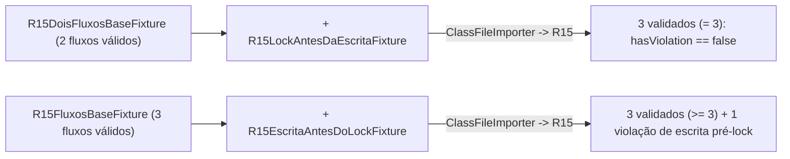

# DEBT-ARCH-005 — Runbook PR 2: E2 (Validação Isolada da Regra R15 via ClassFileImporter)

> Runbook executável e autocontido para o PR 2. Contexto transversal, rastreabilidade (`F3`, `Q3`) e roadmap: [README.md](./README.md).

## Status de Execução

- [x] **E2 — Teste sintético positivo e negativo da regra `R15` via `ClassFileImporter`:** criação das fixtures equivalentes em `inv.checkout.r15fixture`, implementação de cinco casos em `ArquiteturaR15Test` sem Docker e correção da ordenação de escrita pré-lock da `R15` em `ArquiteturaTest` (`F3`, `Q3`).

**Correção da R15 incluída no fechamento da E2.** Durante a revisão, identificamos que a regra aceitava a sequência `saveAndFlush(venda)` → `findByIdWithLock(vendaId)` → `venda.cancelar()`. A presença de `cancelar()` fazia a regra ignorar a gravação anterior ao lock. O commit integrado `801fafd` (PR #64) corrigiu o cálculo da primeira escrita para considerar tanto as gravações no repositório quanto as mutações em `Venda`. Dois testes em `ArquiteturaR15Test` confirmam que a sequência acima gera exatamente uma violação e que a regra aceita o fluxo quando o lock precede ambas as escritas.

---

## 1. Contexto & Invariantes

- **F3 — Anatomia Observada da Regra `R15` (Seleção, Condições e Verificação Global):**
  - Em [`ArquiteturaTest.java`](../../../apps/inv-service/src/test/java/inv/architect/ArquiteturaTest.java#L41-L42), `@AnalyzeClasses(packages = "inv", importOptions = ImportOption.DoNotIncludeTests.class)` inspeciona somente classes de produção contra `R1`–`R15`, sem `FreezingArchRule` e sem `archunit_store/` (ausência validada na CI em `validate-code`).
  - A regra `R15` ([`escritasEmVendaDevemUsarFindByIdWithLock`](../../../apps/inv-service/src/test/java/inv/architect/ArquiteturaTest.java#L183-L339)) seleciona `classes().that().resideInAPackage("inv.checkout..")` e aplica `exigirFindByIdWithLockEmEscritasDeVenda()`:
    - **Proteções estruturais (`#L211-L236`):** em `Venda`, exige campos de instância não-`static` como `private` e proíbe métodos `set*` não-`private`; em `VendaRepository`, proíbe métodos `@Modifying`.
    - **Detecção de mutação intra-procedural (`#L238-L264`):** nos demais métodos de `inv.checkout..`, detecta `chamadasMutadoras` em `Venda` (excluindo `get*`, `is*`, `estaPaga`, `equals`, `hashCode`, `toString`, e dispensando `adicionarItem`/`irParaPagamento` só quando há `new Venda()`) e escritas diretas (`save*`/`delete*`) em `VendaRepository`.
    - **Ordenação lock-antes-da-escrita e Gate 4 (`#L266-L314`):** quando há mutação ou escrita direta, exige `VendaRepository.findByIdWithLock` (`linhaLock`), verifica `linhaLock <= primeiraMutacao` e aplica o Gate 4 (proibindo `PagamentoRepository` ou `Venda.getPagamentos()` antes de `linhaLock`). Só incrementa `metodosEscritaValidados` (`#L313`) nos métodos aprovados sem violação.
    - **Contagem global (`#L204-L207`, `#L321-L328`):** `init()` zera `metodosEscritaValidados` antes de cada avaliação; `finish()` falha se `metodosEscritaValidados < 3`. Em produção hoje, apenas `3` fluxos incrementam esse contador (`VendaService.cancelarVendaExpirada`, `VendaService.cancelarVendaConcluida` e `VendaEventHandler.handlePagamentoConfirmado`); `VendaService.iniciarVenda` (`new Venda()` com `MUTADORES_CRIACAO_VENDA`) e `PagamentoService.criarIntencaoPagamento` (lock sem mutação em `Venda`) não entram nessa contagem.

| Ramo de Falha na `R15` | Trecho (`ArquiteturaTest.java`) | Mensagem Emitida pela Regra |
| :--- | :---: | :--- |
| Ausência de lock | `#L272-L280` | `... realiza escrita em Venda existente (...) sem adquirir lock pessimista via VendaRepository.findByIdWithLock` |
| **Escrita anterior ao lock (alvo da `E2`)** | `#L290-L295` | `... realiza escrita em Venda na linha <X> antes de VendaRepository.findByIdWithLock na linha <Y>` |
| Leitura de pagamento pré-lock (Gate 4) | `#L297-L311` | `... carrega Pagamento/pagamentos na linha <X> antes de VendaRepository.findByIdWithLock na linha <Y>` |
| Quantidade mínima de fluxos (`finish`) | `#L321-L328` | `Esperava validar pelo menos 3 fluxos de escrita em Venda existente com findByIdWithLock, mas encontrou <N>` |

- **Q3 — Reuso Direto da `R15` em Teste Isolado sem Tocar Produção nem Enfraquecer a Regra:**
  - **Baseline antes da E2:** O Javadoc da `R15` registrava ausência de teste sintético negativo com violação intencional.
  - **Separação de engines e acesso package-private:** `ArquiteturaTest` roda via `ArchUnitTestEngine` (`@AnalyzeClasses` + `@ArchTest`) e declara `escritasEmVendaDevemUsarFindByIdWithLock` como `static final` (package-private em `inv.architect`). Criar `inv.architect.ArquiteturaR15Test` (JUnit 5 puro, no mesmo pacote) dá acesso direto à mesma `ArchRule` aplicada ao código de produção e a avalia com `new ClassFileImporter().importClasses(...)` via `evaluate(JavaClasses)` (`EvaluationResult` + `FailureReport.getDetails()`) e `check(JavaClasses)`.
  - **Preservação do filtro de pacote e visibilidade das fixtures:** Como a `R15` filtra `resideInAPackage("inv.checkout..")`, as fixtures devem residir em `inv.checkout.r15fixture` (e não em `inv.architect`), exercitando o filtro real da regra, e ser declaradas `public` para importação direta a partir de `inv.architect.ArquiteturaR15Test`. Além disso, `init()` zera `metodosEscritaValidados` antes de cada avaliação da `ArchRule`.

- **Q3 — Neutralização do Piso Global (`< 3`) e Equivalência Estrita entre Cenários:**
  - **Por que são obrigatórios `3` fluxos base na fixture negativa:** Quando `R15EscritaAntesDoLockFixture` falha na checagem de ordenação (`#L290-L295`), o `continue` salta antes de `metodosEscritaValidados++` (`#L313`). Sem `3` fluxos válidos prévios, `finish()` acusaria contagem `< 3`, tornando impossível distinguir uma falha de contagem mínima da detecção real da escrita pré-lock.
  - **Por que o cenário positivo usa `R15DoisFluxosBaseFixture` (`2` fluxos):** Para provar que o cenário positivo não passa apenas pela base isolada, `R15LockAntesDaEscritaFixture` precisa fornecer o `3º` fluxo válido; o piso `>= 3` só é atingido se a `R15` reconhecer a escrita (`venda.cancelar()`) nessa fixture. Sem essa escrita, `finish()` acusaria `encontrou 2`.

| Origem das Classes (`inv.checkout..`) | Fluxos válidos contabilizados | Violações esperadas na `R15` | Finalidade |
| :--- | :---: | :---: | :--- |
| Produção atual (`Cancelamento`, `Expiracao`, `EventHandler`) | `3` | `0` | Gate contínuo em `ArquiteturaTest` |
| `R15FluxosBaseFixture` isolada | `3` | `0` | Prova de que a base satisfaz `finish()` (`>= 3`) |
| `R15DoisFluxosBaseFixture` + `R15LockAntesDaEscritaFixture` | `3` | `0` | Cenário positivo equivalente (`evaluate` e `check`), que depende do fluxo da fixture positiva |
| `R15FluxosBaseFixture` + `R15EscritaAntesDoLockFixture` | `3` | `1` (escrita pré-lock) | Cenário negativo equivalente sem disparo de `< 3` |

  - **Equivalência obrigatória das fixtures de cenário:** Ambas devem ter mesmo construtor explícito de `VendaRepository`, mesma assinatura `executar(Long vendaId, Venda venda)`, zero `new Venda()`, zero lambdas, zero extração para método auxiliar e zero acesso a `PagamentoRepository`/`getPagamentos()`, invertendo apenas a ordem das linhas `vendaRepository.findByIdWithLock(vendaId)` e `venda.cancelar()`.

- **Q3 — Isolamento no Build (`-proc:none`, Spotless, Surefire e Failsafe):**
  - **Seleção pelos executores:** nomear as fixtures com sufixo `*Fixture` e sem `@Test` garante que nem Surefire (`Test*`, `*Test`, `*Tests`, `*TestCase`) nem Failsafe (`*IT`, `*IntegrationTest`) as tratem como classes de teste.
  - **Escopo dos gates modulares:** `ImportOption.DoNotIncludeTests` exclui `src/test/java` da varredura contínua de `ArquiteturaTest`, e `ModulithTest` (`ApplicationModules.of(InvServiceApplication.class)`) inspeciona apenas `src/main/java`.
  - **Compilação de testes sem Lombok:** `apps/inv-service/pom.xml` configura `-proc:none` em `default-testCompile`; portanto, fixtures e `ArquiteturaR15Test` não devem usar Lombok e devem declarar construtores explícitos.
  - **Formatação e licença:** `spotless-maven-plugin` (`pom.xml`) valida todos os arquivos em `src/test/java/**/*.java`, exigindo cabeçalho `AGPL-3.0-only`, quebras de linha LF, ausência de espaços à direita e linha final em branco.



---

## 2. Referência de Contratos (Published Language & DDL)

A etapa preservou o código de produção, as interfaces `*.api`, os contratos HTTP e o schema SQL. A mudança na `R15` ficou restrita à identificação da primeira escrita no método, considerando mutações em `Venda` e chamadas diretas de escrita em `VendaRepository`.

---

## 3. Passos de Implementação & Critérios de Teste

### Roteiro de Implementação (Plano Original)

1. **Passo 1 — Criar as fixtures equivalentes e as bases de 3 e 2 fluxos em `apps/inv-service/src/test/java/inv/checkout/r15fixture/` (`F3`, `Q3`):**
   - Criar `public class R15FluxosBaseFixture` com cabeçalho `AGPL-3.0-only`, construtor explícito recebendo `VendaRepository` (sem Lombok) e `3` métodos distintos (`fluxoBaseUm`, `fluxoBaseDois`, `fluxoBaseTres`).
   - Criar `public class R15DoisFluxosBaseFixture` com o mesmo padrão e exatamente `2` métodos (`fluxoBaseUm`, `fluxoBaseDois`), exclusiva do cenário positivo.
   - Receber `Venda` por parâmetro nos métodos (evitando `new Venda()`, pois `instanciaNovaVenda` altera o tratamento de `MUTADORES_CRIACAO_VENDA` e `save*`), chamar `vendaRepository.findByIdWithLock(vendaId)` em linha estritamente anterior à mutação (`venda.cancelar()`), e não tocar `PagamentoRepository` ou `Venda.getPagamentos()`.
   - Criar `public class R15LockAntesDaEscritaFixture` e `public class R15EscritaAntesDoLockFixture` espelhados linha a linha (mesmo construtor, mesma assinatura `executar(Long vendaId, Venda venda)`, zero `new Venda()`, zero lambdas): a primeira chama `findByIdWithLock` antes de `venda.cancelar()`; a segunda inverte exclusivamente essas duas linhas em linhas de código distintas.
   - Garantir que `R15FluxosBaseFixture` e `R15DoisFluxosBaseFixture` não compartilhem o arquivo das fixtures de cenário e que nenhuma fixture contenha `@Test`, mantendo-as `public` e puras para importação seletiva via `ClassFileImporter` a partir de `inv.architect`.
2. **Passo 2 — Criar `ArquiteturaR15Test` em `apps/inv-service/src/test/java/inv/architect/ArquiteturaR15Test.java` (`Q3`):**
   - Criar classe JUnit 5 pura (sem `@SpringBootTest`, sem Docker e sem Testcontainers) no pacote `inv.architect`, permitindo acesso package-private direto a `ArquiteturaTest.escritasEmVendaDevemUsarFindByIdWithLock`.
   - Importar via `new ClassFileImporter().importClasses(...)` três conjuntos isolados: `R15FluxosBaseFixture` sozinha, `R15DoisFluxosBaseFixture` + `R15LockAntesDaEscritaFixture` e `R15FluxosBaseFixture` + `R15EscritaAntesDoLockFixture`.
   - Exercitar `evaluate(classes)` e `check(classes)` na base isolada e no cenário positivo afirmando `hasViolation() == false` e `getFailureReport().getDetails()` vazia.
   - No cenário negativo, afirmar `hasViolation() == true`, `getFailureReport().getDetails().size() == 1` identificando método e escrita anterior ao lock, ausência das mensagens de contagem `< 3` ou falta de lock, e `AssertionError` ao invocar `check(classes)`, independente da ordem dos métodos.
3. **Passo 3 — Atualizar somente o Javadoc da `R15` em [`ArquiteturaTest.java`](../../../apps/inv-service/src/test/java/inv/architect/ArquiteturaTest.java#L178-L180) (`Q3`):**
   - Substituir apenas o item de Javadoc referente à ausência de teste sintético negativo dizendo exatamente o que o teste demonstra: `ArquiteturaR15Test` comprova que a regra `R15` detecta a escrita em `Venda` anterior a `findByIdWithLock` (sem reivindicar cobertura sintética dos demais ramos de falha).
   - Manter intactas todas as demais limitações heurísticas descritas, o identificador da regra, a descrição `.as(...)`, as condições e os limiares da `R15`.
4. **Passo 4 — Validar sem Docker e auditar relatórios (`Q3`):**
   - Executar `mvn validate` (`spotless:check`) para confirmar cabeçalhos `AGPL-3.0-only` e formatação LF em todos os novos arquivos Java.
   - Executar `ArquiteturaR15Test`, `ArquiteturaTest`, `ModulithTest` e `mvn clean test` sem Docker ativo.
   - Conferir ausência de `archunit_store/` e verificar que `apps/inv-service/target/surefire-reports/TEST-inv.architect.ArquiteturaR15Test.xml` registra `>= 3` `<testcase>`, `skipped="0"`, `failures="0"`, `errors="0"` na `<testsuite>` e zero `<skipped>`, `<failure>` ou `<error>` nos casos, sem qualquer entrada `*Fixture` (e que a checagem de inventário da CI passa a exigir automaticamente `56/30`).

### Critérios de Teste (Plano Original)

- **Cenário 1 — Fluxo equivalente com lock antes da escrita é aceito (`ArquiteturaR15Test`) (`Q3`):**
  - *Condição:* `JavaClasses` importado via `ClassFileImporter` contendo `R15DoisFluxosBaseFixture` (`2` fluxos válidos) e `R15LockAntesDaEscritaFixture` (`VendaRepository.findByIdWithLock` na linha `A` antes de `venda.cancelar()` na linha `B`, com `A < B`).
  - *Ação:* Invocar `ArquiteturaTest.escritasEmVendaDevemUsarFindByIdWithLock.evaluate(classes)` e `check(classes)`.
  - *Resultado observável:* `evaluate` retorna `hasViolation() == false`, `getFailureReport().getDetails()` está vazia (`3` fluxos validados, exatamente o piso), e `check(classes)` termina sem lançar exceção; remover `venda.cancelar()` de `R15LockAntesDaEscritaFixture` faz a `R15` reportar `encontrou 2` e o cenário falhar.
- **Cenário 2 — Fluxo equivalente invertido produz violação identificando método e escrita anterior ao lock (`ArquiteturaR15Test`) (`F3`, `Q3`):**
  - *Condição:* `JavaClasses` importado via `ClassFileImporter` contendo `R15FluxosBaseFixture` (`3` fluxos válidos que satisfazem `finish()`) e `R15EscritaAntesDoLockFixture` (idêntica à positiva, invertendo apenas `venda.cancelar()` na linha `X` e `findByIdWithLock` na linha `Y`, com `X < Y`).
  - *Ação:* Invocar `ArquiteturaTest.escritasEmVendaDevemUsarFindByIdWithLock.evaluate(classes)` e validar também `check(classes)`.
  - *Resultado observável:* `evaluate` retorna `hasViolation() == true`; `getFailureReport().getDetails()` tem **tamanho exatamente igual a `1`**; essa única entrada identifica o nome completo do método de `R15EscritaAntesDoLockFixture` e contém `"realiza escrita em Venda na linha <X> antes de VendaRepository.findByIdWithLock na linha <Y>"` (`X < Y`); nenhuma mensagem cita `"pelo menos 3 fluxos"` nem `"sem adquirir lock pessimista"`; `check(classes)` lança `AssertionError` reportando essa violação.
- **Cenário 3 — Prova de que a base satisfaz o piso mínimo independentemente da escrita pré-lock (`ArquiteturaR15Test`) (`F3`, `Q3`):**
  - *Condição:* Conjunto base `R15FluxosBaseFixture` avaliado sozinho e em composição com `R15EscritaAntesDoLockFixture`.
  - *Ação:* Avaliar `ArquiteturaTest.escritasEmVendaDevemUsarFindByIdWithLock.evaluate(classes)` sobre `R15FluxosBaseFixture` isoladamente e sobre `R15FluxosBaseFixture` + `R15EscritaAntesDoLockFixture`.
  - *Resultado observável:* `R15FluxosBaseFixture` já satisfaz o piso `>= 3` da `R15` por conta própria (`hasViolation() == false` e `getFailureReport().getDetails()` vazia), comprovando que a única violação emitida no Cenário 2 decorre exclusivamente da escrita em `Venda` anterior a `findByIdWithLock` em `R15EscritaAntesDoLockFixture`.
- **Cenário 4 — Não-interferência sobre produção, `ArquiteturaTest` e `ModulithTest` (`Q3`):**
  - *Condição:* Código de produção intacto e fixtures `public` `*Fixture` isoladas em `inv.checkout.r15fixture`.
  - *Ação:* Executar `ArquiteturaTest` e `ModulithTest` no `inv-service` sem Docker.
  - *Resultado observável:* `ArquiteturaTest` aprova todas as `15` regras sobre produção (sem importar `*Fixture` devido a `DoNotIncludeTests`), `ModulithTest` aprova os `2` testes e `archunit_store/` permanece ausente.
- **Cenário 5 — Execução sem Docker, compilação com `-proc:none` e relatórios Surefire/Failsafe (`Q3`):**
  - *Condição:* Ambiente local ou CI sem daemon Docker ativo.
  - *Ação:* Executar `mvn validate`, `mvn test -pl apps/inv-service "-Dtest=ArquiteturaR15Test"` e `mvn clean test`.
  - *Resultado observável:* `spotless:check` e a compilação sem Lombok passam; `TEST-inv.architect.ArquiteturaR15Test.xml` registra `>= 3` `<testcase>`, `skipped="0"`, `failures="0"`, `errors="0"` na `<testsuite>` e ausência de `<skipped>`, `<failure>` e `<error>` nos casos (elevando de `31` para `32` as classes unitárias do `inv-service` após `E1`, e fazendo a checagem automática da CI exigir `56/30`); nenhum relatório `*Fixture` aparece em `surefire-reports/` ou `failsafe-reports/`.

---

## 4. Commits Sugeridos e Definition of Done (DoD)

### Commits Sugeridos

- `test(arch): adiciona fixtures equivalentes e ArquiteturaR15Test provando deteccao de escrita pre-lock (F3, Q3)`
- `docs(arch): atualiza javadoc da regra R15 referenciando ArquiteturaR15Test (Q3)`

### Comandos de Validação (Portáveis)

```bash
# 1. Conferir Spotless (cabeçalho AGPL-3.0-only e formatação em src/test/java)
mvn validate

# 2. Executar isoladamente a prova positiva/negativa da R15 (sem Docker)
mvn test -pl apps/inv-service "-Dtest=ArquiteturaR15Test"

# 3. Executar ArquiteturaTest (R1-R15 sobre produção) e ModulithTest (sem Docker)
mvn test -pl apps/inv-service -am "-Dtest=ArquiteturaTest,ModulithTest" "-Dsurefire.failIfNoSpecifiedTests=false"

# 4. Executar toda a suíte unitária do reactor (sem Docker, após E1)
mvn clean test

# 5. Conferir relatórios Surefire após execução:
#    - apps/inv-service/target/surefire-reports/TEST-inv.architect.ArquiteturaR15Test.xml (>= 3 <testcase>, skipped="0", failures="0", errors="0" e zero <skipped>/<failure>/<error> nos casos)
#    - ausência de qualquer relatório TEST-*Fixture.xml em surefire-reports/ ou failsafe-reports/
```

### Rollback e Contingência Operacional

- Reverter via `git revert` os commits de `ArquiteturaR15Test`, `inv/checkout/r15fixture/` e das alterações de ordenação pré-lock e Javadoc em `ArquiteturaTest`. O código de produção e o schema SQL foram preservados.

### Definition of Done (DoD)

- [x] `R15FluxosBaseFixture` (`3` fluxos válidos), `R15DoisFluxosBaseFixture` (`2` fluxos válidos), `R15LockAntesDaEscritaFixture`, `R15EscritaAntesDoLockFixture`, `R15SaveAndFlushAntesDoLockFixture` e `R15LockAntesDeSaveAndFlushEMutacaoFixture` criados em `inv.checkout.r15fixture` como classes `public`, sem Lombok, sem `@Test` e aprovadas no `spotless:check`.
- [x] `ArquiteturaR15Test` exercita a mesma `ArchRule` via `ClassFileImporter` em cinco casos sem Docker. A base isolada satisfaz o piso de três fluxos. Os dois cenários positivos aceitam lock antes das escritas. Cada cenário negativo gera exatamente uma violação de ordem, tanto para `venda.cancelar()` pré-lock quanto para `saveAndFlush(venda)` pré-lock seguido de mutação pós-lock.
- [x] A `R15` usa a menor linha entre mutações em `Venda` e escritas diretas em `VendaRepository` no mesmo método. O Javadoc delimita a cobertura sintética à ordem pré-lock. As demais condições da regra e o piso de três fluxos foram preservados. O código de produção permaneceu intacto e `archunit_store/` ausente.
- [x] `ArquiteturaTest` (`15` regras) e `ModulithTest` (`2` testes) verdes sem Docker.
- [x] `mvn validate` e `mvn clean test` verdes sem Docker, com `TEST-inv.architect.ArquiteturaR15Test.xml` registrando cinco casos de teste, `skipped="0"`, `failures="0"`, `errors="0"` na `<testsuite>`, ausência de `<skipped>`, `<failure>` e `<error>` nos casos, zero entradas `*Fixture` e checagem de inventário da CI passando a exigir automaticamente `56/30` relatórios.
