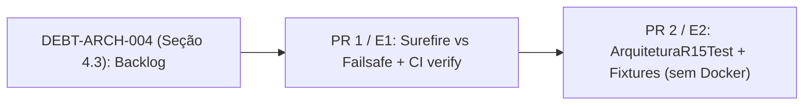

# DEBT-ARCH-005 — Testes de Integração na CI e Validação da Regra de Lock de Venda (R15)

> **TL;DR:** Este épico internaliza dois itens de governança e confiabilidade de testes originados da seção 4.3 do [DEBT-ARCH-004](../DEBT-ARCH-004/README.md#L108-L114), em **2 PRs incrementais** (`E1` e `E2`), executáveis integralmente com o repositório e a infraestrutura local/CI existentes (Docker e Testcontainers), sem adquirente, credenciais de pagamento ou acesso à produção. O **PR 1 (`E1`)** implementa a separação formal entre unitários (`maven-surefire-plugin` na fase `test`) e integração (`maven-failsafe-plugin` nas fases `integration-test` e `verify`), garantindo que as 30 classes de integração (`26 *IT` e `4 *IntegrationTest`) rodem na esteira de CI antes do build das imagens Docker. O **PR 2 (`E2`)** adiciona uma prova isolada com `ClassFileImporter` (`ArquiteturaR15Test`) exercitando diretamente a regra `R15` de `ArquiteturaTest` sobre fixtures equivalentes, demonstrando que o gate detecta escrita em `Venda` anterior a `VendaRepository.findByIdWithLock` sem depender de Docker nem enfraquecer a regra ou sujar o código de produção.

---

## 1. Motivação, Escopo e Roadmap dos 2 PRs

### Motivação
1. **Cobertura silenciosamente omitida na CI:** Antes da E1, o job `unit-tests` em [`.github/workflows/ci-cd.yml`](../../../.github/workflows/ci-cd.yml#L62-L79) executava `mvn clean test -DfailIfNoTests=false`, o que acionava apenas o `maven-surefire-plugin`. Por convenção padrão de nomes (`**/*Test.java`), as **26 classes `*IT`** do `inv-service` ficavam fora da execução automática da CI, enquanto **4 classes `*IntegrationTest`** (`3` no `inv-service` e `1` no `mail-service`) rodavam na fase `test` por terminarem em `Test`. Além disso, em Surefire/Failsafe `3.5.4`, `failIfNoTests` já assume `false` por padrão, exigindo critério de aceite ancorado nos relatórios XML gerados.
2. **Gate arquitetural `R15` sem prova negativa isolada:** A regra `R15` ([`ArquiteturaTest`](../../../apps/inv-service/src/test/java/inv/architect/ArquiteturaTest.java#L162-L339)) protege a hierarquia de locks `vendas -> produtos` em produção, mas registra em seu próprio Javadoc a lacuna de não possuir teste sintético negativo comprovando falha sob inversão entre escrita e aquisição de lock. Como `R15` impõe um piso global mínimo de `3` fluxos validados no método `finish()`, um teste negativo mal desenhado pode falhar apenas pela contagem mínima sem provar que a heurística de ordenação de linhas realmente atuou.

### Escopo e Fronteiras Explícitas
- **Dentro do escopo:** configuração proposta do `maven-failsafe-plugin` e exclusões no `maven-surefire-plugin` nos POMs (`E1`), migração do job de testes na CI para `mvn clean verify` com validação explícita de relatórios e bloqueio de `build-and-push-docker` (`E1`), e criação da suíte isolada `ArquiteturaR15Test` + fixtures `*Fixture` em `inv.checkout.r15fixture` sem Docker (`E2`).
- **Fora do escopo:** renomeação das classes `*IntegrationTest` existentes para `*IT`, inclusão do runner manual [`OutboxConcurrencyManualRunner`](../../../apps/inv-service/src/test/java/inv/scheduler/OutboxConcurrencyManualRunner.java) na CI, alterações em regras de negócio de produção, enfraquecimento de `R1`–`R15` ou reintrodução de `archunit_store/`, integração com adquirente (`DEBT-PAY-001`) e criação ou execução de migrations SQL.

### Roadmap

| PR | Etapa | Runbook | Entregáveis Chave | Status |
| :---: | :---: | :--- | :--- | :---: |
| **1** | **E1** | [E1.md](./E1.md) | Separação Surefire (`test`) vs Failsafe (`verify`) nos POMs, preservação do `-javaagent` do Mockito e comandos direcionados, `mvn clean verify` na CI e aceite por relatórios XML (`F1`, `F2`, `Q1`, `Q2`) | `[x]` Concluída |
| **2** | **E2** | [E2.md](./E2.md) | `ArquiteturaR15Test` via `ClassFileImporter` reutilizando `R15`, `R15FluxosBaseFixture` (3 fluxos), par equivalente lock-antes vs escrita-antes sem Docker e atualização do Javadoc da `R15` (`F3`, `Q3`) | `[x]` Concluída |

---

## 2. Comportamento Observado vs Mudança Proposta

| Dimensão | Situação anterior à E1 | Decisão (`E1` e `E2`) |
| :--- | :--- | :--- |
| **POM raiz ([`pom.xml`](../../../pom.xml))** | Herda `spring-boot-starter-parent:3.4.13` (que já declara `maven-surefire-plugin:3.5.4` e `maven-failsafe-plugin:3.5.4` no `<pluginManagement>`, com goals `integration-test` e `verify`), porém não define `<excludes>` no Surefire nem ativa o Failsafe. | **E1:** Configurar `<excludes>` (`**/*$*`, `**/*IT.java`, `**/*IntegrationTest.java`) no Surefire — preservando a exclusão padrão de classes internas e a descoberta de `@Nested` pela classe externa — e `<includes>` (`**/*IT.java`, `**/*IntegrationTest.java`) no Failsafe no `<pluginManagement>`, ativando o Failsafe no `<build><plugins>`. |
| **POMs dos módulos (`apps/*/pom.xml`)** | `api-gateway`, `auth-service`, `mail-service` e `inv-service` configuram `maven-dependency-plugin:properties` e `-javaagent:${org.mockito:mockito-core:jar}` apenas no Surefire. `common-lib` não usa Mockito nem declara esses plugins. | **E1:** Nos 4 serviços, configurar `maven-failsafe-plugin` com `<argLine>-javaagent:${org.mockito:mockito-core:jar}</argLine>`, preservando Surefire e `-DskipTests` (usado nos 4 `Dockerfile`s); manter `common-lib` intacto. |
| **Seleção de testes (`87` arquivos em `apps/*/src/test/java/`)** | Surefire seleciona `55 *Test` + `4 *IntegrationTest` (`59` classes, exigindo Docker no `mvn test` em `inv-service` e `mail-service`); deixa **26 `*IT`** de fora, além de `ProjecaoDuravelSupport` (`abstract`) e `OutboxConcurrencyManualRunner` (manual). | **E1:** `mvn test` passa a rodar apenas as `55 *Test` (sem Docker); `mvn verify` roda as `55 *Test` no Surefire e todas as `30` classes de integração (`26 *IT` + `4 *IntegrationTest`) no Failsafe, mantendo `ProjecaoDuravelSupport` e `OutboxConcurrencyManualRunner` fora de ambos. |
| **Esteira de CI ([`.github/workflows/ci-cd.yml`](../../../.github/workflows/ci-cd.yml))** | O comentário cita testes unitários e de integração, mas o job `unit-tests` roda `mvn clean test -DfailIfNoTests=false`. `build-and-push-docker` depende de `[unit-tests, security-scan]`. | **E1:** Atualizar o job para `mvn clean verify` (preservando o identificador `unit-tests` em `needs`), incluir checagem de presença e status dos relatórios XML do Surefire e Failsafe e impedir `build-and-push-docker` se qualquer integração falhar ou faltar. |
| **Documentação de build ([`README.md`](../../../README.md#L180-L183))** | Documenta `./mvnw test`, embora o repositório não possua Maven Wrapper (`mvnw`/`mvnw.cmd`). | **E1:** Substituir por `mvn test` (unitários) e `mvn verify` (unitários + integração com Docker ativo). |
| **Regra `R15` ([`ArquiteturaTest.java`](../../../apps/inv-service/src/test/java/inv/architect/ArquiteturaTest.java#L162-L339))** | Validada apenas sobre produção (`@AnalyzeClasses(..., DoNotIncludeTests.class)`), que hoje possui exatamente `3` fluxos contabilizados; `finish()` falha se `< 3`; Javadoc declara ausência de teste sintético negativo. | **E2:** Adicionar `ArquiteturaR15Test` (JUnit 5, mesmo pacote `inv.architect`) e fixtures `*Fixture` em `inv.checkout.r15fixture` (`R15FluxosBaseFixture` com `3` fluxos + par equivalente positivo/negativo), atualizando apenas o Javadoc da `R15`. |

### Divergências Encontradas entre o Backlog e o Repositório
- **Convenção `*IntegrationTest`:** O item *"Maven Failsafe / verify"* da seção 4.3 de `DEBT-ARCH-004/README.md` mencionava separar `*Test` de `*IT`, sem citar as `4` classes `*IntegrationTest` (`ProjecaoRetryIntegrationTest`, `EstoqueConcorrenciaIntegrationTest`, `OutboxConcorrenciaIntegrationTest` e `EmailConsumerIdempotenciaIntegrationTest`) que já rodam hoje pelo Surefire.
- **Escopo além do `inv-service`:** A mudança abrange também `mail-service` (`0` unitários e `1 *IntegrationTest` com PostgreSQL/RabbitMQ Testcontainers e `@MockitoBean`), `api-gateway` e `auth-service` (configuração simétrica do Failsafe para Mockito) e preserva `common-lib` sem Mockito.
- **Inventário de evidências anteriores:** [`integracao-classes-verificadas.json`](../../compliance/evidencias/integracao-classes-verificadas.json) registra `29` classes de integração (`25 *IT` + `4 *IntegrationTest`), anterior à inclusão de `InventarioHttpIT`; o repositório atual possui **`30` classes de integração executáveis**.
- **Pacote vs diretório em `RedisAtividadeSistemaAdapterIT`:** O arquivo [`RedisAtividadeSistemaAdapterIT.java`](../../../apps/inv-service/src/test/java/inv/dashboard/RedisAtividadeSistemaAdapterIT.java) reside em `inv/dashboard/`, declara `package inv.dashboard.infrastructure.redis;` e é a única classe `*IT` sem `@SpringBootTest` e sem Mockito.
- **Comportamento de `OutboxConcurrencyManualRunner`:** A classe não casa com o padrão de includes do Surefire nem do Failsafe; ela só apareceu como ignorada no histórico do `DEBT-ARCH-004` quando `-Dtest=!*IT,!*IntegrationTest` substituiu os includes padrão por negação pura.
- **Piso global da `R15` e engine JUnit do `ArquiteturaTest`:** `ArquiteturaTest` usa `@AnalyzeClasses` (`ArchUnitTestEngine`) e `R15` exige `metodosEscritaValidados >= 3` em `finish()`. Por isso o teste sintético fica em `ArquiteturaR15Test` (`JUnitJupiterTestEngine`, mesmo pacote `inv.architect`) com `3` fluxos base na fixture negativa.

---

## 3. Matriz de Rastreabilidade (`F1`–`F3` e `Q1`–`Q3`)

| ID | Tipo | Descrição, Causa Raiz e Decisão Fechada | PR / Etapa |
| :---: | :---: | :--- | :---: |
| **F1** | Lacuna | `mvn test` via Surefire omite todas as `26 *IT` e executa as `4 *IntegrationTest` na fase `test`; `failIfNoTests=false` padrão permite build verde mesmo sem executar integrações. | PR 1 / E1 |
| **Q1** | Decisão | Particionar estritamente Surefire (`test`, incluindo `**/*$*` junto de `**/*IT.java` e `**/*IntegrationTest.java` em `<excludes>` para preservar `@Nested` pela classe externa) e Failsafe (`verify`, incluindo `*IT` e `*IntegrationTest`), mantendo `OutboxConcurrencyManualRunner` e `ProjecaoDuravelSupport` fora, preservando `-Dtest=<ClasseTest>` e documentando `-Dit.test=<ClasseIT>` (com `'-Dtest=!*'`). | PR 1 / E1 |
| **F2** | Fragilidade | `29` das `30` classes de integração usam Mockito, exigindo `-javaagent:${org.mockito:mockito-core:jar}` também no Failsafe; `common-lib` não declara Mockito; `Dockerfile`s dependem de `-DskipTests`. | PR 1 / E1 |
| **Q2** | Decisão | Declarar `-javaagent` do Mockito no Failsafe apenas nos 4 serviços (`api-gateway`, `auth-service`, `mail-service`, `inv-service`), preservar `-DskipTests` nos dois plugins, migrar o job `unit-tests` da CI para `mvn clean verify` (mantendo o id do job para não quebrar `needs`) e validar pós-`verify` cada relatório XML comparando, por módulo e fase, as classes previstas nos fontes (pelo `package` declarado, `55/30` como referência de `E1` e `56/30` automaticamente em `E2`) com 1 relatório por classe, interseção vazia, pelo menos 1 `<testcase>`, `skipped="0"`, `failures="0"`, `errors="0"`, zero `<skipped>`/`<failure>`/`<error>` nos casos, `failsafe-summary.xml` nos módulos com integrações e upload com `if: always()`. | PR 1 / E1 |
| **F3** | Lacuna | `R15` em `ArquiteturaTest` carece de teste negativo isolado que comprove detecção de escrita em `Venda` anterior a `findByIdWithLock`, com risco de falso positivo caso `metodosEscritaValidados < 3` dispare em `finish()`. | PR 2 / E2 |
| **Q3** | Decisão | Criar `inv.architect.ArquiteturaR15Test` (JUnit 5, sem Docker) exercitando `ArquiteturaTest.escritasEmVendaDevemUsarFindByIdWithLock` via `ClassFileImporter` sobre fixtures `public` `*Fixture` em `inv.checkout.r15fixture`: `R15FluxosBaseFixture` (`3` fluxos válidos) + par equivalente `R15LockAntesDaEscritaFixture` / `R15EscritaAntesDoLockFixture` (invertendo só a ordem das chamadas em linhas distintas), exigindo `details.size() == 1` no cenário negativo identificando método e escrita pré-lock e registrando no Javadoc da `R15` exatamente o que o teste demonstra. | PR 2 / E2 |

---

## 4. Estratégia de Rollback e Definition of Done (DoD) Global

| PR | Estratégia de Rollback e Contingência |
| :---: | :--- |
| **PR 1 (`E1`)** | `git revert` direto das alterações nos POMs, `.github/workflows/ci-cd.yml` e `README.md`. Sem impacto em código de produção, APIs públicas, contratos HTTP ou schema Flyway. |
| **PR 2 (`E2`)** | `git revert` direto removendo `ArquiteturaR15Test`, o pacote de fixtures `inv.checkout.r15fixture` e o ajuste de Javadoc em `ArquiteturaTest`. Sem impacto em código de produção, `R15` ou schema. |

### Definition of Done (DoD) Global

- [x] **PR 1 (`E1`):** `mvn clean test` executa apenas as `55` classes `*Test` (sem Docker); `mvn clean verify` com Docker ativo compara por módulo e fase o inventário descoberto nos fontes (usando o `package` declarado; referência `55/30` em `E1`) com os relatórios XML gerados, com 1 relatório por classe, interseção vazia, pelo menos um `<testcase>` por relatório, `skipped="0"`, `failures="0"`, `errors="0"` na `<testsuite>` e ausência de `<skipped>`, `<failure>` e `<error>` nos casos.
- [x] **PR 1 (`E1`):** Comandos direcionados (`-Dtest=...`, `'-Dtest=!*'`, `-Dit.test=...`, `clean package -DskipTests` nos `Dockerfile`s e `clean verify -DskipTests`) validados; job de testes da CI executando `mvn clean verify`, exigindo `failsafe-summary.xml` nos módulos com integrações (`mail-service` e `inv-service`), publicando relatórios com `if: always()` e bloqueando `build-and-push-docker` em falha de integração.
- [x] **PR 2 (`E2`):** `ArquiteturaR15Test` executa sem Docker exercitando `ArquiteturaTest.escritasEmVendaDevemUsarFindByIdWithLock` via `ClassFileImporter` sobre fixtures `public`, aceitando o cenário positivo e produzindo exatamente 1 violação de escrita antes do lock no cenário negativo (sem violação de contagem `< 3`), Javadoc da `R15` registrando exatamente a detecção de escrita em `Venda` anterior a `findByIdWithLock`, checagem da CI exigindo automaticamente `56/30` relatórios e `ArquiteturaTest` (`15` regras) + `ModulithTest` (`2` testes) verdes.
- [x] **Sanitização:** Documentação verificada após a execução da E1.
