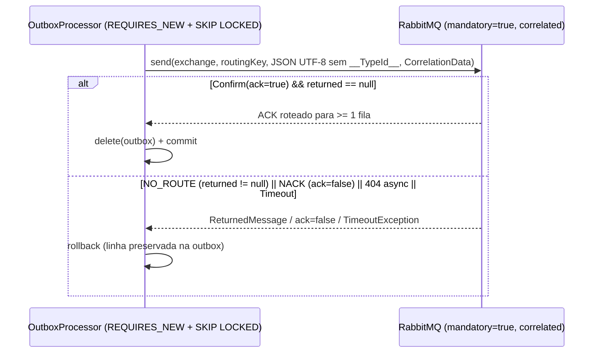

# DEBT-ARCH-006 — Runbook PR 1: E1 (Confirmação de Publicação, Roteamento e Compatibilidade das Rotas)

> Runbook executável e autocontido para o PR 1. Contexto transversal, evidências e matriz de rastreabilidade: [README.md](./README.md).

## Status de Execução

- [x] **E1 — Confirmação AMQP, roteamento obrigatório e compatibilidade das três rotas:** ativa `publisher-confirm-type=correlated`, `publisher-returns=true` e `template.mandatory=true`, exige confirmação e ausência de `NO_ROUTE` antes de concluir o registro, padroniza publicação JSON sem `__TypeId__`, compatibiliza a rota de pagamento e `version = 0`/`1`, e condiciona a fila órfã de estoque (`F1`–`F4`, `Q1`–`Q5`).

---

## 1. Contexto & Invariantes

- **F1 / Q1 — Confirmação do broker vs roteamento vs consumo (`spring-rabbit:3.2.8` / `amqp-client:5.22.0`):**
  - **Caminho atual:** [`OutboxProcessor.processNext()`](../../../apps/inv-service/src/main/java/inv/shared/outbox/scheduler/OutboxProcessor.java#L37-L72) executa `Class.forName` → `objectMapper.readValue` → `rabbitTemplate.convertAndSend` → `outboxRepository.delete(message)` sem `publisher-confirm-type`, `publisher-returns` nem `template.mandatory` configurados em [`application.properties`](../../../apps/inv-service/src/main/resources/application.properties#L46-L58) ou [`RabbitMQConfig`](../../../apps/inv-service/src/main/java/inv/shared/config/RabbitMQConfig.java).
  - **Três níveis distintos de garantia:**
    1. *ACK do broker (`Confirm(ack=true)`):* confirma apenas que o broker aceitou a publicação na exchange; não garante entrega em fila.
    2. *Roteamento para pelo menos uma fila:* exige `mandatory=true` + `publisher-returns=true`, com `Confirm(ack=true)` **e** `correlationData.getReturned() == null`. Em `spring-rabbit:3.2.8` / `amqp-client:5.22.0`, usando `CorrelationData` (ID não-vazio) e `mandatory=true`, o broker entrega `ReturnedMessage` (`basic.return`) antes ou junto de `Confirm(ack=true)` no `NO_ROUTE`; já em exchange inexistente (`404 NOT_FOUND`), o fechamento assíncrono do canal completa o `CompletableFuture` com `ack=false` sem lançar exceção síncrona em `convertAndSend`/`send`.
    3. *Processamento pelo consumidor:* executado de forma assíncrona nos `@RabbitListener`, fora da transação do worker (entrega *at-least-once*).
  - **Destino da linha na `outbox` por modo de falha (resultado incerto admite republicação):**

| Cenário na Publicação | Sinal em `spring-rabbit:3.2.8` | Destino da Linha e Justificativa |
| :--- | :--- | :--- |
| **Sucesso roteado** | `Confirm(ack=true)` e `returned == null` | `outboxRepository.delete(message)` — única condição válida de conclusão |
| **`NO_ROUTE`** (exchange sem fila compatível) | `Confirm(ack=true)` e `returned != null` | Preserva linha (lança falha de roteamento para rollback) |
| **`NACK`** do broker | `Confirm(ack=false)` | Preserva linha para nova tentativa |
| **Exchange inexistente (`404 NOT_FOUND`)** | Canal fechado assincronamente → `ack=false` (ou exceção) | Preserva linha para diagnóstico/recuperação |
| **Falha de conexão ou timeout** | `AmqpException`, `ExecutionException` ou `TimeoutException` | Preserva linha (resultado incerto admite republicação) |

- **F2 / Q2 / Q5 — Identidade estável, correlação por tentativa, remoção de `__TypeId__` e `version = 0`/`1`:**
  - **Identidade vs correlação:** `messageId = "outbox-" + id` permanece estável entre tentativas (com a identidade de negócio preservada no JSON), enquanto `correlationId` varia por tentativa (`"outbox-" + id + "-" + UUID`) e alimenta o ID não-vazio de `CorrelationData`.
  - **Publicação JSON pura:** após validar o payload com `Class.forName(eventType)` + `ObjectMapper` (respeitando `R12`: `inv.shared` sem importar Bounded Contexts), publicar `Message` JSON UTF-8 persistente (`content_type=application/json`, `delivery_mode=PERSISTENT`, `x-outbox-id`, `x-event-version`) **sem header `__TypeId__`**.
  - **Compatibilidade das três rotas e legado `version = 0`/`1`:**

| Rota | Produtor (`BEFORE_COMMIT`) | Consumidor | Ajuste Compatível na `E1` | Versões Aceitas |
| :--- | :--- | :--- | :--- | :--- |
| **Pagamento** | [`PagamentoListener`](../../../apps/inv-service/src/main/java/inv/checkout/infrastructure/messaging/PagamentoListener.java#L30-L48) | [`VendaEventHandler`](../../../apps/inv-service/src/main/java/inv/checkout/infrastructure/messaging/VendaEventHandler.java#L50-L55) | Evoluir para `handlePagamentoConfirmado(Object)` aceitando `PagamentoConfirmadoEvent`, `Message`, `String`, `byte[]` e `Map` (capturar `IllegalArgumentException` de `convertValue` como `AmqpRejectAndDontRequeueException`, preservar `PagamentoMensageriaIT` e `R15`); gravar `setVersion(1)` | `0` (legado) e `1` |
| **Estorno** | [`VendaEstornadaOutboxListener`](../../../apps/inv-service/src/main/java/inv/checkout/infrastructure/messaging/VendaEstornadaOutboxListener.java#L31-L61) | [`VendaEstornadaEventListener`](../../../apps/inv-service/src/main/java/inv/finance/infrastructure/messaging/VendaEstornadaEventListener.java#L43-L122) | Preservar `uuidReferenciaEstorno` e recepção `Object` sem `__TypeId__` | `1` (e `0`) |
| **Estoque baixo** | [`RabbitMQProducerListener`](../../../apps/inv-service/src/main/java/inv/inventory/infrastructure/messaging/RabbitMQProducerListener.java#L35-L60) | [`EmailConsumer`](../../../apps/mail-service/src/main/java/mail/service/EmailConsumer.java#L71-L97) | Publicar JSON sem `__TypeId__` e validar inferência por tipo do consumidor (record espelho no `*IT` do `inv-service` + cenário em [`mail.message.EstoqueBaixoMessage`](../../../apps/mail-service/src/main/java/mail/message/EstoqueBaixoMessage.java#L10-L16) no `mail-service`), preservando `eventId` | `1` (e `0`) |

  - **Inicialização de versão:** [`Outbox.java`](../../../apps/inv-service/src/main/java/inv/shared/outbox/model/Outbox.java#L36-L37) passa a inicializar `private int version = 1;` e [`PagamentoListener`](../../../apps/inv-service/src/main/java/inv/checkout/infrastructure/messaging/PagamentoListener.java#L35-L42) define `outbox.setVersion(1)`, mas o processamento e o replay aceitam linhas já gravadas com `version = 0` e `version = 1`.

- **Q3 — Estratégia transacional do worker e impacto no pool HikariCP:**
  - Manter o row lock `FOR UPDATE SKIP LOCKED` dentro de `@Transactional(propagation = Propagation.REQUIRES_NEW)` durante a espera pelo broker sob teto estrito `outbox.publisher.confirm-timeout-ms=3000` (`R11` já permite `org.springframework.amqp..` em `inv.shared.outbox..`).
  - **Impacto no HikariCP:** o scheduler executa single-thread (`fixedDelay = 2000ms`), retendo no máximo `1` de `10` conexões do pool padrão HikariCP (`10%`) por até `3s` em degradação do broker.
  - **Recuperação de queda:** em crash abrupto da JVM, o PostgreSQL libera o row lock no fechamento do socket sem depender de janela de lease expirado.
  - **Por que não separar reserva e publicação na `E1`:** um modelo claim/lease exigiria colunas/índice adicionais (só introduzidos na `E2`), recuperação de lease expirado e proteção contra um worker atrasado concluir a tentativa já assumida por outro.

- **F3 / Q4 — Restrição da fila órfã de estoque baixo (`inventory.v1.stock-low.notify`):**
  - Enquanto o binding local `inventory.v1.stock-low.notify` em [`RabbitMQConfig`](../../../apps/inv-service/src/main/java/inv/shared/config/RabbitMQConfig.java#L60-L118) existir na exchange `inventory.v1.events` (`inventory.stock.low`), o broker roteia para essa fila órfã e **não emite `NO_ROUTE`** mesmo quando `inventory.v1.low-stock.send-email` (`mail-service`) estiver ausente.
  - Condicionar `lowStockQueue`, `dlqQueueLowStock`, `bindingLowStock`, `dlqBindingLowStock` e `dlqExchangeInventory` a `@ConditionalOnProperty(name = "inv.rabbitmq.legacy-low-stock-queue.enabled", havingValue = "true", matchIfMissing = false)` preservando `inventoryExchange()` e constantes, com remoção do binding legado em brokers pré-provisionados.
  - Em `spring-amqp:3.2.8` (`DefaultJackson2JavaTypeMapper`), a precedência padrão é `TypePrecedence.INFERRED`: em `@RabbitListener` com parâmetro concreto (`EstoqueBaixoMessage`), o tipo do parâmetro já prevalece sobre `__TypeId__`. A remoção de `__TypeId__` visa eliminar acoplamento de FQCN entre serviços distintos e garantir interoperabilidade com consumidores não tipados/`Object` (`VendaEstornadaEventListener` e `handlePagamentoConfirmado(Object)`).



---

## 2. Referência de Contratos (Published Language & DDL)

Sem alterações de DDL/Flyway (`V1`–`V9` mantidas), sem mudanças na Published Language `*.api`, sem novas dependências Maven (auditoria `BOOT-INF/lib/` contra `THIRD-PARTY-NOTICES.md`) e preservando integralmente a gravação `BEFORE_COMMIT` e os contratos JSON das três rotas.

### Propriedades AMQP e Outbox (`apps/inv-service/src/main/resources/application.properties`)
```properties
spring.rabbitmq.publisher-confirm-type=correlated
spring.rabbitmq.publisher-returns=true
spring.rabbitmq.template.mandatory=true
outbox.publisher.confirm-timeout-ms=${OUTBOX_PUBLISHER_CONFIRM_TIMEOUT_MS:3000}
inv.rabbitmq.legacy-low-stock-queue.enabled=${INV_RABBITMQ_LEGACY_LOW_STOCK_QUEUE_ENABLED:false}
```

### Contrato de Publicação AMQP e Payloads Preservados
```text
Exchange / Routing Key : inalterados nas 3 rotas (pdv.exchange | inventory.v1.events)
Body / Content-Type    : JSON UTF-8 idêntico ao gravado no BEFORE_COMMIT / application/json (sem __TypeId__)
Delivery Mode          : PERSISTENT
messageId / correl.Id  : outbox-<id> (estável) / outbox-<id>-<attemptUuid> (por tentativa = CorrelationData.id)
Headers customizados   : x-outbox-id=<id>, x-event-version=<version> (aceita 0 e 1)
```
```java
// Contratos JSON preservados nas 3 rotas (BEFORE_COMMIT -> RabbitMQ -> Consumidor)
public record PagamentoConfirmadoEvent(Long vendaId, Long pagamentoId) {}
public record VendaEstornadaEvent(Long vendaId, UUID uuidReferenciaEstorno, BigDecimal valorEstorno) {}
public record EstoqueBaixoMessage(
        int version, String eventId, String nomeProduto, BigDecimal estoqueAtual, BigDecimal estoqueMinimo) {}

// inv.checkout.infrastructure.messaging.VendaEventHandler
@RabbitListener(queues = RabbitMQConfig.QUEUE_PAGAMENTO_CONFIRMADO)
@Transactional
public void handlePagamentoConfirmado(Object message)
```

---

## 3. Passos de Implementação & Critérios de Teste

### Roteiro de Implementação
1. **Passo 1 — Propriedades AMQP e compatibilidade de `version` (`F1`, `F4`, `Q1`, `Q5`):**
   - Habilitar `publisher-confirm-type=correlated`, `publisher-returns=true`, `template.mandatory=true` e `outbox.publisher.confirm-timeout-ms=3000` em `apps/inv-service/src/main/resources/application.properties`.
   - Inicializar `private int version = 1;` em `Outbox` e definir `outbox.setVersion(1)` em `PagamentoListener` para novos registros, aceitando registros legados já persistidos com `version = 0` e `version = 1`.
2. **Passo 2 — Publicação confirmada sem `__TypeId__` no `OutboxProcessor` (`F1`, `F2`, `Q1`, `Q2`, `Q3`):**
   - Desserializar via `Class.forName(eventType)` + `ObjectMapper` para validar o payload, construir `Message` JSON UTF-8 persistente com `messageId`, `correlationId` único por tentativa e headers `x-outbox-id`/`x-event-version` (sem `__TypeId__`), e enviar com `rabbitTemplate.send(exchange, routingKey, msg, correlationData)`.
   - Registrar `ReturnsCallback` com log estruturado no `RabbitTemplate` para evitar o `WARN "Returned message but no callback available"` a cada `NO_ROUTE` (`correlationData.getReturned()` continua preenchido automaticamente pelo `PublisherCallbackChannelImpl`).
   - Manter a assinatura `public boolean processNext()` e aguardar `correlationData.getFuture().get(confirmTimeoutMs, MILLISECONDS)` dentro da transação `REQUIRES_NEW`; excluir via `outboxRepository.delete(message)` somente se `confirm.isAck() && correlationData.getReturned() == null`; lançar exceção tipada em `NO_ROUTE`, `NACK`, `404 NOT_FOUND`, falha de conexão ou timeout (testes desta etapa devem verificar o **estado observável** na tabela/broker, sem acoplamento ao tipo de exceção, pois a `E2` passa a tratar falhas classificadas sem relançar).
3. **Passo 3 — Rota de pagamento e restrição da fila órfã de estoque (`F2`, `F3`, `Q2`, `Q4`):**
   - Atualizar [`VendaEventHandler.handlePagamentoConfirmado(Object)`](../../../apps/inv-service/src/main/java/inv/checkout/infrastructure/messaging/VendaEventHandler.java#L50-L125) tratando `IllegalArgumentException` (de `objectMapper.convertValue(...)`) junto de `JsonProcessingException | BusinessException` como `AmqpRejectAndDontRequeueException` (erro não-retentável → DLQ), mantendo `findByIdWithLock` → mutação de `Venda` no **mesmo método** conforme heurística intra-procedural da regra `R15` ([`ArquiteturaTest`](../../../apps/inv-service/src/test/java/inv/architect/ArquiteturaTest.java#L174-L189)) e preservando `PagamentoMensageriaIT`.
   - Condicionar os beans da fila `inventory.v1.stock-low.notify` e sua DLX/DLQ em `inv.shared.config.RabbitMQConfig` atrás de `inv.rabbitmq.legacy-low-stock-queue.enabled=false`; atualizar [`RabbitMQConfigTest`](../../../apps/inv-service/src/test/java/inv/shared/config/RabbitMQConfigTest.java) com `ApplicationContextRunner` para validar `@ConditionalOnProperty` nos perfis `false` (padrão) e `true`.
   - Em brokers já provisionados antes da `E1`, remover o binding legado de `inventory.v1.stock-low.notify` na exchange `inventory.v1.events` (mantendo a exchange ativa) para que `NO_ROUTE` reflita corretamente a ausência do consumidor.
4. **Passo 4 — Suíte unitária e de integração contra containers reais:**
   - Adicionar testes unitários e `*IT` dedicados (sem Lombok por `-proc:none` e auxiliares sem `@Test` nomeados `*Fixture` ou `abstract`) preservando integralmente `OutboxConcorrenciaIntegrationTest` e `PagamentoMensageriaIT`.

### Critérios de Teste (Comportamento Esperado)
- **Cenário 1 — Aceite central `NO_ROUTE` → restauração do binding → entrega e conclusão (`F1`, `Q1`):**
  - *Condição:* Evento válido persistido na `outbox` apontando para exchange existente (`pdv.exchange`) sem fila ligada à routing key alvo.
  - *Ação:* Invocar `OutboxProcessor.processNext()`; inspecionar `ReturnedMessage`, `outbox` e fila; declarar o binding da fila e invocar `processNext()` novamente.
  - *Resultado observável:* Na 1ª execução ocorre `ReturnedMessage` (`NO_ROUTE`), o worker falha e **preserva** a linha na `outbox` com fila vazia; na 2ª execução ocorrem `Confirm(ack=true)` e `returned == null`, a mensagem chega à fila com `messageId = outbox-<id>` estável e a linha é removida da `outbox`.
- **Cenário 2 — Demais modos de falha preservam o registro (`F1`, `Q1`, `Q3`):**
  - *Condição:* Exchange inexistente (`404 NOT_FOUND`) com RabbitMQ real em `OutboxConfirmacaoERotasIT`. `OutboxProcessorTest` simula `NACK` puro, fechamento de canal/conexão, falha de conexão e falta de confirmação até o timeout.
  - *Ação:* Executar o worker e inspecionar a linha da `outbox` e o lock no teste de integração. Nos unitários, verificar o resultado do processamento e o registro da falha.
  - *Resultado observável:* Com `404 NOT_FOUND`, a linha permanece na `outbox` e o lock é liberado. Nos unitários, o repositório é mockado. Os testes verificam `FAILED_PAUSE`, ausência de chamada a `delete` e registro do diagnóstico correspondente via `recordFailure`.
- **Cenário 3 — Fluxo saudável pagamento ponta a ponta e legado `version = 0`/`1` (`F2`, `F4`, `Q2`, `Q5`):**
  - *Condição:* Webhook dispara `PagamentoListener` (`version = 1`) e fixture legado insere linha válida com `version = 0` (além de payload malformado/incompatível enviado à rota).
  - *Ação:* Executar `OutboxProcessor.processNext()` contra RabbitMQ real com `VendaEventHandler` escutando `pdv.venda.pagamento.confirmado.queue`.
  - *Resultado observável:* Ambas as versões (`1` e `0`) são enviadas sem `__TypeId__`, consumidas por `VendaEventHandler.handlePagamentoConfirmado(Object)`, liquidam a venda (`CONCLUIDA`) e mantêm `PagamentoMensageriaIT` verde; erro de conversão (`IllegalArgumentException`) é rejeitado sem requeue para DLQ.
- **Cenário 4 — Rota de estoque baixo sem fila órfã e compatível sem `__TypeId__` (`F3`, `Q2`, `Q4`):**
  - *Condição:* Como `inv-service` e `mail-service` são módulos Maven independentes (sem dependência de `mail.message.EstoqueBaixoMessage` em `inv-service`), o `*IT` do `inv-service` opera com `inv.rabbitmq.legacy-low-stock-queue.enabled=false`: primeiro sem `inventory.v1.low-stock.send-email`, depois declarando a fila no teste com consumidor em record espelho de pacote distinto via `Jackson2JsonMessageConverter`; em paralelo, cenário complementar no `mail-service` ([`EmailConsumerEstoqueBaixoSemTypeIdIT`](../../../apps/mail-service/src/test/java/mail/service/EmailConsumerEstoqueBaixoSemTypeIdIT.java)) envia JSON sem `__TypeId__` para `inventory.v1.low-stock.send-email`.
  - *Ação:* Publicar `EstoqueAtingiuMinimoEvent` → `OutboxProcessor.processNext()` no `inv-service`, e consumir JSON sem `__TypeId__` no `mail-service`.
  - *Resultado observável:* Sem a fila do `mail-service`, o broker devolve `NO_ROUTE` e preserva a linha; com a fila ligada, não há header `__TypeId__`, o `*IT` do `inv-service` desserializa no record espelho por inferência do parâmetro e o `mail-service` desserializa diretamente em [`mail.message.EstoqueBaixoMessage`](../../../apps/mail-service/src/main/java/mail/message/EstoqueBaixoMessage.java#L10-L16).
- **Cenário 5 — Preservação de concorrência, topologia e fronteiras (`Q3`, `Q4`):**
  - *Condição:* `OutboxConcorrenciaIntegrationTest` (10 workers, 100 msgs em `adr0004.outbox.queue`) e `RabbitMQConfigTest`.
  - *Ação:* Executar testes unitários, Failsafe e gates arquiteturais.
  - *Resultado observável:* `100` mensagens únicas entregues, `outbox` = `0`, zero duplicatas/deadlocks; `ArquiteturaTest` (`R1`–`R15`), `ArquiteturaR15Test` e `ModulithTest` aprovados.

---

## 4. Commits Sugeridos e Definition of Done (DoD)

### Commits Sugeridos
- `fix(outbox): exige publisher confirm e returns mandatory antes de concluir registro (F1, Q1, Q3)`
- `fix(outbox): publica JSON sem __TypeId__, compatibiliza VendaEventHandler e version 0/1 (F2, F4, Q2, Q5)`
- `fix(rabbitmq): condiciona fila orfa de estoque baixo via propriedade padrao false (F3, Q4)`
- `test(outbox): valida NO_ROUTE, 404, rota de pagamento e estoque sem __TypeId__`

### Comandos de Validação (Portáveis)
```bash
# 1. Unitários e gates de arquitetura (sem Docker)
mvn clean test
mvn test -pl apps/inv-service -am "-Dtest=ArquiteturaTest,ArquiteturaR15Test,ModulithTest" "-Dsurefire.failIfNoSpecifiedTests=false"

# 2. Integrações da etapa e regressões (com Docker ativo)
mvn verify -pl apps/inv-service -am '-Dtest=!*' "-Dsurefire.failIfNoSpecifiedTests=false" "-Dit.test=OutboxConcorrenciaIntegrationTest,PagamentoMensageriaIT" "-Dfailsafe.failIfNoSpecifiedTests=false"
mvn verify -pl apps/inv-service -am '-Dtest=!*' "-Dsurefire.failIfNoSpecifiedTests=false" "-Dit.test=<NovaClasseE1IT>" "-Dfailsafe.failIfNoSpecifiedTests=false"
mvn verify -pl apps/mail-service -am '-Dtest=!*' "-Dsurefire.failIfNoSpecifiedTests=false" "-Dit.test=<ClasseMailE1IT>" "-Dfailsafe.failIfNoSpecifiedTests=false"

# 3. Validação completa, relatórios e estilo
mvn clean verify
python3 .github/scripts/check-test-reports.py
mvn spotless:check
```

### Rollback e Contingência Operacional
- Reverter diretamente via `git revert` (sem migrations Flyway). Em brokers onde `inventory.v1.stock-low.notify` já foi criada antes da `E1`, remover o binding legado manualmente ao implantar a `E1`; em caso de rollback emergencial, `inv.rabbitmq.legacy-low-stock-queue.enabled=true` restaura o comportamento anterior (suprimindo `NO_ROUTE` na rota de estoque).

### Definition of Done (DoD)
- [x] O worker só exclui a linha após `Confirm(ack=true)` com `returned == null`. `processNext()` retorna `true` em `DELIVERED` e `FAILED_CONTINUE`. O `ReturnsCallback` evita o `WARN` espúrio. O teste com RabbitMQ real verifica a preservação da linha em `NO_ROUTE` e `404 NOT_FOUND`. Os unitários simulam `NACK` puro, fechamento de conexão/canal, falha de conexão e timeout e verificam a pausa e as interações com o repositório mockado.
- [x] Publicação em JSON sem `__TypeId__` e cobertura de pagamento com `version = 0` e `1` e estoque baixo com `version = 1`; `VendaEventHandler` trata `IllegalArgumentException` como `AmqpRejectAndDontRequeueException`; fila órfã de estoque condicionada a `false` por padrão validada via `ApplicationContextRunner` e consumo sem `__TypeId__` comprovado no `inv-service` (record espelho) e no `mail-service`.
- [x] Testes novos sem Lombok, auxiliares sem `@Test` como `*Fixture`/`abstract` e zero novas dependências Maven.
- [x] `mvn clean verify`, `check-test-reports.py`, `mvn spotless:check`, `ArquiteturaTest`, `ArquiteturaR15Test` e `ModulithTest` verdes.
