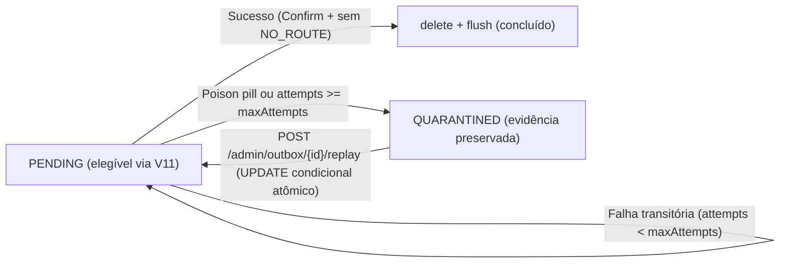

# DEBT-ARCH-006 — Runbook PR 2: E2 (Isolamento de Falhas, Scheduling, Migrations e Replay Administrativo)

> Runbook executável e autocontido para o PR 2. Contexto transversal, evidências e matriz de rastreabilidade: [README.md](./README.md). Etapa anterior: [E1.md](./E1.md).

## Status de Execução

- [x] **E2 — Isolamento de falhas, agendamento e recuperação administrativa:** ativa `@EnableScheduling` no `inv-service` com isolamento seguro em testes, aplica migrations aditivas `V10` e `V11`, isola falhas por backoff (`Clock`) e quarentena sem bloquear eventos válidos, e entrega inspeção/replay atômico por ID (`F4`–`F7`, `Q5`–`Q9`).

---

## 1. Contexto & Invariantes

- **F5 / Q6 — Ativação de `@EnableScheduling`, loop do `OutboxScheduler` e isolamento de testes:**
  - **Problema observado:** nenhum arquivo do `inv-service` declara `@EnableScheduling` (presente apenas no `api-gateway`), [`OutboxRepository.findNextMessageToProcess()`](../../../apps/inv-service/src/main/java/inv/shared/outbox/repository/OutboxRepository.java#L18-L25) ordena `created_at ASC` sem índice, e [`OutboxScheduler`](../../../apps/inv-service/src/main/java/inv/shared/outbox/scheduler/OutboxScheduler.java#L21-L36) encerra o ciclo em qualquer `Exception`.
  - **Solução:** criar `inv.shared.config.SchedulingConfig` com `@EnableScheduling` sob `@ConditionalOnProperty(name = "inv.scheduling.enabled", havingValue = "true", matchIfMissing = true)` e condicionar `OutboxScheduler` a `outbox.scheduler.enabled=true` (com `fixedDelayString` e `initialDelayString`).
  - **Isolamento em testes:** ao ativar `@EnableScheduling`, os demais jobs `@Scheduled` do módulo ([`VendaExpiracaoJob`](../../../apps/inv-service/src/main/java/inv/checkout/infrastructure/jobs/VendaExpiracaoJob.java#L29), [`ProjectionRetryScheduler`](../../../apps/inv-service/src/main/java/inv/finance/infrastructure/jobs/ProjectionRetryScheduler.java#L36), [`ProjecaoDiariaCatchUpJob`](../../../apps/inv-service/src/main/java/inv/finance/infrastructure/jobs/ProjecaoDiariaCatchUpJob.java#L46) e [`FechamentoCaixaScheduler`](../../../apps/inv-service/src/main/java/inv/finance/infrastructure/jobs/FechamentoCaixaScheduler.java#L23)) tornam-se ativos no contexto.
    - **Estratégia sistemática:** todo `@SpringBootTest` do `inv-service` que não testa agendamento declara `inv.scheduling.enabled=false` (via `properties` ou `@TestPropertySource`); apenas os testes de scheduling da `E2` habilitam `inv.scheduling.enabled=true`. Dos 28 `@SpringBootTest`, a maioria mocka `RabbitTemplate` (`CorrelationData.getFuture()` nunca completa → thread presa até o timeout sob `FOR UPDATE SKIP LOCKED`), e `spring.threads.virtual.enabled=true` executa em paralelo jobs sem `initialDelay` (`t = 0ms`), afetando vendas retroativas de [`JdbcVendaQueryServiceIT`](../../../apps/inv-service/src/test/java/inv/checkout/JdbcVendaQueryServiceIT.java#L190-L195), [`ProjecaoRetryIntegrationTest`](../../../apps/inv-service/src/test/java/inv/finance/ProjecaoRetryIntegrationTest.java), [`ProjecaoDuravelSupport`](../../../apps/inv-service/src/test/java/inv/it/ProjecaoDuravelSupport.java#L51), contagens da `outbox` em [`PagamentoConcorrenciaGatesIT`](../../../apps/inv-service/src/test/java/inv/it/PagamentoConcorrenciaGatesIT.java#L378-L407) e `@MockitoSpyBean OutboxRepository` em [`CancelamentoVendaConcluidaIT`](../../../apps/inv-service/src/test/java/inv/it/CancelamentoVendaConcluidaIT.java).
    - **Proibição de sombreamento:** **não criar `src/test/resources/application.properties`**, pois sombrearia `src/main/resources/application.properties` nos demais testes do módulo.

- **F6 / Q7 — Registro durável pós-rollback, classificação com `Clock` e quarentena vs DLQ:**
  - **Durabilidade sem self-invocation nem auto-deadlock:** transformar `OutboxProcessor` em coordenador **não-transacional** que invoca:
    1. Passo transacional `REQUIRES_NEW` **em bean separado** (ex.: `OutboxDeliveryStep`) ou `TransactionTemplate` (`PROPAGATION_REQUIRES_NEW`) — nunca método `this.*` na própria classe (evita bypass do proxy AOP) — executando seleção (`FOR UPDATE SKIP LOCKED`), publicação confirmada e `delete` + `flush()`. Em falha, a exceção dispara rollback limpo e libera o row lock.
    2. `OutboxFailureRecorder` em transação **`REQUIRES_NEW` independente após o rollback**, gravando via `UPDATE` condicional atômico `WHERE id = :id AND status = 'PENDING'` (0 linhas afetadas = no-op se outro worker já entregou/excluiu a linha). Proibido `save(detachedOutbox)` ou `findById(...).orElseThrow()`.
  - **Política por classe de falha (tempo obtido do `@Bean Clock` de [`DateTimeConfig`](../../../apps/inv-service/src/main/java/inv/shared/config/DateTimeConfig.java#L18-L27)):**

| Categoria da Falha | Exemplos | Ação no Registro (`REQUIRES_NEW`) | Efeito no Ciclo do `OutboxScheduler` |
| :--- | :--- | :--- | :--- |
| **Poison pill** | `ClassNotFoundException`, JSON inválido, `version < 0` | `status = 'QUARANTINED'` imediato | **Continua** para próximo evento elegível |
| **Roteamento / Rejeição** | `NO_ROUTE` (`returned != null`), `ack=false` com `getReason()` contendo `404`/`NOT_FOUND` | Backoff (`baseDelayMs * 2^(attempts-1)` ≤ `maxDelayMs`); `attempts >= maxAttempts` → `QUARANTINED` | **Continua** para não travar outras rotas |
| **Broker indisponível** | `AmqpConnectException`, `TimeoutException`, `basic.nack` puro (`ack=false` com `getReason()` nulo/vazio), `ack=false` com `getReason()` de shutdown de conexão/canal ou motivo desconhecido | Backoff exponencial via `Clock`; `attempts >= maxAttempts` → `QUARANTINED` | **Interrompe** ciclo atual para poupar banco/broker |
| **Persistência pós-confirm** | `DataAccessException` / `RuntimeException` em `delete`/`flush`/commit após `Confirm(ack=true)` | Incrementa `attempts`. Abaixo de `maxAttempts`, mantém `PENDING` com backoff via `Clock`. Ao atingir o teto, passa a `QUARANTINED` | **Interrompe** ciclo |

  - **Distinção de `Confirm(ack=false)` (`spring-rabbit:3.2.8`):** no protocolo AMQP 0-9-1, `basic.nack` puro não transporta texto de motivo (`PublisherCallbackChannelImpl.handleNack` deixa `getReason() == null`), enquanto `shutdownCompleted` preenche `getReason()` em `404 NOT_FOUND` e queda de conexão. Classificar por `confirm.getReason()`: `404`/`NOT_FOUND` vai para **Roteamento / Rejeição** (continua), enquanto motivo nulo/vazio (`basic.nack`), shutdown ou motivo desconhecido vão para **Broker indisponível** (interrompe).
  - **Quarentena do publicador vs DLQ do consumidor:** a quarentena retém linhas da outbox no PostgreSQL. Falhas de persistência após ACK sem retorno também podem esgotar as tentativas, mesmo quando a mensagem já chegou a uma fila. Uma nova tentativa ou replay pode repetir a entrega. A DLQ do consumidor atua no RabbitMQ via `x-dead-letter-exchange` após falhas de consumo. Consulte a [ADR-0004](../../adr/0004-transactional-outbox-with-skip-locked.md).

- **F4 / F7 / Q5 / Q8 — Migrations aditivas (`V10`/`V11`), legados `version = 0`/`1` e rollout seguro:**
  - `V10` adiciona colunas e `CHECK (status IN ('PENDING', 'QUARANTINED'))` com `DEFAULT 'PENDING'`, mantendo imediatamente elegíveis todas as linhas preexistentes (inclusive `version = 0` e `version = 1`). `V11` (`.conf` com `executeInTransaction=false`) cria índices parciais concorrentes de elegibilidade e quarentena.
  - **Risco com workers antigos (`F7`):** um worker antigo executa `SELECT * FROM outbox ORDER BY created_at ASC LIMIT 1 FOR UPDATE SKIP LOCKED`, ignorando `status = 'QUARANTINED'` e `next_attempt_at`. **Sequência segura de implantação:** (1) aplicar `V10`/`V11`; (2) desligar pollers antigos (ou subir novos com `outbox.scheduler.enabled=false` enquanto os antigos são encerrados); (3) ativar `outbox.scheduler.enabled=true` apenas com instâncias novas. No rollback, preservar `V10`/`V11` e tratar registros `QUARANTINED` antes de reativar binários antigos.

- **F6 / Q9 — Procedimento operacional de inspeção e replay atômico por ID (`OutboxAdminController`):**
  - **Procedimento e acesso administrativo:** (1) listar pendências em `GET /admin/outbox/quarantined` (`size` limitado a no máx. `100`); (2) inspecionar causa raiz, `payload` e identidade em `GET /admin/outbox/{id}`; (3) corrigir o destino e acionar `POST /admin/outbox/{id}/replay`. O controlador exige `ROLE_ADMIN` para os três endpoints via `@PreAuthorize("hasRole('ADMIN')")`. O acesso é direto ao `inv-service` pela porta `8083`, publicada como `8083:8083` no [Compose](../../../docker-compose.yml), sem rota em [`apps/api-gateway/src/main/resources/application.properties`](../../../apps/api-gateway/src/main/resources/application.properties#L25-L40).
  - **Atomicidade e RFC 7807:** `OutboxReplayService` executa `UPDATE` condicional (`WHERE id = :id AND status = 'QUARANTINED'`) via `OutboxRepository.replayQuarantined` com `@Modifying(clearAutomatically = true, flushAutomatically = true)`, redefinindo `status = 'PENDING'`, `next_attempt_at = :agora`, `attempts = 0`, `replayed_at = :agora` e `replay_count = replay_count + 1` e preservando `payload`, `version` (`0`/`1`), `last_error_type`, `last_error` e `quarantined_at`. Com uma linha atualizada, `findById` lê o estado atualizado na mesma transação para montar a resposta. Com zero linhas, `existsById` distingue conflito de registro inexistente. Erros usam [`ResourceNotFoundException`](../../../apps/common-lib/src/main/java/common/exception/ResourceNotFoundException.java#L11-L16) (`404`) e [`ConflictException`](../../../apps/common-lib/src/main/java/common/exception/ConflictException.java#L11-L20) (`409`) via [`GlobalExceptionHandler`](../../../apps/common-lib/src/main/java/common/exception/GlobalExceptionHandler.java#L56-L65) ([`#L137-L146`](../../../apps/common-lib/src/main/java/common/exception/GlobalExceptionHandler.java#L137-L146)).
  - **Garantia sob concorrência:** diante de dois pedidos simultâneos para o mesmo ID, o lock de linha do `UPDATE` no PostgreSQL garante que exatamente um retorna `200 OK` e o outro retorna `409 Conflict` (`404` se inexistente); o reenvio segue no worker sob `FOR UPDATE SKIP LOCKED`.



---

## 2. Referência de Contratos (Published Language & DDL)

### Migrations Flyway (`apps/inv-service/src/main/resources/db/migration/`)
```sql
-- V10__outbox_resiliencia_entrega.sql
ALTER TABLE outbox
    ADD COLUMN IF NOT EXISTS status VARCHAR(20) NOT NULL DEFAULT 'PENDING',
    ADD COLUMN IF NOT EXISTS attempts INTEGER NOT NULL DEFAULT 0,
    ADD COLUMN IF NOT EXISTS next_attempt_at TIMESTAMP,
    ADD COLUMN IF NOT EXISTS last_attempt_at TIMESTAMP,
    ADD COLUMN IF NOT EXISTS last_error_type VARCHAR(64),
    ADD COLUMN IF NOT EXISTS last_error TEXT,
    ADD COLUMN IF NOT EXISTS quarantined_at TIMESTAMP,
    ADD COLUMN IF NOT EXISTS replayed_at TIMESTAMP,
    ADD COLUMN IF NOT EXISTS replay_count INTEGER NOT NULL DEFAULT 0;

ALTER TABLE outbox
    ADD CONSTRAINT chk_outbox_status CHECK (status IN ('PENDING', 'QUARANTINED'));

-- V11__indice_outbox_elegibilidade.sql (+ V11__indice_outbox_elegibilidade.sql.conf com executeInTransaction=false)
CREATE INDEX CONCURRENTLY IF NOT EXISTS idx_outbox_pending_created_at
    ON outbox (created_at ASC, id ASC) INCLUDE (next_attempt_at)
    WHERE status = 'PENDING';

CREATE INDEX CONCURRENTLY IF NOT EXISTS idx_outbox_quarantined_at
    ON outbox (quarantined_at DESC, id DESC)
    WHERE status = 'QUARANTINED';
```

### Queries, Coordenador e Propriedades (`OutboxRepository`, `OutboxProcessor` e `application.properties`)
```sql
-- Seleção elegível (OutboxDeliveryStep)
SELECT * FROM outbox
 WHERE status = 'PENDING' AND (next_attempt_at IS NULL OR next_attempt_at <= :agora)
 ORDER BY created_at ASC, id ASC LIMIT 1 FOR UPDATE SKIP LOCKED;

-- Registro atômico pós-rollback (OutboxFailureRecorder: 0 linhas = no-op)
UPDATE outbox
   SET status = :status, attempts = :attempts, next_attempt_at = :nextAttemptAt,
       last_attempt_at = :agora, last_error_type = :errorType, last_error = :errorMsg,
       quarantined_at = COALESCE(quarantined_at, :quarantinedAt)
 WHERE id = :id AND status = 'PENDING';

-- Replay condicional atômico (contagem de linhas atualizadas)
UPDATE outbox
   SET status = 'PENDING', next_attempt_at = :agora, attempts = 0,
       replayed_at = :agora, replay_count = replay_count + 1
 WHERE id = :id AND status = 'QUARANTINED';

-- Com 1 linha atualizada, findById lê o registro na mesma transação (200 OK)
SELECT * FROM outbox WHERE id = :id;
-- Com 0 linhas atualizadas, existsById distingue 409 Conflict de 404 Not Found
```
```java
// Contrato do coordenador não-transacional OutboxProcessor
public enum OutboxStepResult { DELIVERED, EMPTY, FAILED_CONTINUE, FAILED_PAUSE }
OutboxStepResult processNextStep(); // OutboxScheduler continua em DELIVERED | FAILED_CONTINUE; para em EMPTY | FAILED_PAUSE
boolean processNext();              // Compatibilidade: true em DELIVERED | FAILED_CONTINUE; false em EMPTY | FAILED_PAUSE (sem relançar falhas classificadas)
```
```properties
inv.scheduling.enabled=${INV_SCHEDULING_ENABLED:true}
outbox.scheduler.enabled=${OUTBOX_SCHEDULER_ENABLED:true}
outbox.scheduler.fixed-delay-ms=${OUTBOX_SCHEDULER_FIXED_DELAY_MS:2000}
outbox.scheduler.initial-delay-ms=${OUTBOX_SCHEDULER_INITIAL_DELAY_MS:1000}
outbox.retry.max-attempts=${OUTBOX_RETRY_MAX_ATTEMPTS:5}
outbox.retry.base-delay-ms=${OUTBOX_RETRY_BASE_DELAY_MS:2000}
outbox.retry.max-delay-ms=${OUTBOX_RETRY_MAX_DELAY_MS:60000}
```

### Contratos REST Administrativos (`inv.shared.outbox.web` — `@PreAuthorize("hasRole('ADMIN')")`)
```java
public record OutboxRecordView(
        Long id, String exchange, String routingKey, String eventType, int version,
        String payload, String status, int attempts, LocalDateTime createdAt,
        LocalDateTime nextAttemptAt, LocalDateTime lastAttemptAt,
        String lastErrorType, String lastError, LocalDateTime quarantinedAt,
        LocalDateTime replayedAt, int replayCount) {}

public record OutboxReplayResponse(Long id, String status, LocalDateTime replayedAt, int replayCount) {}

// GET  /admin/outbox/quarantined?page=0&size=20 -> Page<OutboxRecordView> (teto size <= 100)
// GET  /admin/outbox/{id}                       -> ResponseEntity<OutboxRecordView> (200 | 404 ProblemDetail)
// POST /admin/outbox/{id}/replay                -> ResponseEntity<OutboxReplayResponse> (200 | 404 | 409 ProblemDetail)
```

---

## 3. Passos de Implementação & Critérios de Teste

### Roteiro de Implementação
1. **Passo 1 — Migrations `V10`/`V11`, entidade `Outbox` e `OutboxRepository` (`F4`, `Q5`, `Q8`):**
   - Criar `V10__outbox_resiliencia_entrega.sql` e `V11__indice_outbox_elegibilidade.sql` (com `.conf` `executeInTransaction=false`).
   - Mapear as novas colunas em `Outbox` inicializando `version = 1` e `status = "PENDING"` com proteção contra `null` (ex.: `@PrePersist`/setter), pois os produtores `BEFORE_COMMIT` e `OutboxConcorrenciaIntegrationTest` instanciam `new Outbox()` sem setar `status`; implementar em `OutboxRepository` seleção elegível, `UPDATE` condicional de falha, `UPDATE` condicional de replay com `@Modifying(clearAutomatically = true, flushAutomatically = true)` com retorno da contagem de linhas, além da consulta paginada de `QUARANTINED`.
2. **Passo 2 — `SchedulingConfig` e isolamento sistemático de testes (`F5`, `Q6`):**
   - Criar `inv.shared.config.SchedulingConfig` (`@EnableScheduling` sob `inv.scheduling.enabled=true`) e condicionar `OutboxScheduler` via `outbox.scheduler.enabled=true`.
   - Declarar `inv.scheduling.enabled=false` em todos os `@SpringBootTest` do `inv-service` que não testam agendamento (incluindo `OutboxConcorrenciaIntegrationTest` e `PagamentoMensageriaIT`, exigido para o `mvn clean verify` da `E2`), habilitando `inv.scheduling.enabled=true` apenas nos testes de scheduling da etapa e sem criar `src/test/resources/application.properties`.
3. **Passo 3 — Coordenador `OutboxProcessor` + `OutboxFailureRecorder` (`F6`, `Q7`):**
   - Separar o coordenador não-transacional `OutboxProcessor` da transação `REQUIRES_NEW` de envio/`delete` (`flush()`) em bean separado (`OutboxDeliveryStep`) ou `TransactionTemplate` (`PROPAGATION_REQUIRES_NEW`, sem `this.*`); delegar o registro de falha pós-rollback ao `OutboxFailureRecorder` (`UPDATE ... WHERE id = :id AND status = 'PENDING'`, `0` linhas = no-op) com `Clock` (`DateTimeConfig`), expondo `OutboxStepResult processNextStep()` ao `OutboxScheduler` e preservando `boolean processNext()`.
4. **Passo 4 — `OutboxReplayService`, `OutboxAdminController` e cobertura de testes (`F6`, `Q9`):**
   - Implementar `/admin/outbox/**` (`ROLE_ADMIN`, acesso direto ao `inv-service` em `8083` publicada no Compose, sem rota no `api-gateway`, teto `size <= 100`, `ResourceNotFoundException`/`ConflictException` RFC 7807) preservando `payload`, `version` (`0` e `1`) e diagnóstico; escrever unitários e `*IT` (sem Lombok em testes e auxiliares sem `@Test` como `*Fixture` ou `abstract`).

### Critérios de Teste (Comportamento Esperado)
- **Cenário 1 — Aceite central (*head-of-line*): inválido antigo não bloqueia válido seguinte (`F5`, `F6`, `Q7`):**
  - *Condição:* Mensagem `A` antiga com payload/tipo inválido (`created_at = t0`) seguida da mensagem `B` válida (`created_at = t1`) na `outbox`.
  - *Ação:* Executar ciclos de `OutboxScheduler` / `OutboxProcessor`.
  - *Resultado observável:* `A` passa imediatamente a `QUARANTINED` preservando `payload`, `last_error_type` e `last_error`; `B` é entregue ao RabbitMQ real e removida da tabela; chamadas subsequentes do worker retornam sem reprocessar `A` em repetição contínua.
- **Cenário 2 — Backoff determinístico com `Clock`, broker fora e retomada após reinício (`F5`, `F6`, `Q6`, `Q7`):**
  - *Condição:* (a) Falha de conexão simulada em `RabbitTemplate.send` via `AmqpConnectException` em `OutboxResilienciaEReplayIT`; (b) linha `PENDING` com `next_attempt_at` vencido gravada antes de reiniciar/recriar o contexto Spring.
  - *Ação:* (a) Executar `OutboxProcessor.processNextStep()` antes e depois de avançar `Clock` até esgotar `maxAttempts`; (b) recriar o contexto com o scheduler ativo em `OutboxSchedulingRetomadaIT`, com RabbitMQ real.
  - *Resultado observável:* Em (a), a falha de conexão simulada interrompe o ciclo atual, respeita `next_attempt_at` via `Clock` e move para `QUARANTINED` ao atingir `maxAttempts`; em (b), após reinício a linha vencida é selecionada e entregue ao broker real.
- **Cenário 3 — Replay após corrigir causa, legado `version = 0`/`1` e replay concorrente (`F4`, `Q5`, `Q8`, `Q9`):**
  - *Condição:* Registro (incluindo cenário com `version = 0`) em `QUARANTINED` após `maxAttempts` por `NO_ROUTE`; binding é então restaurado no RabbitMQ.
  - *Ação:* Inspecionar via `GET /admin/outbox/quarantined` e `GET /admin/outbox/{id}`; disparar `2` requisições simultâneas (`CountDownLatch`) a `POST /admin/outbox/{id}/replay` com `ROLE_ADMIN`; acionar worker.
  - *Resultado observável:* Diagnóstico e `payload` originais são preservados; exatamente `1` chamada retorna `200 OK` (`replayCount = 1`) e a outra `409 Conflict`; após restaurar o binding, o teste observa uma mensagem na fila e a conclusão da linha.
- **Cenário 4 — Autorização administrativa, teto de paginação e integridade Flyway `V10`/`V11` (`Q8`, `Q9`):**
  - *Condição:* Chamadas sem autenticação ou sem `ROLE_ADMIN`, `size` acima de `100` em `/quarantined`, replay de ID inexistente e inicialização com `ddl-auto=validate`.
  - *Ação:* Executar `MockMvc` com filtros de segurança ativos e verificar `pg_index.indisvalid` para `V11`.
  - *Resultado observável:* `401`/`403` sem `ROLE_ADMIN`, `size` acima do teto limitado/rejeitado, `404` `ProblemDetail` para ID inexistente, contexto válido sob `ddl-auto=validate` e índices parciais `idx_outbox_pending_created_at` e `idx_outbox_quarantined_at` com `indisvalid = true`.

---

## 4. Commits Sugeridos e Definition of Done (DoD)

### Commits Sugeridos
- `feat(outbox): adiciona colunas de resiliencia (V10) e indices parciais (V11) na outbox (Q8)`
- `feat(scheduling): ativa EnableScheduling configuravel e isola testes do inv-service (F5, Q6)`
- `feat(outbox): implementa OutboxFailureRecorder pos-rollback, backoff com Clock e quarentena (F6, Q7)`
- `feat(outbox): adiciona endpoints admin de inspecao e replay condicional por ID (Q9)`

### Comandos de Validação (Portáveis)
```bash
# 1. Unitários e gates de arquitetura (sem Docker)
mvn clean test
mvn test -pl apps/inv-service -am "-Dtest=ArquiteturaTest,ArquiteturaR15Test,ModulithTest" "-Dsurefire.failIfNoSpecifiedTests=false"

# 2. Integrações da etapa e regressões (com Docker ativo)
mvn verify -pl apps/inv-service -am '-Dtest=!*' "-Dsurefire.failIfNoSpecifiedTests=false" "-Dit.test=OutboxConcorrenciaIntegrationTest,PagamentoMensageriaIT" "-Dfailsafe.failIfNoSpecifiedTests=false"
mvn verify -pl apps/inv-service -am '-Dtest=!*' "-Dsurefire.failIfNoSpecifiedTests=false" "-Dit.test=<NovaClasseE2IT>" "-Dfailsafe.failIfNoSpecifiedTests=false"

# 3. Validação completa, relatórios e formatação
mvn clean verify
python3 .github/scripts/check-test-reports.py
mvn spotless:check
```

### Rollback e Contingência Operacional
- **Implantação segura:** aplicar `V10`/`V11`, encerrar pollers antigos (ou subir novos com `outbox.scheduler.enabled=false` durante drenagem dos antigos) e só então habilitar `outbox.scheduler.enabled=true`.
- **Rollback:** desabilitar `outbox.scheduler.enabled=false`, reverter commits Java **mantendo `V10` e `V11` no repositório** (`FlywayValidateException`), e tratar/drenar linhas `QUARANTINED` antes de reativar código antigo que desconhece `status` e `next_attempt_at`. Se um índice `CONCURRENTLY` da `V11` ficar `indisvalid = false`, executar `DROP INDEX CONCURRENTLY IF EXISTS ...` antes de reaplicar.

### Definition of Done (DoD)
- [x] Todos os `@SpringBootTest` sem teste de agendamento declaram `inv.scheduling.enabled=false` (inclusive `OutboxConcorrenciaIntegrationTest`); `@EnableScheduling` ativo apenas nos testes de scheduling e sem `src/test/resources/application.properties`.
- [x] `V10` e `V11` aplicadas sob `ddl-auto=validate` com índices válidos (`indisvalid = true`), `Outbox` inicializando `status = "PENDING"`/`version = 1` e linhas legadas (`version = 0`/`1`) elegíveis.
- [x] Coordenador sem self-invocation (`OutboxDeliveryStep`/`TransactionTemplate`), `OutboxFailureRecorder` atômico (`0` linhas = no-op), falha pós-confirm tratada como transitória com pausa, mensagem inválida em `QUARANTINED` sem travar evento válido e replay concorrente (`200`/`409`/`404`) comprovados.
- [x] `mvn clean verify`, `check-test-reports.py`, `mvn spotless:check`, `ArquiteturaTest`, `ArquiteturaR15Test` e `ModulithTest` verdes sem novas dependências Maven nem Lombok em testes.
