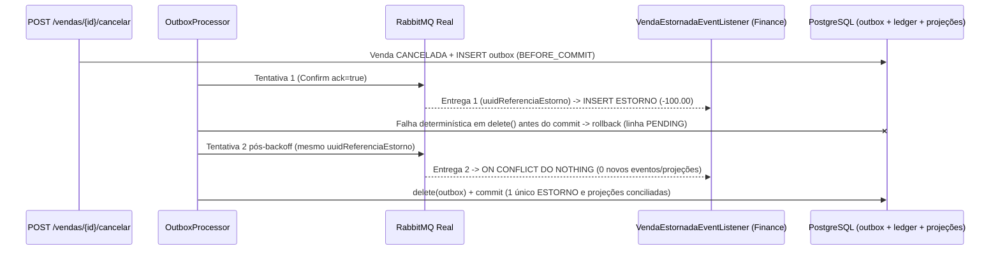

# DEBT-ARCH-006 — Runbook PR 3: E3 (Prova Ponta a Ponta de Recuperação, Operação e Fechamento da ADR-0004)

> Runbook executável e autocontido para o PR 3. Contexto transversal, evidências e matriz de rastreabilidade: [README.md](./README.md). Etapa anterior: [E2.md](./E2.md).

## Status de Execução

- [ ] **E3 — Prova E2E de recuperação pós-confirmação, operação e fechamento da ADR-0004:** implementa `OutboxEstornoRecuperacaoIT` com `VendaEstornadaEvent`, confirma preservação integral de `OutboxConcorrenciaIntegrationTest`, entrega métricas/logs das 3 perguntas operacionais (`Clock` nos produtores e gauge blindado) e atualiza a `ADR-0004` (`F8`, `F9`, `Q10`, `Q11`).

---

## 1. Contexto & Invariantes

- **F8 / Q10 — Cobertura real atual vs lacuna fechada por `OutboxEstornoRecuperacaoIT`:**

| Suíte de Integração | Infraestrutura | Caminho Real Exercitado vs Bypass Observado |
| :--- | :--- | :--- |
| [`LedgerConcorrenciaIdempotenciaIT`](../../../apps/inv-service/src/test/java/inv/it/LedgerConcorrenciaIdempotenciaIT.java) | PostgreSQL apenas | Mocka `RabbitTemplate`/`ConnectionFactory`; chama `handleVendaEstornada` direto em memória |
| [`CancelamentoVendaConcluidaIT`](../../../apps/inv-service/src/test/java/inv/it/CancelamentoVendaConcluidaIT.java) | PostgreSQL apenas | Mocka RabbitMQ; grava na `outbox` via `POST /vendas/{id}/cancelar`, mas bypassa `OutboxProcessor` e broker chamando `handleVendaEstornada(outboxMsg.getPayload())` |
| [`PagamentoMensageriaIT`](../../../apps/inv-service/src/test/java/inv/it/PagamentoMensageriaIT.java) | PostgreSQL + RabbitMQ | Mocka `OutboxScheduler`; ignora a linha da `outbox` e publica `String` manualmente no broker |
| **`OutboxEstornoRecuperacaoIT` (Novo)** | **PostgreSQL + RabbitMQ** | **Ciclo completo real:** `POST /vendas/{id}/cancelar` → `BEFORE_COMMIT` → `outbox` → `OutboxProcessor` → RabbitMQ real → `VendaEstornadaEventListener` → Ledger + projeções |

  - **Prova determinística da janela pós-confirmação AMQP / pré-commit de exclusão:** induzir falha única exclusivamente no teste (via `@MockitoSpyBean OutboxRepository` falhando na 1ª chamada a `delete(...)` após `Confirm(ack=true)`), sem alterar código de produção. Em contraste com exceção lançada antes do envio (zero entregas ao broker antes da recuperação), esse ensaio comprova:
    1. A 1ª entrega via RabbitMQ real atinge `VendaEstornadaEventListener` mesmo com o rollback do worker;
    2. O rollback preserva a linha recuperável na `outbox` (`status = 'PENDING'`, `attempts = 1`, `next_attempt_at` via `Clock`);
    3. Após avançar o `Clock`, a 2ª entrega via broker real com o mesmo `uuidReferenciaEstorno` (`UUID.nameUUIDFromBytes("ESTORNO:" + vendaId)`) resulta em **1 único lançamento `ESTORNO`** (`-100.00`) e **1 único efeito** em `financial_projection_venda` e `financial_projection_diaria`.

- **Q10 — Preservação de `OutboxConcorrenciaIntegrationTest` e conformidade com `DEBT-ARCH-005`:**
  - [`OutboxConcorrenciaIntegrationTest`](../../../apps/inv-service/src/test/java/inv/shared/outbox/OutboxConcorrenciaIntegrationTest.java) mantém **10 workers**, **100 mensagens** em `adr0004.outbox.queue`, drenagem completa (`outbox` = `0`), zero duplicatas e zero deadlocks/exceções no caminho saudável.
  - O isolamento de `OutboxScheduler` (`inv.scheduling.enabled=false`) já aplicado na `E2` permanece ativo; a `E3` apenas confirma a preservação desse isolamento e de todas as garantias originais.
  - Manter `eventType = "java.util.HashMap"` e `version = 1` válidos; preservar carga e asserções; não usar Lombok em testes (`-proc:none`); nomear auxiliares sem `@Test` como `*Fixture` ou `abstract` (`check-test-reports.py`) e manter `Spotless` verde sem novas dependências Maven.

- **F9 / Q11 — Operação para as 3 perguntas e atualização da [`ADR-0004`](../../adr/0004-transactional-outbox-with-skip-locked.md):**
  - **Respostas operacionais objetivas (Micrometer/Prometheus + `OutboxAdminController` + logs):**

| Pergunta Operacional | Fonte Primária (Métrica / Endpoint / Log) | Comprovação SQL / Estado |
| :--- | :--- | :--- |
| **1. Qual a idade do evento elegível mais antigo?** | Gauge `outbox.oldest.eligible.age.seconds` (via `Clock`, `GREATEST(0, ...)` e tolerante a erro DB) | `MIN(created_at)` (gravado com `Clock`) onde `status = 'PENDING'` e elegível |
| **2. Quais registros exigem intervenção?** | `GET /admin/outbox/quarantined`, gauge `outbox.quarantined.count` e counter `outbox.quarantined.total` | Linhas com `status = 'QUARANTINED'` ordenadas por `quarantined_at DESC` |
| **3. Como comprovar que um replay foi concluído?** | Counters `outbox.replay.requested.total` e `outbox.replay.completed.total` + log `outbox_replay_completed` | `GET /admin/outbox/{id}` retorna `404` (linha excluída após `Confirm(ack=true)`) |

  - **Atualização obrigatória da `ADR-0004` (Seções 4, 5, 6 e 7) — Entrega *at-least-once* e garantia por consumidor:**
    - *Entrega do publicador:* **pelo menos uma vez** (*at-least-once*) após `Confirm(ack=true)` sem `NO_ROUTE`.
    - *Checkout ([`VendaEventHandler`](../../../apps/inv-service/src/main/java/inv/checkout/infrastructure/messaging/VendaEventHandler.java)):* efeito **idempotente** sob lock pessimista (`findByIdWithLock` e flags `contabilizado`/`excedente`).
    - *Finance ([`VendaEstornadaEventListener`](../../../apps/inv-service/src/main/java/inv/finance/infrastructure/messaging/VendaEstornadaEventListener.java)):* efeito contábil **exatamente único** via `uuidReferenciaEstorno` + `INSERT ... ON CONFLICT DO NOTHING RETURNING id`.
    - *Mail ([`EmailConsumer`](../../../apps/mail-service/src/main/java/mail/service/EmailConsumer.java#L71-L122)):* deduplicado por `processed_events(eventId)`, porém sujeito ao **limite físico do SMTP** (sem 2PC): `existsByEventId` (sem lock) roda **antes** de `mailSender.send` e `processedEventRepository.save` ocorre **depois**, permitindo reenvio em falha pós-SMTP ou entrega concorrente, além da fila `inventory.v1.low-stock.send-email` operar sem DLQ/retry.



---

## 2. Referência de Contratos (Published Language & DDL)

Sem novas migrations Flyway (`V1`–`V11` inalteradas), sem novos contratos `*.api` e sem novos endpoints HTTP.

### Métricas Micrometer e Log Estruturado (`inv.shared.outbox`)
```text
Métricas Micrometer (/actuator/prometheus):
- outbox.oldest.eligible.age.seconds (Gauge)   : idade em segundos (>= 0) do registro elegível mais antigo via Clock; captura falha transitória de banco sem degradar /actuator/prometheus
- outbox.quarantined.count           (Gauge)   : quantidade atual de registros em status = 'QUARANTINED'
- outbox.quarantined.total           (Counter) : total movido para quarentena (tag: error_type)
- outbox.replay.requested.total      (Counter) : total de pedidos 200 OK em POST /admin/outbox/{id}/replay
- outbox.replay.completed.total      (Counter) : total de registros com replay_count > 0 entregues e concluídos

Log estruturado (evento de conclusão de replay):
- event=outbox_replay_completed outboxId=<id> eventType=<fqcn> version=<0|1> replayCount=<n> messageId=<outbox-id> correlationId=<uuid>
```

### Consultas SQL de Diagnóstico Operacional
```sql
-- 1. Idade (em segundos) do evento elegível mais antigo
SELECT GREATEST(0, COALESCE(EXTRACT(EPOCH FROM (CAST(:agora AS TIMESTAMP) - MIN(created_at))), 0))
  FROM outbox
 WHERE status = 'PENDING' AND (next_attempt_at IS NULL OR next_attempt_at <= CAST(:agora AS TIMESTAMP));

-- 2. Registros em quarentena que exigem intervenção
SELECT id, event_type, routing_key, attempts, last_error_type, quarantined_at
  FROM outbox
 WHERE status = 'QUARANTINED'
 ORDER BY quarantined_at DESC, id DESC;

-- 3. Auditoria pós-replay (ausência de linha indica drenagem concluída)
SELECT id, status, replay_count, replayed_at FROM outbox WHERE id = :id;
```

### Escopo de Atualização da [`ADR-0004`](../../adr/0004-transactional-outbox-with-skip-locked.md) (Seções 4, 5, 6 e 7)
- **Seção 4 (Decisão):** documentar `publisher-confirm-type=correlated`, `mandatory=true`, publicação JSON sem `__TypeId__`, backoff via `Clock`, `V10`/`V11` e replay administrativo.
- **Seção 5 (Prós/Contras e Semântica):** declarar entrega **pelo menos uma vez** e tabela de garantias por consumidor (Checkout, Finance e limite SMTP/`ProcessedEvent` + ausência de DLQ/retry na fila de estoque do `mail-service`).
- **Seções 6 e 7 (Testes e Referências):** atualizar referência de comando portável, registrar `OutboxConcorrenciaIntegrationTest` (com scheduler isolado) e `OutboxEstornoRecuperacaoIT`, e ligar os novos componentes em `inv.shared.outbox`.

---

## 3. Passos de Implementação & Critérios de Teste

### Roteiro de Implementação
1. **Passo 1 — `Clock` nos produtores, métricas resilientes e log de replay (`F9`, `Q11`):**
   - Injetar `@Bean Clock` (`DateTimeConfig`) em [`PagamentoListener`](../../../apps/inv-service/src/main/java/inv/checkout/infrastructure/messaging/PagamentoListener.java#L40), [`VendaEstornadaOutboxListener`](../../../apps/inv-service/src/main/java/inv/checkout/infrastructure/messaging/VendaEstornadaOutboxListener.java#L52) e [`RabbitMQProducerListener`](../../../apps/inv-service/src/main/java/inv/inventory/infrastructure/messaging/RabbitMQProducerListener.java#L49) para gravar `createdAt = LocalDateTime.now(clock)`.
   - Registrar os gauges e counters no `MeterRegistry` (já presente via `spring-boot-starter-actuator`) usando `Clock`, blindar a query do gauge com `GREATEST(0, ...)` e `CAST(:agora AS TIMESTAMP)`, capturar exceções transitórias de banco no supplier do gauge (log + último valor/`NaN` sem quebrar `/actuator/prometheus`), e emitir `outbox_replay_completed` + incrementar `outbox.replay.completed.total` ao concluir registro com `replay_count > 0`.
2. **Passo 2 — `OutboxEstornoRecuperacaoIT` e verificação de `OutboxConcorrenciaIntegrationTest` (`F8`, `Q10`):**
   - Criar `inv.it.OutboxEstornoRecuperacaoIT` (PostgreSQL + RabbitMQ reais, `inv.scheduling.enabled=false`, `features.cancelamento-venda-concluida.enabled=true`, `ROLE_ADMIN` no cancelamento, sem Lombok): concluir venda via `pagamentoService.confirmarPagamentoWebhook(...)` e drenar/limpar o `PagamentoConfirmadoEvent` da `outbox` antes de `POST /vendas/{id}/cancelar` para que a 1ª chamada a `OutboxProcessor.processNext()` exercite exclusivamente `VendaEstornadaEvent`; validar falha pós-confirmação AMQP / pré-commit no `delete(...)` e contraste com falha pré-envio.
   - Confirmar que `OutboxConcorrenciaIntegrationTest` (já isolado com `inv.scheduling.enabled=false` na `E2`) preserva 10 workers, 100 mensagens (`java.util.HashMap`, `version = 1`), carga e todas as asserções originais.
3. **Passo 3 — Atualização da `ADR-0004` (`F9`, `Q11`):**
   - Atualizar as Seções 4, 5, 6 e 7 de `docs/adr/0004-transactional-outbox-with-skip-locked.md` com links relativos válidos, garantia *at-least-once* e limites reais por consumidor.
4. **Passo 4 — Validação completa de arquitetura, estilo, relatórios e Failsafe:**
   - Executar toda a suíte unitária e de integração (`mvn clean verify`), `check-test-reports.py` e `mvn spotless:check`.

### Critérios de Teste (Comportamento Esperado)
- **Cenário 1 — Aceite central (`OutboxEstornoRecuperacaoIT`): recuperação pós-confirmação AMQP / pré-commit (`F8`, `Q10`):**
  - *Condição:* Venda de `100.00` paga com `120.00` (`troco = 20.00`) concluída via `pagamentoService.confirmarPagamentoWebhook(...)`, com a linha `PagamentoConfirmadoEvent` previamente drenada/removida da `outbox` antes do cancelamento; `features.cancelamento-venda-concluida.enabled=true`, `inv.scheduling.enabled=false` e `ROLE_ADMIN` no endpoint de cancelamento (como em [`CancelamentoVendaConcluidaIT`](../../../apps/inv-service/src/test/java/inv/it/CancelamentoVendaConcluidaIT.java#L97-L155)); `@MockitoSpyBean OutboxRepository` lança exceção **uma única vez** em `delete(...)` após `Confirm(ack=true)` sem `NO_ROUTE`.
  - *Ação:* Executar `POST /vendas/{id}/cancelar` → `OutboxProcessor.processNext()` (1ª entrega é `VendaEstornadaEvent` e falha no commit de `delete`) → inspecionar `outbox` e `lancamentos_financeiros` → avançar `Clock` além do backoff → executar `OutboxProcessor.processNext()` (2ª entrega).
  - *Resultado observável:* Após a 1ª entrega o RabbitMQ real entrega o evento e o `VendaEstornadaEventListener` grava o estorno, mas o rollback mantém a linha recuperável na `outbox` (`PENDING`, `attempts = 1`); após a 2ª entrega via broker com o mesmo `uuidReferenciaEstorno`, existem exatamente **1 lançamento `ESTORNO` (`-100.00`)**, `financial_projection_venda` (`saldo = 0.00`, `total_creditos = 100.00`, `total_estornos = 100.00`), `financial_projection_diaria` conciliada, `outbox` = `0` e filas/DLQ vazias.
- **Cenário 2 — Contraste com falha antes do envio AMQP (`Q10`):**
  - *Condição:* Erro induzido antes de publicar no broker (ex.: indisponibilidade simulada antes de `send`).
  - *Ação:* Executar `processNext()`, normalizar envio, avançar `Clock` e executar `processNext()`.
  - *Resultado observável:* `0` entregas no broker na 1ª tentativa; após retomada, exatamente `1` entrega e `1` lançamento `ESTORNO` (`-100.00`).
- **Cenário 3 — Preservação integral de `OutboxConcorrenciaIntegrationTest` (`Q10`):**
  - *Condição:* `100` mensagens (`java.util.HashMap`, `version = 1`) na `outbox` para `adr0004.outbox.queue` com `inv.scheduling.enabled=false` (definido na `E2`).
  - *Ação:* Executar `10` threads concorrentes chamando `OutboxProcessor.processNext()` até drenar.
  - *Resultado observável:* `100` mensagens únicas recebidas em `adr0004.outbox.queue`, `outbox` com `0` linhas e zero duplicatas/exceções.
- **Cenário 4 — Resposta operacional às três perguntas (`F9`, `Q11`):**
  - *Condição:* (a) Linha elegível envelhecida via `Clock` (e caso com `Clock` atrás do `created_at` / falha transitória simulada); (b) linha enviada para `QUARANTINED`; (c) replay via `POST /admin/outbox/{id}/replay` drenado pelo worker.
  - *Ação:* Inspecionar métricas Micrometer (`/actuator/prometheus` / `MeterRegistry`), `GET /admin/outbox/quarantined`, `GET /admin/outbox/{id}` e logs.
  - *Resultado observável:* `outbox.oldest.eligible.age.seconds > 0` quando envelhecida e nunca negativo (`>= 0`) com `Clock` atrasado (sem degradar `/actuator/prometheus` em falha transitória de banco); `outbox.quarantined.count >= 1`, `outbox.quarantined.total` incrementado e registro listado em (b); `outbox.replay.requested.total == 1`, `outbox.replay.completed.total == 1`, log `outbox_replay_completed` emitido e `GET /admin/outbox/{id}` retornando `404` em (c).
- **Cenário 5 — Conformidade final da esteira CI (`DEBT-ARCH-005`):**
  - *Condição:* Repositório com todas as alterações das etapas `E1`–`E3` aplicadas e `ADR-0004` atualizada.
  - *Ação:* Executar `mvn clean verify`, `python3 .github/scripts/check-test-reports.py`, `mvn spotless:check` e os gates arquiteturais.
  - *Resultado observável:* Todos os relatórios XML do Surefire e Failsafe conciliados sem skips/falhas, formatação e cabeçalhos `AGPL-3.0-only` aprovados, `ArquiteturaTest` (`R1`–`R15`), `ArquiteturaR15Test` e `ModulithTest` verdes.

---

## 4. Commits Sugeridos e Definition of Done (DoD)

### Commits Sugeridos
- `feat(outbox): expoe metricas Micrometer e log estruturado de replay concluido (F9, Q11)`
- `test(outbox): comprova recuperacao E2E de estorno pos-confirmacao AMQP e preserva carga ADR-0004 (F8, Q10)`
- `docs(adr): atualiza ADR-0004 com garantia at-least-once e limites por consumidor (Q11)`

### Comandos de Validação (Portáveis)
```bash
# 1. Unitários e arquitetura (sem Docker)
mvn clean test
mvn test -pl apps/inv-service -am "-Dtest=ArquiteturaTest,ArquiteturaR15Test,ModulithTest" "-Dsurefire.failIfNoSpecifiedTests=false"

# 2. Integração da E3 e regressão concorrente da ADR-0004 (com Docker ativo)
mvn verify -pl apps/inv-service -am '-Dtest=!*' "-Dsurefire.failIfNoSpecifiedTests=false" "-Dit.test=OutboxEstornoRecuperacaoIT,OutboxConcorrenciaIntegrationTest" "-Dfailsafe.failIfNoSpecifiedTests=false"

# 3. Gates completos de CI
mvn clean verify
python3 .github/scripts/check-test-reports.py
mvn spotless:check
```

### Rollback e Contingência Operacional
- Reverter diretamente via `git revert` (contém teste `*IT`, métricas/logs de leitura, injeção de `Clock` para `createdAt` nos 3 produtores `BEFORE_COMMIT` e atualização documental da `ADR-0004`, sem impacto em schema Flyway ou contratos de produção).

### Definition of Done (DoD)
- [ ] `OutboxEstornoRecuperacaoIT` comprova o ciclo real `BEFORE_COMMIT -> outbox -> OutboxProcessor -> RabbitMQ -> VendaEstornadaEventListener` com falha pós-confirm/pré-commit e exatamente `1` `ESTORNO` (`-100.00`) conciliado nas projeções.
- [ ] `OutboxConcorrenciaIntegrationTest` preservado integralmente (`10` workers, `100` mensagens em `adr0004.outbox.queue`, drenagem total, zero duplicatas) sem Lombok em testes nem novas dependências Maven.
- [ ] Métricas e logs respondem às 3 perguntas operacionais (`Clock` nos produtores `BEFORE_COMMIT`, gauge não negativo tolerante a erro transitório DB) e `docs/adr/0004-transactional-outbox-with-skip-locked.md` atualizada nas Seções 4, 5, 6 e 7.
- [ ] `mvn clean verify`, `check-test-reports.py`, `mvn spotless:check`, `ArquiteturaTest`, `ArquiteturaR15Test` e `ModulithTest` verdes.
