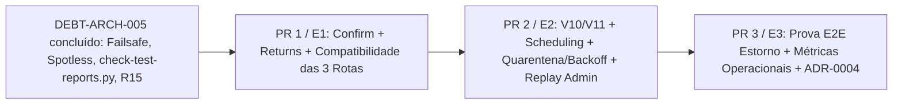

# DEBT-ARCH-006 — Entrega e Recuperação de Eventos da Outbox (`inv-service`)

> **TL;DR:** Este épico endurece o pipeline de publicação da tabela `outbox` do `inv-service` em **3 PRs incrementais e demonstráveis isoladamente** (`E1`, `E2` e `E3`), executáveis integralmente com PostgreSQL, RabbitMQ e Testcontainers do repositório, sem adquirente, SMTP real ou acesso à produção. O **PR 1 (`E1`)** garante confirmação de publicação e roteamento antes de concluir a linha (`NO_ROUTE`, `NACK`, `404 NOT_FOUND`, timeout e falha de conexão), preserva compatibilidade das três rotas reais (incluindo `version = 0` e `1`) e restringe a fila órfã de estoque baixo. O **PR 2 (`E2`)** ativa `@EnableScheduling` no `inv-service` com isolamento seguro em testes, adiciona `V10`/`V11` com índice de elegibilidade, isola falhas permanentes/transitórias via backoff (`Clock`) e quarentena sem bloquear a fila, e entrega inspeção/replay atômico por ID. O **PR 3 (`E3`)** comprova ponta a ponta a recuperação pós-confirmação AMQP / pré-commit com `VendaEstornadaEvent`, preserva `OutboxConcorrenciaIntegrationTest`, entrega observabilidade operacional e atualiza a [`ADR-0004`](../../adr/0004-transactional-outbox-with-skip-locked.md).

---

## 1. Motivação, Escopo, Fronteira com `DEBT-ARCH-005` e Roadmap

### Motivação e Objetivo
1. **Perda silenciosa no despacho AMQP:** [`OutboxProcessor.processNext()`](../../../apps/inv-service/src/main/java/inv/shared/outbox/scheduler/OutboxProcessor.java#L37-L72) hoje publica com `rabbitTemplate.convertAndSend(...)` sem `publisher-confirm-type`, `publisher-returns` ou `mandatory=true` e exclui o registro imediatamente em seguida, aceitando como entregue qualquer evento rejeitado por falta de rota (`NO_ROUTE`), `NACK` ou fechamento assíncrono por exchange inexistente (`404 NOT_FOUND`).
2. **Bloqueio de fila e ausência de recuperação operacional:** O `inv-service` não declara `@EnableScheduling`, o scheduler atual interrompe o ciclo em qualquer exceção e a tabela `outbox` ([`V1__Schema_Inicial.sql`](../../../apps/inv-service/src/main/resources/db/migration/V1__Schema_Inicial.sql#L47-L56)) carece de índice em `created_at`, controle de tentativas/backoff, quarentena para payloads inválidos e fluxo seguro de replay por ID.
3. **Prova ponta a ponta incompleta:** Os testes de integração atuais exercitam banco e broker de forma fragmentada (com bypass da outbox ou mocks de RabbitMQ), faltando prova determinística do ciclo `BEFORE_COMMIT -> outbox -> OutboxProcessor -> RabbitMQ real -> @RabbitListener` sob falha pós-confirmação AMQP / pré-commit de exclusão.

### Fronteira com `DEBT-ARCH-005` (Concluído) e Escopo
- **Premissas herdadas do [`DEBT-ARCH-005`](../DEBT-ARCH-005/README.md):**
  - `mvn test` (Surefire) exclui `**/*$*`, `**/*IT.java` e `**/*IntegrationTest.java`; `mvn verify` (Failsafe) executa exclusivamente `*IT` e `*IntegrationTest`.
  - A esteira em [`.github/workflows/ci-cd.yml`](../../../.github/workflows/ci-cd.yml) executa `mvn spotless:check`, `mvn clean verify`, [`check-test-reports.py`](../../../.github/scripts/check-test-reports.py), `ArquiteturaTest` + `ArquiteturaR15Test` + `ModulithTest` e auditoria de `BOOT-INF/lib/` contra [`THIRD-PARTY-NOTICES.md`](../../../THIRD-PARTY-NOTICES.md).
  - Restrições de código decorrentes: **evitar novas dependências Maven**; classes auxiliares de teste sem `@Test` devem usar sufixo `*Fixture` ou `abstract`; testes do `inv-service` não podem usar Lombok (`default-testCompile` executa com `-proc:none`).
- **Dentro do escopo:** confirmação e roteamento na publicação da outbox, compatibilização das rotas no `inv-service` preservando contratos e `BEFORE_COMMIT`, restrição da fila órfã `inventory.v1.stock-low.notify`, `@EnableScheduling`, migrations `V10`/`V11`, quarentena e backoff com `Clock`, API administrativa de inspeção/replay, observabilidade operacional, novo `*IT` ponta a ponta e atualização da `ADR-0004`.
- **Fora do escopo:** implementação de código neste planejamento documental; integração com adquirente, servidor SMTP real ou acesso à produção; alteração do comportamento interno de consumidores do `mail-service` (ausência de DLQ/retry em `inventory.v1.low-stock.send-email` e janela pré-persistência de `ProcessedEvent` permanecem documentadas como limite conhecido e backlog próprio).

### Roadmap dos 3 PRs

| PR | Etapa | Runbook | Resultado Demonstrável Isoladamente | Status |
| :---: | :---: | :--- | :--- | :---: |
| **1** | **E1** | [E1.md](./E1.md) | `OutboxProcessor` só exclui após `Confirm(ack=true)` sem `ReturnedMessage` (`NO_ROUTE`); RabbitMQ real cobre `NO_ROUTE`, `404 NOT_FOUND`, `Pagamento -> VendaEventHandler` e rota de estoque sem `__TypeId__`. Testes unitários simulam `NACK` puro, falhas de conexão e timeout (`F1`–`F4`, `Q1`–`Q5`) | `[x]` Concluída |
| **2** | **E2** | [E2.md](./E2.md) | `@EnableScheduling` ativo e isolável em testes; `V10`/`V11` aplicadas; falha de payload vai para `QUARANTINED` sem travar evento válido seguinte; backoff com `Clock` sob falha de conexão simulada e retomada após reinício com RabbitMQ real; replay por ID idempotente sob concorrência (`F4`–`F7`, `Q5`–`Q9`) | `[x]` Concluída |
| **3** | **E3** | [E3.md](./E3.md) | `OutboxEstornoRecuperacaoIT` prova entrega via broker + rollback pós-confirm AMQP/pré-commit + 2ª entrega com estorno contábil único; `OutboxConcorrenciaIntegrationTest` preservado; métricas/logs das 3 perguntas operacionais e `ADR-0004` atualizada (`F8`, `F9`, `Q10`, `Q11`) | `[x]` Concluída |

---

## 2. Evidências do Código, Stack AMQP e Análise das Três Rotas Reais

### Inventário Técnico Verificado no Repositório
- **Versões efetivas gerenciadas por `spring-boot-starter-parent:3.4.13` ([`pom.xml`](../../../pom.xml#L7-L12) e [`THIRD-PARTY-NOTICES.md`](../../../THIRD-PARTY-NOTICES.md)):** `org.springframework.amqp:spring-amqp:3.2.8`, `org.springframework.amqp:spring-rabbit:3.2.8` e `com.rabbitmq:amqp-client:5.22.0`.
- **Schema atual de migrations (`inv-service`):** [`V1__Schema_Inicial.sql`](../../../apps/inv-service/src/main/resources/db/migration/V1__Schema_Inicial.sql#L47-L56) cria `outbox` com `version INTEGER NOT NULL DEFAULT 1` e sem índice em `created_at`. A última migration existente é [`V9__indice_movimentacoes_estoque_saida.sql`](../../../apps/inv-service/src/main/resources/db/migration/V9__indice_movimentacoes_estoque_saida.sql).
- **Núcleo atual da outbox:** [`Outbox.java`](../../../apps/inv-service/src/main/java/inv/shared/outbox/model/Outbox.java#L18-L41) declara `private int version;` sem inicializador (`0` por padrão em Java). [`OutboxRepository.java`](../../../apps/inv-service/src/main/java/inv/shared/outbox/repository/OutboxRepository.java#L18-L25) executa `SELECT * FROM outbox ORDER BY created_at ASC LIMIT 1 FOR UPDATE SKIP LOCKED`. [`OutboxScheduler.java`](../../../apps/inv-service/src/main/java/inv/shared/outbox/scheduler/OutboxScheduler.java#L21-L36) usa `@Scheduled(fixedDelay = 2000)` e encerra o loop `do/while` ao capturar qualquer `Exception`.
- **Relógio e agendamento:** [`DateTimeConfig.java`](../../../apps/inv-service/src/main/java/inv/shared/config/DateTimeConfig.java#L18-L27) já expõe `@Bean Clock` em `America/Sao_Paulo`. Nenhum arquivo de `inv-service` (`InvServiceApplication`, `AppConfig`, `ProjectionConfig`, `DateTimeConfig`, `RabbitMQConfig`) declara `@EnableScheduling` — a anotação aparece apenas em [`ApiGatewayApplication.java`](../../../apps/api-gateway/src/main/java/gateway/ApiGatewayApplication.java#L12-L14).
- **Configuração AMQP efetiva:** [`apps/inv-service/src/main/resources/application.properties`](../../../apps/inv-service/src/main/resources/application.properties#L46-L58) configura retry de consumidor (`max-attempts=3`, `initial-interval=1000ms`, `multiplier=2.0`, `default-requeue-rejected=false`), mas não define `publisher-confirm-type`, `publisher-returns` nem `template.mandatory`. [`inv.shared.config.RabbitMQConfig`](../../../apps/inv-service/src/main/java/inv/shared/config/RabbitMQConfig.java#L14-L133) expõe `Jackson2JsonMessageConverter` e declara 3 filas principais com DLX/DLQ. [`apps/mail-service/src/main/resources/application.properties`](../../../apps/mail-service/src/main/resources/application.properties#L4-L8) não configura retry no listener, e [`mail.config.RabbitMQConfig`](../../../apps/mail-service/src/main/java/mail/config/RabbitMQConfig.java#L61-L71) cria `inventory.v1.low-stock.send-email` sem argumentos de DLX/DLQ.

### Os Três Caminhos Reais (Produtor `BEFORE_COMMIT` → Broker → Consumidor)

| Rota | Produtor (`BEFORE_COMMIT`) | Exchange / Routing Key / Filas | Consumidor e Contrato Atual | Identidade de Negócio & `version` |
| :--- | :--- | :--- | :--- | :--- |
| **1. Pagamento** | [`PagamentoListener`](../../../apps/inv-service/src/main/java/inv/checkout/infrastructure/messaging/PagamentoListener.java#L30-L48) | `pdv.exchange` / `venda.pagamento.confirmado` → `pdv.venda.pagamento.confirmado.queue` (+ `.dlq`) | [`VendaEventHandler.handlePagamentoConfirmado(String)`](../../../apps/inv-service/src/main/java/inv/checkout/infrastructure/messaging/VendaEventHandler.java#L50-L125) | Par `(vendaId, pagamentoId)`; omite `setVersion`, logo Hibernate persiste `version = 0` |
| **2. Estorno** | [`VendaEstornadaOutboxListener`](../../../apps/inv-service/src/main/java/inv/checkout/infrastructure/messaging/VendaEstornadaOutboxListener.java#L31-L61) | `pdv.exchange` / `venda.estornada` → `pdv.venda.estornada.queue` (+ `.dlq`) | [`VendaEstornadaEventListener.handleVendaEstornada(Object)`](../../../apps/inv-service/src/main/java/inv/finance/infrastructure/messaging/VendaEstornadaEventListener.java#L43-L122) | `uuidReferenciaEstorno = UUID.nameUUIDFromBytes("ESTORNO:" + vendaId)` em [`VendaService`](../../../apps/inv-service/src/main/java/inv/checkout/usecase/VendaService.java#L177) + `INSERT ON CONFLICT`; `setVersion(1)` |
| **3. Estoque baixo** | [`RabbitMQProducerListener`](../../../apps/inv-service/src/main/java/inv/inventory/infrastructure/messaging/RabbitMQProducerListener.java#L35-L60) | `inventory.v1.events` / `inventory.stock.low` → `inventory.v1.stock-low.notify` (`inv`, órfã + DLQ) e `inventory.v1.low-stock.send-email` (`mail`, sem DLQ) | [`EmailConsumer.receiveLowStockMessage(EstoqueBaixoMessage)`](../../../apps/mail-service/src/main/java/mail/service/EmailConsumer.java#L71-L122) | `eventId` (UUID) em [`EstoqueBaixoMessage`](../../../apps/inv-service/src/main/java/inv/inventory/infrastructure/messaging/EstoqueBaixoMessage.java#L10-L16) e [`mail.message.EstoqueBaixoMessage`](../../../apps/mail-service/src/main/java/mail/message/EstoqueBaixoMessage.java#L10-L16); `setVersion(event.payload().version())` (`1`) |

### Distinção Explícita: Observado vs Hipóteses a Demonstrar vs Decisões de Projeto

| Tema | Comportamento Observado no Código | Cenário de Falha / Hipótese a Demonstrar com Containers | Decisão de Projeto (`Q*`) |
| :--- | :--- | :--- | :--- |
| **Confirmação e `NO_ROUTE` / `404`** | `OutboxProcessor` chama `rabbitTemplate.convertAndSend(...)` e `delete(message)` sem confirms, returns ou `mandatory=true`. | Em `spring-rabbit:3.2.8` / `amqp-client:5.22.0`, validar com broker real que `CorrelationData` (id não-vazio) + `mandatory=true` entrega `ReturnedMessage` antes/junto de `Confirm(ack=true)` no `NO_ROUTE`, e que exchange inexistente (`404 NOT_FOUND`) fecha o canal assincronamente completando o future com `ack=false` sem exceção síncrona em `convertAndSend`. | **Q1, Q3:** Exigir `Confirm(ack=true) && returned == null` sob timeout de `3000ms` mantendo `SKIP LOCKED` (`REQUIRES_NEW`). |
| **Rota de Pagamento (`String` vs JSON)** | `PagamentoListener` grava `eventType = PagamentoConfirmadoEvent`; `OutboxProcessor` desserializa para objeto e usa `Jackson2JsonMessageConverter`; `VendaEventHandler` recebe `String`; [`PagamentoMensageriaIT`](../../../apps/inv-service/src/test/java/inv/it/PagamentoMensageriaIT.java#L178-L180) envia `String` direto no broker. | Demonstrar em container real se `OutboxProcessor -> Jackson2JsonMessageConverter -> VendaEventHandler(String)` falha na conversão de mensagem AMQP (`application/json` + `__TypeId__` para parâmetro `String`). | **Q2:** Publicar JSON puro sem `__TypeId__` e ampliar `VendaEventHandler.handlePagamentoConfirmado(Object)` mantendo `PagamentoMensageriaIT`, `R15` e `version = 0`/`1`. |
| **Rota de Estoque Baixo e `mail-service`** | `inv-service` declara binding para `inventory.v1.stock-low.notify` sem `@RabbitListener`; `mail-service` declara `inventory.v1.low-stock.send-email` sem DLQ/retry; `EmailConsumer` faz `existsByEventId` antes de `mailSender.send` e só salva `ProcessedEvent` depois. | Demonstrar no broker que o binding órfão no `inv-service` absorve mensagens e suprime `NO_ROUTE` quando `mail-service` não declarou a fila, e comprovar consumo sem `__TypeId__` via record espelho no `inv-service` e `mail.message.EstoqueBaixoMessage` no `mail-service` (em `spring-amqp:3.2.8`, `TypePrecedence.INFERRED` já prioriza o parâmetro tipado, enquanto consumidores `Object` exigem ausência de `__TypeId__`). | **Q2, Q4, Q11:** Remover `__TypeId__` na outbox, restringir a fila órfã atrás de flag (`false` por padrão) e documentar o limite SMTP/`ProcessedEvent` na `ADR-0004`. |
| **Scheduling, `Outbox` e Lock** | `@EnableScheduling` ausente no `inv-service`; loop do `OutboxScheduler` para em qualquer exceção; `Outbox.version` inicia `0`; `created_at` sem índice. | Demonstrar bloqueio de cabeça de fila (*head-of-line*) por registro inválido e validar contenção/retomada com `Clock` e `V10`/`V11`. | **Q5–Q9:** `SchedulingConfig`, `V10`/`V11`, `OutboxFailureRecorder` pós-rollback, backoff/quarentena e replay admin atômico. |
| **Ciclo E2E e Janela Pós-Confirm** | [`LedgerConcorrenciaIdempotenciaIT`](../../../apps/inv-service/src/test/java/inv/it/LedgerConcorrenciaIdempotenciaIT.java) e [`CancelamentoVendaConcluidaIT`](../../../apps/inv-service/src/test/java/inv/it/CancelamentoVendaConcluidaIT.java) mockam RabbitMQ; `PagamentoMensageriaIT` mocka `OutboxScheduler`. | Demonstrar falha determinística entre `Confirm(ack=true)` e o commit de exclusão na `outbox` com PostgreSQL + RabbitMQ reais sem duplicar estorno contábil. | **Q10, Q11:** `OutboxEstornoRecuperacaoIT`, preservação de [`OutboxConcorrenciaIntegrationTest`](../../../apps/inv-service/src/test/java/inv/shared/outbox/OutboxConcorrenciaIntegrationTest.java), métricas e atualização da `ADR-0004`. |

---

## 3. Matriz de Rastreabilidade (`F1`–`F9` e `Q1`–`Q11`)

| ID | Tipo | Descrição, Causa Raiz e Decisão Fechada | PR / Etapa |
| :---: | :---: | :--- | :---: |
| **F1** | Crítico | `OutboxProcessor` exclui registros sem `publisher-confirm-type`, `publisher-returns` ou `mandatory=true`, perdendo eventos em `NO_ROUTE`, `NACK` ou `404 NOT_FOUND`. | PR 1 / E1 |
| **Q1** | Decisão | Habilitar `correlated` + `publisher-returns` + `mandatory=true`; concluir a linha apenas com `Confirm(ack=true)` e `returned == null`; preservar linha em `NO_ROUTE`, `NACK`, `404`, timeout e erro de conexão. | PR 1 / E1 |
| **F2** | Crítico | `PagamentoListener` grava `PagamentoConfirmadoEvent` enquanto `VendaEventHandler` recebe `String` e `PagamentoMensageriaIT` bypassa a outbox enviando `String`. | PR 1 / E1 |
| **Q2** | Decisão | Publicar `Message` JSON UTF-8 persistente com `messageId = outbox-<id>`, `correlationId = outbox-<id>-<uuid>` único por tentativa e `x-outbox-id`/`x-event-version` sem `__TypeId__`; evoluir `VendaEventHandler` para `Object` de modo compatível. | PR 1 / E1 |
| **F3** | Alto | Fila órfã `inventory.v1.stock-low.notify` no `inv-service` mascara `NO_ROUTE` quando `mail-service` está ausente; manter `__TypeId__` acopla FQCNs entre serviços distintos e impacta consumidores `Object`/não tipados (em `spring-amqp:3.2.8`, `TypePrecedence.INFERRED` já prioriza o parâmetro concreto em listeners tipados). | PR 1 / E1 |
| **Q3** | Decisão | Manter `FOR UPDATE SKIP LOCKED` em `REQUIRES_NEW` durante o aguardo pelo broker com prazo máximo `outbox.publisher.confirm-timeout-ms=3000` (máx. 1/10 do pool HikariCP padrão por instância, compatível com deploy). | PR 1 / E1 |
| **Q4** | Decisão | Condicionar a fila órfã `inventory.v1.stock-low.notify` (e sua DLX/DLQ) atrás de `inv.rabbitmq.legacy-low-stock-queue.enabled=false`, mantendo `inventory.v1.events` incondicional e removendo bindings órfãos em brokers existentes. | PR 1 / E1 |
| **F4** | Médio | `Outbox.version` sem inicializador (`0` em Java) faz `PagamentoListener` persistir `version = 0` apesar do `DEFAULT 1` SQL, enquanto estorno e estoque gravam `1`. | PR 1 / E1–E2 |
| **Q5** | Decisão | Inicializar `Outbox.version = 1` e setar `1` em `PagamentoListener`, mantendo aceitação plena no processamento e replay para registros legados já gravados com `version = 0` e `version = 1`. | PR 1 / E1–E2 |
| **F5** | Crítico | `@EnableScheduling` ausente no `inv-service`; `OutboxScheduler` para o ciclo em erro; query sem índice em `created_at` permite bloqueio de cabeça de fila por payload inválido. | PR 2 / E2 |
| **Q6** | Decisão | Criar `SchedulingConfig` (`@EnableScheduling` sob `inv.scheduling.enabled=true`) e condicionar `OutboxScheduler` por `outbox.scheduler.enabled=true`; estratégia sistemática: todo `@SpringBootTest` do `inv-service` sem teste de agendamento declara `inv.scheduling.enabled=false` (inclusive `OutboxConcorrenciaIntegrationTest` já na `E2`), habilitando `true` só nos testes de scheduling e sem `src/test/resources/application.properties`. | PR 2 / E2 |
| **F6** | Alto | Ausência de estado, backoff com `Clock`, quarentena durável pós-rollback e endpoint idempotente de inspeção/replay por ID. | PR 2 / E2 |
| **Q7** | Decisão | Coordenador não-transacional `OutboxProcessor` invoca `REQUIRES_NEW` em bean separado (`OutboxDeliveryStep`) ou `TransactionTemplate` (sem self-invocation) e, pós-rollback, aciona `OutboxFailureRecorder` (`UPDATE` condicional `WHERE id = :id AND status = 'PENDING'`, `0` linhas = no-op): *poison pill* -> `QUARANTINED` imediato e segue; roteamento (`NO_ROUTE`, `ack=false` com `404`/`NOT_FOUND` em `getReason()`) -> backoff via `Clock` até `QUARANTINED` e segue; broker fora (`AmqpConnectException`, `TimeoutException`, `basic.nack` puro `ack=false` com motivo nulo/vazio, `ack=false` por shutdown ou razão desconhecida) -> backoff e pausa; persistência pós-confirm -> backoff transitório e pausa (nunca quarentena imediata). Expõe `OutboxStepResult processNextStep()` e preserva `boolean processNext()`. | PR 2 / E2 |
| **F7** | Alto | Workers antigos desconhecem `status = 'QUARANTINED'` e `next_attempt_at`, podendo reenviar mensagens em quarentena ou adiadas durante rollout misto. | PR 2 / E2 |
| **Q8** | Decisão | Migrations aditivas `V10` (colunas + `CHECK`) e `V11` (`.conf` `executeInTransaction=false`, índices parciais); linhas preexistentes nascem `PENDING` elegíveis; `Outbox` inicializa `status = "PENDING"`/`version = 1`; rollout drena/desliga pollers antigos antes de habilitar `outbox.scheduler.enabled=true`. | PR 2 / E2 |
| **Q9** | Decisão | `OutboxAdminController` (`ROLE_ADMIN`, acesso direto ao `inv-service` pela porta `8083` publicada no Compose, sem rota no `api-gateway`) + `OutboxReplayService`: `GET /admin/outbox/quarantined` (teto `size <= 100`), `GET /admin/outbox/{id}` e `POST /admin/outbox/{id}/replay` com `UPDATE` condicional `WHERE id = :id AND status = 'QUARANTINED'` via `@Modifying(clearAutomatically = true, flushAutomatically = true)`. Com uma linha atualizada, `findById` lê o registro na mesma transação. Com zero linhas, `existsById` distingue os erros RFC 7807 (`ResourceNotFoundException` `404` / `ConflictException` `409` via `GlobalExceptionHandler`). | PR 2 / E2 |
| **F8** | Alto | Nenhum `*IT` testa o ciclo real completo `BEFORE_COMMIT -> outbox -> OutboxProcessor -> RabbitMQ -> @RabbitListener` nem a falha entre `Confirm(ack=true)` e o commit de exclusão. | PR 3 / E3 |
| **Q10** | Decisão | Criar `OutboxEstornoRecuperacaoIT` (PostgreSQL + RabbitMQ reais, `inv.scheduling.enabled=false`, drenagem prévia do evento de pagamento, sem Lombok) provando reentrega de `VendaEstornadaEvent` com 1 único `ESTORNO` (`-100.00`); confirmar preservação de `OutboxConcorrenciaIntegrationTest` (10 workers, 100 msgs). | PR 3 / E3 |
| **F9** | Médio | Faltam métricas/logs para responder idade do elegível mais antigo, pendências de intervenção e conclusão de replay, bem como atualização da `ADR-0004`. | PR 3 / E3 |
| **Q11** | Decisão | Injetar `Clock` nos 3 produtores `BEFORE_COMMIT` (`createdAt = LocalDateTime.now(clock)`); expor gauges/counters Micrometer (`outbox.oldest.eligible.age.seconds` com `GREATEST(0, ...)`, `CAST(:agora AS TIMESTAMP)` e tolerante a erro transitório DB; `outbox.quarantined.*`; `outbox.replay.*`), log `outbox_replay_completed` e atualizar `ADR-0004` declarando entrega *at-least-once* e garantia por consumidor (incluindo limite SMTP/`mail-service`). | PR 3 / E3 |

---

## 4. Estratégia de Rollback e Definition of Done (DoD) Global

| PR | Estratégia de Rollback e Contingência |
| :---: | :--- |
| **PR 1 (`E1`)** | `git revert` direto (sem migrations DDL). Caso reative o binding legado em emergência, habilitar `inv.rabbitmq.legacy-low-stock-queue.enabled=true`. |
| **PR 2 (`E2`)** | Desligar `outbox.scheduler.enabled=false` primeiro; reverter código Java **mantendo `V10` e `V11` no repositório** (`FlywayValidateException`). Antes de reativar worker legado sem filtro de `status`, tratar/expurgar registros `QUARANTINED`. |
| **PR 3 (`E3`)** | `git revert` direto (contém teste `*IT`, métricas/logs operacionais, `Clock` para `createdAt` nos 3 produtores `BEFORE_COMMIT` e atualização da `ADR-0004`, sem impacto em schema). |

### Definition of Done (DoD) Global
- [x] **PR 1 (`E1`):** `Confirm(ack=true)` e `mandatory=true` validados com RabbitMQ real em `OutboxConfirmacaoERotasIT`, que cobre `NO_ROUTE` e `404 NOT_FOUND`. `OutboxProcessorTest` simula `NACK` puro, fechamento de conexão/canal, falha de conexão e timeout. A E1 valida mensagem sem `__TypeId__` nas rotas de pagamento (`version = 0` e `1`) e de estoque baixo (`version = 1`, record espelho no `inv-service` e teste próprio no `mail-service`). Fila órfã condicionada por flag.
- [x] **PR 2 (`E2`):** `inv.scheduling.enabled=false` aplicado sistematicamente nos `@SpringBootTest` sem agendamento (inclusive `OutboxConcorrenciaIntegrationTest`), `V10`/`V11` validadas com `ddl-auto=validate`, isolamento de payload inválido sem bloquear evento válido, falha pós-confirm tratada como transitória, retomada após reinício e replay administrativo atômico sob concorrência.
- [x] **PR 3 (`E3`):** `OutboxEstornoRecuperacaoIT` comprova efeito contábil único para estorno (`version = 1`) após falha pós-confirmação AMQP/pré-commit; `OutboxConcorrenciaIntegrationTest` preservado com 100 mensagens; 3 perguntas operacionais respondidas (`Clock` nos produtores, gauge não negativo resiliente) e `ADR-0004` atualizada.
- [x] **Gates Transversais:** `mvn spotless:check`, `mvn clean verify`, `python3 .github/scripts/check-test-reports.py`, `ArquiteturaTest`, `ArquiteturaR15Test` e `ModulithTest` verdes sem novas dependências Maven.
