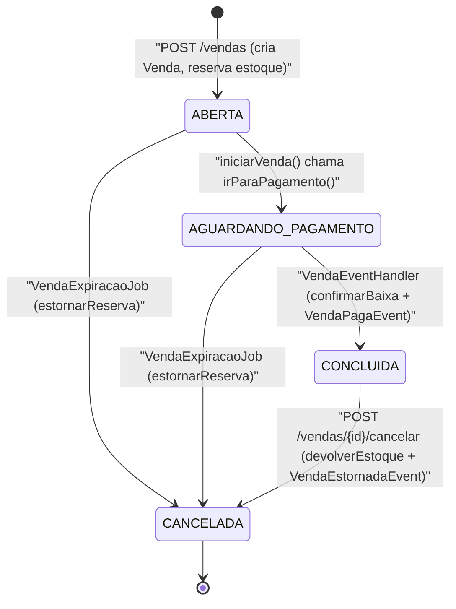
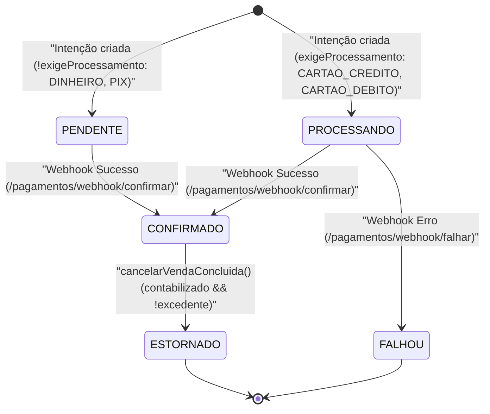

# 🛒 Bounded Context: Checkout (Vendas & Pagamentos)

O módulo **Checkout** é responsável pela orquestração do ciclo de vida das vendas, integração idempotente com gateways de pagamento, cancelamento atômico pós-faturamento e notificação em tempo real para os caixas de PDV via **Long Polling Não-Bloqueante**.

As fronteiras modulares do módulo (`@ApplicationModule(allowedDependencies = {"inventory::api", "shared"})`) garantem isolamento estrito:
* **Dependências de entrada no Inventory:** o Checkout consome exclusivamente a *Published Language* `inv.inventory.api` ([`CatalogoQueryService`](../../apps/inv-service/src/main/java/inv/inventory/api/CatalogoQueryService.java) e [`EstoqueCommandService`](../../apps/inv-service/src/main/java/inv/inventory/api/EstoqueCommandService.java)). O agregado [`ItemVenda`](../../apps/inv-service/src/main/java/inv/checkout/domain/model/ItemVenda.java) armazena apenas a referência escalar `Long produtoId` e snapshots imutáveis de preço e nome, sem `@ManyToOne` cross-context.
* **Fronteira pública de leitura (`inv.checkout.api`, `@NamedInterface("api")`):** expõe [`VendaQueryService`](../../apps/inv-service/src/main/java/inv/checkout/api/VendaQueryService.java) e `VendaRecenteView`, implementados por `JdbcVendaQueryService` (`package-private`) para leitura read-only do módulo **Dashboard**.
* **Acesso administrativo:** todos os endpoints de [`VendaController`](../../apps/inv-service/src/main/java/inv/checkout/infrastructure/web/controller/VendaController.java) (`/vendas/**`) exigem `@PreAuthorize("hasRole('ADMIN')")`.

---

## 1. Glossário da Linguagem Ubíqua (Ubiquitous Language)

| Termo | Definição no Domínio |
| :--- | :--- |
| **Venda** | Agregado raiz que representa o pedido comercial, contendo o valor total, valores pago e de troco, status, versionamento otimista (`@Version`) e as listas de itens e pagamentos. |
| **Item de Venda** | Snapshot imutável do produto (preço unitário, quantidade e nome) criado via `ItemVenda.criar(...)` a partir de `ProdutoCheckoutView`, armazenando apenas a referência escalar `Long produtoId`. |
| **Intenção de Pagamento** | Registro prévio de uma tentativa de pagamento associada a um `uuidReferencia` único (`uk_pagamento_uuid`) e método de pagamento (`DINHEIRO`, `PIX`, `CARTAO_CREDITO`, `CARTAO_DEBITO`). |
| **Pagamento Contabilizado** | Marcação persistida (`pagamentos.contabilizado`, migration `V7`) que indica se o pagamento confirmado já foi somado em `Venda.valorPago` / `Venda.valorTroco`, evitando dupla contabilização e delimitando pagamentos elegíveis a estorno. |
| **Pagamento Excedente** | Pagamento cuja confirmação chega quando a venda já se encontra `CONCLUIDA` ou `CANCELADA`; é marcado com `excedente = true`, incrementa a métrica `pagamento.excedente.total` e permanece para conciliação manual/reembolso externo (`DEBT-PAY-001`). |
| **Cancelamento em Fase Única** | Transição síncrona atômica `CONCLUIDA -> CANCELADA` em `POST /vendas/{id}/cancelar`, que estorna pagamentos contabilizados, devolve integralmente o estoque (`devolverEstoque`) e grava `VendaEstornadaEvent` no Outbox (`BEFORE_COMMIT`). |
| **Recibo** | Projeção formatada de uma venda ativa ou aberta (`ReciboResponse`), contendo a lista de itens, subtotais e data/hora de abertura. |
| **Long Polling (`DeferredResult`)** | Mecanismo de espera reativa assíncrona onde o terminal de PDV aguarda até 30 segundos por uma mudança de estado da venda sem prender threads do servidor. |
| **Venda Expirada** | Venda que permaneceu em `ABERTA` ou `AGUARDANDO_PAGAMENTO` além do tempo limite configurado (30 minutos) e tem sua reserva devolvida ao estoque disponível pelo `VendaExpiracaoJob`. |

---

## 2. Máquinas de Estados do Domínio

### A. Ciclo de Vida da Venda (`StatusVenda`)



> [!NOTE]
> Em `POST /vendas`, [`VendaService.iniciarVenda`](../../apps/inv-service/src/main/java/inv/checkout/usecase/VendaService.java) cria a venda `ABERTA`, adiciona os itens via `CatalogoQueryService`, reserva o estoque via `EstoqueCommandService.reservar` e já chama `venda.irParaPagamento()`, retornando a venda em `AGUARDANDO_PAGAMENTO`. O valor `CANCELAMENTO_SOLICITADO` permanece no enum `StatusVenda` e em `StatusVenda.FATURADAS` (compatibilidade com o índice parcial `idx_vendas_concluidas` da `V5`), sem transição ativa no cancelamento em fase única.

### B. Ciclo de Vida do Pagamento (`StatusPagamento`)



---

## 3. Diagramas de Sequência e Fluxos do Domínio

### Fluxo Completo: Abertura, Long Polling de PDV, Webhook Idempotente e Conclusão

```mermaid
sequenceDiagram
    autonumber
    actor Operador as Operador de PDV
    participant PDV as "Terminal PDV (Front-end)"
    participant VendaCtrl as "VendaController (hasRole ADMIN)"
    participant VendaSvc as VendaService
    participant CatAPI as "CatalogoQueryService (inv.inventory.api)"
    participant EstoqueAPI as "EstoqueCommandService (inv.inventory.api)"
    participant Registry as VendaStatusRegistry
    participant GatewayExt as "Gateway Pagamentos (Externo)"
    participant PagtoCtrl as PagamentoController
    participant PagtoSvc as PagamentoService
    participant Outbox as "Outbox + OutboxProcessor"
    participant RabbitMQ as "RabbitMQ (pdv.exchange)"
    participant Handler as VendaEventHandler
    participant Finance as "Finance (VendaPagaEventListener)"

    Operador->>PDV: Escaneia produtos e finaliza carrinho
    PDV->>VendaCtrl: "POST /vendas (itens, quantidades)"
    VendaCtrl->>VendaSvc: iniciarVenda()
    VendaSvc->>CatAPI: "buscarParaCheckout(produtoIds)"
    VendaSvc->>EstoqueAPI: "reservar(ComandoEstoqueVenda) [MANDATORY, produtoId ASC]"
    VendaSvc->>VendaSvc: venda.irParaPagamento()
    VendaCtrl-->>PDV: "Retorna ReciboResponse (Status persistido: AGUARDANDO_PAGAMENTO)"

    PDV->>VendaCtrl: "GET /vendas/{id}/status?wait=true&sinceVersion=1"
    Note over VendaCtrl,Registry: Thread HTTP liberada. Conexão estacionada no VendaStatusRegistry (30s)

    GatewayExt->>PagtoCtrl: "POST /pagamentos/webhook/confirmar/{pagamentoId} (valor_recebido, nsu)"
    PagtoCtrl->>PagtoSvc: confirmarPagamentoWebhook()
    Note over PagtoSvc: "pagamentoRepository.findByIdWithLock + Pagamento.confirmar() -> boolean"
    PagtoSvc->>Outbox: "PagamentoConfirmadoEvent via PagamentoListener (BEFORE_COMMIT)"
    Outbox->>RabbitMQ: "Publica em pdv.exchange (routing key venda.pagamento.confirmado)"
    RabbitMQ->>Handler: "Consome pdv.venda.pagamento.confirmado.queue"
    Note over Handler: "Lock pessimista em vendas (findByIdWithLock, R15)"
    alt "Pagamento já contabilizado, excedente ou ESTORNADO"
        Handler-->>RabbitMQ: "ACK idempotente (no-op)"
    else "Venda já CONCLUIDA ou CANCELADA (pagamento tardio)"
        Handler->>Handler: "marcarComoExcedenteParaEstorno() + métrica pagamento.excedente.total"
        Handler-->>RabbitMQ: "ACK sem reabrir venda"
    else "Venda aceita pagamento (AGUARDANDO_PAGAMENTO)"
        Handler->>Handler: "venda.registrarPagamentoConfirmado() -> contabilizado = true"
        Handler->>EstoqueAPI: "confirmarBaixa(ComandoEstoqueVenda) [MANDATORY, produtoId ASC]"
        Handler->>Finance: "Publica VendaPagaEvent (valor líquido = recebido - troco)"
        Finance->>Finance: "INSERT INTO lancamentos_financeiros ON CONFLICT DO NOTHING RETURNING id"
        Note over Handler,Finance: "Commit da Transação Principal (Venda + Pagamento + Estoque + Ledger)"
        Handler-->>Registry: "VendaAtualizadaEvent (@TransactionalEventListener AFTER_COMMIT)"
        Registry-->>PDV: "Resolve DeferredResult: Status CONCLUIDA (HTTP 200)"
        PDV->>Operador: Imprime Recibo e libera mercadoria
    end
```



---

## 4. Rotinas Periódicas de Expiração (Housekeeping)

O componente [`VendaExpiracaoJob`](../../apps/inv-service/src/main/java/inv/checkout/infrastructure/jobs/VendaExpiracaoJob.java) roda periodicamente a cada 5 minutos:
1. Localiza vendas em `StatusVenda.ABERTA` ou `StatusVenda.AGUARDANDO_PAGAMENTO` criadas há mais de 30 minutos.
2. Executa `vendaService.cancelarVendaExpirada(vendaId)` sob lock pessimista (`findByIdWithLock`), aplicando um **guard pós-lock idempotente** que retorna silenciosamente caso a venda já esteja `CANCELADA` (Q10/F2).
3. Invoca `estoqueCommandService.estornarReserva(comandoPara(venda))` (`Propagation.MANDATORY`, lote ordenado por `produtoId ASC`), devolvendo as unidades reservadas para `estoque_disponivel` sem intervenção manual.

---

## 5. Especificação do Contrato de Webhooks de Pagamento

Os webhooks de liquidação externa comunicam-se diretamente com o [`PagamentoController`](../../apps/inv-service/src/main/java/inv/checkout/infrastructure/web/controller/PagamentoController.java) para confirmar ou rejeitar transações de cartão e Pix:

* **Endpoint Principal:** `POST /pagamentos/webhook/confirmar/{pagamentoId}`
* **Endpoint de Falha:** `POST /pagamentos/webhook/falhar/{pagamentoId}`
* **Precedência e Isenção no API Gateway:** A rota dedicada `inv-webhook` (`order: 1`) intercepta o padrão `/pagamentos/webhook/**` antes da rota corporativa geral de estoque (`order: 2`). Esta rota é **isenta de `RequestRateLimiter`**, garantindo que notificações legítimas e rajadas de confirmação emitidas pelas adquirentes não sofram descarte (HTTP 429).
* **Contrato de Validação DTO ([`ConfirmarPagamentoWebhookRequest`](../../apps/inv-service/src/main/java/inv/checkout/infrastructure/web/dto/ConfirmarPagamentoWebhookRequest.java)):**
  ```json
  {
    "valor_recebido": 150.50,
    "nsu": "NSU-987654321"
  }
  ```
* **Regras de Integridade do Payload:**
  - `valor_recebido`: `@NotNull(message = "valor_recebido é obrigatório")`, `@Positive(message = "valor_recebido deve ser positivo")`
  - `nsu`: `@NotBlank(message = "nsu é obrigatório")`
* **Tratamento Semântico de Erro (RFC 7807):**
  Payloads sem corpo, valores negativos, nulos ou strings de NSU vazias/em branco disparam validação do Bean Validation interceptada pelo `GlobalExceptionHandler`, respondendo com **HTTP 400 Bad Request**:
  ```json
  {
    "type": "https://petshop.com/errors/invalid-data",
    "title": "Dados Inválidos",
    "status": 400,
    "detail": "Erro de validação nos campos",
    "fields": {
      "valor_recebido": "valor_recebido deve ser positivo",
      "nsu": "nsu é obrigatório"
    },
    "timestamp": "2026-10-30T21:00:00Z"
  }
  ```
* **Pipeline Idempotente de Confirmação em 5 Camadas:**
  1. **Ingresso / Webhook (`PagamentoService.confirmarPagamentoWebhook`):** adquire `pagamentoRepository.findByIdWithLock(pagamentoId)` e invoca `Pagamento.confirmar(valor, nsu)`, que retorna `boolean`; o evento `PagamentoConfirmadoEvent` só é gravado no Outbox ([`PagamentoListener`](../../apps/inv-service/src/main/java/inv/checkout/infrastructure/messaging/PagamentoListener.java), `BEFORE_COMMIT`) quando ocorre transição real para `CONFIRMADO`.
  2. **Lock Pessimista e Decisão Pós-Lock (`VendaEventHandler`):** consome `pdv.venda.pagamento.confirmado.queue` sob `vendaRepository.findByIdWithLock(vendaId)` (imposto pela regra `R15`). Pagamentos já `contabilizado`, `excedente` ou `ESTORNADO` recebem ACK idempotente imediato; pagamentos tardios/órfãos recebidos após `CONCLUIDA` ou `CANCELADA` são marcados com `excedente = true`, incrementam o contador `pagamento.excedente.total` e retornam ACK sem reabrir a venda. Falhas não-retentáveis (`JsonProcessingException`, `BusinessException`) lançam `AmqpRejectAndDontRequeueException`, roteando para `pdv.venda.pagamento.confirmado.queue.dlq`.
  3. **Deduplicação JPA-Safe em `Venda`:** `Venda.registrarPagamentoConfirmado` verifica igualdade semântica por `uuidReferencia` e `Pagamento.class.hashCode()`, impedindo acúmulo duplicado na coleção `@OneToMany`.
  4. **Flag `pagamentos.contabilizado` (`V7`):** registra na tabela `pagamentos` se o valor já integrou `Venda.valorPago` / `Venda.valorTroco`, protegendo contra dupla soma e restringindo futuros estornos a pagamentos regularmente contabilizados.
  5. **Absorção Atômica no Ledger (`VendaPagaEventListener`):** calcula o valor líquido retido (`valorRecebido - trocoDestePagamento`) e persiste no Ledger do Finance via `INSERT ... ON CONFLICT (referencia) DO NOTHING RETURNING id`, eliminando `UnexpectedRollbackException` em reentregas.

---

## 6. Contrato de Criação de Intenção de Pagamento e Idempotência

O registro de intenções de pagamento ocorre via `POST /pagamentos/intencao/{vendaId}` no [`PagamentoController`](../../apps/inv-service/src/main/java/inv/checkout/infrastructure/web/controller/PagamentoController.java), orquestrado pelo [`PagamentoService`](../../apps/inv-service/src/main/java/inv/checkout/usecase/PagamentoService.java) e [`PagamentoRepository`](../../apps/inv-service/src/main/java/inv/checkout/infrastructure/persistence/PagamentoRepository.java).

* **Validação Decimal Sem Arredondamento (`CriarIntencaoPagamentoRequest` e Service):**
  - Campos obrigatórios (`@NotNull`): `uuidReferencia` (`UUID`), `metodo` (`MetodoPagamento`), `valor` (`BigDecimal`).
  - Regras numéricas no DTO: `@Positive` e `@Digits(integer = 8, fraction = 2)` alinhadas à coluna `valor_esperado NUMERIC(10, 2)`.
  - Normalização sem arredondamento: o construtor compacto de [`CriarIntencaoPagamentoRequest`](../../apps/inv-service/src/main/java/inv/checkout/infrastructure/web/dto/CriarIntencaoPagamentoRequest.java) remove zeros à direita com `stripTrailingZeros()` (ajustando escalas negativas via `setScale(0)`), aceitando representações equivalentes como `10.000`, `10.00` e `100` e rejeitando com **HTTP 400** valores com mais de 2 casas decimais significativas (ex.: `10.005`) para evitar arredondamentos silenciosos no banco e falsos conflitos em retries.
  - Defesa em profundidade no `PagamentoService`: rejeita com `BusinessException` (`400`) quando `valor == null`, `valor.signum() <= 0`, `valor > 99999999.99` ou `valor.stripTrailingZeros().scale() > 2`.

* **Protocolo de Idempotência em 6 Etapas (`criarIntencaoPagamento`):**
  1. **Consulta rápida:** busca `findByUuidReferencia(uuidReferencia)`. Se existir, valida igualdade de `vendaId`, `metodo` e `valorEsperado.compareTo(valor) == 0`; se coincidir, retorna o `pagamentoId` (`200`), mesmo que a venda já esteja `CONCLUIDA` ou `CANCELADA`; se divergir, lança `ConflictException` (`409`).
  2. **Lock pessimista na venda:** executa `VendaRepository.findByIdWithLock(vendaId)` (`SELECT ... FOR UPDATE`), lançando `ResourceNotFoundException` (`404`) caso a venda não exista e serializando com conclusão, expiração e cancelamento (alinhado à hierarquia global `vendas -> produtos`).
  3. **Reconsulta pós-lock:** executa novamente `findByUuidReferencia(uuidReferencia)` antes de validar o status da venda, preservando retries legítimos de transações concorrentes mesmo que a venda tenha mudado para `CONCLUIDA` ou `CANCELADA` durante a espera pelo lock (ou lançando `409` se o payload divergir).
  4. **Validação de status da venda:** verifica `venda.getStatus().aceitaPagamento()`; caso contrário, lança `ConflictException` (`409`).
  5. **Inserção atômica com fonte única do domínio:** instancia `Pagamento` (aplicando `processar()` quando `metodo.isExigeProcessamento()` for `true`) e persiste via query nativa `inserirIntencaoIdempotente` (`INSERT INTO pagamentos (...) VALUES (...) ON CONFLICT (uuid_referencia) DO NOTHING RETURNING id`). Se retornar o ID gerado, devolve-o (`200`).
  6. **Fallback em conflito concorrente:** se o `Optional<Long>` retornar vazio em razão da constraint única `uk_pagamento_uuid` (ex.: concorrência entre vendas distintas com o mesmo UUID), consulta `findByUuidReferencia(uuidReferencia)` novamente e aplica a comparação compartilhada (`200` se igual; `ConflictException` `409` revertendo a transação se divergente, sem sobrescrever o registro existente).

* **Semântica de Erros (`ProblemDetail` RFC 7807 via `GlobalExceptionHandler`):**
  - **HTTP 400 Bad Request:** falha de validação DTO (`invalid-data`) ou regra de valor no service (`BusinessException` / `business-rule-violation`).
  - **HTTP 404 Not Found:** `vendaId` inexistente (`ResourceNotFoundException` / `resource-not-found`).
  - **HTTP 409 Conflict:** venda em status que não aceita pagamento ou `uuidReferencia` reutilizado com `vendaId`, `metodo` ou `valor` divergentes (`ConflictException`, `title: "Conflito de Estado"`, `type: "https://petshop.com/errors/conflict"`).

---

## 7. Contrato HTTP de Cancelamento de Venda Concluída

O cancelamento pós-faturamento ocorre em **fase única síncrona** via `POST /vendas/{id}/cancelar`, protegido em [`VendaController`](../../apps/inv-service/src/main/java/inv/checkout/infrastructure/web/controller/VendaController.java) por `@PreAuthorize("hasRole('ADMIN')")` e governado pela feature flag `features.cancelamento-venda-concluida.enabled` (`FEATURES_CANCELAMENTO_VENDA_CONCLUIDA_ENABLED`, default `false`).

### Fluxo Atômico (`VendaService.cancelarVendaConcluida`)

```mermaid
sequenceDiagram
    autonumber
    actor Admin as "Operador ADMIN (JWT ROLE_ADMIN)"
    participant Ctrl as VendaController
    participant Svc as VendaService
    participant EstoqueAPI as "EstoqueCommandService (inv.inventory.api)"
    participant OutboxL as "VendaEstornadaOutboxListener (BEFORE_COMMIT)"
    participant OutboxDB as "PostgreSQL (outbox)"
    participant Registry as VendaStatusRegistry

    Admin->>Ctrl: "POST /vendas/{id}/cancelar"
    Ctrl->>Svc: cancelarVendaConcluida(id)
    alt "Flag FEATURES_CANCELAMENTO_VENDA_CONCLUIDA_ENABLED = false"
        Svc-->>Ctrl: "CancelamentoVendaDesabilitadoException (HTTP 503 ProblemDetail)"
    else "Flag habilitada = true"
        Svc->>Svc: "vendaRepository.findByIdWithLock(id) [404 se ausente]"
        alt "Status != CONCLUIDA (ex.: CANCELADA, AGUARDANDO_PAGAMENTO)"
            Svc-->>Ctrl: "CancelamentoVendaConflitoException (HTTP 409 ProblemDetail)"
        else "Status == CONCLUIDA"
            Svc->>Svc: "venda.cancelarVendaConcluida() [CONCLUIDA -> CANCELADA; estorna pagamentos contabilizados && !excedente]"
            Svc->>EstoqueAPI: "devolverEstoque(ComandoEstoqueVenda) [MANDATORY, produtoId ASC, auditoria SAIDA]"
            Svc->>Svc: "Calcula valorEstorno = valorPago - valorTroco e UUID determinístico ESTORNO:{vendaId}"
            Svc->>OutboxL: "Publica VendaEstornadaEvent"
            OutboxL->>OutboxDB: "INSERT outbox (pdv.exchange, venda.estornada) [BEFORE_COMMIT]"
            Svc-->>Registry: "VendaAtualizadaEvent [AFTER_COMMIT]"
            Svc-->>Ctrl: "VendaStatusResponse (status CANCELADA, HTTP 200)"
        end
    end
```

### Semântica HTTP e Padronização RFC 7807 (`ProblemDetail`)

Todos os erros de cancelamento são tratados exclusivamente pelo [`GlobalExceptionHandler`](../../apps/common-lib/src/main/java/common/exception/GlobalExceptionHandler.java) da `common-lib` (`Content-Type: application/problem+json`). Os handlers locais legados de `VendaController` e o formato `{"mensagem": "..."}` foram integralmente removidos:

| HTTP / `status` | Condição | Exceção / Origem | `title` | `type` |
| :---: | :--- | :--- | :--- | :--- |
| **200** | Venda `CONCLUIDA` estornada com sucesso | `VendaStatusResponse` (`CANCELADA`) | — | — |
| **401** | Token JWT ausente, malformado, expirado ou não confiável | Cadeia de filtros Security | — | — |
| **403** | Usuário autenticado sem autoridade `ROLE_ADMIN` (ex.: `ROLE_USER`) | `AccessDeniedException` | `Acesso Negado` | `https://petshop.com/errors/forbidden` |
| **404** | Flag habilitada e `vendaId` inexistente | `ResourceNotFoundException` | `Recurso não encontrado` | `https://petshop.com/errors/resource-not-found` |
| **409** | Venda em estado incompatível, inclusive já `CANCELADA` | `CancelamentoVendaConflitoException` (`extends ConflictException`) | `Conflito de Estado` | `https://petshop.com/errors/conflict` |
| **503** | Flag `FEATURES_CANCELAMENTO_VENDA_CONCLUIDA_ENABLED` desabilitada (`false`) | `CancelamentoVendaDesabilitadoException` (`extends ServiceUnavailableException`) | `Serviço Indisponível` | `https://petshop.com/errors/service-unavailable` |

> [!NOTE]
> O campo `detail` contém a mensagem específica da falha, e `timestamp` registra o instante da resposta. O cancelamento atual executa o **estorno interno/contábil** (`StatusPagamento.ESTORNADO`, recomposição física do estoque e lançamento `ESTORNO` no Finance via `pdv.venda.estornada.queue`); o reembolso automático junto ao adquirente externo integra o backlog separado `DEBT-PAY-001`, exigindo conciliação operacional manual enquanto a flag estiver ativa com pagamentos reais. Consumidores externos (SPA e PDV) devem ler `detail`, `title`, `status` e `type` em `ProblemDetail`.

---

## 8. ADRs Vinculados a Este Domínio

* 📑 **[ADR-0001: Monólito Modular com Bounded Contexts](../adr/0001-modular-monolith-bounded-contexts.md)**
* 📑 **[ADR-0002: Controle Híbrido de Concorrência e Estoque Atômico](../adr/0002-atomic-sql-inventory-and-hybrid-locking.md)**
* 📑 **[ADR-0003: Long Polling Não-Bloqueante com DeferredResult](../adr/0003-async-long-polling-pos-deferred-result.md)**
* 📑 **[ADR-0004: Transactional Outbox Pattern com SKIP LOCKED](../adr/0004-transactional-outbox-with-skip-locked.md)**
* 📑 **[ADR-0009: Arquitetura de Autenticação com Spring Authorization Server e RSA](../adr/0009-centralized-oauth2-oidc-and-stateless-resource-servers.md)**
* 📑 **[ADR-0010: Dashboard como Módulo de Composição de Leitura (BFF Interno Read-Only)](../adr/0010-dashboard-read-only-composition-module.md)**
* 📑 **[ADR-0011: Open Host Service Síncrono de Comandos e Catálogo (Checkout → Inventory)](../adr/0011-synchronous-open-host-service-checkout-inventory.md)**
* 📑 **[ADR-0012: Pipeline Idempotente de Pagamento e Cancelamento em Fase Única de Venda Concluída](../adr/0012-idempotent-payment-pipeline-and-single-phase-sale-reversal.md)**
