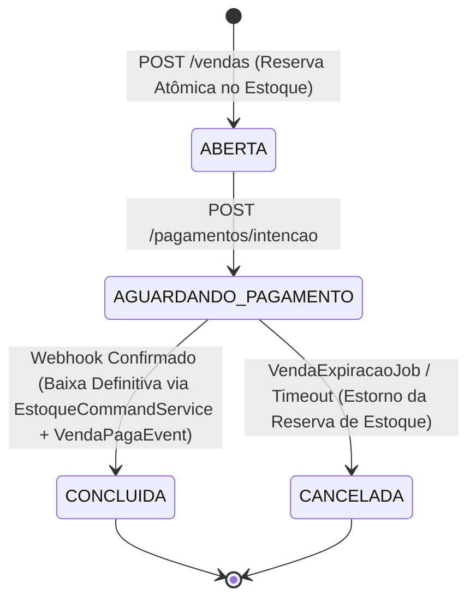
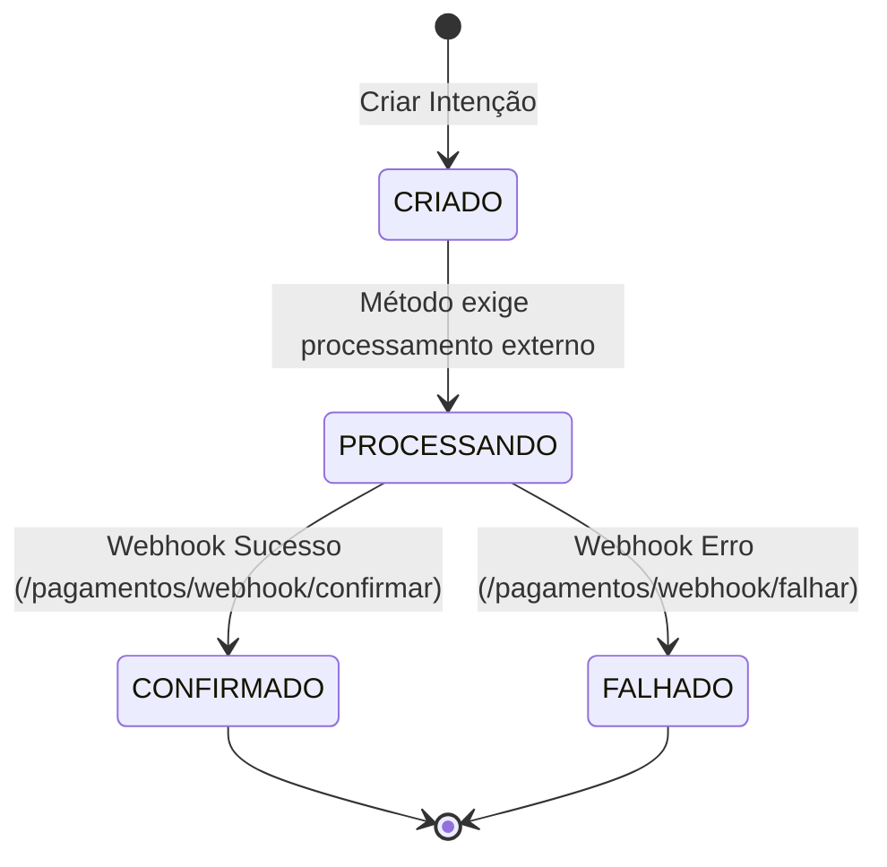
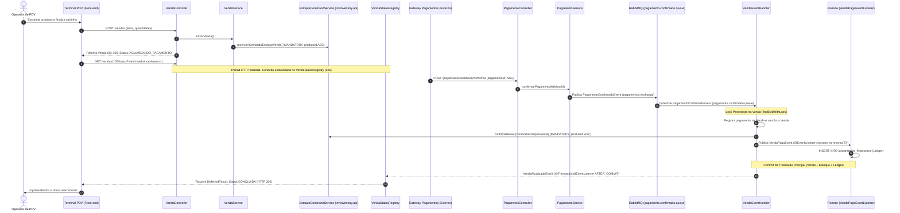

# 🛒 Bounded Context: Checkout (Vendas & Pagamentos)

O módulo **Checkout** é responsável pela orquestração do ciclo de vida das vendas, integração com gateways de pagamento, controle de concorrência na liquidação e notificação em tempo real para os caixas de PDV via **Long Polling Não-Bloqueante**.

---

## 1. Glossário da Linguagem Ubíqua (Ubiquitous Language)

| Termo | Definição no Domínio |
| :--- | :--- |
| **Venda** | Agregado raiz que representa o pedido comercial, contendo o valor total, status, versionamento otimista e a lista de itens comprados. |
| **Item de Venda** | Snapshot imutável do produto (preço unitário, quantidade e nome) no momento exato em que foi adicionado ao carrinho, armazenando apenas a referência escalar `Long produtoId`. |
| **Intenção de Pagamento** | Registro prévio de uma tentativa de pagamento associada a uma referência UUID externa e método de pagamento (Pix, Cartão, Dinheiro). |
| **Recibo** | Projeção formatada de uma venda ativa ou concluída, contendo a lista de itens, subtotais e dados de abertura. |
| **Long Polling (`DeferredResult`)** | Mecanismo de espera reativa assíncrona onde o terminal de PDV aguarda até 30 segundos por uma mudança de estado da venda sem prender threads do servidor. |
| **Venda Expirada** | Venda que permaneceu em `ABERTA` ou `AGUARDANDO_PAGAMENTO` além do tempo limite configurado e tem seus itens devolvidos automaticamente ao estoque disponível por um job agendado. |

---

## 2. Máquinas de Estados do Domínio

### A. Ciclo de Vida da Venda (`StatusVenda`)



### B. Ciclo de Vida do Pagamento (`StatusPagamento`)



---

## 3. Diagramas de Sequência e Fluxos do Domínio

### Fluxo Completo: Abertura, Long Polling de PDV, Webhook e Conclusão



---

## 4. Rotinas Periódicas de Expiração (Housekeeping)

O componente [`VendaExpiracaoJob`](../../apps/inv-service/src/main/java/inv/checkout/infrastructure/jobs/VendaExpiracaoJob.java) roda periodicamente a cada 5 minutos:
1. Localiza vendas em `StatusVenda.ABERTA` ou `StatusVenda.AGUARDANDO_PAGAMENTO` criadas há mais de 30 minutos.
2. Executa `vendaService.cancelarVendaExpirada(vendaId)` sob lock pessimista (`findByIdWithLock`), aplicando um **guard pós-lock idempotente** que retorna silenciosamente caso a venda já esteja `CANCELADA` (Q10/F2).
3. Invoca `estoqueCommandService.estornarReserva(comandoPara(venda))` (`Propagation.MANDATORY`, lote ordenado por `produtoId ASC`), devolvendo as unidades reservadas para `estoque_disponivel` sem intervenção manual.

---

## 5. Especificação do Contrato de Webhooks de Pagamento

Os webhooks de liquidação externa comunicam-se diretamente com o [`PagamentoController`](../../apps/inv-service/src/main/java/inv/checkout/infrastructure/web/controller/PagamentoController.java) para confirmar ou rejeitar transações de cartão e Pix:

* **Endpoint Principal:** `POST /pagamentos/webhook/confirmar/{pagamentoId}`
* **Endpoint de Falha:** `POST /pagamentos/webhook/falhar/{pagamentoId}`
* **Precedência e Isenção no API Gateway:** A rota dedicada `inv-webhook` (`order: 1`) intercepta o padrão `/pagamentos/webhook/**` antes da rota corporativa geral de estoque (`order: 2`). Esta rota é **isenta de `RequestRateLimiter`**, garantindo que notificações legítimas e rajadas de confirmação emitidas pelas adquirentes não sofram descarte (HTTP 429).
* **Contrato de Validação DTO ([`ConfirmarPagamentoWebhookRequest`](../../apps/inv-service/src/main/java/inv/checkout/infrastructure/web/dto/ConfirmarPagamentoWebhookRequest.java)):**
  ```json
  {
    "valor_recebido": 150.50,
    "nsu": "NSU-987654321"
  }
  ```
* **Regras de Integridade do Payload:**
  - `valor_recebido`: `@NotNull(message = "valor_recebido é obrigatório")`, `@Positive(message = "valor_recebido deve ser positivo")`
  - `nsu`: `@NotBlank(message = "nsu é obrigatório")`
* **Tratamento Semântico de Erro (RFC 7807):**
  Payloads sem corpo, valores negativos, nulos ou strings de NSU vazias/em branco disparam validação do Bean Validation interceptada pelo `GlobalExceptionHandler`, respondendo com **HTTP 400 Bad Request**:
  ```json
  {
    "type": "https://petshop.com/errors/invalid-data",
    "title": "Dados Inválidos",
    "status": 400,
    "detail": "Erro de validação nos campos",
    "fields": {
      "valor_recebido": "valor_recebido deve ser positivo",
      "nsu": "nsu é obrigatório"
    },
    "timestamp": "2026-10-30T21:00:00Z"
  }
  ```
* **Concorrência e Idempotência:**
  A recepção do webhook dispara `pagamentoService.confirmarPagamentoWebhook(pagamentoId, valor, nsu)` e publica `PagamentoConfirmadoEvent` via RabbitMQ. O consumidor do evento adquire lock pessimista (`findByIdWithLock`) na venda correspondente, aplica a liquidação, confirma a baixa definitiva no estoque (`EstoqueCommandService.confirmarBaixa`) e registra a transação imutável no Ledger contábil.

---

## 6. ADRs Vinculados a Este Domínio

* 📑 **[ADR-0002: Controle Híbrido de Concorrência e Estoque Atômico](../adr/0002-atomic-sql-inventory-and-hybrid-locking.md)**
* 📑 **[ADR-0003: Long Polling Não-Bloqueante com DeferredResult](../adr/0003-async-long-polling-pos-deferred-result.md)**
* 📑 **[ADR-0004: Transactional Outbox Pattern com SKIP LOCKED](../adr/0004-transactional-outbox-with-skip-locked.md)**
* 📑 **[ADR-0011: Open Host Service Síncrono de Comandos e Catálogo (Checkout → Inventory)](../adr/0011-synchronous-open-host-service-checkout-inventory.md)**
