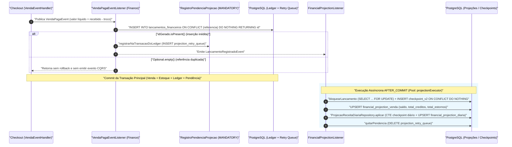
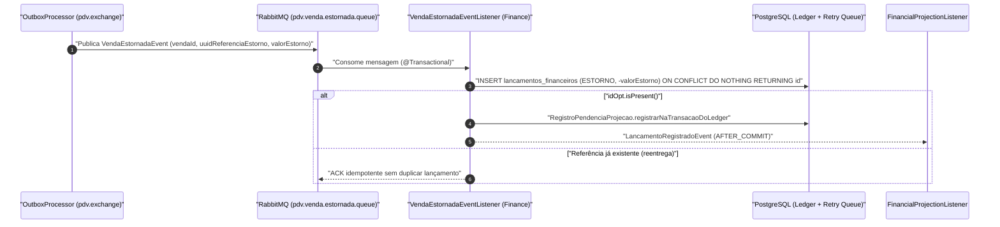
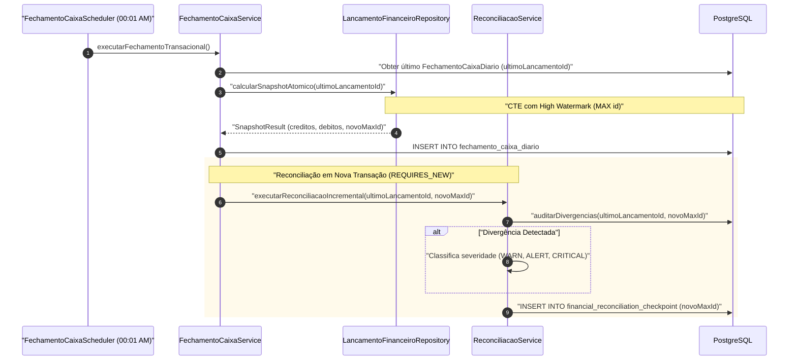
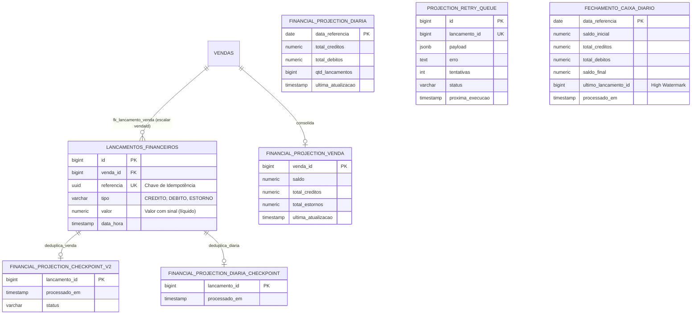

# 💰 Bounded Context: Finance (Motor Contábil & Financeiro)

O módulo **Finance** é o núcleo contábil do sistema (`@ApplicationModule(allowedDependencies = {"shared"})`). Ele é projetado sob os princípios de **Imutabilidade (Ledger Append-Only)**, **Deduplicação Idempotente Nativa em SQL (`ON CONFLICT DO NOTHING`)**, **CQRS Assíncrono com Pendência Durável e Auto-Cura** e **Consolidação Incremental via High Watermark**.

A fronteira pública de leitura do módulo (*Published Language* em `inv.finance.api`, anotada com `@NamedInterface("api")` do Spring Modulith) expõe o contrato **[`ReceitaQueryService`](../../apps/inv-service/src/main/java/inv/finance/api/ReceitaQueryService.java)** (`resumir`, `serieDiaria`, `ultimoFechamento`, `frescor`), implementado por `ProjecaoReceitaQueryService` (`package-private`) e consumido pelo módulo **Dashboard** ([ADR-0010](../adr/0010-dashboard-read-only-composition-module.md)).

---

## 1. Glossário da Linguagem Ubíqua (Ubiquitous Language)

| Termo | Definição no Domínio |
| :--- | :--- |
| **Lançamento Financeiro** | Registro atômico e imutável de uma movimentação monetária vinculada a uma venda (`vendaId` escalar) em regime de caixa líquido (`valorRecebido - troco`, ou negativo em estornos). Não sofre edição ou exclusão (`@Immutable`). |
| **Ledger (Livro-Razão)** | Conjunto sequencial e histórico de todos os lançamentos financeiros do sistema (`lancamentos_financeiros`). |
| **Referência UUID** | Chave única de idempotência física (`uk_lancamento_referencia`): na liquidação (`CREDITO`), corresponde ao `uuidReferencia` do pagamento; no cancelamento pós-faturamento (`ESTORNO`), é derivada deterministicamente por `UUID.nameUUIDFromBytes("ESTORNO:" + vendaId)`. |
| **Estorno Contábil (`TipoLancamento.ESTORNO`)** | Lançamento compensatório negativo (`-(valorPago - valorTroco)`) emitido de forma idempotente ao consumir `VendaEstornadaEvent` via Outbox/AMQP. |
| **Pendência Durável de Projeção** | Registro inserido em `projection_retry_queue` na mesma transação do Ledger via [`RegistroPendenciaProjecao`](../../apps/inv-service/src/main/java/inv/finance/infrastructure/messaging/RegistroPendenciaProjecao.java) (`Propagation.MANDATORY`) e quitado somente após a conclusão das projeções aplicáveis. |
| **Projeção CQRS por Venda** | Visão pré-calculada e desnormalizada do saldo de uma venda (`financial_projection_venda`), otimizada para leitura instantânea $O(1)$. |
| **Projeção CQRS Diária** | Visão agregada por dia de calendário (`financial_projection_diaria`), alimentando KPIs e séries temporais do Dashboard em $O(\text{dias})$ sob regime de caixa. |
| **Checkpoints CQRS** | Tabelas de controle (`financial_projection_checkpoint_v2` e `financial_projection_diaria_checkpoint`) indexadas por `lancamento_id` real que garantem projeção *exactly-once*. |
| **High Watermark** | Identificador máximo (`id`) de lançamento financeiro processado até determinado ponto no tempo, usado como marco delimitador. |
| **Fechamento D+0** | Snapshot consolidado diário contendo saldo inicial, créditos, débitos e saldo final até determinado High Watermark. |
| **Reconciliação $O(\Delta)$** | Auditoria incremental que compara o saldo real no Ledger com o saldo projetado no CQRS apenas para as vendas modificadas no período. |

---

## 2. Diagramas de Sequência e Fluxos do Domínio

### A. Fluxo de Registro de Lançamento (`CREDITO` via `VendaPagaEvent`) e Projeções CQRS

### B. Fluxo de Estorno Contábil Assíncrono (`VendaEstornadaEvent` via Outbox / AMQP)

No cancelamento em fase única de venda concluída, o Checkout grava `VendaEstornadaEvent` na tabela `outbox` (`BEFORE_COMMIT`). O `OutboxProcessor` despacha para `pdv.exchange` (`routing key: venda.estornada`), entregue à fila `pdv.venda.estornada.queue` (com DLQ `pdv.venda.estornada.queue.dlq`). O [`VendaEstornadaEventListener`](../../apps/inv-service/src/main/java/inv/finance/infrastructure/messaging/VendaEstornadaEventListener.java) (`@RabbitListener`, `@Transactional`) executa:

1. **Desserialização:** aceita JSON sem `__TypeId__`. Erros de conversão disparam `AmqpRejectAndDontRequeueException`. Eventos desserializados com campos obrigatórios ausentes são registrados em log e ignorados.
2. **Idempotência Determinística no Ledger:** usa a `uuidReferenciaEstorno` recebida do Checkout, derivada dos bytes UTF-8 de `ESTORNO:<vendaId>` com `UUID.nameUUIDFromBytes`. Se a referência já existir, retorna sem alterar o Ledger. Caso contrário, grava `TipoLancamento.ESTORNO` com `event.valorEstorno().abs().negate()` via `inserirIdempotente` (`INSERT ... ON CONFLICT (referencia) DO NOTHING RETURNING id`), que também absorve duplicatas concorrentes.
3. **Gate de Pendência e Projeções CQRS:** somente quando `idOpt.isPresent()`, registra a pendência em `projection_retry_queue` (`RegistroPendenciaProjecao`) e publica `LancamentoRegistradoEvent`.

O `OutboxEstornoRecuperacaoIT` simula uma falha de persistência da Outbox após o ACK do broker e antes do commit da exclusão. A tentativa seguinte republica o evento. O teste verifica duas entregas ao consumidor, um único lançamento `ESTORNO` com a mesma referência e projeções conciliadas.

A Outbox retenta a publicação AMQP. A `projection_retry_queue`, consumida pelo `ProjectionRetryScheduler`, recupera a aplicação das projeções a partir de um lançamento já persistido no Ledger.

**Impacto do `ESTORNO` nas Projeções CQRS e no Fechamento D+0:**
* **`financial_projection_venda`:** `FinancialProjectionListener` soma `valorAssinado` negativo em `saldo` (zerando o saldo líquido da venda estornada) e acumula `ABS(valor)` em `total_estornos`.
* **`financial_projection_diaria`:** a CTE `ProjecaoReceitaDiariaRepository.aplicar` contabiliza `GREATEST(-lf.valor, 0)` em `total_debitos` na data extraída por `lf.data_hora::date`. O PostgreSQL preenche a coluna `TIMESTAMP` sem fuso do Ledger com `CURRENT_TIMESTAMP`, que representa o início da transação. A conversão para o horário local usa o fuso da sessão ao gravar a coluna. O cast para `date` extrai a data local já gravada.
* **`fechamento_caixa_diario` (D+0):** capturado automaticamente pelo *High Watermark* (`id > :ultimoId AND id <= max_id`), somando `ABS(valor)` em `total_debitos` quando `valor < 0` e validado pela reconciliação incremental $O(\Delta)$.

### C. Ciclo de Fechamento Diário D+0 e Reconciliação Incremental

---

## 3. Modelo Físico de Tabelas do Domínio Financeiro

> [!NOTE]
> **FK de Fronteira Modular (`fk_lancamento_venda`):** A constraint física entre `lancamentos_financeiros.venda_id` e `vendas.id` é mantida no PostgreSQL e documentada na migration `V6__comentarios_fk_fronteira_modular.sql`. Na entidade JPA `LancamentoFinanceiro`, a referência é mantida exclusivamente pelo escalar `Long vendaId`, sem associação `@ManyToOne` com `inv.checkout`.

---

## 4. Matriz de Resiliência e Tratamento de Erros

| Cenário de Falha | Mecanismo de Defesa | Efeito no Sistema |
| :--- | :--- | :--- |
| **Reenvio de Webhook / Estorno Duplicado** | `INSERT ... ON CONFLICT (referencia) DO NOTHING RETURNING id` em `uk_lancamento_referencia` | Absorção atômica no PostgreSQL retornando `Optional.empty()` sem `UnexpectedRollbackException` e sem emitir `LancamentoRegistradoEvent`. |
| **Payload Inválido na Fila `pdv.venda.estornada.queue`** | `AmqpRejectAndDontRequeueException` em `VendaEstornadaEventListener` | Descarta da fila principal imediatamente e roteia para a DLQ `pdv.venda.estornada.queue.dlq`. |
| **Crash do servidor após commit do Ledger antes da projeção CQRS** | `RegistroPendenciaProjecao` (`MANDATORY`) na transação do Ledger | A pendência já nasce persistida em `projection_retry_queue` e é quitada somente após `financial_projection_venda` e `financial_projection_diaria` confirmarem; caso contrário, `ProjectionRetryScheduler` e `ProjecaoDiariaCatchUpJob` convergem o estado (`ProjecaoDuravelIT`). |
| **Conflito / Lock temporário durante Upsert CQRS** | Retry interno (`40001`/`40P01`, até 3 tentativas) + `registrarFalhaAssincrona` | Marca erro e torna a pendência elegível imediatamente ao `ProjectionRetryScheduler` sem perder o evento. |
| **Divergência de Saldo Real vs Projetado** | `ReconciliacaoService` $O(\Delta)$ | Alerta classificado automaticamente: \(\le 0,01\) (Warn), \(\le 1,00\) (Alert), \(> 1,00\) (Critical). |

---

## 5. ADRs Vinculados a Este Domínio

* 📑 **[ADR-0001: Monólito Modular com Bounded Contexts](../adr/0001-modular-monolith-bounded-contexts.md)**
* 📑 **[ADR-0004: Transactional Outbox Pattern com SKIP LOCKED](../adr/0004-transactional-outbox-with-skip-locked.md)**
* 📑 **[ADR-0005: Ledger Financeiro Imutável (Append-Only) com UUID](../adr/0005-append-only-financial-ledger-and-idempotency.md)**
* 📑 **[ADR-0006: Projeções CQRS Assíncronas e Auto-Cura via SKIP LOCKED](../adr/0006-cqrs-asynchronous-projections-and-self-healing-retry.md)**
* 📑 **[ADR-0007: Fechamento de Caixa D+0 com High Watermark](../adr/0007-d0-daily-cash-closing-and-high-watermark.md)**
* 📑 **[ADR-0010: Dashboard como Módulo de Composição de Leitura (BFF Interno Read-Only)](../adr/0010-dashboard-read-only-composition-module.md)**
* 📑 **[ADR-0012: Pipeline Idempotente de Pagamento e Cancelamento em Fase Única de Venda Concluída](../adr/0012-idempotent-payment-pipeline-and-single-phase-sale-reversal.md)**
