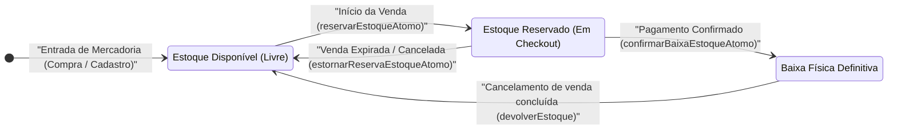
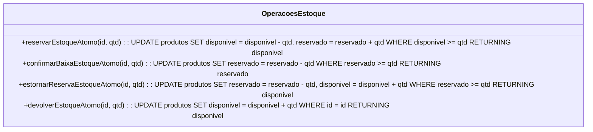
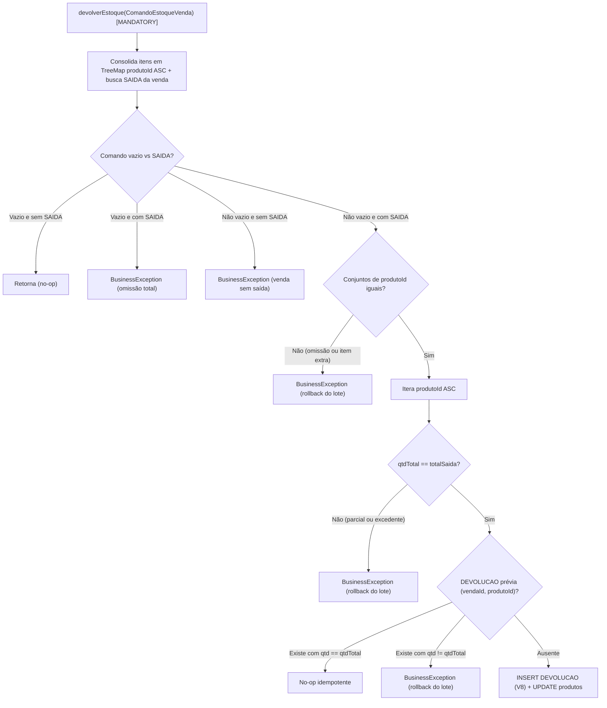
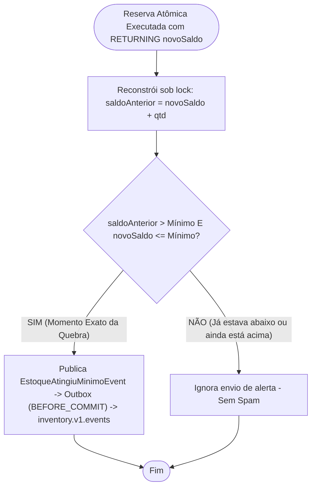
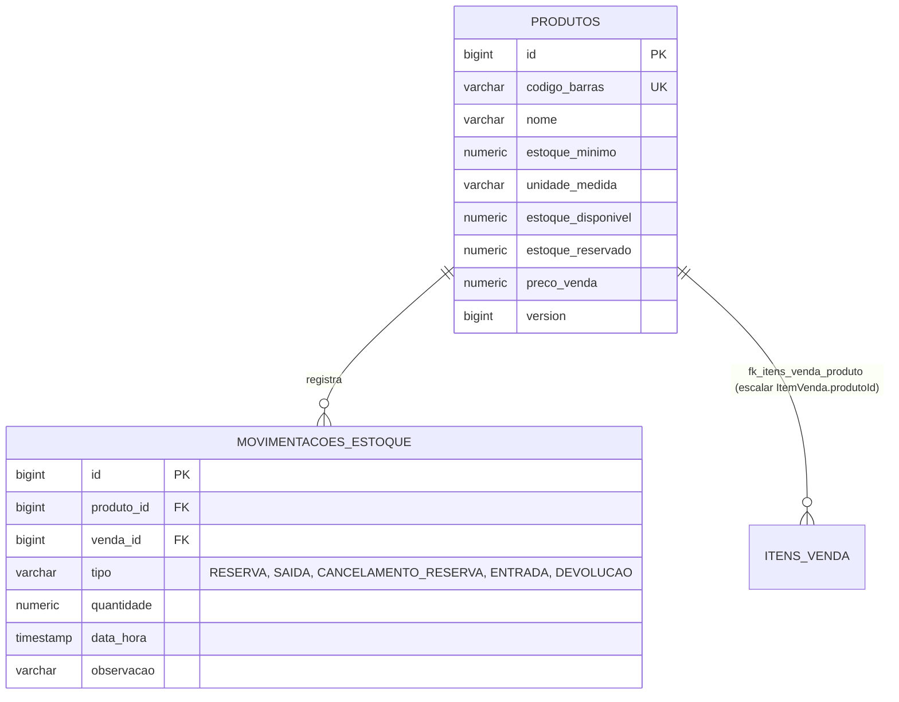

# 📦 Bounded Context: Inventory (Controle de Estoque & Catálogo)

O módulo **Inventory** é responsável pelo catálogo de produtos, rastreabilidade física de mercadorias, prevenção de *overselling* (vendas a descoberto) via **SQL Atômico**, recomposição integral em cancelamentos pós-faturamento e alertas de estoque baixo orientados a eventos com proteção anti-spam.

A fronteira pública do módulo (*Published Language* em `inv.inventory.api`, anotada com `@NamedInterface("api")` do Spring Modulith e governada pelas regras `R9`, `R10` e `R14` do `ArquiteturaTest`) expõe três contratos puros com implementações `package-private`:

| Contrato (`inv.inventory.api`) | Tipos / Assinaturas | Implementação (`package-private`) | Consumidor |
| :--- | :--- | :--- | :--- |
| **[`EstoqueCommandService`](../../apps/inv-service/src/main/java/inv/inventory/api/EstoqueCommandService.java)** | `reservar`, `confirmarBaixa`, `estornarReserva`, `devolverEstoque` (`ComandoEstoqueVenda`, `ItemComando`, `Propagation.MANDATORY`, `produtoId ASC`) | `EstoqueService` | `inv.checkout` |
| **[`CatalogoQueryService`](../../apps/inv-service/src/main/java/inv/inventory/api/CatalogoQueryService.java)** | `buscarParaCheckout(Set<Long>)` → `List<ProdutoCheckoutView>` | `JpaCatalogoQueryService` | `inv.checkout` |
| **[`EstoqueQueryService`](../../apps/inv-service/src/main/java/inv/inventory/api/EstoqueQueryService.java)** | `resumo()` → `ResumoEstoque` | `JpaEstoqueQueryService` | `inv.dashboard` |

---

## 1. Glossário da Linguagem Ubíqua (Ubiquitous Language)

| Termo | Definição no Domínio |
| :--- | :--- |
| **Produto** | Entidade de catálogo com identificação por código de barras, unidade de medida, preço e regras de estoque. |
| **Estoque Disponível** | Quantidade física de produto livre para novas compras nos caixas de PDV. |
| **Estoque Reservado** | Quantidade alocada para vendas em andamento que ainda aguardam liquidação de pagamento. |
| **Estoque Mínimo** | Ponto de reposição (*Reorder Point*); limiar crítico que dispara alertas automáticos para compras/administração. |
| **Movimentação de Estoque** | Registro de auditoria (`movimentacoes_estoque`) com tipo (`RESERVA`, `SAIDA`, `CANCELAMENTO_RESERVA`, `ENTRADA`, `DEVOLUCAO`), `vendaId` escalar e timestamp. |
| **Transição de Limiar (Anti-Spam)** | Regra que dispara o evento de alerta apenas quando o saldo cruza o limite mínimo pela primeira vez (\(Antes > Minimo\) e \(Depois \le Minimo\)), evitando spams de e-mail em vendas subsequentes. |

---

## 2. Ciclo de Vida do Estoque e Operações Atômicas

### Comportamento das Queries SQL Nativas ([`ProdutoRepository.java`](../../apps/inv-service/src/main/java/inv/inventory/infrastructure/persistence/ProdutoRepository.java#L50-L82))

### Devolução Estritamente Integral de Venda Concluída (`devolverEstoque`)

O Checkout envia todos os `itens_venda` ao cancelar uma venda concluída (`Propagation.MANDATORY`). Dentro da fronteira do Inventory (sem consultar tabelas de `vendas` ou `itens_venda`), [`EstoqueService.devolverEstoque`](../../apps/inv-service/src/main/java/inv/inventory/usecase/EstoqueService.java#L100-L140) agrega os itens repetidos em `TreeMap<Long, BigDecimal>` (iteração determinística por `produtoId ASC`) e audita a integralidade contra todas as movimentações `SAIDA` daquela venda via [`MovimentacaoRepository.buscarSaidasPorVenda`](../../apps/inv-service/src/main/java/inv/inventory/infrastructure/persistence/MovimentacaoRepository.java#L33-L40) (`SaidaPorProduto`, apoiado pelo índice parcial `idx_movimentacoes_venda_saida` da migration `V9`):

* **Matriz de Integralidade (`comando` vs `SAIDA`s registradas):**
  1. Comando vazio **e** nenhuma `SAIDA` na venda → no-op.
  2. Comando vazio **e** com `SAIDA` na venda → `BusinessException` (omissão total de itens).
  3. Comando não vazio **e** nenhuma `SAIDA` na venda → `BusinessException`.
  4. Comando não vazio **e** com `SAIDA` na venda → exige **igualdade exata dos conjuntos de `produtoId`** (`consolidado.keySet().equals(saidasPorProduto.keySet())`) e **`quantidadeTotal.compareTo(totalSaida) == 0`** para cada produto (qualquer omissão, item extra, quantidade menor ou maior dispara `BusinessException` com rollback integral do lote).
* **Idempotência e Sequência Fail-Fast (`V8`):** antes de inserir, `buscarQuantidadeDevolucao(vendaId, produtoId)` verifica se já há `DEVOLUCAO` registrada: se houver com a mesma quantidade (`compareTo == 0`, ignorando diferenças apenas de escala decimal), registra log e segue como no-op idempotente sem alterar saldo; se houver com quantidade divergente, lança `BusinessException` revertendo todo o lote (inclusive produtos anteriores já processados). Para novos registros, a movimentação `DEVOLUCAO` é inserida **antes** do `UPDATE` em `produtos` (`devolverEstoqueAtomo`), fazendo com que chamadas duplicadas concorrentes sem lock de venda colidam imediatamente no índice único parcial `uk_movimentacoes_venda_produto_devolucao` (`V8`, `SQLState 23505`) sem adquirir row lock em `produtos`.

---

## 3. Lógica de Alerta Anti-Spam para Estoque Baixo

Para evitar que múltiplos caixas vendendo o mesmo produto disparem dezenas de e-mails para o administrador quando o estoque já está abaixo do mínimo, o [`EstoqueService`](../../apps/inv-service/src/main/java/inv/inventory/usecase/EstoqueService.java#L56-L71) (`package-private`) reconstrói o saldo anterior diretamente do valor retornado pela cláusula `RETURNING` sob o row lock do `UPDATE` atômico (`saldoAnterior = novoSaldo.add(item.quantidade())`), eliminando leituras prévias fora de lock, e aplica a **verificação de transição de estado** ([`verificarEAlertarEstoqueBaixo`](../../apps/inv-service/src/main/java/inv/inventory/usecase/EstoqueService.java#L178-L184)). Quando o saldo cruza o limiar, o [`RabbitMQProducerListener`](../../apps/inv-service/src/main/java/inv/inventory/infrastructure/messaging/RabbitMQProducerListener.java) grava o alerta na tabela `outbox` em `BEFORE_COMMIT`, na mesma transação da reserva e da movimentação.

O `OutboxProcessor` publica em `inventory.v1.events` com a routing key `inventory.stock.low`. O `mail-service` declara e consome `inventory.v1.low-stock.send-email`, fila durável sem DLQ nem política de retry configurada no listener. A fila legada `inventory.v1.stock-low.notify` e sua DLQ são declaradas pelo `inv-service` somente com `inv.rabbitmq.legacy-low-stock-queue.enabled=true` (padrão `false`). A fila legada está sem consumidor e, se o binding estiver presente no broker, pode mascarar `NO_ROUTE` quando falta a fila do Mail.

O alerta pode ser entregue mais de uma vez. O `EmailConsumer` infere `EstoqueBaixoMessage` pelo tipo do parâmetro, consome JSON sem `__TypeId__` e verifica o `eventId` em `processed_events`. Como o envio SMTP ocorre antes da gravação dessa marca, uma falha entre o envio e o commit ou duas entregas concorrentes podem gerar e-mails duplicados. Ver [ADR-0008](../adr/0008-distributed-idempotent-consumer-and-schema-evolution.md).

---

## 4. Modelo Físico de Dados e Índices Parciais

> [!NOTE]
> **FKs de Fronteira Modular (Sem Mapeamento JPA Cross-Context):** A relação física entre `itens_venda.produto_id` e `produtos.id` (`fk_itens_venda_produto`) e entre `movimentacoes_estoque.venda_id` e `vendas.id` (`fk_movimentacoes_venda`) é mantida no PostgreSQL para integridade referencial e documentada na migration [`V6__comentarios_fk_fronteira_modular.sql`](../../apps/inv-service/src/main/resources/db/migration/V6__comentarios_fk_fronteira_modular.sql). No modelo de domínio JPA, `ItemVenda` armazena apenas a referência escalar `Long produtoId` e `MovimentacaoEstoque` armazena `Long vendaId`, preservando o isolamento estrito entre os Bounded Contexts.

### Índices Parciais de Performance e Idempotência (`V5`, `V8`, `V9`)

| Índice | Tabela | Migration | Definição / Finalidade |
| :--- | :--- | :---: | :--- |
| `idx_produtos_abaixo_min` | `produtos` | `V5` | `(id) WHERE estoque_disponivel <= estoque_minimo` — acelera `EstoqueQueryService.resumo()` para o Dashboard. |
| `uk_movimentacoes_venda_produto_devolucao` | `movimentacoes_estoque` | `V8` | `UNIQUE (venda_id, produto_id) WHERE tipo = 'DEVOLUCAO'` — garante no máximo 1 devolução por produto/venda e proteção Fail-Fast (`SQLState 23505`). |
| `idx_movimentacoes_venda_saida` | `movimentacoes_estoque` | `V9` | `(venda_id) WHERE tipo = 'SAIDA'` — acelera a auditoria integral `buscarSaidasPorVenda`; em carga sintética de 60.000 movimentações (`EXPLAIN (ANALYZE, BUFFERS)`), reduziu o acesso de `Seq Scan` (561 blocos, 4,264 ms) para `Index Scan` (3 blocos, 0,096 ms). |

---

## 5. Contratos HTTP de Catálogo e Movimentações

* **Cadastro (`POST /produtos`):** protegido por `@PreAuthorize("hasRole('ADMIN')")` em [`ProdutoController`](../../apps/inv-service/src/main/java/inv/inventory/infrastructure/web/controller/ProdutoController.java); retorna [`ProdutoResponse`](../../apps/inv-service/src/main/java/inv/inventory/infrastructure/web/dto/ProdutoResponse.java) (preservando `quantidadeEstoque`).
* **Consultas de Produtos (`GET /produtos`, `GET /produtos/{id}`, `GET /produtos/ean/{ean}`):** retornam [`ProdutoResumoResponse`](../../apps/inv-service/src/main/java/inv/inventory/infrastructure/web/dto/ProdutoResumoResponse.java) (`id`, `codigoBarras`, `nome`, `unidadeMedida`, `estoqueDisponivel`, `precoVenda`). A listagem envolve os itens em `Page<ProdutoResumoResponse>`; os campos internos `estoqueMinimo`, `estoqueReservado` e `version` não são expostos.
* **Auditoria de Movimentações (`GET /movimentacoes`):** [`MovimentacaoController`](../../apps/inv-service/src/main/java/inv/inventory/infrastructure/web/controller/MovimentacaoController.java) delega para a projeção JPQL `MovimentacaoRepository.listarResumo(Pageable)` com `countQuery` explícito (`SELECT COUNT(m) FROM MovimentacaoEstoque m`), retornando `Page<MovimentacaoResponse>` plano (`id`, `produtoId`, `produtoNome`, `codigoBarras`, `vendaId`, `tipo`, `quantidade`, `dataHora` em string ISO-8601 sem fuso, `observacao`) sem objeto `produto` aninhado. Isso elimina `LazyInitializationException` mantendo `spring.jpa.open-in-view=false`.

| Regra | `/produtos` | `/movimentacoes` |
| :--- | :--- | :--- |
| **Página padrão / negativa** | `0` / normalizada para `0` | `0` / normalizada para `0` |
| **Tamanho padrão / menor que 1** | `10` | `20` |
| **Tamanho acima de 50** | Normalizado para `50` | Normalizado para `50` |
| **Ordenação** | Fixa `id ASC`, inclusive na busca por `nome` ou `busca`; ignora `sort` | Padrão `dataHora DESC`; aceita whitelist `{id, dataHora, tipo, quantidade}` |
| **Desempate** | `id ASC` | Acrescenta `id ASC` automaticamente quando `id` não foi solicitado |
| **Ordenação inválida** | Não há ordenação dinâmica | Propriedade fora da whitelist ou modificador `ignorecase` lança `BusinessException` → HTTP 400 `ProblemDetail` (`title: "Regra de Negócio Violada"`) |

Exemplo: `GET /movimentacoes?page=0&size=2&sort=dataHora,desc` preserva ordem crescente de ID entre horários iguais e informa `totalElements` e `totalPages` via `countQuery`.

> [!IMPORTANT]
> Consumidores externos (SPA e PDV) devem adotar `ProdutoResumoResponse` (sem `estoqueMinimo`, `estoqueReservado` e `version`) e o formato plano de [`MovimentacaoResponse`](../../apps/inv-service/src/main/java/inv/inventory/infrastructure/web/dto/MovimentacaoResponse.java), além de respeitar o teto `size <= 50` e o erro HTTP 400 para `sort` inválido.

---

## 6. ADRs Vinculados a Este Domínio

* 📑 **[ADR-0001: Monólito Modular com Bounded Contexts](../adr/0001-modular-monolith-bounded-contexts.md)**
* 📑 **[ADR-0002: Controle Híbrido de Concorrência e Estoque Atômico](../adr/0002-atomic-sql-inventory-and-hybrid-locking.md)**
* 📑 **[ADR-0004: Transactional Outbox Pattern com SKIP LOCKED](../adr/0004-transactional-outbox-with-skip-locked.md)**
* 📑 **[ADR-0008: Consumidor Idempotente e Evolução de Schemas](../adr/0008-distributed-idempotent-consumer-and-schema-evolution.md)**
* 📑 **[ADR-0010: Dashboard como Módulo de Composição de Leitura (BFF Interno Read-Only)](../adr/0010-dashboard-read-only-composition-module.md)**
* 📑 **[ADR-0011: Open Host Service Síncrono de Comandos e Catálogo (Checkout → Inventory)](../adr/0011-synchronous-open-host-service-checkout-inventory.md)**
* 📑 **[ADR-0012: Pipeline Idempotente de Pagamento e Cancelamento em Fase Única de Venda Concluída](../adr/0012-idempotent-payment-pipeline-and-single-phase-sale-reversal.md)**
