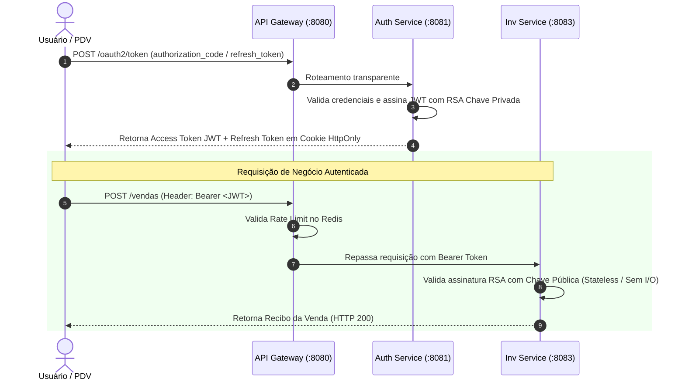

# 🔐 Bounded Context: Security & Identity (Autenticação, OIDC & Gateway)

O domínio de **Security & Identity** estabelece o padrão de segurança corporativa do sistema através do **Spring Authorization Server (OpenID Connect 1.0)**, validação criptográfica assimétrica (**RSA 2048-bit**) e proteção de borda com **Rate Limiting via Redis** no API Gateway.

---

## 1. Arquitetura de Segurança & Fluxo OIDC



---

## 2. API Gateway & Proteção de Borda

O **API Gateway** (`apps/api-gateway`) é a única porta de entrada exposta publicamente para os clientes:

### A. Rate Limiting com Redis ([`RateLimitConfig.java`](../../apps/api-gateway/src/main/java/gateway/config/RateLimitConfig.java))
* **Algoritmo:** *Token Bucket* implementado nativamente pelo Spring Cloud Gateway e Redis.
* **Resolução de Identidade por IP & Proxy Reverso:**
  O `userKeyResolver` resolve a identidade da requisição na seguinte ordem de precedência:
  1. Primeiro IP válido e não-em-branco extraído de `X-Forwarded-For` (`split(",")`).
  2. Cabeçalho `X-Real-IP`.
  3. IP direto da conexão de rede (`remoteAddress`).
  4. **Mitigação de DoS para clientes anônimos:** Caso nenhum IP seja determinável, gera uma chave particionada pelo hash hexadecimal de `(User-Agent, Path)` sob o prefixo `anon_<hash>`. Isso mitiga a colisão global no bucket genérico `anonymous` (embora clientes com o mesmo `User-Agent` e mesma rota ainda compartilhem o bucket daquela partição específica).
  5. Fallback final: `anonymous`.

#### Requisitos de Configuração de Proxy Reverso (Nginx / Cloudflare)
Para garantir que o Rate Limiter identifique o cliente real sem permitir falsificação de identidade (IP Spoofing), o proxy reverso de borda deve repassar os cabeçalhos de forma segura:

```nginx
# Configuração para Nginx upstream ao API Gateway (Cenário de Proxy Único)
# IMPORTANTE: Sobrescreve o cabeçalho X-Forwarded-For com o IP real da conexão ($remote_addr)
proxy_set_header X-Real-IP $remote_addr;
proxy_set_header X-Forwarded-For $remote_addr;
```

```nginx
# Configuração para Nginx operando atrás de CDN/Cloudflare
# IMPORTANTE: Requer aceitar conexões apenas dos IPs oficiais da Cloudflare para evitar spoofing!
# Consulte a lista completa e dinâmica de CIDRs em: https://www.cloudflare.com/ips/
set_real_ip_from 173.245.48.0/20;
set_real_ip_from 103.21.244.0/22;
# (...demais faixas CIDR IPv4 e IPv6 oficiais da Cloudflare...)
real_ip_header CF-Connecting-IP;

proxy_set_header X-Real-IP $remote_addr;
proxy_set_header X-Forwarded-For $remote_addr;
```

> [!WARNING]
> **Prevenção de Spoofing via `X-Forwarded-For`:**  
> Tratar o primeiro IP de `X-Forwarded-For` como identidade só é seguro se o proxy de borda **SOBRESCREVER** o header (`proxy_set_header X-Forwarded-For $remote_addr;`). **Nunca utilize `$proxy_add_x_forwarded_for`** quando o rate limit confia no primeiro IP, pois essa diretiva preserva o header enviado pelo cliente e apenas concatena o IP real ao final (`<ip-injetado-pelo-atacante>, <ip-real>`), permitindo que um invasor falsifique sua identidade a cada requisição. O Gateway também não pode ficar acessível diretamente da internet, apenas a partir do proxy confiável.

> [!NOTE]
> **Comportamento Atual vs Ponto de Melhoria no Código (RateLimitConfig):**  
> O `RateLimitConfig` faz parsing manual do primeiro elemento não-em-branco de `X-Forwarded-For.split(",")`. Em arquiteturas com múltiplos proxies em cadeia, a boa prática recomendada para o Spring Cloud Gateway é utilizar `XForwardedRemoteAddressResolver.maxTrustedIndex(n)` (que avalia a cadeia pela direita com base em `n` saltos confiáveis), tornando a extração imune a cabeçalhos malformados ou múltiplos proxies intermediários. A documentação instrui a configuração segura necessária para o comportamento atual da aplicação e anota o uso de `maxTrustedIndex` como oportunidade de evolução técnica futura no código.

### B. Telemetria Redis Resiliente e Proteção contra Log Storms
O Gateway registra métricas de atividade de tráfego através do [`ActivityFilter.java`](../../apps/api-gateway/src/main/java/gateway/filter/ActivityFilter.java) e do scheduler em segundo plano [`ActivityPurgeScheduler.java`](../../apps/api-gateway/src/main/java/gateway/telemetry/ActivityPurgeScheduler.java):
* **Expurgo Periódico Desacoplado:** A limpeza dos registros com mais de 1 hora no Sorted Set (`ATIVIDADE_ZSET`) é executada assincronamente a cada 5 minutos (`@Scheduled(fixedRate = 300_000)`), eliminando o overhead de expurgo síncrono durante as requisições HTTP dos usuários.
* **Circuito Não-Bloqueante & Supressão de Logs:** Na thread reativa do filtro, a operação de escrita Redis utiliza `onErrorResume`, garantindo que uma indisponibilidade temporária do Redis não bloqueie ou degrade as requisições dos clientes. O tratamento de erro emprega um circuito de throttling (`AtomicLong lastLogTimestamp`) que emite no máximo um warning no log a cada 10 segundos (`LOG_SUPPRESSION_INTERVAL_MS = 10_000`), prevenindo tempestades de logs (*log storms*) e saturação de I/O em disco.

### C. Mapeamento e Precedência de Rotas ([`application.properties`](../../apps/api-gateway/src/main/resources/application.properties))
* **`order: 1` — `inv-webhook`:** Intercepta `/pagamentos/webhook/**` e encaminha diretamente para `http://inv-service:8083`. **Isenta de `RequestRateLimiter`** para garantir que notificações legítimas de operadoras parceiras de pagamento não sofram bloqueio por estouro de cota.
* **`order: 2` — `inv-service`:** Roteamento dos recursos de negócio (`/produtos/**`, `/vendas/**`, `/movimentacoes/**`, `/dashboard/**`, `/pagamentos/**`) com filtro `RequestRateLimiter` ativo (replenishRate: 10, burstCapacity: 20).
* **`order: 0` — `auth-service`:** Encaminhamento de autenticação e contas (`/oauth2/**`, `/usuarios/**`) com `RequestRateLimiter` ativo (replenishRate: 5, burstCapacity: 10).
* **Documentação OpenAPI Agregada:** Rotas internas `auth-docs` (`order: 3`) e `inv-docs` (`order: 4`) consolidam as especificações OpenAPI downstream.

---

## 3. Estrutura do JWT e Claims Customizadas

O payload do Access Token carrega os dados de identidade para que os Resource Servers downstream tomem decisões de autorização (`@PreAuthorize`) de forma totalmente autônoma:

```json
{
  "iss": "http://auth-service:8081",
  "sub": "admin@petshop.com",
  "user_id": 1,
  "name": "Administrador Principal",
  "email": "admin@petshop.com",
  "roles": [
    "ADMIN",
    "OPERADOR"
  ],
  "exp": 1724851200,
  "iat": 1724847600
}
```

---

## 4. Gerenciamento Seguro de Refresh Tokens

Para mitigar riscos de roubo de sessão em navegadores:
* O Refresh Token é transportado exclusivamente através de cookies com flag **`HttpOnly`** e política de **`SameSite`** configurável (`Lax` em DEV / `Strict` em PROD).
* Filtros dedicados ([`RefreshTokenCookieFilter.java`](../../apps/auth-service/src/main/java/auth/security/filter/RefreshTokenCookieFilter.java) e [`CookieRefreshTokenRequestFilter.java`](../../apps/auth-service/src/main/java/auth/security/filter/CookieRefreshTokenRequestFilter.java)) interceptam a renovação de sessão de forma transparente para o Front-end.

---

## 5. Contratos de Perfil, Preferências e Tratamento Semântico de Erros (RFC 7807)

O controlador [`UsuarioController.java`](../../apps/auth-service/src/main/java/auth/controller/UsuarioController.java) e o serviço [`AuthService.java`](../../apps/auth-service/src/main/java/auth/service/AuthService.java) formalizam a comunicação de sessão com o front-end e fluxos de credenciais:

### A. Endpoint `GET /usuarios/me` (Handshake de Sessão do Frontend)
Recupera os dados do usuário autenticado após recarregamento de página (F5) ou inicialização da Single Page Application (SPA).

* **Resolução Polimórfica de Identidade:**
  O controlador aceita dinamicamente diferentes tipos de principal de autenticação:
  - `Jwt`: Extrai a identificação da claim `sub` (com fallback para a claim `email`).
  - `UserDetailsImpl`: Utilizado em autenticações baseadas em sessão com Spring Security padrão (extrai username e ID).
  - `Usuario`: Instância de entidade de domínio vinda do contexto de segurança.
* **Payload de Resposta de Sucesso (HTTP 200 OK):**
  ```json
  {
    "id": 1,
    "nome": "Operador Caixa",
    "email": "caixa@petshop.com",
    "roles": [
      "OPERADOR"
    ],
    "theme": "DARK"
  }
  ```
* **Tratamento Semântico de Falhas de Autenticação / Autorização (RFC 7807):**
  - **Não Autenticado (HTTP 401 Unauthorized):** Quando o principal for nulo ou o token não contiver `sub`/`email`, lança `BadCredentialsException`. O `GlobalExceptionHandler` intercepta e retorna:
    ```json
    {
      "type": "https://petshop.com/errors/unauthorized",
      "title": "Falha na Autenticação",
      "status": 401,
      "detail": "Usuário ou senha inválidos",
      "timestamp": "2026-10-30T21:00:00Z"
    }
    ```
    > [!NOTE]
    > **Comportamento Atual vs Ponto de Melhoria no Código:**  
    > O campo `detail: "Usuário ou senha inválidos"` é gerado de forma estática pelo `GlobalExceptionHandler.handleBadCredentialsException()`. Em cenários de validação de token ou restauração de sessão no `GET /usuarios/me` (onde nenhuma senha foi digitada), essa mensagem pode soar contra-intuitiva. A documentação retrata fielmente o contrato em vigor no sistema hoje, mas registra como recomendação de melhoria futura no código desacoplar essa mensagem estática (ex: utilizar `ex.getMessage()` ou "Credenciais/token ausentes ou inválidos").
  - **Acesso Negado / Principal Não Suportado (HTTP 403 Forbidden):** Caso o principal seja de tipo desconhecido, lança `AccessDeniedException`:
    ```json
    {
      "type": "https://petshop.com/errors/forbidden",
      "title": "Acesso Negado",
      "status": 403,
      "detail": "Você não tem permissão para acessar este recurso",
      "timestamp": "2026-10-30T21:00:00Z"
    }
    ```
* **Diretriz de Handshake para o Frontend (SPA):**
  Ao inicializar, a aplicação web executa `GET /usuarios/me`:
  - Se retornar **HTTP 200**: Popula o estado global de usuário (nome, permissões e tema de interface).
  - Se retornar **HTTP 401**: Considera a sessão expirada ou inexistente, limpa dados locais e redireciona o usuário para o login.
  - Se retornar **HTTP 403**: Bloqueia a navegação e exibe tela de privilégios insuficientes.

### B. Endpoint `PATCH /usuarios/settings` (Preferências de Usuário)
Atualiza configurações visuais do operador autenticado (suporta JWT via `user_id`/`sub` e sessão):
* **Payload da Requisição (`UserSettingsRequest`):**
  ```json
  {
    "theme": "DARK"
  }
  ```
  *(Valores válidos: `LIGHT`, `DARK`, `SYSTEM`).*
* **Resposta de Sucesso:** HTTP 204 No Content.

### C. Política Anti-Enumeração em `/usuarios/forgot-password` e Liberação de `/usuarios/reset-password`
* **`POST /usuarios/forgot-password` (Mitigação de Account Enumeration):**
  - Recebe payload `@Valid ForgotPasswordRequest` com campo `email`.
  - Caso o e-mail exista no banco de dados, gera um `PasswordResetToken` efêmero e publica a mensagem `auth.v1.password-reset` no RabbitMQ para envio assíncrono de e-mail.
  - Caso o e-mail **não exista** (`ResourceNotFoundException`), a exceção é capturada internamente e a API retorna intencionalmente a mesma resposta **HTTP 200 OK** com a mensagem neutra:
    ```json
    {
      "message": "Se o email existir, um link de recuperação foi enviado."
    }
    ```
    Isso impede que atacantes façam varredura no endpoint para descobrir quais e-mails estão cadastrados na base (aderente à norma OWASP ASVS).
* **`POST /usuarios/reset-password` (Redefinição Pública):**
  - Isento de proteção CSRF e liberado publicamente no `SecurityConfig` (`permitAll()`) para permitir o consumo por links enviados por e-mail.
  - Valida o token e confirmação da nova senha (`ResetPasswordRequest`). Retorna HTTP 200 OK em caso de sucesso ou HTTP 400 (`BusinessException`) se as senhas divergirem.

---

## 6. ADRs Vinculados a Este Domínio

* 📑 **[ADR-0009: Arquitetura de Autenticação com Spring Authorization Server e RSA](../adr/0009-centralized-oauth2-oidc-and-stateless-resource-servers.md)**
