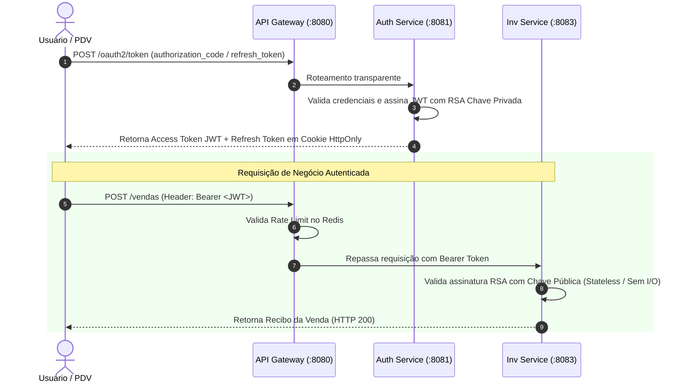

# 🔐 Bounded Context: Security & Identity (Autenticação, OIDC & Gateway)

O domínio de **Security & Identity** estabelece o padrão de segurança corporativa do sistema através do **Spring Authorization Server (OpenID Connect 1.0)**, validação criptográfica assimétrica (**RSA 2048-bit**) e proteção de borda com **Rate Limiting via Redis** no API Gateway.

---

## 1. Arquitetura de Segurança & Fluxo OIDC



---

## 2. API Gateway & Proteção de Borda

O **API Gateway** (`apps/api-gateway`) é a única porta de entrada exposta publicamente para os clientes:

### A. Rate Limiting com Redis ([`RateLimitConfig.java`](../../apps/api-gateway/src/main/java/gateway/config/RateLimitConfig.java))
* **Algoritmo:** *Token Bucket* implementado nativamente pelo Spring Cloud Gateway e Redis.
* **Resolução de Identidade por IP & Proxy Reverso Confiável (`gateway.rate-limit.trusted-proxy-hops`):**
  O `userKeyResolver` extrai exclusivamente o endereço IP sem porta efêmera (`getAddress().getHostAddress()` / `getHostString()`), evitando bypass por abertura de novas conexões TCP, seguindo a configuração `gateway.rate-limit.trusted-proxy-hops=${GATEWAY_TRUSTED_PROXY_HOPS:0}` (rejeitando valores negativos no startup):
  1. **`trusted-proxy-hops = 0` (padrão seguro):** ignora `X-Forwarded-For` e `X-Real-IP` e utiliza exclusivamente `exchange.getRequest().getRemoteAddress()`.
  2. **`trusted-proxy-hops >= 1`:** delega para `XForwardedRemoteAddressResolver.maxTrustedIndex(trustedProxyHops)` do Spring Cloud Gateway (avaliando a cadeia `X-Forwarded-For` pela direita conforme o número exato de saltos confiáveis e descartando headers múltiplos/ambíguos), com fallback para `remoteAddress` do socket se ausente ou inválido. Nunca lê `X-Real-IP`.
  3. **Mitigação de DoS para clientes anônimos:** Caso nenhum IP seja determinável, gera uma chave particionada pelo hash hexadecimal de `(User-Agent, Path)` sob o prefixo `anon_<hash>`. Isso mitiga a colisão global no bucket genérico `anonymous` (embora clientes com o mesmo `User-Agent` e mesma rota ainda compartilhem o bucket daquela partição específica).
  4. Fallback final: `anonymous`.

#### Requisitos de Configuração de Proxy Reverso (Nginx / Cloudflare)
Para garantir que o Rate Limiter identifique o cliente real sem permitir falsificação de identidade (IP Spoofing), configure `GATEWAY_TRUSTED_PROXY_HOPS` exatamente igual ao número de proxies reversos confiáveis à frente do Gateway e garanta que o Gateway não aceite tráfego direto da internet quando `hops >= 1`:

```nginx
# Exemplo para Nginx upstream ao API Gateway (GATEWAY_TRUSTED_PROXY_HOPS=1)
# Sobrescreve ou anexa após o proxy de borda confiável
proxy_set_header X-Forwarded-For $remote_addr;
```

```nginx
# Exemplo para Nginx operando atrás de CDN/Cloudflare
# Aceite conexões apenas dos CIDRs oficiais da Cloudflare (https://www.cloudflare.com/ips/)
set_real_ip_from 173.245.48.0/20;
set_real_ip_from 103.21.244.0/22;
# (...demais faixas CIDR IPv4 e IPv6 oficiais da Cloudflare...)
real_ip_header CF-Connecting-IP;

proxy_set_header X-Forwarded-For $remote_addr;
```

### B. Telemetria Redis Resiliente e Proteção contra Log Storms
O Gateway registra métricas de atividade de tráfego através do [`ActivityFilter.java`](../../apps/api-gateway/src/main/java/gateway/filter/ActivityFilter.java) em buckets `O(1)` por minuto (`system:activity:bucket:<epochMinute>`):
* **Memória `O(1)` e TTL Atômico via Script Lua:** Cada requisição incrementa o contador do minuto corrente por meio do script Lua [`TelemetriaKeys.ATIVIDADE_INCREMENT_LUA`](../../apps/common-lib/src/main/java/common/telemetry/TelemetriaKeys.java) (`INCR` + `EXPIRE` de 1 hora quando `count == 1` ou `TTL < 0`), eliminando chaves órfãs sem TTL, dispensando schedulers de expurgo e mantendo consumo de memória constante por minuto.
* **Circuito Não-Bloqueante, Timeout Fail-Open & Supressão de Logs:** Na thread reativa do filtro, a chamada Redis é limitada por `.timeout(200ms)` seguido de `onErrorResume`, garantindo que indisponibilidade ou lentidão do Redis não bloqueie as requisições dos clientes. O tratamento de erro emprega um circuito de throttling (`AtomicLong lastLogTimestamp`) que emite no máximo um warning no log a cada 10 segundos (`LOG_SUPPRESSION_INTERVAL_MS = 10_000`), prevenindo tempestades de logs (*log storms*) e saturação de I/O em disco.

### C. Mapeamento e Precedência de Rotas ([`application.properties`](../../apps/api-gateway/src/main/resources/application.properties))
* **`order: 1` — `inv-webhook`:** Intercepta `/pagamentos/webhook/**` e encaminha diretamente para `http://inv-service:8083`. **Isenta de `RequestRateLimiter`** para garantir que notificações legítimas de operadoras parceiras de pagamento não sofram bloqueio por estouro de cota.
* **`order: 2` — `inv-service`:** Roteamento dos recursos de negócio (`/produtos/**`, `/vendas/**`, `/movimentacoes/**`, `/dashboard/**`, `/pagamentos/**`) com filtro `RequestRateLimiter` ativo (replenishRate: 10, burstCapacity: 20).
* **`order: 0` — `auth-service`:** Encaminhamento de autenticação e contas (`/oauth2/**`, `/usuarios/**`) com `RequestRateLimiter` ativo (replenishRate: 5, burstCapacity: 10).
* **Documentação OpenAPI Agregada:** Rotas internas `auth-docs` (`order: 3`) e `inv-docs` (`order: 4`) consolidam as especificações OpenAPI downstream.

---

## 3. Estrutura do JWT, Claims Customizadas e Autorização nos Resource Servers

O payload do Access Token carrega os dados de identidade para que os Resource Servers downstream tomem decisões de autorização (`@PreAuthorize`) de forma totalmente autônoma:

```json
{
  "iss": "http://auth-service:8081",
  "sub": "admin@petshop.com",
  "user_id": 1,
  "name": "Administrador Principal",
  "email": "admin@petshop.com",
  "roles": [
    "ROLE_ADMIN"
  ],
  "exp": 1724851200,
  "iat": 1724847600
}
```

### A. Alinhamento entre `auth-service` e `inv-service`

1. **Emissão no `auth-service`:** [`UserDetailsServiceImpl`](../../apps/auth-service/src/main/java/auth/security/user/UserDetailsServiceImpl.java) constrói `SimpleGrantedAuthority("ROLE_" + role.getNome())` (`ROLE_ADMIN`, `ROLE_USER`), e o `OAuth2TokenCustomizer` em [`SecurityConfig`](../../apps/auth-service/src/main/java/auth/config/SecurityConfig.java) grava essas strings na claim `"roles"` do Access Token.
2. **Conversão no `inv-service`:** o [`SecurityConfig`](../../apps/inv-service/src/main/java/inv/shared/config/SecurityConfig.java) (`@EnableMethodSecurity`) combina o conversor padrão de `scope` (`SCOPE_*`) com um `JwtGrantedAuthoritiesConverter` configurado com `setAuthoritiesClaimName("roles")` e `setAuthorityPrefix("")`, preservando integralmente os nomes `ROLE_ADMIN` e `ROLE_USER` sem duplicar o prefixo.
3. **Expressões `@PreAuthorize`:** como o `SecurityExpressionRoot` do Spring Security adiciona automaticamente o prefixo `"ROLE_"` em `hasRole(...)` / `hasAnyRole(...)`, os endpoints protegidos devem utilizar **`hasRole('ADMIN')`** (e nunca `hasAuthority('ADMIN')`, que exigiria a string literal sem prefixo — corrigido em [`VendaController`](../../apps/inv-service/src/main/java/inv/checkout/infrastructure/web/controller/VendaController.java) no `DEBT-ARCH-004`).
4. **Distinção com `/usuarios/me`:** o payload JSON de `GET /usuarios/me` expõe os nomes de perfil sem prefixo (`["ADMIN"]` ou `["USER"]`) para exibição na SPA; esses nomes não devem ser confundidos com as autoridades emitidas na claim `"roles"` do JWT.

### B. Matriz de Controle de Acesso (`inv-service`)

| Rota / Recurso | Regra de Segurança | Comportamento por Perfil / Token |
| :--- | :--- | :--- |
| `/vendas/**` (`POST /vendas`, `GET /vendas/{id}/status`, `GET /vendas/aberta`, `POST /vendas/{id}/cancelar`) | `.anyRequest().authenticated()` + `@PreAuthorize("hasRole('ADMIN')")` na classe `VendaController` | `ROLE_ADMIN` autorizado; `ROLE_USER` recebe HTTP 403 (`ProblemDetail`); ausente/inválido recebe HTTP 401. |
| `POST /produtos` | `.anyRequest().authenticated()` + `@PreAuthorize("hasRole('ADMIN')")` no método `ProdutoController.criar` | `ROLE_ADMIN` autorizado; `ROLE_USER` recebe HTTP 403 (`ProblemDetail`); ausente/inválido recebe HTTP 401. |
| `GET /admin/outbox/quarantined`, `GET /admin/outbox/{id}`, `POST /admin/outbox/{id}/replay` | `.anyRequest().authenticated()` + `@PreAuthorize("hasRole('ADMIN')")` em `OutboxAdminController` | JWT Bearer com `ROLE_ADMIN` autorizado. JWT válido sem a autoridade exigida recebe HTTP 403. Token ausente ou inválido recebe HTTP 401. |
| `GET /produtos*`, `GET /movimentacoes`, `GET /dashboard/stats`, `POST /pagamentos/intencao/{vendaId}`, `GET /pagamentos/{id}/status` | `.anyRequest().authenticated()` | Qualquer JWT válido (`ROLE_ADMIN` ou `ROLE_USER`) autenticado; ausente/inválido recebe HTTP 401. |
| `/pagamentos/webhook/**`, `/actuator/**`, `/v3/api-docs/**`, `/swagger-ui/**`, `/swagger-ui.html` | `.permitAll()` | Acesso público sem Bearer token (webhooks isentos de rate limit no Gateway). |

#### Operações administrativas da Outbox

| Operação | Resposta com `ROLE_ADMIN` |
| :--- | :--- |
| `GET /admin/outbox/quarantined` | HTTP 200. `page` começa em 0 e valores negativos são normalizados para 0. `size` tem padrão 20, volta a 20 quando menor que 1 e tem teto 100. |
| `GET /admin/outbox/{id}` | HTTP 200 com os dados do registro, incluindo o payload, ou HTTP 404 quando o ID não existe. |
| `POST /admin/outbox/{id}/replay` | HTTP 200 ao recolocar um registro em quarentena no estado `PENDING` para publicação assíncrona, HTTP 404 para ID inexistente ou HTTP 409 para registro fora da quarentena. |

O `api-gateway` não tem rota para `/admin/outbox/**`. As operações chegam diretamente ao `inv-service`, cuja porta o Compose publica no host somente em loopback (`127.0.0.1:8083:8083`). Em outros ambientes, onde essa porta estiver acessível na rede, o JWT e a exigência de `ROLE_ADMIN` continuam sendo aplicados pelo próprio serviço, sem passar pelo controle de tráfego do Gateway.

### C. Cobertura da Cadeia Real de Filtros (`springSecurityFilterChain`)

Para impedir regressões mascaradas por testes que desabilitam filtros (`addFilters = false`), o `inv-service` mantém suítes que sobem a cadeia real de filtros JWT (`SecurityConfig` + `GlobalExceptionHandler` + chaves RSA geradas em runtime via `RsaKeyUtils`):

* **[`VendaSecurityFilterTest`](../../apps/inv-service/src/test/java/inv/checkout/infrastructure/web/controller/VendaSecurityFilterTest.java):** cobre `POST /vendas`, `GET /vendas/{id}/status`, `GET /vendas/aberta` e `POST /vendas/{id}/cancelar` (`ROLE_ADMIN` → `200`/`204`; `ROLE_USER` → `403 ProblemDetail` com `title: "Acesso Negado"` e `verifyNoInteractions` no service; token ausente, sem `Bearer`, malformado, expirado ou de chave não confiável → `401`).
* **[`ProdutoSecurityFilterTest`](../../apps/inv-service/src/test/java/inv/inventory/infrastructure/web/controller/ProdutoSecurityFilterTest.java):** cobre a mesma matriz para `POST /produtos`.
* **[`PagamentoSecurityFilterTest`](../../apps/inv-service/src/test/java/inv/checkout/infrastructure/web/controller/PagamentoSecurityFilterTest.java):** valida acesso autenticado a `/pagamentos/intencao/{vendaId}` e `/pagamentos/{id}/status`, liberação pública dos webhooks `/pagamentos/webhook/**` e rejeição `401` sem credencial válida.

---

## 4. Gerenciamento Seguro de Refresh Tokens, Proteção de Login e Fronteiras Aceitas

Para mitigar riscos de roubo de sessão em navegadores:
* O Refresh Token é transportado exclusivamente através de cookies com flag **`HttpOnly`** e política de **`SameSite`** configurável (`Lax` em DEV / `Strict` em PROD).
* Filtros dedicados ([`RefreshTokenCookieFilter.java`](../../apps/auth-service/src/main/java/auth/security/filter/RefreshTokenCookieFilter.java) e [`CookieRefreshTokenRequestFilter.java`](../../apps/auth-service/src/main/java/auth/security/filter/CookieRefreshTokenRequestFilter.java)) interceptam a renovação de sessão de forma transparente para o Front-end.

### A. Proteção contra Brute Force no `/login` e Hardening da Página de Login
* **Lockout por `(username normalizado, IP)`:** O [`LoginLockoutFilter.java`](../../apps/auth-service/src/main/java/auth/security/filter/LoginLockoutFilter.java) consulta o [`LoginAttemptService.java`](../../apps/auth-service/src/main/java/auth/security/LoginAttemptService.java) antes da validação de credenciais (evitando custo de `BCrypt` sob ataque e respondendo com o mesmo redirect `/login?error` para contas existentes e inexistentes). O estado em memória é limitado por LRU (`auth.login.lockout.max-entries:10000`), compacta componentes extensos de chave via SHA-256 e aplica janela/bloqueio configuráveis (`max-attempts:5`, `duration-minutes:15`).
* **Anti-Spoofing de IP e Path:** O [`ClientIpResolver.java`](../../apps/auth-service/src/main/java/auth/security/ClientIpResolver.java) desembrulha wrappers de requisição (como `ForwardedHeaderFilter`) e lê `auth.login.lockout.trusted-proxy-hops` (padrão `0`), impedindo bypass por rotação de `X-Forwarded-For`; a detecção da rota `/login` também cobre parâmetros de matriz (ex.: `/login;jsessionid=...`).
* **CSP e CSS Local sem CDN:** A página [`login.html`](../../apps/auth-service/src/main/resources/templates/login.html) utiliza exclusivamente a folha local [`login.css`](../../apps/auth-service/src/main/resources/static/css/login.css) (liberada publicamente via `/css/**`), sem scripts externos ou inline, protegida pelo cabeçalho `Content-Security-Policy: default-src 'self'; script-src 'self'; style-src 'self'; object-src 'none'; frame-ancestors 'none'; base-uri 'self'`.

### B. Fronteiras de CSRF em `/oauth2/token` e Armazenamento de `refresh_token`
* **CSRF double-submit em `/oauth2/token` (mantido desativado para compatibilidade atual):** A cadeia OAuth2 (`authorizationServerSecurityFilterChain`) mantém `.csrf(AbstractHttpConfigurer::disable)`, confiando na validação estrita de `Origin`/`Referer` em [`CookieRefreshTokenRequestFilter.java`](../../apps/auth-service/src/main/java/auth/security/filter/CookieRefreshTokenRequestFilter.java) (além do `logoutOriginValidationFilter` em `/logout`) combinada à política `HttpOnly` + `SameSite` do cookie `refresh_token`.
  * **Contrato futuro para o `petshop-frontend`:** Caso a proteção CSRF double-submit venha a ser habilitada em `/oauth2/token` ou `/logout`, o frontend precisará ler o cookie `XSRF-TOKEN` emitido pelo `CookieCsrfTokenRepository` e enviar o cabeçalho **`X-XSRF-TOKEN`** em cada requisição mutável (`POST /oauth2/token` com `grant_type=refresh_token` e `POST /logout`) usando `credentials: 'include'`.
* **Armazenamento de `refresh_token` em `oauth2_authorization` (risco aceito):** O `JdbcOAuth2AuthorizationService` permanece sem camada customizada de hash na coluna `refresh_token_value`. Esse risco é explicitamente aceito sob a condição operacional de manter acesso estritamente restrito ao banco `postgres-auth` (credenciais dedicadas de menor privilégio, isolamento em rede interna sem exposição pública de porta em produção e proteção de backups).

---

## 5. Contratos de Perfil, Preferências e Tratamento Semântico de Erros (RFC 7807)

O controlador [`UsuarioController.java`](../../apps/auth-service/src/main/java/auth/controller/UsuarioController.java) e o serviço [`AuthService.java`](../../apps/auth-service/src/main/java/auth/service/AuthService.java) formalizam a comunicação de sessão com o front-end e fluxos de credenciais:

### A. Endpoint `GET /usuarios/me` (Handshake de Sessão do Frontend)
Recupera os dados do usuário autenticado após recarregamento de página (F5) ou inicialização da Single Page Application (SPA).

* **Resolução Polimórfica de Identidade:**
  O controlador aceita dinamicamente diferentes tipos de principal de autenticação:
  - `Jwt`: Extrai a identificação da claim `sub` (com fallback para a claim `email`).
  - `UserDetailsImpl`: Utilizado em autenticações baseadas em sessão com Spring Security padrão (extrai username e ID).
  - `Usuario`: Instância de entidade de domínio vinda do contexto de segurança.
* **Payload de Resposta de Sucesso (HTTP 200 OK):**
  ```json
  {
    "id": 1,
    "nome": "Operador Caixa",
    "email": "caixa@petshop.com",
    "roles": [
      "USER"
    ],
    "theme": "DARK"
  }
  ```
* **Tratamento Semântico de Falhas de Autenticação / Autorização (RFC 7807):**
  - **Não Autenticado (HTTP 401 Unauthorized):** Quando o principal for nulo ou o token não contiver `sub`/`email`, lança `BadCredentialsException`. O `GlobalExceptionHandler` intercepta e retorna:
    ```json
    {
      "type": "https://petshop.com/errors/unauthorized",
      "title": "Falha na Autenticação",
      "status": 401,
      "detail": "Usuário ou senha inválidos",
      "timestamp": "2026-10-30T21:00:00Z"
    }
    ```
    > [!NOTE]
    > **Comportamento Atual vs Ponto de Melhoria no Código:**  
    > O campo `detail: "Usuário ou senha inválidos"` é gerado de forma estática pelo `GlobalExceptionHandler.handleBadCredentialsException()`. Em cenários de validação de token ou restauração de sessão no `GET /usuarios/me` (onde nenhuma senha foi digitada), essa mensagem pode soar contra-intuitiva. A documentação retrata fielmente o contrato em vigor no sistema hoje, mas registra como recomendação de melhoria futura no código desacoplar essa mensagem estática (ex: utilizar `ex.getMessage()` ou "Credenciais/token ausentes ou inválidos").
  - **Acesso Negado / Principal Não Suportado (HTTP 403 Forbidden):** Caso o principal seja de tipo desconhecido, lança `AccessDeniedException`:
    ```json
    {
      "type": "https://petshop.com/errors/forbidden",
      "title": "Acesso Negado",
      "status": 403,
      "detail": "Você não tem permissão para acessar este recurso",
      "timestamp": "2026-10-30T21:00:00Z"
    }
    ```
* **Diretriz de Handshake para o Frontend (SPA):**
  Ao inicializar, a aplicação web executa `GET /usuarios/me`:
  - Se retornar **HTTP 200**: Popula o estado global de usuário (nome, permissões e tema de interface).
  - Se retornar **HTTP 401**: Considera a sessão expirada ou inexistente, limpa dados locais e redireciona o usuário para o login.
  - Se retornar **HTTP 403**: Bloqueia a navegação e exibe tela de privilégios insuficientes.

### B. Endpoint `PATCH /usuarios/settings` (Preferências de Usuário)
Atualiza configurações visuais do operador autenticado (suporta JWT via `user_id`/`sub`/`email` e sessão via `UserDetailsImpl`/`Usuario`):
* **Payload da Requisição (`UserSettingsRequest`):**
  ```json
  {
    "theme": "DARK"
  }
  ```
  *(Valores válidos: `LIGHT`, `DARK`, `SYSTEM`).*
* **Resposta de Sucesso:** HTTP 204 No Content.
* **Tratamento Semântico de Falhas (RFC 7807):**
  - **Dados Inválidos (HTTP 400 Bad Request):** Caso o campo `theme` seja nulo ou receba um valor divergente do enum, a validação do `@Valid` dispara erro com payload padronizado (`title: "Dados Inválidos"`).
  - **Não Autenticado (HTTP 401 Unauthorized):** Quando o principal for nulo ou o token não contiver `sub`/`email`/`user_id`, lança `BadCredentialsException` (`title: "Falha na Autenticação"`).
  - **Acesso Negado (HTTP 403 Forbidden):** Caso o principal seja de tipo desconhecido, lança `AccessDeniedException` (`title: "Acesso Negado"`).

### C. Política Anti-Enumeração em `/usuarios/forgot-password` e Liberação de `/usuarios/reset-password`
* **`POST /usuarios/forgot-password` (Mitigação de Account Enumeration):**
  - Isento de proteção CSRF no `SecurityConfig` (`ignoringRequestMatchers`).
  - Recebe payload `@Valid ForgotPasswordRequest`:
    ```json
    {
      "email": "operador@petshop.com"
    }
    ```
  - Caso o e-mail exista no banco de dados, gera um `PasswordResetToken` efêmero e publica a mensagem `auth.v1.password-reset` no RabbitMQ para envio assíncrono de e-mail.
  - Caso o e-mail **não exista** (`ResourceNotFoundException`), a exceção é capturada internamente e a API retorna intencionalmente a mesma resposta **HTTP 200 OK** com a mensagem neutra:
    ```json
    {
      "message": "Se o email existir, um link de recuperação foi enviado."
    }
    ```
    Isso impede que atacantes façam varredura no endpoint para descobrir quais e-mails estão cadastrados na base (aderente à norma OWASP ASVS).
* **`POST /usuarios/reset-password` (Redefinição Pública):**
  - Isento de proteção CSRF e liberado publicamente no `SecurityConfig` (`permitAll()`) para permitir o consumo por links enviados por e-mail.
  - Recebe payload `@Valid ResetPasswordRequest`:
    ```json
    {
      "token": "45d5a9e3-8f0a-4221-a7b2-132d7138f0a1",
      "newPassword": "NovaSenhaSegura123!",
      "confirmPassword": "NovaSenhaSegura123!"
    }
    ```
  - **Respostas:**
    - **HTTP 200 OK:** Senha alterada com sucesso (`{"message": "Senha alterada com sucesso!"}`).
    - **HTTP 400 Bad Request (RFC 7807):** Se as senhas divergirem (`detail: "As senhas não conferem."`) ou o token estiver expirado (`detail: "Token expirado"`).
    - **HTTP 404 Not Found (RFC 7807):** Se o token não for encontrado no banco (`detail: "Token inválido"`).

> [!NOTE]
> A matriz completa de mapeamento RFC 7807 (`ProblemDetail`) do [`GlobalExceptionHandler`](../../apps/common-lib/src/main/java/common/exception/GlobalExceptionHandler.java) para os serviços (`400`, `401`, `403`, `404`, `409 ConflictException` e `503 ServiceUnavailableException`) está consolidada na [Visão Geral da Arquitetura](../architecture/system-overview.md#5-padronização-transversal-de-erros-http-rfc-7807--problemdetail).

---

## 6. ADRs Vinculados a Este Domínio

* 📑 **[ADR-0009: Arquitetura de Autenticação com Spring Authorization Server e RSA](../adr/0009-centralized-oauth2-oidc-and-stateless-resource-servers.md)**
* 📑 **[ADR-0012: Pipeline Idempotente de Pagamento e Cancelamento em Fase Única de Venda Concluída](../adr/0012-idempotent-payment-pipeline-and-single-phase-sale-reversal.md)**
